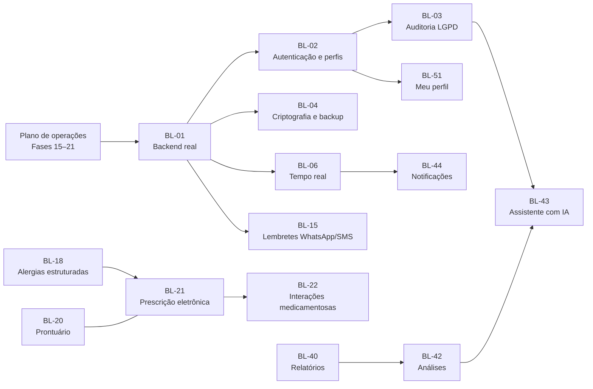

# 🗂️ MediCore — Backlog Futuro

> **Projeto:** MediCore · Operações Hospitalares
> **Versão publicada:** 1.1.0 (Painel + cadastros de pacientes, médicos e consultas)
> **Em andamento:** `PLANO_OPERACOES_MEDICORE.md` (Gestão de leitos, Emergência e Farmácia, Fases 15–21)
> **Fontes consolidadas:**
> - `docs/planos/PLANO_IMPLEMENTACAO_MEDICORE.md` (Painel, Fases 1–7)
> - `docs/planos/PLANO_CADASTROS_MEDICORE.md` (cadastros, Fases 8–14, com a revisão do Encerramento)
> - `PLANO_OPERACOES_MEDICORE.md` (módulos operacionais)
> - lições aprendidas registradas no Diário
>
> **Versão do documento:** 28/10/2026

---

## 📋 Sumário

1. [Como usar este documento](#-como-usar-este-documento)
2. [Visão geral e ordem sugerida](#-visão-geral-e-ordem-sugerida)
3. [Dependências entre itens](#-dependências-entre-itens)
4. [Plataforma, segurança e LGPD](#-plataforma-segurança-e-lgpd)
5. [Cadastros e agenda](#-cadastros-e-agenda)
6. [Funcionalidades clínicas](#-funcionalidades-clínicas)
7. [Leitos, Emergência e Farmácia (após a versão 1.2.0)](#-leitos-emergência-e-farmácia-após-a-versão-120)
8. [Painel, relatórios e comunicação](#-painel-relatórios-e-comunicação)
9. [Experiência e configurações](#-experiência-e-configurações)
10. [Qualidade e operação](#-qualidade-e-operação)
11. [Itens já resolvidos ou absorvidos por planos](#-itens-já-resolvidos-ou-absorvidos-por-planos)
12. [Pendências manuais (não são backlog)](#-pendências-manuais-não-são-backlog)
13. [Registro de decisões e observações](#-registro-de-decisões-e-observações)

---

## 🧭 Como usar este documento

- **Identificação:** cada item tem um código (`BL-xx`), que não muda mesmo se a prioridade mudar.
- **Para começar um item:**
  1. mova-o para um plano de implementação (novo ou existente);
  2. marque-o aqui como 🟨 com o nome do plano;
  3. ao concluir, marque ✅ e registre a data no [Registro](#-registro-de-decisões-e-observações).
- **Novas ideias:** entram ao final da área correspondente, com o próximo código livre da área.
- **Esforço** (1 desenvolvedor):

  | Esforço | Duração |
  |:---:|---|
  | **P** (pequeno) | até 2 dias |
  | **M** (médio) | 3 a 8 dias |
  | **G** (grande) | mais de 8 dias |

- **Horizonte:**

  | Horizonte | Quando entra |
  |---|---|
  | **Agora** | Pré-requisito para uso com pessoas e dados reais |
  | **Próximo** | Ganho direto no trabalho do dia a dia |
  | **Depois** | Útil, sem urgência |
  | **Ideia** | Exige estudo, licença ou parceiro |

- **Status:** ⬜ Não iniciado · 🟨 Em plano/andamento · ✅ Concluído · ⏸️ Adiado

> ⚠️ **Lembrete (RS-01):** enquanto **BL-01**, **BL-02** e **BL-03** não forem feitos, o MediCore é um **ambiente de demonstração**, só com dados fictícios, porque os dados ficam apenas no navegador, sem login nem backup.

---

## 📊 Visão geral e ordem sugerida

| Ordem | Código | Item | Horizonte | Esforço | Depende de | Status |
|:---:|---|---|:---:|:---:|---|:---:|
| 1 | BL-01 | Backend real (API + banco de dados) | Agora | G | — | ⬜ |
| 2 | BL-02 | Autenticação e perfis de acesso | Agora | G | BL-01 | ⬜ |
| 3 | BL-03 | Auditoria de acesso (LGPD) | Agora | M | BL-01, BL-02 | ⬜ |
| 4 | BL-04 | Criptografia, backup e guarda dos dados | Agora | M | BL-01 | ⬜ |
| 5 | BL-05 | Monitoramento de erros (ex.: Sentry) | Agora | P | — | ⬜ |
| 6 | BL-60 | Integração contínua no GitHub (lint, testes, e2e a cada push) | Agora | P | — | ⬜ |
| 7 | BL-10 | Horários por dia da semana e bloqueios de agenda | Próximo | M | — | ⬜ |
| 8 | BL-13 | Pacientes sem CPF (recém-nascido, estrangeiro, CNS) | Próximo | M | — | ⬜ |
| 9 | BL-18 | Cadastro estruturado de alergias | Próximo | M | — | ⬜ |
| 10 | BL-30 | Cadastro da estrutura hospitalar (setores, quartos, leitos) | Próximo | M | Plano de operações | ⬜ |
| 11 | BL-23 | CID-10 na internação e no desfecho da emergência | Próximo | M | Plano de operações | ⬜ |
| 12 | BL-40 | Relatórios gerenciais com exportação | Próximo | M | Plano de operações | ⬜ |
| 13 | BL-44 | Notificações no sino do cabeçalho | Próximo | M | Plano de operações | ⬜ |
| 14 | BL-50 | Tela de Configurações | Próximo | M | — | ⬜ |
| 15 | BL-51 | Tela "Meu perfil" | Próximo | P | BL-02 | ⬜ |
| 16 | BL-17 | Campo de data próprio (sempre `dd/mm/aaaa`) | Próximo | P | — | ⬜ |
| — | BL-11, BL-12, BL-14, BL-15, BL-16, BL-21, BL-24, BL-31, BL-32, BL-34, BL-41, BL-45, BL-06, BL-61 | Ver as áreas | Depois | — | — | ⬜ |
| — | BL-20, BL-22, BL-33, BL-42, BL-43, BL-46, BL-52, BL-07 | Ver as áreas | Ideia | — | — | ⬜ |

**Sequência combinada:**
1. Concluir o plano em andamento: **`PLANO_OPERACOES_MEDICORE.md`** (Fases 15–21, versão 1.2.0).
2. Fazer o bloco **"Agora"** (BL-01 a BL-05 e BL-60), começando por **BL-01**.
3. Seguir para o bloco **"Próximo"**.

---

## 🔗 Dependências entre itens

---

## 🔐 Plataforma, segurança e LGPD

### BL-01 — Backend real (API + banco de dados)
| | |
|---|---|
| **O que é** | Servidor com API (REST) e banco de dados, substituindo o armazenamento no navegador. As telas passam a usar cache de requisições (ex.: React Query) |
| **Por quê** | Hoje cada navegador tem seus próprios dados, sem compartilhamento entre pessoas, sem backup e com o limite de ~5 MB (RS-01, RS-09) |
| **Como encaixa** | A troca mexe só em `src/services/` (as assinaturas continuam). Erros HTTP viram as classes de `services/erros.ts`. Regras de agenda e estoque também no banco (ex.: restrição de intervalos sobrepostos). O passo a passo está no README |
| **Esforço / horizonte** | G · Agora |
| **Origem** | Painel (backlog), Cadastros (Encerramento, prioridade 1), Operações (RS-09) |

### BL-02 — Autenticação e perfis de acesso
| | |
|---|---|
| **O que é** | Login, sessão e perfis: Administrador, Recepção, Médico, Enfermagem, Farmácia e Gestão. Cada perfil vê e faz apenas o que precisa (ex.: só a Farmácia dispensa; só Enfermagem e Médico fazem triagem) |
| **Por quê** | Sem login não há responsabilidade sobre as ações nem proteção dos dados |
| **Depende de** | BL-01 |
| **Esforço / horizonte** | G · Agora |
| **Origem** | Painel, Cadastros, Operações |

### BL-03 — Auditoria de acesso (LGPD)
| | |
|---|---|
| **O que é** | Registro de **quem criou, alterou ou visualizou** cada cadastro, internação, atendimento e dispensação, com consulta pela gestão |
| **Por quê** | Dados de saúde são dados sensíveis na LGPD. Hoje já existem o mascaramento de CPF e o consentimento, mas não há o registro de acessos |
| **Depende de** | BL-01, BL-02 |
| **Esforço / horizonte** | M · Agora |
| **Origem** | Painel, Cadastros |

### BL-04 — Criptografia, backup e guarda dos dados
| | |
|---|---|
| **O que é** | HTTPS de ponta a ponta, criptografia dos dados no banco, backups automáticos com teste de restauração e política de guarda conforme os prazos legais de prontuário (validar com o jurídico) |
| **Por quê** | Requisito para guardar dados reais de pacientes |
| **Depende de** | BL-01 |
| **Esforço / horizonte** | M · Agora |
| **Origem** | Cadastros |

### BL-05 — Monitoramento de erros
| | |
|---|---|
| **O que é** | Captura de erros do navegador e do servidor (ex.: Sentry), com alerta para a equipe. Os dados pessoais saem dos relatos de erro |
| **Por quê** | Hoje um erro só é visto por quem o encontra. Pode ser feito antes do backend |
| **Esforço / horizonte** | P · Agora |
| **Origem** | Cadastros (Encerramento, prioridade 3) |

### BL-06 — Atualização em tempo real entre usuários
| | |
|---|---|
| **O que é** | Mudanças feitas por uma pessoa aparecem na tela das outras (WebSocket ou SSE), como já acontece hoje entre abas do mesmo navegador. Inclui alertas de emergência em tempo real com aviso sonoro opcional |
| **Depende de** | BL-01 |
| **Esforço / horizonte** | M · Depois |
| **Origem** | Painel |

### BL-07 — PWA com uso offline básico
| | |
|---|---|
| **O que é** | Instalar como aplicativo; consulta a dados recentes sem internet; fila de envio quando a conexão voltar |
| **Atenção** | Gravação offline com vários usuários exige tratamento de conflitos (ex.: dois agendamentos no mesmo horário) |
| **Esforço / horizonte** | M · Ideia |
| **Origem** | Painel |

---

## 📅 Cadastros e agenda

### BL-10 — Horários por dia da semana e bloqueios de agenda
| | |
|---|---|
| **O que é** | Disponibilidade diferente por dia (ex.: seg 8–12, qua 13–18) e bloqueios por período: férias, feriados, congressos. Consultas atingidas por um bloqueio aparecem para reagendar |
| **Por quê** | É o pedido mais provável de quem usa a agenda. Hoje o médico tem um único horário para todos os dias |
| **Esforço / horizonte** | M · Próximo |
| **Origem** | Cadastros (Encerramento, prioridade 4) |

### BL-11 — Calendário semanal e mensal
| | |
|---|---|
| **O que é** | Visões de semana e mês na agenda, além da lista por dia (D7), com arrastar para reagendar e acesso completo por teclado |
| **Esforço / horizonte** | M · Depois |
| **Origem** | Cadastros (D7) |

### BL-12 — Encaixes e lista de espera
| | |
|---|---|
| **O que é** | Encaixe fora da grade (com aviso de sobreposição) e lista de espera por médico ou especialidade, avisando quando um horário for liberado por cancelamento |
| **Esforço / horizonte** | M · Depois |
| **Origem** | Cadastros |

### BL-13 — Pacientes sem CPF
| | |
|---|---|
| **O que é** | Outras formas de identificação: recém-nascido (vínculo com o responsável), estrangeiro (passaporte), Cartão Nacional de Saúde (CNS) |
| **Por quê** | Hoje o CPF é obrigatório (R-P1). A Emergência contorna isso com o atendimento provisório (D9), mas internar ainda exige cadastro |
| **Esforço / horizonte** | M · Próximo |
| **Origem** | Cadastros |

### BL-14 — Cadastro de convênios e procedimentos
| | |
|---|---|
| **O que é** | Lista de convênios (hoje é texto livre no paciente), planos, procedimentos e regras de cobertura e autorização |
| **Esforço / horizonte** | M · Depois |
| **Origem** | Cadastros |

### BL-15 — Lembretes por WhatsApp, SMS ou e-mail
| | |
|---|---|
| **O que é** | Lembrete de consulta (ex.: 24 h antes) com confirmação ou cancelamento pelo paciente, respeitando o consentimento de contato |
| **Depende de** | BL-01 (envio pelo servidor) e contratação de um provedor de mensagens |
| **Esforço / horizonte** | G · Depois |
| **Origem** | Cadastros |

### BL-16 — Importação e exportação CSV
| | |
|---|---|
| **O que é** | Importar pacientes e médicos de planilhas (com validação e relatório de erros por linha) e exportar listas filtradas |
| **Esforço / horizonte** | M · Depois |
| **Origem** | Cadastros |

### BL-17 — Campo de data próprio
| | |
|---|---|
| **O que é** | Campo de data que mostra sempre `dd/mm/aaaa`, independente do idioma do navegador, com calendário acessível |
| **Por quê** | O campo nativo mostra `mm/dd/aaaa` em navegadores em inglês. Só vale a pena se houver esse público |
| **Esforço / horizonte** | P · Próximo |
| **Origem** | Cadastros (Fase 14) |

### BL-18 — Cadastro estruturado de alergias
| | |
|---|---|
| **O que é** | Alergias como lista: substância ou princípio ativo, tipo de reação e gravidade, no lugar do texto livre |
| **Por quê** | Torna o alerta da farmácia (A10, hoje por comparação de texto) mais confiável. É base para a prescrição (BL-21) |
| **Esforço / horizonte** | M · Próximo |
| **Origem** | Operações (D14) |

---

## 🩺 Funcionalidades clínicas

> Itens que mudam o MediCore de **administrativo** para **clínico**. Exigem validação com profissionais de saúde, atenção à regulamentação e, em geral, BL-01 a BL-03 antes.

### BL-20 — Prontuário eletrônico
| | |
|---|---|
| **O que é** | Evolução médica e de enfermagem, anamnese e anexos (exames, imagens) |
| **Esforço / horizonte** | G · Ideia |
| **Origem** | Cadastros |

### BL-21 — Prescrição eletrônica e aprazamento
| | |
|---|---|
| **O que é** | Prescrição com dose, via, frequência e duração, com aprazamento de enfermagem (horários) e checagem de administração. A dispensação passa a seguir a prescrição |
| **Por quê** | Hoje a dispensação registra só o que saiu, sem dose (D12) |
| **Depende de** | BL-18; idealmente BL-20 |
| **Esforço / horizonte** | G · Depois |
| **Origem** | Operações (D12) |

### BL-22 — Interações medicamentosas
| | |
|---|---|
| **O que é** | Alerta de interação entre os medicamentos de um mesmo paciente |
| **Atenção** | Exige uma base de dados farmacológica licenciada e mantida. Não deve ser criada à mão |
| **Depende de** | BL-21 |
| **Esforço / horizonte** | G · Ideia |
| **Origem** | Operações |

### BL-23 — CID-10 na internação e na emergência
| | |
|---|---|
| **O que é** | Diagnóstico pelo CID-10 (busca por código ou descrição) na internação e no desfecho da emergência, no lugar do texto livre |
| **Por quê** | Permite relatórios por diagnóstico (BL-40) |
| **Esforço / horizonte** | M · Próximo |
| **Origem** | Operações |

### BL-24 — Protocolo de classificação de risco com fluxogramas
| | |
|---|---|
| **O que é** | Triagem guiada por fluxogramas e discriminadores (ex.: Protocolo de Manchester), no lugar da escolha livre da cor (D8) |
| **Atenção** | O Protocolo de Manchester é licenciado. Exige contrato e treinamento |
| **Esforço / horizonte** | M · Depois |
| **Origem** | Operações (D8) |

---

## 🏥 Leitos, Emergência e Farmácia (após a versão 1.2.0)

> O básico dos três módulos está em andamento em `PLANO_OPERACOES_MEDICORE.md`. Aqui ficam as extensões.

### BL-30 — Cadastro da estrutura hospitalar
| | |
|---|---|
| **O que é** | Criar, editar e desativar setores, quartos e leitos (perfil, isolamento) pela tela. Hoje a estrutura é fixa (D10) |
| **Esforço / horizonte** | M · Próximo |
| **Origem** | Operações (D10) |

### BL-31 — Painel de chamada da emergência
| | |
|---|---|
| **O que é** | Tela para a TV da sala de espera: chamada por número (não por nome, por privacidade) e tempo médio de espera por cor |
| **Esforço / horizonte** | M · Depois |
| **Origem** | Operações |

### BL-32 — Dispensação ambulatorial
| | |
|---|---|
| **O que é** | Dispensar para pacientes sem internação nem atendimento aberto (ex.: pós-consulta), com receita |
| **Por quê** | Hoje a dispensação exige internação ou atendimento (R-F12) |
| **Esforço / horizonte** | M · Depois |
| **Origem** | Operações |

### BL-33 — Compras e fornecedores
| | |
|---|---|
| **O que é** | Cadastro de fornecedores, pedido de compra sugerido pelo estoque mínimo e pelo consumo médio, e recebimento ligado à entrada de lote |
| **Esforço / horizonte** | G · Ideia |
| **Origem** | Operações |

### BL-34 — Inventário com código de barras
| | |
|---|---|
| **O que é** | Contagem do estoque com leitor de código de barras ou câmera, comparação com o sistema e ajuste em lote |
| **Esforço / horizonte** | M · Depois |
| **Origem** | Operações |

---

## 📈 Painel, relatórios e comunicação

### BL-40 — Relatórios gerenciais com exportação
| | |
|---|---|
| **O que é** | Relatórios com exportação em CSV, PDF e Excel: • **Leitos:** permanência média e giro de leito • **Emergência:** tempo de espera por cor • **Farmácia:** consumo por medicamento • **Agenda:** taxa de faltas e cancelamentos |
| **Esforço / horizonte** | M · Próximo |
| **Origem** | Painel, Operações |

### BL-41 — "Desempenho por departamento" com dados reais
| | |
|---|---|
| **O que é** | Substituir o card simulado por um indicador real |
| **Atenção** | Primeiro é preciso **definir o que é "desempenho"** com a gestão: ocupação? consultas realizadas sobre agendadas? tempo de espera? Sem essa definição, o card não deve ser ligado |
| **Esforço / horizonte** | M · Depois |
| **Origem** | Cadastros, Operações |

### BL-42 — Tela de Análises
| | |
|---|---|
| **O que é** | Página do menu "Análises" (hoje "em construção") com séries históricas, comparação entre períodos e filtros por setor, médico e departamento |
| **Depende de** | BL-40 |
| **Esforço / horizonte** | G · Ideia |
| **Origem** | Painel, Cadastros |

### BL-43 — Assistente com IA sobre dados reais
| | |
|---|---|
| **O que é** | O card "Assistente hospitalar com IA" (hoje com insights calculados por regras) passa a responder perguntas sobre os dados, sem decisões clínicas |
| **Atenção** | Dados sensíveis: exige BL-03, anonimização e avaliação jurídica antes de enviar qualquer dado a um serviço externo |
| **Esforço / horizonte** | G · Ideia |
| **Origem** | Painel |

### BL-44 — Notificações no sino do cabeçalho
| | |
|---|---|
| **O que é** | O sino (hoje só visual) lista os alertas operacionais (A12), estoque baixo e solicitações de leito, com marcar como lido |
| **Esforço / horizonte** | M · Próximo (local) · tempo real com BL-06 |
| **Origem** | Painel, Operações |

### BL-45 — Busca global no cabeçalho
| | |
|---|---|
| **O que é** | Busca única (pacientes, médicos, leitos, atendimentos, medicamentos) com resultados agrupados e atalho de teclado |
| **Esforço / horizonte** | M · Depois |
| **Origem** | Painel, Cadastros |

### BL-46 — Central de mensagens
| | |
|---|---|
| **O que é** | O ícone de mensagens (hoje só visual) vira uma troca de mensagens entre setores, como recepção, farmácia e enfermagem |
| **Depende de** | BL-01, BL-02, BL-06 |
| **Esforço / horizonte** | G · Ideia |
| **Origem** | Painel |

---

## 🎨 Experiência e configurações

### BL-50 — Tela de Configurações
| | |
|---|---|
| **O que é** | Página do menu "Configurações" (hoje "em construção") para ajustar os parâmetros que hoje ficam em `config/limites.ts`: tempos-alvo da triagem, limite de higienização, dias de "vencendo", antecedência de agendamento, retenção. Edição só para administradores (com BL-02) |
| **Esforço / horizonte** | M · Próximo |
| **Origem** | Painel |

### BL-51 — Tela "Meu perfil"
| | |
|---|---|
| **O que é** | Dados do usuário, foto, preferências (tema, página inicial) e troca de senha |
| **Depende de** | BL-02 |
| **Esforço / horizonte** | P · Próximo |
| **Origem** | Painel (rota `/perfil` hoje é "em construção") |

### BL-52 — Outros idiomas
| | |
|---|---|
| **O que é** | Suporte a outros idiomas (ex.: espanhol, inglês) com troca pelo usuário. Os textos já estão centralizados em `src/i18n` |
| **Esforço / horizonte** | M · Ideia |
| **Origem** | Painel |

---

## 🧪 Qualidade e operação

### BL-60 — Integração contínua no GitHub
| | |
|---|---|
| **O que é** | GitHub Actions rodando, a cada push, `npm run lint`, `npm run test:coverage`, `npm run i18n:verificar`, `npm run build` e `npm run test:e2e` |
| **Por quê** | Hoje as verificações só rodam na máquina de quem desenvolve, e cada push na `main` já publica na Vercel. A integração contínua impede publicar com teste quebrado |
| **Esforço / horizonte** | P · Agora |
| **Origem** | Lições aprendidas (Encerramento) |

### BL-61 — Revisão por pull request
| | |
|---|---|
| **O que é** | Uma branch por fase e PR com revisão antes da `main` (proteção da branch). A Vercel publica uma prévia de cada PR |
| **Por quê** | As Fases 8–14 foram um commit por fase direto na `main`, sem revisão |
| **Esforço / horizonte** | P · Depois |
| **Origem** | Lições aprendidas (Encerramento) |

---

## ✅ Itens já resolvidos ou absorvidos por planos

| Item original | Origem | Situação |
|---|---|---|
| Páginas de Pacientes, Médicos e Consultas | Painel | ✅ Fases 8–14 (`PLANO_CADASTROS_MEDICORE.md`), versão 1.1.0 |
| Páginas de Gestão de leitos, Emergência e Farmácia | Painel, Cadastros | 🟨 `PLANO_OPERACOES_MEDICORE.md`, Fases 17–19 |
| Alertas de emergência com dados reais | Cadastros | 🟨 `PLANO_OPERACOES_MEDICORE.md`, Fase 20 (A12) |
| Mascaramento de CPF e consentimento LGPD | Painel | ✅ Fase 10 (falta o registro de acessos: BL-03) |

---

## 📝 Pendências manuais (não são backlog)

Verificações de entregas já feitas, que precisam de uma pessoa. Os roteiros estão em `docs/VERIFICACAO_MANUAL.md`.

- [ ] Teste com o leitor de tela NVDA: Painel e fluxos P1 (cadastrar paciente) e P9 (agendar)
- [ ] Revisão das mensagens de erro E-01 a E-10 por alguém que não seja desenvolvedor

---

## 📝 Registro de decisões e observações

| Data | Decisão / Observação | Responsável |
|---|---|---|
| 28/10/2026 | Backlog consolidado a partir dos planos do Painel, dos cadastros e das operações, mais as lições aprendidas do Encerramento. Itens repetidos foram unificados (ex.: busca global, alertas, relatórios) | |
| 28/10/2026 | Ordem: concluir o plano de operações (versão 1.2.0) e depois o bloco "Agora", começando pelo backend real (BL-01) | |
| | | |
