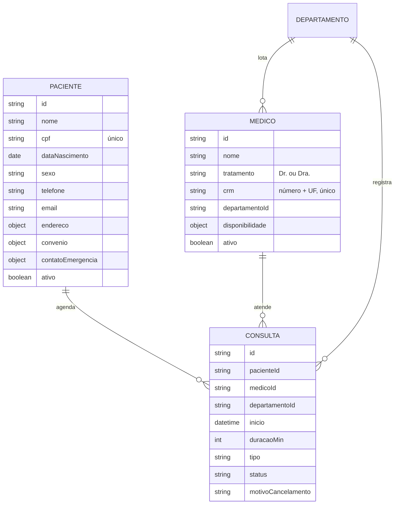

# 🏥 MediCore — Plano de Implementação dos Cadastros

> **Projeto:** MediCore · Operações Hospitalares
> **Escopo:** telas de cadastro e gestão de **Pacientes**, **Médicos** e **Consultas** (listar, buscar, criar, editar, visualizar, inativar/cancelar), integradas ao Painel já existente. Interface 100% em português do Brasil.
> **Base:** continua o `PLANO_IMPLEMENTACAO_MEDICORE.md` (Fases 1–7 concluídas). Por isso a numeração segue a partir da **Fase 8**.
> **Stack atual:** React 19 + TypeScript · Vite 8 · Tailwind CSS 4 · Recharts 3 · lucide-react · React Router 7 · Vitest 5
> **Estimativa total:** 10 a 13 dias úteis (1 desenvolvedor)

---

## 📋 Sumário

1. [Como usar este documento](#-como-usar-este-documento)
2. [Painel de progresso](#-painel-de-progresso)
3. [Análise do projeto atual](#-análise-do-projeto-atual)
4. [Decisões a confirmar antes de começar](#-decisões-a-confirmar-antes-de-começar)
5. [Modelo de dados](#-modelo-de-dados)
6. [Regras de negócio](#-regras-de-negócio)
7. [Mapa de telas e rotas](#-mapa-de-telas-e-rotas)
8. [Estrutura de pastas (novos arquivos)](#-estrutura-de-pastas-novos-arquivos)
9. [Fase 8 — Fundação de dados](#fase-8--fundação-de-dados)
10. [Fase 9 — Componentes de formulário e listagem](#fase-9--componentes-de-formulário-e-listagem)
11. [Fase 10 — Cadastro de Pacientes](#fase-10--cadastro-de-pacientes)
12. [Fase 11 — Cadastro de Médicos](#fase-11--cadastro-de-médicos)
13. [Fase 12 — Cadastro e agenda de Consultas](#fase-12--cadastro-e-agenda-de-consultas)
14. [Fase 13 — Integração com o Painel](#fase-13--integração-com-o-painel)
15. [Fase 14 — Qualidade, testes e entrega](#fase-14--qualidade-testes-e-entrega)
16. [Checklist final de aceite](#-checklist-final-de-aceite)
17. [Backlog futuro](#-backlog-futuro-fora-do-escopo)
18. [Registro de decisões e observações](#-registro-de-decisões-e-observações)

---

## 🧭 Como usar este documento

- Marque cada tarefa trocando `- [ ]` por `- [x]` conforme for concluindo.
- Cada fase tem uma seção **✅ Critérios de conclusão**. Só avance para a próxima quando todos estiverem marcados.
- Atualize o [Painel de progresso](#-painel-de-progresso) ao final de cada fase.
- Antes da Fase 8, responda à seção [Decisões a confirmar](#-decisões-a-confirmar-antes-de-começar). Ela muda dependências e parte do trabalho.
- Registre desvios e decisões no [Registro](#-registro-de-decisões-e-observações).
- Sugestão de branches: `feat/fase-8-dados`, `feat/fase-9-formularios`, etc. Faça um PR por fase.

---

## 📊 Painel de progresso

| Fase | Descrição | Estimativa | Status | Início | Fim |
|:---:|---|:---:|:---:|:---:|:---:|
| 8 | Fundação de dados (tipos, repositório, API CRUD) | 1,5 dia | ⬜ Não iniciada | | |
| 9 | Componentes de formulário e listagem | 2 dias | ⬜ Não iniciada | | |
| 10 | Cadastro de Pacientes | 2 dias | ⬜ Não iniciada | | |
| 11 | Cadastro de Médicos | 1,5 dia | ⬜ Não iniciada | | |
| 12 | Cadastro e agenda de Consultas | 2,5 dias | ⬜ Não iniciada | | |
| 13 | Integração com o Painel | 1 dia | ⬜ Não iniciada | | |
| 14 | Qualidade, testes e entrega | 1,5 dia | ⬜ Não iniciada | | |

Legenda: ⬜ Não iniciada · 🟨 Em andamento · ✅ Concluída · 🟥 Bloqueada

---

## 🔎 Análise do projeto atual

O que já existe e será **reaproveitado**:

| Recurso | Onde está | Uso nos cadastros |
|---|---|---|
| Layout, sidebar, cabeçalho, menu mobile | `components/layout/` | Sem mudanças; os itens Pacientes, Médicos e Consultas já existem no menu |
| Rotas por item de menu | `routes.tsx`, `config/navegacao.ts` | Trocar o `Placeholder` pelas páginas reais e adicionar sub-rotas |
| `Card`, `Button`/`ButtonLink`, `StatusBadge`, `Skeleton`, `EmptyState`/`ErrorState`, `ConteudoAsync`, `Avatar` | `components/ui/` | Base de todas as telas novas |
| Hook `useAsync` (dados, carregando, erro, recarregar) | `hooks/useAsync.ts` | Listas e detalhes |
| Textos centralizados | `i18n/pt-BR.ts` | Novos grupos `pacientes`, `medicos`, `agenda`, `formulario`, `validacao` |
| Formatação pt-BR | `utils/format.ts` | Datas, horas e números nas listas |
| Tokens de cor claro/escuro e contraste AA | `index.css` | Estados de campo (erro, foco, desabilitado) |
| Departamentos (6) | `data/mock.ts` | Especialidade do médico e departamento da consulta |
| Infra de testes (Vitest, Testing Library, cobertura ≥70%) | `vite.config.ts`, `__tests__/` | Mesmo padrão |

O que **precisa mudar** (pontos de atenção):

| # | Situação atual | Impacto | Solução no plano |
|---|---|---|---|
| 1 | Dados mockados são **somente leitura** e gerados a cada chamada (`criarConsultasHoje`) | Não há onde salvar um cadastro | Repositório em memória com persistência no `localStorage` (Fase 8) |
| 2 | `Consulta` guarda `paciente` e `departamento` como **texto livre** | Não dá para vincular a cadastros nem detectar conflito de agenda | Trocar por `pacienteId` e `medicoId`, com o nome resolvido na leitura (Fase 8) |
| 3 | `services/api.ts` só tem funções `get*` | Sem criação, edição ou exclusão | Adicionar `listar`, `obter`, `criar`, `atualizar`, `inativar` e `cancelar` (Fase 8) |
| 4 | Não há componentes de formulário, modal, toast nem tabela genérica | Cada tela reinventaria a roda | Kit de formulário e listagem (Fase 9) |
| 5 | Não há validação de CPF, CRM, telefone e e-mail nem máscaras | Dados inconsistentes | `utils/validacao.ts` e `utils/mascaras.ts` (Fase 9) |
| 6 | O card "Consultas de hoje" e os KPIs leem dados fixos | Um agendamento novo não apareceria no Painel | Painel passa a ler o mesmo repositório (Fase 13) |
| 7 | `useAsync` não é invalidado quando os dados mudam | A lista ficaria desatualizada depois de salvar | Repositório com assinatura (`subscribe`), e os hooks recarregam sozinhos (Fase 8) |
| 8 | O `UserMenu` já tem rota `/perfil` e a busca do cabeçalho é só visual | — | Busca global fica no backlog; não bloqueia os cadastros |

---

## ❓ Decisões a confirmar antes de começar

> Cada item tem uma **recomendação**. Se nada for dito, o plano segue a recomendação.

| # | Decisão | Opções | Recomendação |
|---|---|---|---|
| D1 | Biblioteca de formulários | (a) **react-hook-form + zod** (+ `@hookform/resolvers`) · (b) formulários manuais com `useState` | **(a)**: validação declarativa, menos re-renderizações e o mesmo esquema serve para os tipos e para os testes |
| D2 | Persistência enquanto não há backend | (a) **memória + `localStorage`** · (b) só memória (perde ao recarregar) · (c) backend real agora | **(a)**: os dados sobrevivem ao recarregar e a troca pela API real continua isolada em `services/` |
| D3 | Remover paciente ou médico | (a) **inativar (exclusão lógica)** · (b) excluir de vez | **(a)**: preserva o histórico de consultas; a exclusão definitiva só é permitida sem nenhuma consulta vinculada |
| D4 | Remover consulta | (a) **cancelar com motivo** · (b) excluir | **(a)**: consultas nunca são apagadas, só canceladas |
| D5 | Busca de endereço por CEP | (a) **ViaCEP no navegador**, opcional · (b) preenchimento manual | **(a)**, com fallback manual se a consulta falhar |
| D6 | Nomes dos dados de exemplo | (a) manter os da referência (John Smith…) · (b) **trocar por nomes brasileiros** | **(b)**: os cadastros terão CPF, CEP e convênio; nomes brasileiros deixam o exemplo coerente |
| D7 | Visão de agenda | (a) **lista por dia + grade de horários livres** · (b) calendário completo (semana/mês) | **(a)** agora; o calendário completo fica no backlog |

---

## 🗃️ Modelo de dados



### Campos

**Paciente**

| Campo | Tipo | Obrigatório | Regras |
|---|---|:---:|---|
| `nome` | texto | ✅ | 3–120 caracteres; ao menos nome e sobrenome |
| `nomeSocial` | texto | | Exibido no lugar do nome quando preenchido |
| `cpf` | texto (11 dígitos) | ✅ | Dígitos verificadores válidos; único entre pacientes |
| `dataNascimento` | data (ISO) | ✅ | Não futura; idade ≤ 130 anos |
| `sexo` | `feminino` · `masculino` · `outro` · `nao_informado` | ✅ | |
| `telefone` | texto | ✅ | Celular (11) ou fixo (10) com DDD |
| `email` | texto | | Formato válido |
| `endereco` | `{ cep, logradouro, numero, complemento, bairro, cidade, uf }` | | CEP com 8 dígitos; UF da lista de 27 |
| `convenio` | `{ tipo: 'particular' \| 'convenio', nome?, carteirinha?, validade? }` | ✅ | Nome e carteirinha obrigatórios se `tipo = convenio` |
| `tipoSanguineo` | `A+` … `O-` | | |
| `alergias` | texto | | Até 500 caracteres |
| `contatoEmergencia` | `{ nome, telefone, parentesco }` | | Telefone válido se informado |
| `observacoes` | texto | | Até 1.000 caracteres |
| `consentimentoLgpd` | booleano | ✅ | Deve ser `true` para salvar |
| `ativo`, `criadoEm`, `atualizadoEm` | sistema | | |

**Médico**

| Campo | Tipo | Obrigatório | Regras |
|---|---|:---:|---|
| `nome` | texto | ✅ | 3–120 caracteres |
| `tratamento` | `Dr.` · `Dra.` | ✅ | Usado em "Dr. James Wilson" |
| `crm` | `{ numero, uf }` | ✅ | 4–7 dígitos + UF; combinação única |
| `departamentoId` | id | ✅ | Um dos departamentos existentes (Cardiologia, Emergência…) |
| `telefone` | texto | ✅ | |
| `email` | texto | ✅ | Formato válido; único |
| `disponibilidade` | `{ diasSemana: number[], inicio: 'HH:mm', fim: 'HH:mm', duracaoPadraoMin }` | ✅ | Ao menos 1 dia; `fim > inicio`; duração de 15, 20, 30, 45 ou 60 min |
| `ativo`, `criadoEm`, `atualizadoEm` | sistema | | |

**Consulta**

| Campo | Tipo | Obrigatório | Regras |
|---|---|:---:|---|
| `pacienteId` | id | ✅ | Paciente ativo |
| `medicoId` | id | ✅ | Médico ativo |
| `departamentoId` | id | ✅ | Herdado do médico (não editável) |
| `inicio` | data e hora (ISO) | ✅ | Ver [regras de agenda](#agenda-e-conflitos) |
| `duracaoMin` | número | ✅ | Padrão = `duracaoPadraoMin` do médico |
| `tipo` | `primeira_vez` · `retorno` · `exame` · `teleconsulta` | ✅ | |
| `status` | `agendada` · `concluida` · `cancelada` · `faltou` | ✅ | Ver transições |
| `motivo` | texto | | Queixa ou motivo da consulta, até 500 caracteres |
| `motivoCancelamento` | texto | se cancelada | 5–300 caracteres |
| `criadoEm`, `atualizadoEm` | sistema | | |

> **Compatibilidade:** o card "Consultas de hoje" usa hoje `paciente` e `departamento` como texto. A Fase 8 cria um tipo de leitura `ConsultaDetalhada` (consulta + nome do paciente, do médico e do departamento), e a Fase 13 migra o card para ele.

---

## 📐 Regras de negócio

### Pacientes
- **R-P1** O CPF é único. Ao salvar um CPF já cadastrado, mostrar "Já existe um paciente com este CPF" com link para o cadastro existente.
- **R-P2** Inativar um paciente cancela automaticamente as consultas **futuras** dele (com confirmação e motivo "Paciente inativado").
- **R-P3** A exclusão definitiva só é permitida se o paciente nunca teve consulta; caso contrário, apenas inativar.
- **R-P4** Nas listagens, o CPF aparece mascarado (`***.456.789-**`); o CPF completo só aparece na tela de detalhe (LGPD).

### Médicos
- **R-M1** CRM + UF é único.
- **R-M2** Um médico inativo não aparece para novos agendamentos; as consultas futuras dele precisam ser remarcadas ou canceladas antes de inativar (o sistema lista quais são).
- **R-M3** Mudar a disponibilidade não altera consultas já marcadas, mas o sistema avisa quantas ficaram fora do novo horário.

### Agenda e conflitos
- **R-C1** Não é permitido agendar no passado (tolerância de 5 minutos).
- **R-C2** O horário deve estar dentro da disponibilidade do médico (dia da semana e faixa de horas), e o fim da consulta não pode passar do fim do expediente.
- **R-C3** **Conflito do médico:** não pode haver duas consultas `agendada` do mesmo médico com horários sobrepostos.
- **R-C4** **Conflito do paciente:** o paciente não pode ter duas consultas `agendada` sobrepostas, nem com médicos diferentes.
- **R-C5** Os horários livres oferecidos na tela já excluem conflitos (R-C2 a R-C4); a validação se repete no salvamento.
- **R-C6** Reagendar = editar `inicio` (e opcionalmente o médico) de uma consulta `agendada`, revalidando R-C1 a R-C4.

### Transições de status

```
            ┌──────────► concluida
agendada ───┼──────────► faltou        (só depois do horário de início)
            └──────────► cancelada     (exige motivo)
```

- **R-S1** Apenas consultas `agendada` podem ser editadas, reagendadas ou mudar de status.
- **R-S2** `concluida` e `faltou` só podem ser marcadas a partir do horário de início.
- **R-S3** Consultas `concluida`, `faltou` e `cancelada` ficam somente leitura.

---

## 🗺️ Mapa de telas e rotas

| Rota | Tela | Observações |
|---|---|---|
| `/pacientes` | Lista de pacientes | Busca por nome, CPF ou telefone; filtro ativo/inativo; ordenação; paginação |
| `/pacientes/novo` | Novo paciente | Formulário em seções |
| `/pacientes/:id` | Detalhe do paciente | Dados, próximas consultas, histórico, ações |
| `/pacientes/:id/editar` | Editar paciente | Mesmo formulário, preenchido |
| `/medicos` | Lista de médicos | Busca por nome ou CRM; filtro por departamento e status |
| `/medicos/novo` | Novo médico | Inclui a disponibilidade semanal |
| `/medicos/:id` | Detalhe do médico | Dados, disponibilidade, agenda de hoje e da semana |
| `/medicos/:id/editar` | Editar médico | |
| `/consultas` | Agenda / lista de consultas | Filtros: data (padrão hoje), médico, departamento, status; navegação dia anterior/próximo |
| `/consultas/nova` | Agendar consulta | Aceita `?pacienteId=` e `?medicoId=` para vir pré-preenchida |
| `/consultas/:id` | Detalhe da consulta | Ações: reagendar, concluir, faltou, cancelar |
| `/consultas/:id/editar` | Reagendar / editar | Só para `agendada` |

### Esboço das telas

**Lista (padrão para pacientes e médicos)**
```
┌─────────────────────────────────────────────────────────────────────┐
│ Pacientes                                        [ + Novo paciente ] │
│ Painel › Pacientes                                                   │
├─────────────────────────────────────────────────────────────────────┤
│ [🔍 Buscar por nome, CPF ou telefone ]  [Status: Ativos ▾]          │
├─────────────────────────────────────────────────────────────────────┤
│ NOME ▲            CPF              TELEFONE         CONVÊNIO   ...  │
│ Ana Souza         ***.456.789-**   (11) 98765-4321  Unimed     ⋯   │
│ Bruno Lima        ***.111.222-**   (21) 3456-7890   Particular ⋯   │
├─────────────────────────────────────────────────────────────────────┤
│ Mostrando 1–10 de 48                      ‹ 1 2 3 4 5 ›             │
└─────────────────────────────────────────────────────────────────────┘
   (abaixo de 640px: cada linha vira um cartão)
```

**Formulário (em seções)**
```
┌──────────────────────────────────────────┐
│ Novo paciente                            │
├──────────────────────────────────────────┤
│ Dados pessoais                           │
│ Nome completo*  [                     ]  │
│ CPF* [___.___.___-__]  Nascimento* [  ]  │
│ Sexo* (•) Feminino ( ) Masculino ...     │
│ Contato                                  │
│ Telefone* [(__) _____-____] E-mail [   ] │
│ Endereço  CEP [_____-___] 🔍 ...         │
│ Convênio  (•) Particular ( ) Convênio    │
│ Informações clínicas  ...                │
│ [✓] Autorizo o uso dos dados (LGPD)*     │
├──────────────────────────────────────────┤
│            [ Cancelar ] [ Salvar ]       │
└──────────────────────────────────────────┘
```

**Agendar consulta**
```
┌─────────────────────────────────────────────────────────────┐
│ Agendar consulta                                            │
│ Paciente*  [🔍 Digite nome ou CPF          ▾]               │
│ Departamento [Cardiologia ▾]  Médico* [Dr. James Wilson ▾]  │
│ Data* [26/10/2026]   Tipo* [Primeira vez ▾]                 │
│ Horários livres:                                            │
│  [08:00] [08:30] [09:00]  09:30  [10:00] ... (riscado = ocupado) │
│ Motivo [                                         ]          │
│                              [ Cancelar ] [ Agendar ]       │
└─────────────────────────────────────────────────────────────┘
```

---

## 🗂️ Estrutura de pastas (novos arquivos)

```
src/
├── types/
│   ├── index.ts                      # (existente) + reexporta os novos
│   ├── paciente.ts
│   ├── medico.ts
│   └── consulta.ts                   # Consulta, ConsultaDetalhada, TipoConsulta
├── schemas/                          # esquemas zod (D1) — validação + tipos de formulário
│   ├── paciente.ts
│   ├── medico.ts
│   └── consulta.ts
├── data/
│   ├── mock.ts                       # (existente) dados do painel
│   └── seeds/                        # dados iniciais dos cadastros
│       ├── pacientes.ts
│       ├── medicos.ts
│       └── consultas.ts
├── services/
│   ├── api.ts                        # (existente) painel
│   ├── repositorio.ts                # coleção genérica: memória + localStorage + subscribe
│   ├── pacientes.ts                  # listar/obter/criar/atualizar/inativar
│   ├── medicos.ts
│   ├── consultas.ts                  # + horariosLivres, cancelar, concluir, marcarFalta
│   └── erros.ts                      # ErroValidacao, ErroConflito, ErroNaoEncontrado
├── utils/
│   ├── validacao.ts                  # cpf, crm, telefone, cep, email
│   ├── mascaras.ts                   # formatar/limpar cpf, telefone, cep
│   ├── agenda.ts                     # slots, sobreposição, transições de status
│   └── datas.ts                      # idade, início/fim do dia, ISO ↔ input date/time
├── hooks/
│   ├── useColecao.ts                 # lista reativa (recarrega quando o repositório muda)
│   ├── useFiltrosUrl.ts              # busca, filtros, ordenação e página na query string
│   ├── useToast.ts
│   └── useConfirmar.ts               # diálogo de confirmação com Promise
├── components/
│   ├── ui/                           # (existente) + novos:
│   │   ├── form/
│   │   │   ├── Campo.tsx             # label + dica + erro + aria
│   │   │   ├── Input.tsx
│   │   │   ├── InputMascarado.tsx
│   │   │   ├── Select.tsx
│   │   │   ├── Textarea.tsx
│   │   │   ├── Checkbox.tsx
│   │   │   ├── RadioGroup.tsx
│   │   │   ├── Combobox.tsx          # busca de paciente/médico
│   │   │   └── SecaoFormulario.tsx
│   │   ├── DataTable.tsx             # ordenação + versão cartão no mobile
│   │   ├── Paginacao.tsx
│   │   ├── BarraFiltros.tsx
│   │   ├── CabecalhoPagina.tsx       # título + breadcrumb + ações
│   │   ├── Breadcrumb.tsx
│   │   ├── Modal.tsx
│   │   ├── DialogoConfirmacao.tsx
│   │   ├── Toast.tsx / ToastProvider.tsx
│   │   ├── MenuAcoes.tsx             # menu "⋯" da linha
│   │   └── DescricaoLista.tsx        # pares rótulo/valor das telas de detalhe
│   ├── pacientes/                    # FormPaciente, TabelaPacientes, CardHistorico…
│   ├── medicos/                      # FormMedico, EditorDisponibilidade, AgendaMedico…
│   └── consultas/                    # FormConsulta, SeletorHorario, ListaAgenda, AcoesConsulta…
└── pages/
    ├── pacientes/   ListaPacientes · NovoPaciente · DetalhePaciente · EditarPaciente
    ├── medicos/     ListaMedicos · NovoMedico · DetalheMedico · EditarMedico
    └── consultas/   Agenda · NovaConsulta · DetalheConsulta · EditarConsulta
```

---

## Fase 8 — Fundação de dados

**Estimativa:** 1,5 dia · **Branch:** `feat/fase-8-dados`

### 8.1 Dependências (se D1 = react-hook-form + zod)

- [ ] Instalar:
  ```bash
  npm install react-hook-form zod @hookform/resolvers
  ```
- [ ] Registrar a decisão no [Registro](#-registro-de-decisões-e-observações)

### 8.2 Tipos

- [ ] `types/paciente.ts`: `Paciente`, `Sexo`, `Endereco`, `Convenio`, `ContatoEmergencia`, `TipoSanguineo`
- [ ] `types/medico.ts`: `Medico`, `Tratamento`, `Crm`, `Disponibilidade`, `DiaSemana` (0 = domingo … 6 = sábado)
- [ ] `types/consulta.ts`:
  - [ ] `StatusConsulta` passa a incluir `'faltou'`
  - [ ] `TipoConsulta = 'primeira_vez' | 'retorno' | 'exame' | 'teleconsulta'`
  - [ ] `Consulta` com `pacienteId`, `medicoId`, `departamentoId`, `inicio`, `duracaoMin`
  - [ ] `ConsultaDetalhada = Consulta & { pacienteNome, medicoNome, departamentoNome }`
- [ ] Tipos utilitários: `EntradaPaciente = Omit<Paciente, 'id' | 'ativo' | 'criadoEm' | 'atualizadoEm'>` (idem para médico e consulta)
- [ ] Reexportar tudo por `types/index.ts`, mantendo os tipos do painel

### 8.3 Repositório genérico (`services/repositorio.ts`)

- [ ] `criarRepositorio<T extends { id: string }>(chave, seed)` com:
  - [ ] `todos()`, `obter(id)`, `inserir(item)`, `atualizar(id, parcial)`, `remover(id)`
  - [ ] Persistência no `localStorage` (`medicore:<chave>:v1`), com try/catch e fallback para memória
  - [ ] Na primeira execução, carrega o `seed`
  - [ ] `assinar(callback)` → `cancelar()`; notifica a cada alteração
  - [ ] Versão do esquema na chave, para migrar no futuro
  - [ ] `resetar()` (usado nos testes e no botão de desenvolvimento "Restaurar dados de exemplo")
- [ ] IDs com `crypto.randomUUID()`
- [ ] Datas sempre em ISO 8601 (UTC); a conversão para o horário local acontece só na exibição

### 8.4 Erros tipados (`services/erros.ts`)

- [ ] `ErroValidacao` (com `campos: Record<string, string>`)
- [ ] `ErroConflito` (ex.: CPF duplicado, horário ocupado), com `campo` e `mensagem`
- [ ] `ErroNaoEncontrado`
- [ ] Mensagens vindas de `t.validacao` / `t.erros`

### 8.5 Serviços CRUD

- [ ] `services/pacientes.ts`
  - [ ] `listarPacientes({ busca, status, ordenarPor, ordem, pagina, porPagina })` → `{ itens, total }`
  - [ ] A busca ignora acentos e maiúsculas e aceita CPF ou telefone com ou sem máscara
  - [ ] `obterPaciente(id)`, `criarPaciente(entrada)`, `atualizarPaciente(id, entrada)`
  - [ ] `inativarPaciente(id)` (R-P2) e `reativarPaciente(id)`
  - [ ] `excluirPaciente(id)` (R-P3: lança `ErroConflito` se houver consultas)
- [ ] `services/medicos.ts`
  - [ ] `listarMedicos({ busca, departamentoId, status, ... })`
  - [ ] `obterMedico`, `criarMedico`, `atualizarMedico`
  - [ ] `inativarMedico(id)` (R-M2: lança `ErroConflito` listando as consultas futuras), `reativarMedico`
- [ ] `services/consultas.ts`
  - [ ] `listarConsultas({ data, de, ate, medicoId, pacienteId, departamentoId, status, ... })` → `ConsultaDetalhada[]`
  - [ ] `obterConsulta(id)`, `agendarConsulta(entrada)`, `reagendarConsulta(id, entrada)`
  - [ ] `concluirConsulta(id)`, `marcarFalta(id)`, `cancelarConsulta(id, motivo)`
  - [ ] `horariosLivres(medicoId, data, duracaoMin, { ignorarConsultaId? })` → `{ hora, livre, motivo? }[]`
  - [ ] Validação de R-C1 a R-C6 e R-S1 a R-S3 no serviço (não só na tela)
- [ ] Mesma latência simulada (`delay`) e flag `VITE_SIMULAR_ERRO` já usadas em `api.ts`

### 8.6 Utilitários de agenda (`utils/agenda.ts`)

- [ ] `sobrepoe(aInicio, aFim, bInicio, bFim)`
- [ ] `gerarSlots(disponibilidade, data, duracaoMin)`
- [ ] `podeTransitar(statusAtual, novoStatus, agora, inicio)`
- [ ] `fimConsulta(inicio, duracaoMin)`

### 8.7 Dados iniciais (seeds)

- [ ] ~30 pacientes (nomes brasileiros se D6 = b), com CPFs **válidos e fictícios** gerados por algoritmo
- [ ] 8 médicos: ao menos 1 por departamento, incluindo os já citados no painel (Dr. James Wilson, Dr. Michael Brown, Dra. Emily Davis, Dr. Robert Lee) se D6 = a
- [ ] ~40 consultas entre a semana passada e a próxima, com a data relativa a "hoje" na primeira carga
- [ ] Os 4 agendamentos de hoje do painel continuam existindo (09:00, 10:30, 12:00, 16:00)

### 8.8 Hooks

- [ ] `useColecao(fn, deps)`: igual a `useAsync`, mas também recarrega quando o repositório notifica mudança
- [ ] `usePaciente(id)`, `useMedico(id)`, `useConsulta(id)`, `useListaPacientes(filtros)` etc.

### 8.9 Testes da fase

- [ ] `repositorio.test.ts`: CRUD, persistência (simulando `localStorage`), `assinar`, fallback sem storage
- [ ] `agenda.test.ts`: sobreposição nas bordas (fim de uma = início da outra **não** conflita), slots, transições
- [ ] `consultas.service.test.ts`: conflito do médico, conflito do paciente, fora do expediente, passado, médico inativo
- [ ] `pacientes.service.test.ts`: CPF duplicado, busca sem acento, exclusão bloqueada com histórico

### ✅ Critérios de conclusão — Fase 8

- [ ] Nenhuma tela mudou ainda; o Painel continua igual
- [ ] Todas as regras R-* têm teste no serviço
- [ ] Dados sobrevivem ao recarregar a página
- [ ] `npm run test:coverage` passa e `services/` e `utils/` ficam com ≥ 80%
- [ ] Commit e PR da fase abertos

---

## Fase 9 — Componentes de formulário e listagem

**Estimativa:** 2 dias · **Branch:** `feat/fase-9-formularios`

### 9.1 Validação e máscaras

- [ ] `utils/validacao.ts`
  - [ ] `cpfValido(cpf)`: dígitos verificadores, rejeitando sequências repetidas (`111.111.111-11`)
  - [ ] `telefoneValido(tel)`: 10 ou 11 dígitos, DDD de 11 a 99, celular começando com 9
  - [ ] `cepValido`, `emailValido`, `crmValido(numero, uf)`, `ufValida`
- [ ] `utils/mascaras.ts`
  - [ ] `mascararCpf`, `mascararTelefone`, `mascararCep` (enquanto digita)
  - [ ] `somenteDigitos`, `ocultarCpf` (`***.456.789-**`, R-P4)
- [ ] `utils/datas.ts`: `idade(dataNascimento)`, `paraInputDate`, `deInputDate`, `inicioDoDia`, `formatarData` (`26/10/2026`), `formatarDataExtenso` ("segunda-feira, 26 de outubro")
- [ ] Esquemas zod em `schemas/` usando esses validadores, com mensagens de `t.validacao`

### 9.2 Componentes de campo (`components/ui/form/`)

- [ ] `Campo`: rótulo, marcação de obrigatório (`*` + "obrigatório" para leitores de tela), dica, mensagem de erro
  - [ ] Liga `aria-describedby` (dica + erro), `aria-invalid` e `aria-required`
- [ ] `Input`, `Textarea` (com contador de caracteres), `Select` (nativo, estilizado)
- [ ] `InputMascarado`: aplica a máscara e entrega o valor limpo ao formulário
- [ ] `Checkbox`, `RadioGroup` (`fieldset` + `legend`)
- [ ] `Combobox` acessível (padrão ARIA 1.2): digitar para buscar, setas, Enter, Esc; usado para paciente e médico
- [ ] `SecaoFormulario`: título, descrição e grade de 1, 2 ou 3 colunas responsiva
- [ ] Estados: normal, foco, erro, desabilitado e somente leitura, nos temas claro e escuro

### 9.3 Componentes de listagem e página

- [ ] `CabecalhoPagina`: `<h1>`, `Breadcrumb` e área de ações (ex.: "+ Novo paciente")
- [ ] `BarraFiltros`: busca com atraso de 300 ms e filtros em uma linha (quebra no mobile)
- [ ] `DataTable<T>`
  - [ ] Colunas declarativas `{ chave, titulo, render?, ordenavel?, largura?, ocultarAbaixoDe? }`
  - [ ] Ordenação por clique no cabeçalho (`aria-sort`)
  - [ ] Linha clicável que leva ao detalhe, com link real na primeira coluna (acessível)
  - [ ] Versão em cartões abaixo de 640px (container query, como em "Consultas de hoje")
  - [ ] Estados: carregando (skeleton), vazio ("Nenhum paciente encontrado" + ação), erro
- [ ] `Paginacao`: "Mostrando 1–10 de 48", anterior/próxima, números, `aria-current`
- [ ] `MenuAcoes` ("⋯"), reaproveitando a lógica de teclado do `UserMenu`
- [ ] `DescricaoLista` (`<dl>`) para as telas de detalhe
- [ ] `useFiltrosUrl`: busca, filtros, ordenação e página na query string (o link compartilhado abre a mesma visão)

### 9.4 Feedback

- [ ] `Modal`: foco preso, Esc fecha, `aria-modal`, volta o foco ao gatilho (reaproveitar a lógica do `MobileDrawer`)
- [ ] `DialogoConfirmacao` + `useConfirmar()` → `await confirmar({ titulo, mensagem, confirmar: 'Inativar', perigo: true })`
- [ ] `ToastProvider` + `useToast()`: sucesso, erro e aviso; `role="status"`/`alert`; some em 5 s; botão fechar
- [ ] Aviso de alterações não salvas ao sair de um formulário modificado (`useBlocker` do React Router)

### 9.5 Textos

- [ ] Novos grupos em `i18n/pt-BR.ts`: `formulario` (Salvar, Cancelar, Campos obrigatórios…), `validacao` (CPF inválido, Campo obrigatório…), `lista` (Buscar, Mostrando x–y de z…), `confirmacao`, `toast`
- [ ] Vitrine `/ui` atualizada com todos os componentes novos

### 9.6 Testes da fase

- [ ] `validacao.test.ts`: CPFs válidos e inválidos conhecidos, telefones fixos e celulares, CEP, CRM
- [ ] `mascaras.test.ts`: digitação parcial, colagem de valor com e sem máscara
- [ ] Componentes: `Campo` liga o erro via `aria-describedby`; `Combobox` funciona por teclado; `DataTable` ordena e pagina; `Modal` prende o foco; `useConfirmar` resolve true/false

### ✅ Critérios de conclusão — Fase 9

- [ ] Todos os componentes na vitrine `/ui`, nos dois temas
- [ ] axe sem violações na vitrine
- [ ] Testes da fase passando; `components/ui/` continua ≥ 70%
- [ ] Commit e PR da fase abertos

---

## Fase 10 — Cadastro de Pacientes

**Estimativa:** 2 dias · **Branch:** `feat/fase-10-pacientes`

### 10.1 Rotas

- [ ] Em `routes.tsx`, trocar o `Placeholder` de `/pacientes` por:
  - [ ] `pacientes` → `ListaPacientes`
  - [ ] `pacientes/novo` → `NovoPaciente`
  - [ ] `pacientes/:id` → `DetalhePaciente`
  - [ ] `pacientes/:id/editar` → `EditarPaciente`
- [ ] Item "Pacientes" do menu ativo em todas as sub-rotas
- [ ] Título da aba: "MediCore — Pacientes", "MediCore — Novo paciente", "MediCore — Ana Souza"
- [ ] ID inexistente → tela "Paciente não encontrado" com link para a lista

### 10.2 Lista (`/pacientes`)

- [ ] `CabecalhoPagina` com "+ Novo paciente"
- [ ] Busca por nome, CPF ou telefone; filtro de status (Ativos, Inativos, Todos), padrão **Ativos**
- [ ] Colunas: Nome (com nome social e avatar de iniciais) · CPF (mascarado) · Idade · Telefone · Convênio · Próxima consulta · Status · ações
- [ ] Ordenação por nome, idade e próxima consulta
- [ ] Ações da linha: Ver, Editar, Agendar consulta (→ `/consultas/nova?pacienteId=`), Inativar/Reativar
- [ ] Paginação de 10 por página
- [ ] Estado vazio sem nenhum cadastro: "Nenhum paciente cadastrado" + botão
- [ ] Estado vazio com filtro: "Nenhum paciente encontrado para 'xyz'" + "Limpar filtros"

### 10.3 Formulário (novo e editar)

- [ ] `FormPaciente` em seções: Dados pessoais · Contato · Endereço · Convênio · Informações clínicas · Contato de emergência · Consentimento
- [ ] Máscaras de CPF, telefone e CEP
- [ ] CEP com 8 dígitos → busca no ViaCEP (D5) e preenche logradouro, bairro, cidade e UF
  - [ ] Indicador de carregamento; erro tratado ("CEP não encontrado"), campos continuam editáveis
- [ ] Campos de convênio aparecem só quando "Convênio" está selecionado
- [ ] Idade calculada ao lado da data de nascimento ("34 anos")
- [ ] Erros mostrados ao sair do campo e ao tentar salvar; foco vai para o primeiro campo com erro
- [ ] Erro de CPF duplicado vindo do serviço aparece no campo CPF
- [ ] Botão "Salvar" com estado de carregamento; desabilitado durante o envio
- [ ] Ao salvar: toast "Paciente cadastrado" / "Alterações salvas" e redirecionamento para o detalhe
- [ ] "Cancelar" volta para a tela anterior, com aviso se houver alterações não salvas

### 10.4 Detalhe (`/pacientes/:id`)

- [ ] Cabeçalho: avatar, nome, idade, status e ações (Editar, Agendar consulta, Inativar)
- [ ] Cards: Dados pessoais · Contato e endereço · Convênio · Informações clínicas (alergias em destaque `danger` se houver)
- [ ] Card "Próximas consultas" (data, hora, médico, departamento, status) com link para cada consulta
- [ ] Card "Histórico" (consultas passadas, mais recentes primeiro, paginado)
- [ ] CPF completo visível só aqui, com botão "Mostrar CPF" (oculto por padrão)

### 10.5 Inativar, reativar e excluir

- [ ] Inativar: confirmação mostrando quantas consultas futuras serão canceladas (R-P2)
- [ ] Reativar: confirmação simples
- [ ] Excluir: só aparece se não houver consultas (R-P3); confirmação digitando o nome do paciente

### 10.6 Testes da fase

- [ ] Lista: busca filtra, filtro de status, ordenação, paginação, estados vazios
- [ ] Formulário: obrigatórios, CPF inválido, CPF duplicado, convênio condicional, sucesso redireciona
- [ ] CEP: preenchimento com `fetch` simulado; falha não bloqueia
- [ ] Detalhe: 404, CPF oculto por padrão, inativar cancela consultas futuras

### ✅ Critérios de conclusão — Fase 10

- [ ] Fluxo completo: cadastrar → ver → editar → inativar → reativar
- [ ] Responsivo de 375 a 1920px; formulário em 1 coluna no celular
- [ ] Navegação 100% por teclado; axe sem violações nas 4 telas
- [ ] Commit e PR da fase abertos

---

## Fase 11 — Cadastro de Médicos

**Estimativa:** 1,5 dia · **Branch:** `feat/fase-11-medicos`

### 11.1 Rotas

- [ ] `medicos`, `medicos/novo`, `medicos/:id`, `medicos/:id/editar` (mesmo padrão dos pacientes)

### 11.2 Lista (`/medicos`)

- [ ] Busca por nome ou CRM; filtros por departamento e status
- [ ] Colunas: Nome (com "Dr."/"Dra.") · CRM (`12345/SP`) · Departamento · Dias de atendimento (`Seg–Sex`) · Consultas hoje · Status · ações
- [ ] Ações: Ver, Editar, Ver agenda (→ `/consultas?medicoId=`), Agendar (→ `/consultas/nova?medicoId=`), Inativar/Reativar
- [ ] Opção de visualização em cartões (grade com avatar), além da tabela

### 11.3 Formulário

- [ ] Seções: Identificação (tratamento, nome, CRM + UF) · Contato · Lotação (departamento) · Disponibilidade
- [ ] `EditorDisponibilidade`:
  - [ ] Dias da semana como botões alternáveis (`aria-pressed`): Dom Seg Ter Qua Qui Sex Sáb
  - [ ] Início e fim do expediente (`input type="time"`, passo de 15 min)
  - [ ] Duração padrão da consulta (15/20/30/45/60)
  - [ ] Prévia: "Seg a Sex, 08:00–17:00 · 18 horários de 30 min por dia"
- [ ] CRM + UF duplicado → erro no campo CRM
- [ ] Na edição, aviso de R-M3 se consultas futuras ficarem fora da nova disponibilidade

### 11.4 Detalhe (`/medicos/:id`)

- [ ] Cabeçalho com avatar, nome, CRM, departamento, status e ações
- [ ] Card de disponibilidade (grade semanal simples)
- [ ] Card "Agenda de hoje" (horários ocupados e livres)
- [ ] Card "Próximos 7 dias" (quantidade de consultas por dia)
- [ ] Indicadores: consultas no mês, taxa de faltas, cancelamentos

### 11.5 Inativar

- [ ] Se houver consultas futuras (R-M2), o diálogo lista quais são, com links para reagendar, e bloqueia a inativação até que sejam resolvidas

### 11.6 Testes da fase

- [ ] CRM inválido/duplicado; disponibilidade sem dias; fim antes do início
- [ ] Prévia de horários calculada corretamente
- [ ] Inativação bloqueada com consultas futuras

### ✅ Critérios de conclusão — Fase 11

- [ ] Fluxo completo de médico, com disponibilidade refletida nos horários livres
- [ ] Responsivo, teclado e axe ok
- [ ] Commit e PR da fase abertos

---

## Fase 12 — Cadastro e agenda de Consultas

**Estimativa:** 2,5 dias · **Branch:** `feat/fase-12-consultas`

### 12.1 Rotas

- [ ] `consultas` (agenda), `consultas/nova`, `consultas/:id`, `consultas/:id/editar`
- [ ] O botão "Ver agenda" do Painel e o "Ver todas" de "Consultas de hoje" passam a abrir a agenda real

### 12.2 Agenda (`/consultas`)

- [ ] Cabeçalho com a data em destaque ("Segunda-feira, 26 de outubro"), botões ‹ Hoje › e seletor de data
- [ ] Filtros: médico, departamento, status (sincronizados na URL)
- [ ] Resumo do dia: total · agendadas · concluídas · canceladas · faltas
- [ ] Lista agrupada por horário (ou por médico, com alternância)
  - [ ] Cada item: hora–fim, paciente, médico, departamento, tipo, `StatusBadge`, ações rápidas
- [ ] Ações rápidas na própria linha: Concluir, Faltou, Cancelar (respeitando R-S1/R-S2)
- [ ] Vazio: "Nenhuma consulta em 26/10" + "Agendar consulta"
- [ ] `StatusBadge` ganha a variante `faltou` (tom de aviso)

### 12.3 Agendar consulta (`/consultas/nova`)

- [ ] Passo único com campos em ordem lógica:
  1. [ ] **Paciente** (`Combobox`: nome ou CPF, só ativos) com link "+ Cadastrar novo paciente" que volta para cá depois de salvar
  2. [ ] **Departamento** (opcional, filtra os médicos)
  3. [ ] **Médico** (só ativos; mostra dias de atendimento)
  4. [ ] **Data** (dias sem atendimento aparecem desabilitados ou com aviso)
  5. [ ] **Tipo** e **duração** (padrão do médico)
  6. [ ] **Horário** com `SeletorHorario`: botões dos slots do dia; ocupados riscados com o motivo no tooltip ("Médico ocupado", "Paciente já tem consulta"); grupo de rádio acessível
  7. [ ] **Motivo** (opcional)
- [ ] Pré-preenchimento por `?pacienteId=`, `?medicoId=` e `?data=`
- [ ] Os horários recarregam ao trocar médico, data ou duração
- [ ] Ao salvar: revalida no serviço; se surgir conflito (outro usuário ocupou), mostra erro e atualiza os horários
- [ ] Sucesso: toast "Consulta agendada para 26/10 às 10:30 com Dr. James Wilson" → detalhe da consulta

### 12.4 Detalhe (`/consultas/:id`)

- [ ] Dados: paciente (link), médico (link), departamento, data, hora–fim, tipo, motivo, status, criado/atualizado em
- [ ] Linha do tempo da consulta (agendada em…, reagendada em…, cancelada em… com motivo)
- [ ] Ações conforme o status: Reagendar · Concluir · Marcar falta · Cancelar

### 12.5 Reagendar e cancelar

- [ ] Reagendar (`/consultas/:id/editar`): mesmo formulário com paciente fixo; os horários ignoram a própria consulta (`ignorarConsultaId`)
- [ ] Cancelar: modal com motivo obrigatório (5–300 caracteres) e sugestões rápidas ("Paciente desmarcou", "Médico indisponível")
- [ ] Concluir / Marcar falta: confirmação curta; desabilitados antes do horário, com a explicação no tooltip

### 12.6 Testes da fase

- [ ] Fluxo de agendamento completo (paciente → médico → data → horário → salvar)
- [ ] Horários ocupados não são selecionáveis; conflito detectado no salvamento
- [ ] Transições de status permitidas e bloqueadas
- [ ] Cancelamento sem motivo é bloqueado
- [ ] Pré-preenchimento pela URL

### ✅ Critérios de conclusão — Fase 12

- [ ] Nenhuma combinação permite conflito de médico ou de paciente
- [ ] Agenda navega entre dias e filtros pela URL
- [ ] Responsivo, teclado e axe ok (incluindo `Combobox` e `SeletorHorario`)
- [ ] Commit e PR da fase abertos

---

## Fase 13 — Integração com o Painel

**Estimativa:** 1 dia · **Branch:** `feat/fase-13-integracao`

- [ ] **Consultas de hoje:** passa a ler `listarConsultas({ data: hoje })` (tipo `ConsultaDetalhada`); um agendamento novo aparece no Painel na hora
  - [ ] Linhas clicáveis → detalhe da consulta
- [ ] **Resumo de boas-vindas:** "{n} consultas hoje" calculado do repositório
- [ ] **KPI Total de pacientes:** contagem de pacientes ativos (a variação diária continua mockada até existir histórico)
- [ ] **KPI Médicos de plantão:** médicos ativos com atendimento no dia da semana atual
- [ ] **Linha do tempo de atividades:** registrar eventos reais (paciente cadastrado, consulta agendada/concluída/cancelada) em um repositório `atividades`
- [ ] **Alertas e Desempenho:** continuam mockados (registrar no backlog)
- [ ] Ajustar os testes do Painel (`dashboard.test.tsx`) para usar os seeds
- [ ] Botão de desenvolvimento "Restaurar dados de exemplo" (só em `npm run dev`), em Configurações ou na vitrine `/ui`

### ✅ Critérios de conclusão — Fase 13

- [ ] Agendar, concluir ou cancelar uma consulta muda o Painel sem recarregar a página
- [ ] O Painel continua visualmente idêntico à Fase 6 (comparação de captura em 1600px)
- [ ] Commit e PR da fase abertos

---

## Fase 14 — Qualidade, testes e entrega

**Estimativa:** 1,5 dia · **Branch:** `feat/fase-14-qualidade`

### 14.1 Testes de ponta a ponta (opcional recomendado)

- [ ] Instalar `@playwright/test` e criar `e2e/`
- [ ] Cenário 1: cadastrar paciente → agendar consulta → ver no Painel → concluir
- [ ] Cenário 2: tentar agendar horário ocupado → erro → escolher outro
- [ ] Cenário 3: inativar médico com consultas futuras → bloqueio → cancelar consultas → inativar
- [ ] Script `npm run test:e2e`

### 14.2 Acessibilidade

- [ ] axe sem violações em todas as telas novas, claro e escuro, em 375/768/1280px
- [ ] Formulários: todo campo com rótulo; erros anunciados (`role="alert"` no resumo de erros); foco no primeiro erro
- [ ] `Combobox`, `SeletorHorario`, `Modal`, `MenuAcoes` e `Toast` testados só com teclado
- [ ] Teste manual com NVDA no fluxo "agendar consulta"

### 14.3 Idioma e formatos

- [ ] Varredura de textos fora do `pt-BR.ts` (mesmo script da Fase 7)
- [ ] Datas `dd/mm/aaaa`, horas 24h, CPF `000.000.000-00`, telefone `(00) 00000-0000`, CEP `00000-000`
- [ ] Mensagens de validação revisadas (claras, sem jargão técnico)

### 14.4 Performance

- [ ] Páginas de cadastro carregadas sob demanda (`React.lazy` por módulo: pacientes, médicos, consultas)
- [ ] Lista com 1.000 pacientes de teste continua fluida (busca com atraso e paginação)
- [ ] Lighthouse desktop ≥ 90 nas telas de lista e de formulário

### 14.5 Documentação

- [ ] README: seção "Cadastros" (rotas, regras de negócio, como restaurar os dados de exemplo)
- [ ] README: como trocar o repositório local pela API real (`services/pacientes.ts` etc.)
- [ ] Capturas de tela das novas telas em `docs/capturas/`
- [ ] Atualizar este plano e o `PLANO_IMPLEMENTACAO_MEDICORE.md`

### ✅ Critérios de conclusão — Fase 14

- [ ] Todos os testes passando (unitários, componentes e e2e)
- [ ] Cobertura: `services/` e `utils/` ≥ 80%, `components/ui/` ≥ 70%
- [ ] Lighthouse e axe dentro das metas
- [ ] README atualizado
- [ ] PR final aprovado e mesclado na `main`

---

## 🏁 Checklist final de aceite

### Funcional
- [ ] Cadastrar, editar, visualizar, inativar e reativar **pacientes**
- [ ] Cadastrar, editar, visualizar, inativar e reativar **médicos**, com disponibilidade semanal
- [ ] **Agendar**, reagendar, concluir, marcar falta e cancelar **consultas**
- [ ] Horários livres respeitam disponibilidade e conflitos
- [ ] Busca, filtros, ordenação e paginação nas listas, preservados na URL
- [ ] Painel reflete os cadastros em tempo real

### Dados e regras
- [ ] CPF e CRM únicos e válidos
- [ ] Nenhum conflito de agenda possível (médico ou paciente)
- [ ] Consultas nunca apagadas, só canceladas com motivo
- [ ] Dados persistem ao recarregar a página

### Experiência
- [ ] Mensagens de sucesso e erro (toast) em toda ação
- [ ] Aviso ao sair de formulário com alterações
- [ ] Responsivo de 375 a 1920px, temas claro e escuro

### Qualidade
- [ ] 100% em PT-BR; formatos brasileiros
- [ ] Acessível por teclado e leitor de tela
- [ ] Testes e build limpos

---

## 🚀 Backlog futuro (fora do escopo)

- [ ] Backend real (API REST/GraphQL) com autenticação e controle de acesso por perfil
- [ ] Calendário completo (visão semanal e mensal, arrastar para reagendar)
- [ ] Prontuário eletrônico (evolução, prescrição, anexos de exames)
- [ ] Lembretes de consulta por WhatsApp, SMS ou e-mail
- [ ] Lista de espera e encaixes
- [ ] Bloqueios de agenda (férias, feriados, congressos)
- [ ] Cadastro de convênios e tabela de procedimentos
- [ ] Busca global no cabeçalho (pacientes, médicos, consultas)
- [ ] Importação/exportação CSV de pacientes
- [ ] Auditoria: quem criou, alterou ou visualizou cada registro (LGPD)
- [ ] Alertas de emergência e desempenho por departamento ligados a dados reais
- [ ] Telas de Gestão de leitos, Emergência, Farmácia e Análises

---

## 📝 Registro de decisões e observações

| Data | Decisão / Observação | Responsável |
|---|---|---|
| 26/10/2026 | Numeração das fases continua o plano anterior (Fases 8–14) para manter o histórico de commits e PRs contínuo | |
| 26/10/2026 | `Consulta` deixa de guardar nomes como texto e passa a referenciar `pacienteId`/`medicoId`; o Painel usa `ConsultaDetalhada` | |
| 26/10/2026 | Novo status `faltou` (não comparecimento), além de agendada/concluída/cancelada | |
| | D1 — Biblioteca de formulários: | |
| | D2 — Persistência: | |
| | D3 — Remover paciente/médico: | |
| | D4 — Remover consulta: | |
| | D5 — Busca de CEP: | |
| | D6 — Nomes dos dados de exemplo: | |
| | D7 — Visão de agenda: | |
| | | |
