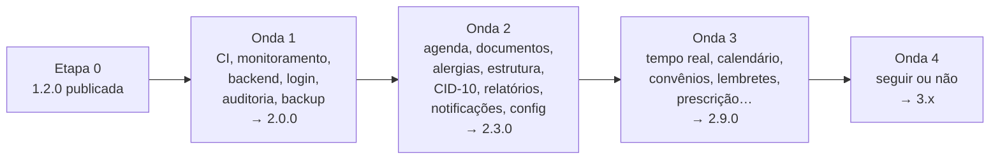

# ✅ MediCore — Plano de Execução das Melhorias (Backlog 2.x)

> **O que é:** a lista de trabalho, na ordem em que deve ser feita, para implementar **as 40 melhorias do `BACKLOG_MEDICORE.md`**. Cada melhoria é uma fase. Cada **processo** da especificação (`BL-10.2`, `BL-21.3`…) vira uma **etapa com as suas tarefas**. Cada tarefa é pequena (de 15 minutos a 2 horas) e tem um checkbox.
> **Base:** [`PLANO_MELHORIAS_MEDICORE.md`](PLANO_MELHORIAS_MEDICORE.md) (Revisão 1), que é a **especificação**: decisões, processos, regras e critérios. Em caso de dúvida, vale a especificação.
> **Fases:** 22 a 64, em 4 ondas, precedidas da Etapa 0 (preparação) e com um encerramento por onda (versões 2.0.0, 2.3.0, 2.9.0 e 3.x).
> **Estimativa:** ~231 dias úteis (1 desenvolvedor) se todos os itens da Onda 4 forem aprovados · ver [cronograma](#-cronograma-por-onda)
> **Criado em:** 12/11/2026 · **Situação:** 🟨 Etapa 0 em andamento (5 de 12 tarefas; o resto depende de você). Versão 1.2.0 publicada em 13/11/2026

---

## 📋 Sumário

1. [Como usar](#-como-usar)
2. [Painel de execução](#-painel-de-execução)
3. [Cronograma por onda](#-cronograma-por-onda)
4. [Rotina de cada fase (git, PR e fechamento)](#-rotina-de-cada-fase-git-pr-e-fechamento)
5. [Comandos de referência](#-comandos-de-referência)
6. [Lições dos planos anteriores aplicadas aqui](#-lições-dos-planos-anteriores-aplicadas-aqui)
7. [Etapa 0 — Preparação](#etapa-0--preparação)
8. [Onda 1 — Agora (Fases 22–30, versão 2.0.0)](#onda-1--agora-fases-2230-versão-200)
9. [Onda 2 — Próximo (Fases 31–40, versões 2.1–2.3)](#onda-2--próximo-fases-3140-versões-2123)
10. [Onda 3 — Depois (Fases 41–56, versões 2.4–2.9)](#onda-3--depois-fases-4156-versões-2429)
11. [Onda 4 — Ideias (Fases 57–64, versão 3.x)](#onda-4--ideias-fases-5764-versão-3x)
12. [Diário de execução](#-diário-de-execução)

---

## 🧭 Como usar

**Formato de cada tarefa**

```
- [ ] **31.2.3** O que fazer — `arquivo(s)` · 🔗 referência na especificação · ✔ como verificar
```

- **Número** `fase.etapa.tarefa`. A etapa corresponde ao **processo** da especificação: na Fase 31 (BL-10), a etapa 31.2 é o processo **BL-10.2**. As etapas `.0` (abertura), `.T` (testes), `.V` (verificação) e `.F` (fechamento) se repetem em todas as fases.
- **🔗 Referência**: processo (`BL-10.2`), decisão (`D36`), regra (`R-AG2`), algoritmo (`A19`), erro (`E-19`) ou risco (`RS-19`). Leia antes de começar.
- **✔ Verificação**: o que precisa ser verdade para marcar o checkbox.
- **Use na mensagem de commit** o número da etapa: `fase-31: 31.2 registrar bloqueio de agenda`.

**Regras**
1. Siga a ordem das fases dentro da onda, salvo onde o painel diz que dá para paralelizar.
2. Teste junto com o código: cada processo termina com o seu teste. Não acumule testes para o fim.
3. Nenhuma fase começa com as decisões dela pendentes: se a decisão não foi aprovada, a fase fica 🟥.
4. **Itens da Onda 4** começam pela etapa `.0` "Seguir ou não". Resposta "não": marque a fase ⏸️, registre o motivo no Diário e devolva o item ao backlog.
5. Trabalho novo que surgir vai para o Diário e para o `BACKLOG_MEDICORE.md`, **com código, no mesmo dia** (lição do Encerramento da 1.2.0: pendências adiadas sem número se perdem).
6. Todo texto visível vai para `src/i18n/`. Até a 2.0.0, todo dado é fictício (RS-20).
7. Ao fechar cada fase, marque também o `BACKLOG_MEDICORE.md` (✅ com a data) e o painel da especificação.

**Legenda:** ⬜ não iniciada · 🟨 em andamento · ✅ concluída · 🟥 bloqueada · ⏸️ adiada (decisão "não seguir") · ⭐ tarefa crítica · 👤 tarefa manual ou feita por você (git, contrato, decisão, verificação com pessoa)

---

## 📊 Painel de execução

| Etapa / Fase | Melhoria | Processos | Tarefas | Dias | Status | Início | Fim |
|---|---|:---:|:---:|:---:|:---:|:---:|:---:|
| Etapa 0 | Preparação (1.2.0 publicada, acessos, decisões, contratos) | — | 12 | 2 | 🟨 | 13/11 | |
| **Onda 1** | **Agora — versão 2.0.0** | | | **49** | | | |
| Fase 22 | BL-60 Integração contínua | 4 | 17 | 2 | ⬜ | | |
| Fase 23 | BL-05 Monitoramento de erros | 4 | 12 | 2 | ⬜ | | |
| Fase 24 | BL-01 Backend (1/4): monorepo, API, banco e contrato | 3 | 23 | 8 | ⬜ | | |
| Fase 25 | BL-01 Backend (2/4): cadastros e agenda | 1 | 12 | 7 | ⬜ | | |
| Fase 26 | BL-01 Backend (3/4): leitos, emergência, farmácia e rotinas | 2 | 15 | 9 | ⬜ | | |
| Fase 27 | BL-01 Backend (4/4): navegador na API e ambientes | 2 | 13 | 5 | ⬜ | | |
| Fase 28 | BL-02 Autenticação e perfis | 7 | 21 | 8 | ⬜ | | |
| Fase 29 | BL-03 Auditoria (LGPD) | 5 | 11 | 4 | ⬜ | | |
| Fase 30 | BL-04 Criptografia, backup e guarda | 6 | 9 | 4 | ⬜ | | |
| Encerramento 1 | Versão 2.0.0 com dados reais | — | 6 | 1 | ⬜ | | |
| **Onda 2** | **Próximo — versões 2.1 a 2.3** | | | **47** | | | |
| Fase 31 | BL-10 Agenda por dia e bloqueios | 4 | 14 | 6 | ⬜ | | |
| Fase 32 | BL-13 Pacientes sem CPF | 4 | 13 | 5 | ⬜ | | |
| Fase 33 | BL-18 Alergias estruturadas | 5 | 14 | 6 | ⬜ | | |
| Fase 34 | BL-30 Estrutura hospitalar | 4 | 10 | 5 | ⬜ | | |
| Fase 35 | BL-23 CID-10 | 3 | 7 | 4 | ⬜ | | |
| Fase 36 | BL-40 Relatórios | 6 | 14 | 7 | ⬜ | | |
| Fase 37 | BL-44 Notificações | 4 | 9 | 4 | ⬜ | | |
| Fase 38 | BL-50 Configurações | 4 | 8 | 6 | ⬜ | | |
| Fase 39 | BL-51 Meu perfil | 4 | 6 | 2 | ⬜ | | |
| Fase 40 | BL-17 Campo de data | 3 | 6 | 2 | ⬜ | | |
| Encerramento 2 | Versão 2.3.0 | — | 5 | 0,5 | ⬜ | | |
| **Onda 3** | **Depois — versões 2.4 a 2.9** | | | **~70** | | | |
| Fase 41 | BL-61 Revisão por PR | 3 | 4 | 0,5 | ⬜ | | |
| Fase 42 | BL-06 Tempo real | 4 | 9 | 5 | ⬜ | | |
| Fase 43 | BL-11 Calendário semanal e mensal | 3 | 8 | 5 | ⬜ | | |
| Fase 44 | BL-12 Encaixes e lista de espera | 4 | 7 | 4 | ⬜ | | |
| Fase 45 | BL-14 Convênios e procedimentos | 4 | 7 | 5 | ⬜ | | |
| Fase 46 | BL-15 Lembretes | 5 | 10 | 9 | ⬜ | | |
| Fase 47 | BL-16 Importação e exportação CSV | 3 | 7 | 4 | ⬜ | | |
| Fase 48 | BL-21 Prescrição e aprazamento | 5 | 13 | 12 | ⬜ | | |
| Fase 49 | BL-24 Protocolo de classificação | 4 | 6 | 6 | ⬜ | | |
| Fase 50 | BL-31 Painel de chamada | 3 | 4 | 3 | ⬜ | | |
| Fase 51 | BL-32 Dispensação ambulatorial | 2 | 3 | 3 | ⬜ | | |
| Fase 52 | BL-34 Inventário com código de barras | 4 | 5 | 4 | ⬜ | | |
| Fase 53 | BL-35 Gráfico dos sinais vitais | 2 | 3 | 1 | ⬜ | | |
| Fase 54 | BL-36 Ícones na linha do tempo | 2 | 3 | 1 | ⬜ | | |
| Fase 55 | BL-41 Desempenho por departamento | 3 | 5 | 3 | ⬜ | | |
| Fase 56 | BL-45 Busca global | 3 | 4 | 4 | ⬜ | | |
| Encerramento 3 | Versão 2.9.0 | — | 5 | 0,5 | ⬜ | | |
| **Onda 4** | **Ideias — versão 3.x** | | | **~65** | | | |
| Fase 57 | BL-07 PWA offline | 4 | 5 | 6 | ⬜ | | |
| Fase 58 | BL-20 Prontuário eletrônico | 5 | 7 | 15 | ⬜ | | |
| Fase 59 | BL-22 Interações medicamentosas | 4 | 5 | 6 | ⬜ | | |
| Fase 60 | BL-33 Compras e fornecedores | 4 | 5 | 9 | ⬜ | | |
| Fase 61 | BL-42 Tela de Análises | 4 | 5 | 8 | ⬜ | | |
| Fase 62 | BL-43 Assistente com IA | 3 | 5 | 8 | ⬜ | | |
| Fase 63 | BL-46 Central de mensagens | 4 | 5 | 8 | ⬜ | | |
| Fase 64 | BL-52 Outros idiomas | 4 | 5 | 5 | ⬜ | | |
| Encerramento 4 | Versão 3.x | — | 4 | 0,5 | ⬜ | | |
| **Total** | **40 melhorias** | **161** | **406** | **~231** | ⬜ | | |

**Ordem das ondas**



> **Duas pessoas:** na Onda 1, uma faz 22 → 23 e a outra prepara a 24 (monorepo). Na Onda 2, BL-13 + BL-18 com uma e BL-10 + BL-30 com outra; depois BL-23 → BL-40. Na Onda 3, BL-06 libera BL-31, BL-44 em tempo real e BL-46.

---

## 📅 Cronograma por onda

| Semanas | Onda | Fases | Entrega verificável |
|:---:|---|---|---|
| 0 | Etapa 0 | — | 1.2.0 em produção; decisões D21–D35 aprovadas; contratos de hospedagem e Sentry |
| 1 | Onda 1 | 22, 23 | PR com teste quebrado fica vermelho; erro provocado aparece no Sentry sem dados pessoais |
| 2–3 | Onda 1 | 24 | Monorepo; API e banco sobem com 1 comando; OpenAPI publicado |
| 4–5 | Onda 1 | 25 | Cadastros e agenda no servidor com os testes de serviço verdes contra o banco |
| 6–7 | Onda 1 | 26 | Módulos no servidor; 500 operações aleatórias sem violação contra o banco |
| 8 | Onda 1 | 27 | Navegador na API; cenários e2e 1–10 verdes; demonstração 2.0-beta publicada |
| 9–10 | Onda 1 | 28 | Login com MFA; matriz ação × perfil 100% testada |
| 11 | Onda 1 | 29, 30 | Auditoria; criptografia de campo; restauração testada; **2.0.0 com dados reais** |
| 12–21 | Onda 2 | 31–40 | 2.1.0 (semana 15), 2.2.0 (semana 18), 2.3.0 (semana 21) |
| 22–35 | Onda 3 | 41–56 | 2.4.0 a 2.9.0, uma a cada 2–3 semanas |
| 36+ | Onda 4 | 57–64 | Só os itens com "seguir" aprovado |

> **Margem:** a Onda 1 não tem folga. Se a Fase 26 passar de 12 dias, separe a farmácia numa fase própria e registre no Diário.

---

## 🔁 Rotina de cada fase (git, PR e fechamento)

**Abertura (`N.0`)**
1. 👤 Atualizar a `main` e criar a branch `feat/fase-N-<nome>`
2. Confirmar a base verde (a partir da Fase 22: o último check da `main` verde)
3. Ler a melhoria na especificação: processos, decisões, regras e critérios de conclusão
4. Conferir que as decisões da fase estão aprovadas (senão, a fase fica 🟥)

**Durante**
- Um commit por etapa (processo), com a mensagem `fase-N: N.E descrição`
- Migração de banco junto do código que a usa, revisada e com plano de volta

**Fechamento (`N.F`)**
1. Integração contínua verde (lint, formato, i18n, cobertura, build, pacote, e2e)
2. Metas de cobertura (`dominio` ≥ 90%, serviços da API ≥ 85%, `components/ui/` ≥ 70%)
3. Pacote inicial medido; crescimento acima de 5 kB na onda precisa de justificativa
4. Telas novas em 375, 768 e 1280 px, claro e escuro, teclado, escala de cinza, axe sem violações
5. A partir da Fase 28: permissões das ações novas testadas; a partir da Fase 29: auditoria das ações novas
6. Sessão de uso no navegador (~10 min) com as telas da fase, sem erros no console (lição do Encerramento)
7. `docs/PR_FASE_N.md` com resumo, processos entregues, números, desvios e capturas
8. Checkboxes deste plano, painel da especificação e `BACKLOG_MEDICORE.md` atualizados
9. 👤 PR revisado e mesclado (a partir da Fase 41, com a `main` protegida)

---

## 🛠️ Comandos de referência

| Para quê | Comando (a partir de) |
|---|---|
| Rodar o app (hoje) | `npm run dev` |
| Subir API + banco locais | `docker compose up -d && npm run dev --workspaces` (Fase 24) |
| Migrações do banco | `npm run db:gerar` · `npm run db:migrar` · `npm run db:semear` (Fase 24) |
| Testes do domínio e do app | `npm run test --workspace packages/dominio` · `npm run test --workspace apps/web` |
| Testes da API (com banco em contêiner) | `npm run test --workspace apps/api` (Fase 24) |
| Testes de contrato | `npm run test:contrato` (Fase 24) |
| Ponta a ponta contra a API | `npm run test:e2e` (Fase 27: sobe API, banco e app) |
| Carga | `npm run carga` (k6, Fase 27) |
| Pacote inicial | `npm run pacote:medir` |
| Textos fora do i18n | `npm run i18n:verificar` |
| Documentação da API | `http://localhost:3000/api/v1/docs` (Fase 24) |

---

## 🎓 Lições dos planos anteriores aplicadas aqui

| Lição (Encerramento da 1.2.0) | Como este plano aplica |
|---|---|
| O orçamento de armazenamento usou tamanhos estimados e só a Fase 21 mostrou o problema | Medições reais logo na fase que cria o dado: carga e p95 já na Fase 27, não no fim da onda |
| Sem acesso de escrita ao GitHub, os PRs se acumularam e não houve prévia | Etapa 0 resolve o acesso; Fase 22 (CI) primeiro; um PR por fase, mesclado antes da próxima |
| Pendências adiadas "para depois" sem número se perderam | Regra 5 do [Como usar](#-como-usar): toda pendência vira código no backlog no mesmo dia |
| O pacote inicial chegou ao teto | Teto de +5 kB por onda; telas novas sempre sob demanda; `pacote:medir` na CI |
| Um bug só apareceu no uso real (alta no mesmo minuto) | Sessão de uso no navegador no fechamento de toda fase com tela |
| Testes de tela instáveis sob carga | Na CI, os testes rodam sob carga real; teste instável é corrigido na hora, nunca repetido até passar |
| Invariantes, e2e com relógio fixo e verificação por fase funcionaram | Continuam: invariantes viram restrições do banco e rotina noturna; os cenários 1–10 rodam contra a API |

---

## Etapa 0 — Preparação

**Objetivo:** começar com a 1.2.0 publicada, os acessos resolvidos e as decisões da Onda 1 aprovadas. **Duração:** 2 dias.

### 0.1 Fechar a 1.2.0

- [x] **0.1.1** 👤 Mesclar na `main` os PRs das Fases 19, 20 e 21 e o `release/1.2.0`, nessa ordem · ✔ Vercel "Ready" na produção — *13/11: PRs #5, #6 e #7 mesclados; `main` = `c487e33`, mesma árvore do `release/1.2.0`*
- [ ] **0.1.2** 👤 Criar e enviar a tag `v1.2.0` — *13/11: criada, mas aponta para `4478845` (merge da Fase 21, sem o `release/1.2.0`); mover para `c487e33`*
- [x] **0.1.3** Testar a URL publicada: emergência → internação → dispensação → alta, no desktop e no celular · ✔ sem erros no console — *13/11: testada por você*
- [ ] **0.1.4** 👤 Verificações manuais pendentes da 1.2.0: NVDA (P1, P9, Painel, L1, E2, F3), revisão de termos e mensagens, testes com duas abas · 🔗 `docs/VERIFICACAO_MANUAL.md` · ✔ registro preenchido; correções viram itens do backlog

### 0.2 Acessos

- [ ] **0.2.1** 👤 Instalar o app do Claude no repositório do GitHub (ou definir quem faz os pushes) · ✔ um push de teste numa branch funciona
- [ ] **0.2.2** 👤 Confirmar o acesso ao time da Vercel e às variáveis de ambiente dos projetos

### 0.3 Decisões e contratos da Onda 1

- [x] **0.3.1** 👤 Aprovar ou ajustar D21–D35 · 🔗 [Decisões](PLANO_MELHORIAS_MEDICORE.md#-decisões-propostas) · ✔ resultado no Registro da especificação — *13/11: aprovadas como recomendadas*
- [ ] **0.3.2** 👤 Escolher o provedor de hospedagem da API e do banco com região no Brasil (D23) e iniciar o contrato de operador de dados com o jurídico · 🔗 RS-21 — *13/11: provedor escolhido, Google Cloud em São Paulo (D23); falta o contrato*
- [ ] **0.3.3** 👤 Criar a conta do Sentry (ou alternativa da D34) e o projeto `medicore-web`
- [ ] **0.3.4** 👤 Indicar quem aprova os itens clínicos e jurídicos das Ondas 3 e 4 (direção clínica, farmácia, enfermagem, jurídico)

### 0.4 Linha de base

- [x] **0.4.1** Registrar no Diário os números de partida (iguais aos finais da 1.2.0): 672 Vitest, 139 Playwright, cobertura 92,3%, pacote 153,6 kB, Lighthouse do Painel 99 · ✔ tabela da linha de base preenchida — *13/11: medida de novo na `main`, mesmos números*
- [ ] **0.4.2** Atualizar o painel de execução: Etapa 0 ✅

---

## Onda 1 — Agora (Fases 22–30, versão 2.0.0)

## Fase 22 — BL-60 Integração contínua no GitHub

**Objetivo:** nada entra na `main` sem as verificações. **Duração:** 2 dias. **Branch:** `feat/fase-22-integracao-continua`. **Especificação:** BL-60, D35.

### 22.0 Abertura
- [ ] **22.0.1** 👤 Criar a branch a partir da `main` com a 1.2.0
- [ ] **22.0.2** Rodar localmente a sequência completa (`lint`, `format:check`, `i18n:verificar`, `test:coverage`, `build`, `pacote:medir`, `test:e2e`) e anotar o tempo de cada uma
- [ ] **22.0.3** Corrigir a formatação dos 10 `docs/PR_FASE_*.md` que hoje falham no `format:check` (8–13, 16, 18–20), senão o primeiro PR com CI já fica vermelho · ✔ `npm run format:check` verde

### 22.1 Verificar um PR · BL-60.1
- [ ] **22.1.1** ⭐ `.github/workflows/verificacoes.yml`: gatilho em `pull_request` e `push` na `main`; Node 22; `npm ci` com cache · ✔ o workflow aparece no PR
- [ ] **22.1.2** Passos `lint`, `format:check` e `i18n:verificar` em um job rápido (`estatica`)
- [ ] **22.1.3** Job `testes`: `test:coverage` com as metas de `vite.config.ts`; anexar o relatório de cobertura
- [ ] **22.1.4** Job `pacote`: `build` e `pacote:medir` (falha com marcador dos módulos)
- [ ] **22.1.5** Job `e2e`: instalar o Chromium do Playwright com cache; `test:e2e`; anexar o relatório e os traces das falhas
- [ ] **22.1.6** Check obrigatório agregado "verificacoes" que depende dos quatro jobs · ✔ um PR com um teste quebrado de propósito fica vermelho

### 22.2 Verificar a `main` · BL-60.2
- [ ] **22.2.1** Mesmo workflow no push da `main`; aviso por e-mail ao responsável quando falhar · ✔ commit verde mostra o check

### 22.3 Publicar só com tudo verde · BL-60.3
- [ ] **22.3.1** 👤 Na Vercel, ligar "esperar os checks do GitHub" para a produção · ✔ com o check vermelho, a produção não muda
- [ ] **22.3.2** Documentar no README (seção Deploy) como a publicação depende da CI

### 22.4 Comparar o pacote · BL-60.4
- [ ] **22.4.1** Passo que mede o pacote da `main` (em cache) e do PR e comenta a diferença no PR · ✔ comentário com "153,6 kB → X kB (±Y)"
- [ ] **22.4.2** Aviso (não falha) quando o crescimento passar de 5 kB

### 22.F Fechamento
- [ ] **22.F.1** Tempo total do workflow < 15 min (paralelismo dos jobs) · ✔ número no Diário
- [ ] **22.F.2** `docs/PR_FASE_22.md`; painel e backlog (BL-60 ✅)
- [ ] **22.F.3** 👤 PR revisado e mesclado

## Fase 23 — BL-05 Monitoramento de erros

**Objetivo:** erros de produção visíveis, sem dados pessoais. **Duração:** 2 dias. **Branch:** `feat/fase-23-monitoramento`. **Especificação:** BL-05, D34.

### 23.0 Abertura
- [ ] **23.0.1** 👤 Criar a branch; conferir o projeto no Sentry (0.3.3) e a chave pública (DSN) nas variáveis da Vercel

### 23.1 Capturar um erro da tela · BL-05.1
- [ ] **23.1.1** Instalar o SDK do Sentry carregado **sob demanda** (depois da primeira pintura), para não pesar no pacote inicial · ✔ `pacote:medir` com crescimento < 1 kB
- [ ] **23.1.2** Ligar no `errorElement` do roteador, no `ErrorState` e em erros não tratados; incluir rota sem parâmetros, versão e ambiente
- [ ] **23.1.3** ⭐ Filtro `beforeSend` que remove nomes, CPF, e-mail, telefone, alergias, valores de campos, corpo e parâmetros de requisições · 🔗 D34
- [ ] **23.1.4** Teste do filtro: evento com um paciente de exemplo inteiro não sai com nenhum dado pessoal · ✔ teste unitário
- [ ] **23.1.5** Enviar os mapas de código no build da Vercel (e não publicá-los)

### 23.2 Capturar um erro da API · BL-05.2
- [ ] **23.2.1** Deixar pronto o módulo de captura da API (usado a partir da Fase 24), com o mesmo filtro e o `id` do evento na resposta 500
- [ ] **23.2.2** A tela de erro mostra "código {id}" quando houver · 🔗 E-09

### 23.3 Alertar a equipe · BL-05.3
- [ ] **23.3.1** 👤 Regras de alerta: erro novo e pico (> 10 em 5 min) por e-mail

### 23.4 Monitorar as invariantes · BL-05.4
- [ ] **23.4.1** Deixar anotado para a Fase 26 (rotina A17 no servidor → evento no Sentry) · ✔ tarefa 26.2.4 existe

### 23.F Fechamento
- [ ] **23.F.1** Erro provocado em homologação aparece com a pilha legível e sem dados pessoais · ✔ captura no PR
- [ ] **23.F.2** `docs/PR_FASE_23.md`; painel; backlog (BL-05 ✅); 👤 PR mesclado

## Fase 24 — BL-01 Backend (1/4): monorepo, API, banco e contrato

**Objetivo:** API e banco funcionando localmente, com o contrato publicado. **Duração:** 8 dias. **Branch:** `feat/fase-24-backend-fundacao`. **Especificação:** BL-01.1 a BL-01.3, D21–D25, D28.

### 24.0 Abertura
- [ ] **24.0.1** 👤 Criar a branch; conferir D21–D25 e D28 aprovadas
- [ ] **24.0.2** Inventário das funções exportadas de `src/services/` (nome, entrada, saída, coleções lidas e gravadas) · ✔ tabela em `docs/backend/INVENTARIO.md`

### 24.1 Montar o monorepo · BL-01.1
- [ ] **24.1.1** ⭐ Workspaces do npm: mover o app para `apps/web` sem mudar código; ajustar scripts, Vite, Vitest, Playwright e a Vercel (diretório raiz) · ✔ 672 testes e 139 e2e verdes; prévia da Vercel igual
- [ ] **24.1.2** Criar `packages/dominio` e mover tipos (`types/`), esquemas (`schemas/`) e textos de erro usados pelas regras
- [ ] **24.1.3** Mover para o domínio os algoritmos puros: `fila`, `fefo`, `alergia`, `compatibilidade-leito`, `tempos`, `sinais-vitais`, `consistencia`, `datas`, `agenda` · ✔ testes de `utils/` passam no pacote novo com a mesma cobertura
- [ ] **24.1.4** O app passa a importar do `@medicore/dominio`; `pacote:medir` sem crescimento
- [ ] **24.1.5** A CI (Fase 22) roda por workspace

### 24.2 Subir a API e o banco · BL-01.2
- [ ] **24.2.1** `apps/api` com Fastify, TypeScript, carregamento de configuração por variáveis de ambiente (validadas com zod) e logs estruturados sem dados pessoais
- [ ] **24.2.2** `docker-compose.yml` com PostgreSQL 16 e a API; `npm run dev` sobe tudo · ✔ `/api/v1/saude` responde 200
- [ ] **24.2.3** ⭐ Esquema Drizzle com as 13 tabelas (cadastros, agenda, atividades, leitos, internações, solicitações, atendimentos, medicamentos, lotes, movimentações, dispensações, resumos) e os campos de versão e datas
- [ ] **24.2.4** ⭐ Restrições da arquitetura: `UNIQUE`, índices únicos parciais (R-L1, R-E10), `CHECK` de estoque, `EXCLUDE` de consultas sobrepostas, `UNIQUE (dia, numero)` · 🔗 D25 · ✔ teste que viola cada uma recebe o erro do banco
- [ ] **24.2.5** Usuário do banco da aplicação sem `UPDATE`/`DELETE` em movimentações (R-F9)
- [ ] **24.2.6** Migração inicial gerada e revisada; `db:migrar` idempotente
- [ ] **24.2.7** Semeadura: os geradores de `data/seeds/` rodam no servidor (A16) · ✔ mesmos números dos dados de exemplo (72% de ocupação, 3 com estoque baixo)
- [ ] **24.2.8** Testes da API com PostgreSQL em contêiner (Testcontainers) na CI

### 24.3 Contrato e erros · BL-01.3
- [ ] **24.3.1** Gerar o OpenAPI a partir dos esquemas zod; `/api/v1/docs` · 🔗 D24
- [ ] **24.3.2** ⭐ Tradutor de erros (classes → 422/409/412/404/500) e o inverso no navegador · 🔗 [Contrato](PLANO_MELHORIAS_MEDICORE.md#-contrato-da-api-e-erros)
- [ ] **24.3.3** `ETag` nas leituras e `If-Match` obrigatório nas gravações (R-API1, 412, 428)
- [ ] **24.3.4** Padrão de listas: paginação, busca, filtros e ordenação como hoje (R-API2)
- [ ] **24.3.5** Testes de contrato: cada rota confere o formato da resposta e dos erros
- [ ] **24.3.6** Captura de erros da API no Sentry (23.2.1) ligada

### 24.F Fechamento
- [ ] **24.F.1** CI verde com os três workspaces; `docs/PR_FASE_24.md` com o diagrama e o inventário
- [ ] **24.F.2** Painel; 👤 PR mesclado

## Fase 25 — BL-01 Backend (2/4): cadastros e agenda no servidor

**Objetivo:** P1–P13 no servidor, com as mesmas regras. **Duração:** 7 dias. **Branch:** `feat/fase-25-backend-cadastros`. **Especificação:** BL-01.4.

### 25.0 Abertura
- [ ] **25.0.1** 👤 Criar a branch; separar a lista de rotas a partir do inventário (24.0.2)

### 25.1 Cadastros e agenda no servidor · BL-01.4
- [ ] **25.1.1** Pacientes: listar, obter, criar, editar, inativar, reativar, excluir (P1–P5, R-P1–R-P6, R-X2, R-X3) com as transações no banco
- [ ] **25.1.2** Médicos: listar, obter, criar, editar, inativar, reativar (P6–P8, R-M1–R-M4, R-X4)
- [ ] **25.1.3** ⭐ Agenda: horários livres (A1/A2) no servidor, agendar, reagendar, cancelar, concluir, falta, baixa em lote (P9–P13); o `EXCLUDE` como última garantia (E-04)
- [ ] **25.1.4** Atividades: gravadas na mesma transação de cada operação (R-X6)
- [ ] **25.1.5** Pendências entre módulos (R-X2–R-X4) lendo as tabelas dos módulos (ainda vazias até a Fase 26)
- [ ] **25.1.6** Painel: indicadores dos cadastros (`useIndicadoresPainel`) como rota de indicadores
- [ ] **25.1.7** Rota de CEP continua no navegador (só o CEP sai do navegador; sem mudança)

### 25.T Testes
- [ ] **25.T.1** ⭐ Os testes de serviço de pacientes, médicos e consultas rodam contra a API e o banco · ✔ mesmas asserções, todas verdes
- [ ] **25.T.2** Concorrência real: duas transações agendando o mesmo horário (uma recebe E-04); duas edições do mesmo paciente (uma recebe 412)
- [ ] **25.T.3** Testes de contrato das rotas novas

### 25.F Fechamento
- [ ] **25.F.1** CI verde; `docs/PR_FASE_25.md`; painel; 👤 PR mesclado

## Fase 26 — BL-01 Backend (3/4): leitos, emergência, farmácia e rotinas

**Objetivo:** L1–L9, E1–E10, F1–F9, R-X e indicadores no servidor; rotinas sem depender de alguém abrir o sistema. **Duração:** 9 dias. **Branch:** `feat/fase-26-backend-modulos`. **Especificação:** BL-01.5, BL-01.6, R-API3.

### 26.0 Abertura
- [ ] **26.0.1** 👤 Criar a branch; listar as transações multi-coleção do inventário e o nível de isolamento de cada uma

### 26.1 Módulos operacionais no servidor · BL-01.5
- [ ] **26.1.1** ⭐ Leitos: L1–L9, mapa, compatíveis (A11), pedidos de leito; transações `SERIALIZABLE` com nova tentativa (R-API3)
- [ ] **26.1.2** ⭐ Emergência: E1–E10, fila (A7), número do atendimento (A8) com `UNIQUE (dia, numero)` e nova tentativa
- [ ] **26.1.3** ⭐ Farmácia: F1–F9, FEFO (A9) com `SELECT … FOR UPDATE` nos lotes, livro de controlados
- [ ] **26.1.4** Regras entre módulos: óbito (R-X7), situação hospitalar (R-X8), pendências (R-X2–R-X4)
- [ ] **26.1.5** Indicadores (A12–A14) e resumo de estoque como rotas de leitura, com o mesmo resultado de hoje
- [ ] **26.1.6** Janelas de correção (D19) com a hora do servidor

### 26.2 Rotinas do servidor · BL-01.6
- [ ] **26.2.1** Agendador com trava no banco (uma execução por dia, mesmo com mais de uma instância da API)
- [ ] **26.2.2** Retenção e resumos mensais (A15); os tetos por coleção da D15 deixam de existir · ✔ teste da retenção contra o banco
- [ ] **26.2.3** Rotina do dia: `lote_vencido` e `estoque_baixo`
- [ ] **26.2.4** ⭐ Verificação das invariantes (A17) toda madrugada; violação vira evento no Sentry com os ids · 🔗 BL-05.4

### 26.T Testes
- [ ] **26.T.1** ⭐ Os testes de serviço de leitos, emergência e farmácia rodam contra o banco · ✔ todas as asserções verdes
- [ ] **26.T.2** ⭐ Teste de 500 operações aleatórias contra a API, com `verificarConsistencia()` depois de cada uma · ✔ 3 sementes sem violação
- [ ] **26.T.3** Concorrência real: duas transações no mesmo leito (E-11) e no último estoque (E-12)

### 26.F Fechamento
- [ ] **26.F.1** CI verde; `docs/PR_FASE_26.md`; painel; 👤 PR mesclado

## Fase 27 — BL-01 Backend (4/4): o navegador usa a API e ambientes

**Objetivo:** as telas funcionam igual, com os dados no servidor; demonstração 2.0-beta publicada. **Duração:** 5 dias. **Branch:** `feat/fase-27-backend-corte`. **Especificação:** BL-01.7, BL-01.8, D26–D28.

### 27.0 Abertura
- [ ] **27.0.1** 👤 Criar a branch; 👤 criar os bancos de demonstração e homologação no provedor (D23, D28)

### 27.1 O navegador usa a API · BL-01.7
- [ ] **27.1.1** ⭐ Adaptador HTTP: cada função de `src/services/` passa a chamar a API, com as mesmas assinaturas e as mesmas classes de erro
- [ ] **27.1.2** `useColecao` recarrega depois de gravações próprias e a cada 30 s nas telas operacionais (fila, mapa, estoque, Painel) · 🔗 D26
- [ ] **27.1.3** Erro de rede (E-22) com "Tentar de novo"; nada gravado pela metade
- [ ] **27.1.4** O `localStorage` só guarda tema e preferências; o código do repositório local sai do app (fica só nos testes que ainda o usam)

### 27.2 Ambientes e corte · BL-01.8
- [ ] **27.2.1** Prévia por PR com banco de homologação; demonstração com a semeadura dos dados de exemplo
- [ ] **27.2.2** "Restaurar dados de exemplo" vira rotina da demonstração (só lá)
- [ ] **27.2.3** Aviso único no primeiro acesso depois da troca: "Os dados de exemplo agora ficam no servidor" · 🔗 D27

### 27.T Testes
- [ ] **27.T.1** ⭐ Cenários e2e 1 a 10 contra a API local (a CI sobe API, banco e app) · ✔ 3 vezes seguidas verdes
- [ ] **27.T.2** Carga: 50 usuários simultâneos com k6 nas telas operacionais · ✔ p95 < 300 ms por chamada · 🔗 RS-22
- [ ] **27.T.3** Lighthouse ≥ 90 no Painel, mapa, fila, estoque e dispensar

### 27.V Verificação
- [ ] **27.V.1** Sessão de uso de 10 min na demonstração publicada, com duas pessoas ao mesmo tempo · ✔ sem erros e sem violação na rotina A17 do dia seguinte

### 27.F Fechamento
- [ ] **27.F.1** `docs/PR_FASE_27.md`; painel; backlog (BL-01 ✅ — ainda sem dados reais); 👤 PR mesclado; demonstração 2.0-beta publicada

## Fase 28 — BL-02 Autenticação e perfis de acesso

**Objetivo:** cada pessoa com a própria conta e só o que o perfil permite. **Duração:** 8 dias. **Branch:** `feat/fase-28-autenticacao`. **Especificação:** BL-02, D29–D31, R-AU1–R-AU5, E-19–E-21.

### 28.0 Abertura
- [ ] **28.0.1** 👤 Criar a branch; conferir D29–D31; serviço de e-mail transacional para convites e redefinição (👤 conta)
- [ ] **28.0.2** Tabelas `usuarios`, `perfis_usuario`, `sessoes`, `convites`, `codigos_recuperacao`; permissões por ação em `packages/dominio` (a [matriz](PLANO_MELHORIAS_MEDICORE.md#-perfis-de-acesso))

### 28.1 Entrar · BL-02.1
- [ ] **28.1.1** Rota de login: Argon2id (R-AU1), mensagem única para e-mail ou senha errados, bloqueio progressivo (R-AU3, E-21)
- [ ] **28.1.2** Sessão em cookie `HttpOnly`, `Secure`, `SameSite=Lax`; proteção CSRF nas gravações (R-AU4)
- [ ] **28.1.3** Tela de login (fora do layout, sem menu), acessível, com o retorno para a rota pedida

### 28.2 Primeiro acesso e MFA · BL-02.2
- [ ] **28.2.1** Convite (48 h, uso único) e definição de senha com verificação de senhas vazadas (lista local)
- [ ] **28.2.2** MFA por TOTP com QR code e códigos de recuperação; obrigatório para Administrador e Gestão (R-AU2)

### 28.3 Esqueci a senha · BL-02.3
- [ ] **28.3.1** Link de redefinição (30 min, uso único), mesma resposta exista ou não a conta; encerra as sessões

### 28.4 Sair e expirar · BL-02.4
- [ ] **28.4.1** "Sair" no menu do usuário; expiração por inatividade (30 min) e absoluta (12 h)
- [ ] **28.4.2** ⭐ Diálogo E-19 que reabre o login **sem perder o formulário em edição**

### 28.5 Administrar usuários · BL-02.5
- [ ] **28.5.1** Tela de usuários (em Configurações): convidar, editar perfis, vincular médico, desativar, desbloquear, redefinir MFA
- [ ] **28.5.2** O último Administrador ativo não pode ser desativado (E-17)

### 28.6 Conferir a permissão · BL-02.6
- [ ] **28.6.1** ⭐ Verificação de permissão em toda rota da API, negada por padrão (E-20) · 🔗 RS-25
- [ ] **28.6.2** O navegador esconde botões, itens de menu e ações rápidas sem permissão (`usePermissao`)
- [ ] **28.6.3** O usuário logado substitui o "Dr. Ricardo Almeida" fixo do cabeçalho e do Painel

### 28.7 Autor real · BL-02.7
- [ ] **28.7.1** `autor` = `{ usuarioId, nome }` em eventos, movimentações e atividades; os antigos ficam como estão (D31)

### 28.T Testes
- [ ] **28.T.1** ⭐ Matriz ação × perfil 100% testada (permitido e E-20)
- [ ] **28.T.2** e2e: login com MFA; sessão expirada no meio de um formulário; Recepção não vê "Dar alta"; Farmácia não vê triagem
- [ ] **28.T.3** Varredura de segurança (OWASP ZAP básico) · ✔ sem achado alto
- [ ] **28.T.4** Nenhuma senha, token ou código em logs, auditoria ou Sentry (R-AU5) · ✔ teste automatizado

### 28.F Fechamento
- [ ] **28.F.1** axe nas telas novas; `docs/PR_FASE_28.md`; painel; backlog (BL-02 ✅); 👤 PR mesclado

## Fase 29 — BL-03 Auditoria de acesso (LGPD)

**Objetivo:** responder "quem viu ou mudou, quando e de onde". **Duração:** 4 dias. **Branch:** `feat/fase-29-auditoria`. **Especificação:** BL-03, D32.

### 29.0 Abertura
- [ ] **29.0.1** 👤 Criar a branch; 👤 confirmar com o jurídico o prazo de guarda (D32)
- [ ] **29.0.2** Tabela `auditoria` só de inclusão para o usuário da aplicação; índices por paciente, usuário e data

### 29.1 Registrar gravações · BL-03.1
- [ ] **29.1.1** ⭐ Gancho único nas gravações: ação, entidade, id, campos alterados (antes → depois, com documentos mascarados), usuário, IP, agente — na mesma transação

### 29.2 Registrar leituras sensíveis · BL-03.2
- [ ] **29.2.1** Leituras de cadastro de paciente, CPF completo, alergias, atendimento, internação, dispensação e exportações

### 29.3 Consultar a auditoria · BL-03.3
- [ ] **29.3.1** Tela em Configurações → Auditoria, com filtros e exportação (registrada)
- [ ] **29.3.2** "Histórico de acesso" no detalhe do paciente (Administrador e Gestão)

### 29.4 Atender pedido do titular · BL-03.4
- [ ] **29.4.1** Relatório "acessos ao cadastro" e "cópia dos dados" do paciente, em PDF

### 29.5 Proteger a trilha · BL-03.5
- [ ] **29.5.1** Cadeia de hash por dia e conferência mensal de integridade · ✔ alterar um registro direto no banco é detectado

### 29.T Testes
- [ ] **29.T.1** Cada gravação e leitura sensível tem teste que confere o registro
- [ ] **29.T.2** Consulta por paciente em < 1 s com 1 milhão de registros

### 29.F Fechamento
- [ ] **29.F.1** `docs/PR_FASE_29.md`; painel; backlog (BL-03 ✅); 👤 PR mesclado

## Fase 30 — BL-04 Criptografia, backup e guarda dos dados

**Objetivo:** dados protegidos em trânsito, em repouso e contra perda; liberar a produção com dados reais. **Duração:** 4 dias. **Branch:** `feat/fase-30-criptografia-backup`. **Especificação:** BL-04, D33.

### 30.0 Abertura
- [ ] **30.0.1** 👤 Criar a branch; 👤 criar a chave no Cloud KMS (D23)

### 30.1 Criptografar em trânsito · BL-04.1
- [ ] **30.1.1** HTTPS obrigatório com HSTS e cabeçalhos de segurança (CSP, `X-Content-Type-Options`, `Referrer-Policy`); TLS com o banco

### 30.2 Criptografar campos sensíveis · BL-04.2
- [ ] **30.2.1** ⭐ Criptografia de campo para CPF, CNS, documentos, telefone e e-mail; hash com sal para busca e unicidade
- [ ] **30.2.2** Migração dos dados de homologação e demonstração; busca por CPF continua funcionando

### 30.3 Fazer backup · BL-04.3
- [ ] **30.3.1** 👤 PITR de 7 dias no Cloud SQL e cópia diária em bucket de outro projeto (São Paulo, bloqueio de retenção) por 35 dias; alerta de falha (D33)

### 30.4 Testar a restauração · BL-04.4
- [ ] **30.4.1** ⭐ Roteiro de restauração em `docs/OPERACAO.md`; restaurar em ambiente isolado; conferir contagens e invariantes; cronometrar · ✔ < 4 h

### 30.5 Guardar e descartar · BL-04.5
- [ ] **30.5.1** 👤 Política de guarda aprovada pelo jurídico, em `docs/POLITICA_DADOS.md`

### 30.6 Plano de incidente · BL-04.6
- [ ] **30.6.1** 👤 Plano de resposta a incidente aprovado (conter, avaliar, comunicar à ANPD e aos titulares, registrar)

### 30.F Fechamento
- [ ] **30.F.1** Varredura de TLS e cabeçalhos sem achado; `docs/PR_FASE_30.md`; painel; backlog (BL-04 ✅); 👤 PR mesclado

## Encerramento 1 — Versão 2.0.0

- [ ] **E1.1** Checklist de aceite da Onda 1 marcado · 🔗 [Checklist](PLANO_MELHORIAS_MEDICORE.md#-checklist-final-de-aceite-por-onda)
- [ ] **E1.2** 👤 Criar o banco de produção (vazio) e o primeiro Administrador; **produção com dados reais liberada**
- [ ] **E1.3** Versão `2.0.0`; README (ambiente real × demonstração, login, LGPD); notas da versão
- [ ] **E1.4** 👤 Tag `v2.0.0`; teste da URL de produção e da demonstração
- [ ] **E1.5** Diário: números finais da onda contra a linha de base; lições
- [ ] **E1.6** 👤 Aprovar as decisões da Onda 2 (D36–D44)

---
## Onda 2 — Próximo (Fases 31–40, versões 2.1–2.3)

> **Versões:** 2.1.0 depois da Fase 33 (agenda, documentos, alergias) · 2.2.0 depois da Fase 36 (estrutura, CID-10, relatórios) · 2.3.0 no Encerramento 2 (notificações, configurações, perfil, data).
> **Em todas as fases:** permissões conferidas pelo perfil (Fase 28) e gravações auditadas (Fase 29). Cada fase inclui as tarefas de teste de permissão e de auditoria na etapa `.T`.

## Fase 31 — BL-10 Agenda por dia da semana e bloqueios

**Objetivo:** horários diferentes por dia e bloqueios (férias, congresso, feriado) sem cancelar nada sozinho. **Duração:** 6 dias. **Branch:** `feat/fase-31-agenda-bloqueios`. **Especificação:** BL-10, D36, A19, R-AG1, R-AG2.

### 31.0 Abertura
- [ ] **31.0.1** 👤 Criar a branch; conferir a D36 aprovada
- [ ] **31.0.2** Migração: `horarios_medico` (dia da semana, início, fim, intervalo) e `bloqueios_agenda` (médico ou todos, início, fim, motivo, autor); converter a agenda única de hoje em 7 dias iguais · ✔ horários livres iguais antes e depois da migração

### 31.1 Definir os horários por dia · BL-10.1
- [ ] **31.1.1** Domínio: horários livres (A1/A2) passam a ler o dia da semana; **A19** une horário do dia − bloqueios − consultas · 🔗 A19
- [ ] **31.1.2** Rota e esquema dos horários; alterar um horário não mexe em consultas existentes (R-AG1); avisa quantas ficaram fora do novo horário
- [ ] **31.1.3** Tela: grade de 7 dias no formulário do médico, com "copiar para os dias úteis"

### 31.2 Registrar um bloqueio · BL-10.2
- [ ] **31.2.1** ⭐ Rota de bloqueio com validação (fim depois do início, E-01); lista as consultas atingidas **sem cancelar** (R-AG2)
- [ ] **31.2.2** Diálogo "Bloquear agenda" com médico (ou todos), período e motivo; resumo "12 consultas atingidas"

### 31.3 Reagendar as consultas atingidas · BL-10.3
- [ ] **31.3.1** Lista "Consultas a reagendar" com filtro por bloqueio; ação de reagendar (P10) ou cancelar com motivo (P11) uma a uma
- [ ] **31.3.2** Selo "Em bloqueio" nas consultas atingidas até serem resolvidas

### 31.4 Desfazer um bloqueio · BL-10.4
- [ ] **31.4.1** Excluir ou encurtar o bloqueio; as consultas atingidas que ainda não foram mexidas voltam ao normal

### 31.T Testes
- [ ] **31.T.1** A19 com 100% de ramos (dia sem expediente, bloqueio parcial, bloqueio de todos, virada de dia)
- [ ] **31.T.2** e2e: bloquear férias → ver as atingidas → reagendar uma → desfazer o bloqueio
- [ ] **31.T.3** Permissões (Recepção, Gestão) e auditoria das rotas novas

### 31.F Fechamento
- [ ] **31.F.1** Telas em 375/768/1280, teclado e axe; sessão de uso; `docs/PR_FASE_31.md`; painel; backlog (BL-10 ✅); 👤 PR mesclado

## Fase 32 — BL-13 Pacientes sem CPF

**Objetivo:** atender quem não tem CPF (estrangeiro, recém-nascido, não identificado) sem duplicar cadastros. **Duração:** 5 dias. **Branch:** `feat/fase-32-documentos`. **Especificação:** BL-13, D37, A20, R-ID1, R-ID2.

### 32.0 Abertura
- [ ] **32.0.1** 👤 Criar a branch; conferir a D37
- [ ] **32.0.2** Migração: `documentos_paciente` (tipo: CPF, CNS, passaporte, RNE, certidão; número cifrado + hash); CPF deixa de ser obrigatório; restrição única por (tipo, hash)

### 32.1 Cadastrar com outro documento · BL-13.1
- [ ] **32.1.1** Esquema: pelo menos um documento, ou o motivo "sem documento"; validação do CNS (dígito) e formato do passaporte (E-01)
- [ ] **32.1.2** Formulário P2: seção "Documentos" com tipo e número, vários por paciente; busca da lista acha por qualquer documento

### 32.2 Cadastrar recém-nascido · BL-13.2
- [ ] **32.2.1** "Recém-nascido de {mãe}" com vínculo à mãe e data de nascimento; nome definitivo editável depois

### 32.3 Identificar depois · BL-13.3
- [ ] **32.3.1** Cadastro "Não identificado" (sexo aparente, idade estimada, sinais); selo na lista; ação "Identificar" que completa os dados (R-ID1)

### 32.4 Unir cadastros duplicados · BL-13.4
- [ ] **32.4.1** ⭐ **A20** sugere duplicados (documento igual, ou nome + nascimento parecidos) · 🔗 A20
- [ ] **32.4.2** ⭐ União numa transação: move consultas, internações, atendimentos e dispensações para o cadastro que fica; o outro vira "unido a" (R-ID2); conflito com internação ativa nos dois (E-14)
- [ ] **32.4.3** Tela de comparação lado a lado, escolha campo a campo, confirmação com o resumo do que será movido

### 32.T Testes
- [ ] **32.T.1** A20 com casos de nomes com e sem acento, gêmeos, mesma mãe
- [ ] **32.T.2** União: invariantes verdes depois de unir; contagens somadas
- [ ] **32.T.3** e2e: não identificado na emergência → identificar → unir com o cadastro antigo; permissões e auditoria

### 32.F Fechamento
- [ ] **32.F.1** Telas, teclado, axe; sessão de uso; `docs/PR_FASE_32.md`; painel; backlog (BL-13 ✅); 👤 PR mesclado

## Fase 33 — BL-18 Alergias estruturadas

**Objetivo:** alergias como lista codificada, com o alerta da dispensação por código e não por texto. **Duração:** 6 dias. **Branch:** `feat/fase-33-alergias`. **Especificação:** BL-18, D38, A18, R-AL1–R-AL3.

### 33.0 Abertura
- [ ] **33.0.1** 👤 Criar a branch; conferir a D38 (lista de substâncias e classes); 👤 farmácia valida a lista inicial
- [ ] **33.0.2** Migração: `substancias` (com classe), `alergias_paciente` (substância, reação, gravidade, situação, autor, data); o campo de texto atual fica como "texto antigo"

### 33.1 Registrar alergia · BL-18.1
- [ ] **33.1.1** Rota e esquema (R-AL1: sem repetir a mesma substância ativa); busca de substância com autocompletar
- [ ] **33.1.2** Seção "Alergias" no cadastro e no detalhe do paciente, na triagem e na internação

### 33.2 Registrar "sem alergias conhecidas" · BL-18.2
- [ ] **33.2.1** Marcação explícita, com data e autor; some quando uma alergia é registrada (R-AL2); "não informado" ≠ "sem alergias"

### 33.3 Inativar alergia · BL-18.3
- [ ] **33.3.1** Inativar com motivo ("descartada após teste"); a alergia fica no histórico, nunca é apagada

### 33.4 Revisar o texto antigo · BL-18.4
- [ ] **33.4.1** Lista "Alergias a revisar" com sugestões tiradas do texto (A10 adaptado); quem revisa confirma cada sugestão (R-AL3)
- [ ] **33.4.2** Selo "Alergia não revisada" no paciente até a revisão

### 33.5 Alerta na dispensação · BL-18.5
- [ ] **33.5.1** ⭐ **A18**: confere princípio ativo e classe do medicamento contra as alergias ativas; R-F15 passa a usar o código; texto antigo não revisado mantém o alerta atual · 🔗 A18
- [ ] **33.5.2** Diálogo do alerta mostra substância, reação e gravidade; justificativa obrigatória como hoje

### 33.T Testes
- [ ] **33.T.1** ⭐ A18 com 100% de ramos (mesma substância, mesma classe, inativa, texto não revisado)
- [ ] **33.T.2** e2e: registrar alergia → dispensar medicamento da mesma classe → alerta → justificar
- [ ] **33.T.3** Permissões e auditoria (leitura de alergias é sensível, Fase 29)

### 33.F Fechamento
- [ ] **33.F.1** Telas, teclado, axe; `docs/PR_FASE_33.md`; painel; backlog (BL-18 ✅); 👤 PR mesclado; **versão 2.1.0** (👤 tag)

## Fase 34 — BL-30 Estrutura hospitalar editável

**Objetivo:** setores, quartos e leitos cadastrados pela gestão, sem código. **Duração:** 5 dias. **Branch:** `feat/fase-34-estrutura`. **Especificação:** BL-30, D39, R-ES1, R-ES2.

### 34.0 Abertura
- [ ] **34.0.1** 👤 Criar a branch; conferir a D39
- [ ] **34.0.2** Migração: a estrutura fixa de hoje vira dados (`setores`, `quartos`, `leitos`) com os mesmos ids · ✔ mapa e Painel iguais antes e depois

### 34.1 Criar ou editar setor · BL-30.1
- [ ] **34.1.1** Rota e tela (nome, tipo, sexo do setor, ordem no mapa); nome único (E-02)

### 34.2 Criar quarto e leitos · BL-30.2
- [ ] **34.2.1** Quarto com N leitos de uma vez (numeração automática, editável); tipo de leito e isolamento

### 34.3 Desativar leito ou setor · BL-30.3
- [ ] **34.3.1** ⭐ Só desativa o que está livre (R-ES1, E-16); desativado some do mapa e dos compatíveis, mas fica no histórico
- [ ] **34.3.2** Indicadores (A13) contam só leitos ativos no período (R-ES2) · ✔ ocupação do Painel bate com o relatório

### 34.4 Reativar · BL-30.4
- [ ] **34.4.1** Reativar leito ou setor; volta ao mapa como "livre, a higienizar"

### 34.T Testes
- [ ] **34.T.1** Desativar leito ocupado é recusado; ocupação recalculada; e2e da estrutura
- [ ] **34.T.2** Permissões (NIR, Gestão, Administrador) e auditoria

### 34.F Fechamento
- [ ] **34.F.1** Telas, teclado, axe; `docs/PR_FASE_34.md`; painel; backlog (BL-30 ✅); 👤 PR mesclado

## Fase 35 — BL-23 CID-10

**Objetivo:** diagnóstico codificado na alta e no desfecho da emergência. **Duração:** 4 dias. **Branch:** `feat/fase-35-cid10`. **Especificação:** BL-23, D40, R-CID1.

### 35.0 Abertura
- [ ] **35.0.1** 👤 Criar a branch; conferir a D40 (fonte oficial da tabela do DATASUS)

### 35.1 Carregar a tabela · BL-23.1
- [ ] **35.1.1** Importador da tabela CID-10 (capítulos, grupos, categorias, subcategorias) com versão; busca por código e por texto sem acento

### 35.2 Informar o CID · BL-23.2
- [ ] **35.2.1** Campo de CID com autocompletar na alta (L6), no óbito e no desfecho da emergência (E7/E8); obrigatório onde a D40 define (R-CID1, E-01)
- [ ] **35.2.2** CID principal e secundários; texto livre continua como observação

### 35.3 Mostrar o CID · BL-23.3
- [ ] **35.3.1** Código e descrição no detalhe da internação, do atendimento e na linha do tempo

### 35.T Testes
- [ ] **35.T.1** Importação idempotente; busca em < 200 ms; e2e de alta com CID; permissões e auditoria

### 35.F Fechamento
- [ ] **35.F.1** `docs/PR_FASE_35.md`; painel; backlog (BL-23 ✅); 👤 PR mesclado

## Fase 36 — BL-40 Relatórios gerenciais com exportação

**Objetivo:** relatórios por período, com os mesmos números do Painel, exportáveis. **Duração:** 7 dias. **Branch:** `feat/fase-36-relatorios`. **Especificação:** BL-40, D41, R-RL1–R-RL3.

### 36.0 Abertura
- [ ] **36.0.1** 👤 Criar a branch; conferir a D41; 👤 Gestão confirma as colunas de cada relatório
- [ ] **36.0.2** Estrutura comum: rota `/relatorios/:tipo` com filtros (período, setor, médico), paginação no servidor, tela `/relatorios` com o catálogo (R-RL1: mesmas funções de indicador do Painel)

### 36.1 Leitos · BL-40.1
- [ ] **36.1.1** Ocupação por setor e dia, permanência média, giro, altas por tipo, tempo de higienização (A13, A15) · ✔ ocupação de hoje = Painel

### 36.2 Emergência · BL-40.2
- [ ] **36.2.1** Atendimentos por cor e desfecho, tempo até o chamado por cor, acima do prazo, evasões

### 36.3 Farmácia · BL-40.3
- [ ] **36.3.1** Consumo por medicamento, dispensações por setor, perdas e descartes, livro de controlados

### 36.4 Agenda · BL-40.4
- [ ] **36.4.1** Consultas por médico e departamento, faltas, cancelamentos por motivo

### 36.5 Diagnósticos · BL-40.5
- [ ] **36.5.1** Internações e atendimentos por capítulo e categoria do CID-10 (depende da Fase 35)

### 36.6 Exportar · BL-40.6
- [ ] **36.6.1** ⭐ CSV (`;`, UTF-8 com BOM), XLSX e PDF gerados no servidor, com filtros e data de geração no cabeçalho (R-RL2)
- [ ] **36.6.2** Relatórios com dados de pacientes só para perfis com permissão; exportação entra na auditoria (R-RL3)
- [ ] **36.6.3** Exportações grandes (> 10 mil linhas) geradas em segundo plano, com aviso quando estiver pronta

### 36.T Testes
- [ ] **36.T.1** ⭐ Cada relatório confere com o indicador do Painel no mesmo período (teste automatizado)
- [ ] **36.T.2** Arquivos exportados abrem no Excel e no LibreOffice com acentos corretos; PDF legível
- [ ] **36.T.3** Relatório de 1 ano em < 3 s; permissões e auditoria

### 36.F Fechamento
- [ ] **36.F.1** Telas, teclado, axe; `docs/PR_FASE_36.md`; painel; backlog (BL-40 ✅); 👤 PR mesclado; **versão 2.2.0** (👤 tag)

## Fase 37 — BL-44 Notificações no sino

**Objetivo:** o sino do cabeçalho passa a funcionar, com avisos por perfil. **Duração:** 4 dias. **Branch:** `feat/fase-37-notificacoes`. **Especificação:** BL-44, D42.

### 37.0 Abertura
- [ ] **37.0.1** 👤 Criar a branch; conferir a D42 (tipos de aviso e quem recebe)
- [ ] **37.0.2** Migração: `notificacoes` (tipo, destinatário ou perfil, link, lida em, criada em) com guarda de 90 dias

### 37.1 Gerar notificações · BL-44.1
- [ ] **37.1.1** Geração no servidor pelos mesmos eventos dos alertas do Painel (A12): estoque baixo, lote vencido, espera acima do prazo, pedido de leito, consulta atingida por bloqueio
- [ ] **37.1.2** Sem duplicar o mesmo aviso aberto; sem dados clínicos no texto (só o link)

### 37.2 Ver e abrir · BL-44.2
- [ ] **37.2.1** Painel do sino (menu acessível), contador de não lidas, clique leva ao registro; atualização a cada 30 s (tempo real na Fase 42)

### 37.3 Marcar como lida · BL-44.3
- [ ] **37.3.1** Lida ao abrir; "Marcar todas como lidas"

### 37.4 Preferências · BL-44.4
- [ ] **37.4.1** Tipos de aviso ligados e desligados por usuário (alguns obrigatórios pela D42)

### 37.T Testes
- [ ] **37.T.1** Cada evento gera o aviso só para os perfis certos; e2e do sino; axe do menu

### 37.F Fechamento
- [ ] **37.F.1** `docs/PR_FASE_37.md`; painel; backlog (BL-44 ✅); 👤 PR mesclado

## Fase 38 — BL-50 Tela de Configurações

**Objetivo:** parâmetros do sistema editáveis, com histórico; `/configuracoes` deixa de estar "em construção". **Duração:** 6 dias. **Branch:** `feat/fase-38-configuracoes`. **Especificação:** BL-50, R-CF1, R-CF2.

### 38.0 Abertura
- [ ] **38.0.1** 👤 Criar a branch; inventário dos parâmetros fixos no código (prazos da classificação, janelas de correção, estoque mínimo padrão, retenção, duração de consulta…)
- [ ] **38.0.2** Migração: `parametros` (chave, valor, tipo, faixa válida) e `parametros_historico`

### 38.1 Ver parâmetros · BL-50.1
- [ ] **38.1.1** Tela por grupos (Agenda, Leitos, Emergência, Farmácia, Segurança); Gestão só lê

### 38.2 Alterar parâmetro · BL-50.2
- [ ] **38.2.1** ⭐ Validação da faixa (R-CF1); o código lê os parâmetros do banco com cache curto; a mudança vale a partir de agora, sem recalcular o passado (R-CF2)

### 38.3 Ver o histórico · BL-50.3
- [ ] **38.3.1** Quem mudou, de quê para quê e quando, por parâmetro

### 38.4 Usuários, estrutura e feriados · BL-50.4
- [ ] **38.4.1** Reunir em Configurações as telas de usuários (28.5), auditoria (29.3) e estrutura (Fase 34); cadastro de feriados (usado pelos bloqueios da Fase 31)

### 38.T Testes
- [ ] **38.T.1** Mudar um prazo da classificação muda o "acima do prazo" na fila; valor fora da faixa recusado; permissões e auditoria

### 38.F Fechamento
- [ ] **38.F.1** Telas, teclado, axe; `docs/PR_FASE_38.md`; painel; backlog (BL-50 ✅); 👤 PR mesclado

## Fase 39 — BL-51 Meu perfil

**Objetivo:** `/perfil` funcionando para cada usuário. **Duração:** 2 dias. **Branch:** `feat/fase-39-perfil`. **Especificação:** BL-51, R-AU1.

### 39.0 Abertura
- [ ] **39.0.1** 👤 Criar a branch

### 39.1 Ver e editar dados · BL-51.1
- [ ] **39.1.1** Nome de exibição, telefone, foto (opcional); e-mail só pelo Administrador

### 39.2 Trocar a senha · BL-51.2
- [ ] **39.2.1** Senha atual + nova, com as regras de 28.2.1 (R-AU1); encerra as outras sessões

### 39.3 MFA e sessões · BL-51.3
- [ ] **39.3.1** Ativar ou trocar o MFA, gerar novos códigos de recuperação; lista de sessões ativas com "encerrar"

### 39.4 Preferências · BL-51.4
- [ ] **39.4.1** Tema, página inicial, densidade das tabelas, avisos (37.4) e idioma (preparado para a Fase 64)

### 39.F Fechamento
- [ ] **39.F.1** Testes e axe; `docs/PR_FASE_39.md`; painel; backlog (BL-51 ✅); 👤 PR mesclado

## Fase 40 — BL-17 Campo de data próprio

**Objetivo:** nenhum campo de data nativo; o mesmo comportamento em todos os navegadores. **Duração:** 2 dias. **Branch:** `feat/fase-40-campo-data`. **Especificação:** BL-17.

### 40.0 Abertura
- [ ] **40.0.1** 👤 Criar a branch; listar todos os `type="date"` e `datetime-local` do app

### 40.1 Componente `CampoData` · BL-17.1
- [ ] **40.1.1** Máscara `dd/mm/aaaa`, validação (data existe, faixa mínima e máxima), botão que abre o calendário em diálogo com teclado (setas, PageUp/PageDown, Home/End, Esc)
- [ ] **40.1.2** Carregado sob demanda; testes do componente e axe

### 40.2 `CampoDataHora` · BL-17.2
- [ ] **40.2.1** Mesmo componente com hora `HH:mm` (24 h)

### 40.3 Trocar nos formulários · BL-17.3
- [ ] **40.3.1** Substituir em todos os formulários da lista de 40.0.1 · ✔ busca no código por `type="date"` sem resultados

### 40.F Fechamento
- [ ] **40.F.1** e2e nos formulários com data verdes; teste no Safari e Firefox (👤 ou BrowserStack); `docs/PR_FASE_40.md`; painel; backlog (BL-17 ✅); 👤 PR mesclado

## Encerramento 2 — Versão 2.3.0

- [ ] **E2.1** Checklist de aceite da Onda 2 marcado · 🔗 [Checklist](PLANO_MELHORIAS_MEDICORE.md#-checklist-final-de-aceite-por-onda)
- [ ] **E2.2** Versão `2.3.0`; README; notas da versão (2.1, 2.2 e 2.3)
- [ ] **E2.3** 👤 Tag `v2.3.0`; teste da URL
- [ ] **E2.4** Diário: números da onda; lições
- [ ] **E2.5** 👤 Aprovar as decisões da Onda 3 (D45–D57) e indicar os validadores clínicos da Fase 48

---
## Onda 3 — Depois (Fases 41–56, versões 2.4–2.9)

> **Versões sugeridas:** 2.4.0 (Fases 41–44) · 2.5.0 (45–46) · 2.6.0 (47–48) · 2.7.0 (49–51) · 2.8.0 (52–54) · 2.9.0 (55–56).
> **A Fase 41 pode ser antecipada** para logo depois da Fase 22 (só configuração no GitHub).

## Fase 41 — BL-61 Revisão por pull request

**Objetivo:** a `main` protegida. **Duração:** 0,5 dia. **Branch:** `feat/fase-41-revisao-pr`. **Especificação:** BL-61.

### 41.1 Proteger a `main` · BL-61.1
- [ ] **41.1.1** 👤 Regra da `main`: PR obrigatório, 1 aprovação, check "verificacoes" verde, branch atualizada; sem push direto e sem force-push · ✔ push direto recusado

### 41.2 Modelo de PR · BL-61.2
- [ ] **41.2.1** `.github/pull_request_template.md` com a checklist da Definição de pronto e o link do `docs/PR_FASE_N.md`

### 41.3 Prévia por PR · BL-61.3
- [ ] **41.3.1** Conferir que a prévia de cada PR usa o banco de homologação (27.2.1) e aparece no PR

### 41.F Fechamento
- [ ] **41.F.1** Painel; backlog (BL-61 ✅)

## Fase 42 — BL-06 Tempo real entre usuários

**Objetivo:** o que um usuário grava aparece para os outros em menos de 3 s. **Duração:** 5 dias. **Branch:** `feat/fase-42-tempo-real`. **Especificação:** BL-06, D45, R-TR1.

### 42.0 Abertura
- [ ] **42.0.1** 👤 Criar a branch; conferir a D45 (SSE); conferir que o provedor permite conexões longas

### 42.1 Canal de eventos · BL-06.1
- [ ] **42.1.1** ⭐ Rota SSE `/api/v1/eventos` autenticada; evento depois do commit de cada gravação (`colecao`, `id`, `versao`), **sem dados clínicos** (R-TR1)
- [ ] **42.1.2** Entrega entre instâncias da API via `LISTEN/NOTIFY` do PostgreSQL; cada usuário só recebe eventos de coleções que pode ler

### 42.2 Recarregar as telas · BL-06.2
- [ ] **42.2.1** `useColecao` recarrega ao receber o evento da sua coleção; a consulta a cada 30 s (D26) fica só como reserva

### 42.3 Alertas imediatos · BL-06.3
- [ ] **42.3.1** Sino (Fase 37) e alertas do Painel atualizados pelo canal; aviso sonoro opcional para "vermelho na fila"

### 42.4 Reconectar · BL-06.4
- [ ] **42.4.1** Reconexão com espera crescente; ao voltar, recarrega tudo; faixa "Reconectando…" depois de 10 s

### 42.T Testes
- [ ] **42.T.1** ⭐ e2e com dois navegadores: gravar em um e ver no outro em < 3 s (mapa, fila, estoque)
- [ ] **42.T.2** Carga: 200 conexões abertas sem passar do orçamento de memória da API

### 42.F Fechamento
- [ ] **42.F.1** `docs/PR_FASE_42.md`; painel; backlog (BL-06 ✅); 👤 PR mesclado

## Fase 43 — BL-11 Calendário semanal e mensal

**Objetivo:** ver e mover consultas num calendário. **Duração:** 5 dias. **Branch:** `feat/fase-43-calendario`. **Especificação:** BL-11, D46.

### 43.0 Abertura
- [ ] **43.0.1** 👤 Criar a branch; conferir a D46

### 43.1 Visão semana · BL-11.1
- [ ] **43.1.1** `/consultas?visao=semana`: colunas por dia, linhas por horário; filtro por médico ou departamento; blocos com paciente e situação; carregada sob demanda
- [ ] **43.1.2** Grade como tabela acessível; no celular, vira lista do dia

### 43.2 Visão mês · BL-11.2
- [ ] **43.2.1** Contagem por dia, com os dias bloqueados (Fase 31) e feriados destacados; clique abre o dia

### 43.3 Reagendar arrastando · BL-11.3
- [ ] **43.3.1** Arrastar o bloco para um horário livre chama o P10 (E-04 se ocupado)
- [ ] **43.3.2** ⭐ Alternativa por teclado: "Mover para…" no menu do bloco (D46)

### 43.T Testes
- [ ] **43.T.1** e2e: arrastar e mover por teclado; axe; leitor de tela (👤 NVDA)

### 43.F Fechamento
- [ ] **43.F.1** `docs/PR_FASE_43.md`; painel; backlog (BL-11 ✅); 👤 PR mesclado

## Fase 44 — BL-12 Encaixes e lista de espera

**Objetivo:** atender fora do horário com controle e aproveitar horários liberados. **Duração:** 4 dias. **Branch:** `feat/fase-44-encaixes`. **Especificação:** BL-12, D47, R-EN1.

### 44.0 Abertura
- [ ] **44.0.1** 👤 Criar a branch; conferir a D47 (limite de encaixes por dia)

### 44.1 Encaixe · BL-12.1
- [ ] **44.1.1** Consulta marcada como encaixe, fora da grade, com limite por médico e dia (R-EN1, E-16 ao passar); selo na agenda

### 44.2 Entrar na lista de espera · BL-12.2
- [ ] **44.2.1** Paciente, médico ou especialidade, períodos aceitos e prioridade

### 44.3 Avisar quando liberar · BL-12.3
- [ ] **44.3.1** Ao cancelar uma consulta, o sistema sugere os primeiros da lista compatíveis (notificação para a Recepção, Fase 37)

### 44.4 Sair da lista · BL-12.4
- [ ] **44.4.1** Sair ao agendar ou por pedido, com motivo

### 44.T Testes
- [ ] **44.T.1** Limite de encaixes; ordem da sugestão; e2e cancelar → sugestão → agendar; permissões e auditoria

### 44.F Fechamento
- [ ] **44.F.1** `docs/PR_FASE_44.md`; painel; backlog (BL-12 ✅); 👤 PR mesclado; **versão 2.4.0** (👤 tag)

## Fase 45 — BL-14 Convênios e procedimentos

**Objetivo:** convênio estruturado no paciente e na consulta. **Duração:** 5 dias. **Branch:** `feat/fase-45-convenios`. **Especificação:** BL-14, D48.

### 45.0 Abertura
- [ ] **45.0.1** 👤 Criar a branch; conferir a D48; 👤 faturamento indica as operadoras e a tabela de procedimentos usada

### 45.1 Cadastrar operadora e planos · BL-14.1
- [ ] **45.1.1** Operadora (registro ANS), planos e situação; o texto livre de convênio de hoje vira sugestão de vínculo

### 45.2 Vincular ao paciente · BL-14.2
- [ ] **45.2.1** Carteirinha (número, plano, validade) no cadastro; aviso de carteirinha vencida ao agendar

### 45.3 Procedimentos · BL-14.3
- [ ] **45.3.1** Importar a tabela de procedimentos (TUSS) com versão; procedimento na consulta

### 45.4 Regras de autorização · BL-14.4
- [ ] **45.4.1** Por plano e procedimento: precisa de autorização? Campo do número da autorização na consulta; selo "aguardando autorização"

### 45.T Testes
- [ ] **45.T.1** Importação idempotente; aviso de validade; permissões e auditoria

### 45.F Fechamento
- [ ] **45.F.1** `docs/PR_FASE_45.md`; painel; backlog (BL-14 ✅); 👤 PR mesclado

## Fase 46 — BL-15 Lembretes por WhatsApp, SMS ou e-mail

**Objetivo:** reduzir faltas com lembretes, só com consentimento. **Duração:** 9 dias. **Branch:** `feat/fase-46-lembretes`. **Especificação:** BL-15, D49, R-LB1, R-LB2.

### 46.0 Contratar o provedor · BL-15.0
- [ ] **46.0.1** 👤 Escolher o provedor (WhatsApp Business API, SMS, e-mail) e assinar o contrato de operador de dados (D49)
- [ ] **46.0.2** 👤 Aprovar os modelos de mensagem com o provedor (WhatsApp exige modelos aprovados); texto sem dado clínico
- [ ] **46.0.3** 👤 Criar a branch

### 46.1 Consentimento de contato · BL-15.1
- [ ] **46.1.1** Consentimento por canal no cadastro, com data e quem registrou; revogável (R-LB1)

### 46.2 Enviar lembrete · BL-15.2
- [ ] **46.2.1** ⭐ Rotina que envia 48 h e 24 h antes, só com consentimento e fora do horário de silêncio (R-LB2); fila com novas tentativas
- [ ] **46.2.2** Texto com data, hora, médico e endereço; nunca o motivo da consulta

### 46.3 Confirmar ou cancelar pelo paciente · BL-15.3
- [ ] **46.3.1** Resposta "1 confirmar / 2 cancelar" (webhook assinado) muda a consulta; cancelamento alimenta a lista de espera (Fase 44)

### 46.4 Acompanhar entregas · BL-15.4
- [ ] **46.4.1** Situação de cada lembrete (enviado, entregue, lido, falhou) na consulta; relatório de faltas antes × depois

### 46.T Testes
- [ ] **46.T.1** Provedor simulado nos testes; webhook com assinatura inválida recusado; sem consentimento não envia; auditoria

### 46.F Fechamento
- [ ] **46.F.1** `docs/PR_FASE_46.md`; painel; backlog (BL-15 ✅); 👤 PR mesclado; **versão 2.5.0** (👤 tag)

## Fase 47 — BL-16 Importação e exportação CSV

**Objetivo:** trazer cadastros de outro sistema e levar listas para fora. **Duração:** 4 dias. **Branch:** `feat/fase-47-csv`. **Especificação:** BL-16, D50, A20.

### 47.0 Abertura
- [ ] **47.0.1** 👤 Criar a branch; conferir a D50

### 47.1 Baixar o modelo · BL-16.1
- [ ] **47.1.1** Modelos CSV de pacientes, médicos e medicamentos, com cabeçalho e uma linha de exemplo

### 47.2 Importar · BL-16.2
- [ ] **47.2.1** ⭐ Pré-visualização com a validação de cada linha (mesmos esquemas zod) e possíveis duplicados (A20); só importa o que estiver válido, numa transação
- [ ] **47.2.2** Relatório do resultado (importadas, recusadas com o motivo) para baixar

### 47.3 Exportar listas · BL-16.3
- [ ] **47.3.1** "Exportar" nas listas, com os filtros atuais; registrado na auditoria

### 47.T Testes
- [ ] **47.T.1** Arquivo com 5 mil linhas, acentos, `;` e `,`, BOM; linhas inválidas recusadas; permissões

### 47.F Fechamento
- [ ] **47.F.1** `docs/PR_FASE_47.md`; painel; backlog (BL-16 ✅); 👤 PR mesclado

## Fase 48 — BL-21 Prescrição eletrônica e aprazamento

**Objetivo:** prescrever, aprazar, checar e dispensar pela prescrição. **Duração:** 12 dias. **Branch:** `feat/fase-48-prescricao`. **Especificação:** BL-21, D51, A21, R-RX1.

### 48.0 Abertura
- [ ] **48.0.1** 👤 Criar a branch; conferir a D51; 👤 médico, enfermeiro e farmacêutico validadores indicados (E2.5)
- [ ] **48.0.2** Migração: `prescricoes`, `itens_prescricao` (medicamento, dose, via, frequência, duração, se necessário), `aprazamentos`, `administracoes`

### 48.1 Prescrever · BL-21.1
- [ ] **48.1.1** Prescrição por internação ou atendimento; item com medicamento do estoque; validação de dose e via (E-01); alerta de alergia (A18)
- [ ] **48.1.2** Assinatura do médico (senha + MFA); prescrição assinada não se edita (R-RX1)

### 48.2 Aprazar · BL-21.2
- [ ] **48.2.1** ⭐ **A21**: horários sugeridos pela frequência a partir da hora padrão do setor; enfermagem ajusta · 🔗 A21

### 48.3 Checar a administração · BL-21.3
- [ ] **48.3.1** Lista do turno por leito; checar como "administrado", "não administrado" (motivo) ou "adiado"; atrasos viram alerta (A12)

### 48.4 Dispensar pela prescrição · BL-21.4
- [ ] **48.4.1** A farmácia dispensa a partir dos itens prescritos (F3 com FEFO); quantidade pelas próximas 24 h; controlados seguem R-F7

### 48.5 Suspender ou renovar · BL-21.5
- [ ] **48.5.1** Suspender item com motivo; renovar a prescrição do dia copiando a anterior para revisão e nova assinatura

### 48.T Testes
- [ ] **48.T.1** ⭐ A21 com 100% de ramos (virada de dia, "se necessário", intervalo irregular)
- [ ] **48.T.2** e2e do ciclo: prescrever → aprazar → dispensar → checar → suspender
- [ ] **48.T.3** Permissões (só Médico prescreve) e auditoria

### 48.V Verificação
- [ ] **48.V.1** 👤 Sessão de validação com o médico, o enfermeiro e o farmacêutico em homologação · ✔ ata no Diário; ajustes viram tarefas

### 48.F Fechamento
- [ ] **48.F.1** `docs/PR_FASE_48.md`; painel; backlog (BL-21 ✅); 👤 PR mesclado; **versão 2.6.0** (👤 tag)

## Fase 49 — BL-24 Protocolo de classificação com fluxogramas

**Objetivo:** triagem guiada por protocolo licenciado. **Duração:** 6 dias. **Branch:** `feat/fase-49-protocolo`. **Especificação:** BL-24, D52, R-MT1.

### 49.0 Seguir ou não · BL-24.0
- [ ] **49.0.1** 👤 Licença do protocolo (D52), treinamento das equipes e versão · ✔ decisão no Diário; se "não", fase ⏸️
- [ ] **49.0.2** 👤 Criar a branch

### 49.1 Carregar os fluxogramas · BL-24.1
- [ ] **49.1.1** Importar fluxogramas e discriminadores da versão licenciada, com a cor de cada discriminador e a versão

### 49.2 Triagem guiada · BL-24.2
- [ ] **49.2.1** Na triagem (E2): escolher o fluxograma pela queixa; discriminadores em ordem; o primeiro "sim" sugere a cor; o profissional confirma ou muda com justificativa (R-MT1)

### 49.3 Auditoria da triagem · BL-24.3
- [ ] **49.3.1** Relatório de discordância entre a cor sugerida e a escolhida, por profissional e fluxograma

### 49.F Fechamento
- [ ] **49.F.1** Testes e e2e; 👤 validação com a enfermagem; `docs/PR_FASE_49.md`; painel; backlog (BL-24 ✅); 👤 PR mesclado

## Fase 50 — BL-31 Painel de chamada da emergência

**Objetivo:** TV da sala de espera com as chamadas, sem nomes. **Duração:** 3 dias. **Branch:** `feat/fase-50-painel-chamada`. **Especificação:** BL-31, D53.

### 50.1 Tela da TV · BL-31.1
- [ ] **50.1.1** 👤 Criar a branch; `/painel-chamada` em tela cheia, com token de dispositivo (sem login de pessoa); **número e sala, nunca o nome** (D53); espera média

### 50.2 Chamar na TV · BL-31.2
- [ ] **50.2.1** Ao chamar (E3), escolher a sala; destaque e aviso sonoro; últimas 5 chamadas

### 50.3 Atualização · BL-31.3
- [ ] **50.3.1** Pelo canal do BL-06 (ou consulta a cada 10 s se o canal cair)

### 50.F Fechamento
- [ ] **50.F.1** Teste de que nenhum nome aparece; legibilidade a 5 m (👤); `docs/PR_FASE_50.md`; painel; backlog (BL-31 ✅); 👤 PR mesclado

## Fase 51 — BL-32 Dispensação ambulatorial

**Objetivo:** dispensar para quem não está internado. **Duração:** 3 dias. **Branch:** `feat/fase-51-ambulatorial`. **Especificação:** BL-32, D54, R-F12, R-F17.

### 51.1 Dispensar sem internação · BL-32.1
- [ ] **51.1.1** 👤 Criar a branch; dispensação para paciente com consulta ou atendimento, com dados da receita (médico, data); FEFO e baixa como no F3 (R-F12)

### 51.2 Controlados · BL-32.2
- [ ] **51.2.1** Receita de controle especial: número, validade e retenção (R-F17); entra no livro de controlados

### 51.F Fechamento
- [ ] **51.F.1** Testes, e2e, permissões e auditoria; `docs/PR_FASE_51.md`; painel; backlog (BL-32 ✅); 👤 PR mesclado; **versão 2.7.0** (👤 tag)

## Fase 52 — BL-34 Inventário com código de barras

**Objetivo:** contar o estoque com leitor e ajustar as diferenças. **Duração:** 4 dias. **Branch:** `feat/fase-52-inventario`. **Especificação:** BL-34, D55, A22.

### 52.1 Abrir inventário · BL-34.1
- [ ] **52.1.1** 👤 Criar a branch; inventário total ou por medicamento; congela o saldo do sistema no início

### 52.2 Contar · BL-34.2
- [ ] **52.2.1** Leitura do código de barras (leitor USB como teclado e câmera no celular, D55); GTIN + lote + validade (GS1 DataMatrix quando houver); contagem manual como alternativa

### 52.3 Comparar e ajustar · BL-34.3
- [ ] **52.3.1** ⭐ **A22**: diferença por lote (sistema × contado, descontando as movimentações durante a contagem); ajuste vira movimentação com motivo, aprovada pelo farmacêutico

### 52.4 Entrada pelo código · BL-34.4
- [ ] **52.4.1** Entrada de lote (F2) preenchida pela leitura

### 52.F Fechamento
- [ ] **52.F.1** A22 com 100% de ramos; e2e com leitura simulada; 👤 teste com leitor real; `docs/PR_FASE_52.md`; painel; backlog (BL-34 ✅); 👤 PR mesclado

## Fase 53 — BL-35 Gráfico dos sinais vitais

**Duração:** 1 dia. **Branch:** `feat/fase-53-grafico-sinais`. **Especificação:** BL-35, D18.

### 53.1 Gráfico · BL-35.1
- [ ] **53.1.1** 👤 Criar a branch; no detalhe do atendimento (desktop): FC, SpO₂, PAS e temperatura das triagens e reavaliações, com as faixas de alerta da idade (D18) sombreadas; carregado sob demanda

### 53.2 Acessibilidade · BL-35.2
- [ ] **53.2.1** A tabela continua; descrição em texto da tendência ("SpO₂ caiu de 96% para 89% em 40 min")

### 53.F Fechamento
- [ ] **53.F.1** Teste e axe; `docs/PR_FASE_53.md`; painel; backlog (BL-35 ✅); 👤 PR mesclado

## Fase 54 — BL-36 Ícones na linha do tempo do Painel

**Duração:** 1 dia. **Branch:** `feat/fase-54-icones-atividades`. **Especificação:** BL-36, D66.

### 54.1 Ícones · BL-36.1
- [ ] **54.1.1** 👤 Criar a branch; ícone por grupo de atividade (D66), com a cor de hoje, decorativo (`aria-hidden`)

### 54.2 Comparar com a referência · BL-36.2
- [ ] **54.2.1** Painel em 1600 px comparado com `docs/capturas/referencia-fase14.png`; a altura dos itens não muda

### 54.F Fechamento
- [ ] **54.F.1** `docs/PR_FASE_54.md`; painel; backlog (BL-36 ✅); 👤 PR mesclado; **versão 2.8.0** (👤 tag)

## Fase 55 — BL-41 Desempenho por departamento com dados reais

**Duração:** 3 dias. **Branch:** `feat/fase-55-desempenho`. **Especificação:** BL-41, D56.

### 55.0 Definir o indicador · BL-41.0
- [ ] **55.0.1** 👤 Reunião com a Gestão: o que é "desempenho" (proposta da D56: realizadas ÷ agendadas no mês) e metas · ✔ definição no Diário
- [ ] **55.0.2** 👤 Criar a branch

### 55.1 Calcular · BL-41.1
- [ ] **55.1.1** Função de indicador no servidor, mesmo período do Painel, com testes

### 55.2 Ligar o card · BL-41.2
- [ ] **55.2.1** O card lê o indicador; texto de ajuda explica a conta; `data/mock.ts` (`departamentos`) é removido · ✔ busca por `departamentos` do mock sem resultados

### 55.F Fechamento
- [ ] **55.F.1** `docs/PR_FASE_55.md`; painel; backlog (BL-41 ✅); 👤 PR mesclado

## Fase 56 — BL-45 Busca global no cabeçalho

**Duração:** 4 dias. **Branch:** `feat/fase-56-busca-global`. **Especificação:** BL-45, D57.

### 56.1 Buscar · BL-45.1
- [ ] **56.1.1** 👤 Criar a branch; campo do cabeçalho (`Ctrl+K`); rota de busca em pacientes, médicos, leitos, atendimentos e medicamentos, **só no que o perfil pode ver** (D57); 5 resultados por grupo; < 300 ms

### 56.2 Navegar · BL-45.2
- [ ] **56.2.1** Combobox acessível (setas, Enter, Esc); "Ver todos" abre a lista do módulo com a busca na URL

### 56.3 Registrar · BL-45.3
- [ ] **56.3.1** Buscas por CPF entram na auditoria

### 56.F Fechamento
- [ ] **56.F.1** Testes de permissão (Farmácia não acha atendimento); axe; `docs/PR_FASE_56.md`; painel; backlog (BL-45 ✅); 👤 PR mesclado

## Encerramento 3 — Versão 2.9.0

- [ ] **E3.1** Checklist de aceite da Onda 3 marcado
- [ ] **E3.2** Versão `2.9.0`; README; notas das versões 2.4 a 2.9
- [ ] **E3.3** 👤 Tag `v2.9.0`; teste da URL
- [ ] **E3.4** Diário: números da onda; lições
- [ ] **E3.5** 👤 Agendar as decisões "Seguir ou não" da Onda 4, com dono e data para cada item

---
## Onda 4 — Ideias (Fases 57–64, versão 3.x)

> **Regra da onda:** toda fase começa pela etapa `N.0` **Seguir ou não**. Sem aprovação registrada, a fase fica ⏸️, as demais etapas não começam e o item volta ao backlog com o motivo. A ordem entre as fases aprovadas é livre.

## Fase 57 — BL-07 PWA com uso offline básico

**Duração:** 6 dias. **Branch:** `feat/fase-57-pwa`. **Especificação:** BL-07, D58.

### 57.0 Seguir ou não · BL-07.0
- [ ] **57.0.1** 👤 Há uso em locais sem rede estável? O ganho compensa? (D58) · ✔ decisão no Diário

### 57.1 Instalar como aplicativo · BL-07.1
- [ ] **57.1.1** Manifesto, ícones e *service worker* com cache dos pacotes · ✔ Lighthouse "instalável"

### 57.2 Ler sem rede · BL-07.2
- [ ] **57.2.1** Últimas listas e detalhes abertos guardados só para o usuário logado, apagados ao sair; faixa "Sem conexão — dados de {hora}"

### 57.3 Bloquear gravação offline · BL-07.3
- [ ] **57.3.1** Botões de gravar desabilitados sem rede, com o motivo (D58)

### 57.F Fechamento
- [ ] **57.F.1** Teste com a rede desligada; sair apaga o cache; `docs/PR_FASE_57.md`; painel; backlog; 👤 PR mesclado

## Fase 58 — BL-20 Prontuário eletrônico

**Duração:** 15 dias. **Branch:** `feat/fase-58-prontuario`. **Especificação:** BL-20, D59, R-PR1.

### 58.0 Seguir ou não · BL-20.0
- [ ] **58.0.1** 👤 Validação com a direção clínica; parecer jurídico (resoluções do CFM, guarda por 20 anos); assinatura digital ICP-Brasil e certificação desejada (D59) · ✔ decisão e escopo no Diário
- [ ] **58.0.2** 👤 Contratar a assinatura digital, se aprovada

### 58.1 Evolução · BL-20.1
- [ ] **58.1.1** ⭐ Evolução médica e de enfermagem por internação e atendimento, com data, autor e assinatura; nunca editada, só complementada (R-PR1)

### 58.2 Anamnese e exame físico · BL-20.2
- [ ] **58.2.1** Modelos por especialidade, editáveis pelo Administrador

### 58.3 Anexos · BL-20.3
- [ ] **58.3.1** Upload de PDF e JPG para armazenamento de arquivos cifrado; antivírus; leitura auditada

### 58.4 Linha do tempo do paciente · BL-20.4
- [ ] **58.4.1** Consultas, internações, atendimentos, dispensações e evoluções num só lugar, com filtros

### 58.F Fechamento
- [ ] **58.F.1** Testes, e2e, permissões e auditoria; 👤 validação clínica; `docs/PR_FASE_58.md`; painel; backlog; 👤 PR mesclado

## Fase 59 — BL-22 Interações medicamentosas

**Duração:** 6 dias. **Branch:** `feat/fase-59-interacoes`. **Especificação:** BL-22, D60, A23.

### 59.0 Seguir ou não · BL-22.0
- [ ] **59.0.1** 👤 Contratar base farmacológica licenciada e mantida (D60); nunca uma base feita à mão · ✔ decisão no Diário

### 59.1 Carregar a base · BL-22.1
- [ ] **59.1.1** Importação e atualização periódica, com versão; mapeamento dos medicamentos do estoque

### 59.2 Alertar na prescrição · BL-22.2
- [ ] **59.2.1** ⭐ **A23**: pares do item novo com os itens ativos; gravidade; justificativa obrigatória para "grave" (depende da Fase 48)

### 59.3 Alertar na dispensação · BL-22.3
- [ ] **59.3.1** Mesmo alerta no F3 para itens não prescritos

### 59.F Fechamento
- [ ] **59.F.1** A23 com 100% de ramos; 👤 validação da farmácia; `docs/PR_FASE_59.md`; painel; backlog; 👤 PR mesclado

## Fase 60 — BL-33 Compras e fornecedores

**Duração:** 9 dias. **Branch:** `feat/fase-60-compras`. **Especificação:** BL-33, D61, A24.

### 60.0 Seguir ou não · BL-33.0
- [ ] **60.0.1** 👤 Já existe ERP de compras no hospital? Integrar ou construir? · ✔ decisão no Diário (se integrar, reescrever as etapas abaixo como integração)

### 60.1 Fornecedores · BL-33.1
- [ ] **60.1.1** Cadastro com CNPJ (validação), contato e medicamentos fornecidos com prazo de entrega

### 60.2 Pedido sugerido · BL-33.2
- [ ] **60.2.1** ⭐ **A24** (D61): consumo médio de 90 dias, estoque, mínimo e prazo → quantidade sugerida; pedido editável e aprovado

### 60.3 Receber · BL-33.3
- [ ] **60.3.1** Entrada de lote (F2) a partir do pedido; diferenças registradas

### 60.F Fechamento
- [ ] **60.F.1** A24 com 100% de ramos; e2e pedido → recebimento; `docs/PR_FASE_60.md`; painel; backlog; 👤 PR mesclado

## Fase 61 — BL-42 Tela de Análises

**Duração:** 8 dias. **Branch:** `feat/fase-61-analises`. **Especificação:** BL-42, D62.

### 61.0 Seguir ou não · BL-42.0
- [ ] **61.0.1** 👤 Gestão lista de 5 a 10 perguntas que a tela deve responder · ✔ escopo no Diário

### 61.1 Séries históricas · BL-42.1
- [ ] **61.1.1** `/analises` no lugar do "em construção": ocupação, permanência, espera por cor, consumo e faltas a partir dos resumos mensais e relatórios (D62); gráficos sob demanda com tabela alternativa

### 61.2 Comparar períodos · BL-42.2
- [ ] **61.2.1** Mês contra mês e ano contra ano, com variação

### 61.3 Filtros · BL-42.3
- [ ] **61.3.1** Setor, médico, departamento e convênio

### 61.F Fechamento
- [ ] **61.F.1** Números conferidos com os relatórios (Fase 36); axe; `docs/PR_FASE_61.md`; painel; backlog; 👤 PR mesclado

## Fase 62 — BL-43 Assistente com IA sobre dados reais

**Duração:** 8 dias. **Branch:** `feat/fase-62-assistente-ia`. **Especificação:** BL-43, D63.

### 62.0 Seguir ou não · BL-43.0
- [ ] **62.0.1** 👤 Parecer jurídico; provedor e região; contrato de operador de dados; política de uso (D63) · ✔ decisão no Diário

### 62.1 Perguntas sobre indicadores · BL-43.1
- [ ] **62.1.1** ⭐ O card do Painel responde usando **só dados agregados e anonimizados** (indicadores e relatórios), nunca registros de pacientes; cada resposta mostra a fonte dos números

### 62.2 Limites · BL-43.2
- [ ] **62.2.1** Recusa perguntas clínicas (diagnóstico, dose, conduta); cada pergunta registrada na auditoria
- [ ] **62.2.2** Teste com perguntas adversariais (pedir nome de paciente, dose) · ✔ todas recusadas

### 62.F Fechamento
- [ ] **62.F.1** `docs/PR_FASE_62.md`; painel; backlog; 👤 PR mesclado

## Fase 63 — BL-46 Central de mensagens

**Duração:** 8 dias. **Branch:** `feat/fase-63-mensagens`. **Especificação:** BL-46, D64.

### 63.0 Seguir ou não · BL-46.0
- [ ] **63.0.1** 👤 O hospital já usa outro canal oficial? (D64) · ✔ decisão no Diário

### 63.1 Conversas · BL-46.1
- [ ] **63.1.1** Conversas por setor (Farmácia, NIR, Recepção…) e diretas, em tempo real (BL-06); ícone de mensagens com função

### 63.2 Ligação com registros · BL-46.2
- [ ] **63.2.1** Citar leito, atendimento ou dispensação por link, sem copiar dados clínicos; aviso na tela (D64)

### 63.3 Guarda · BL-46.3
- [ ] **63.3.1** Mensagens guardadas e auditadas; sem exclusão pelo usuário

### 63.F Fechamento
- [ ] **63.F.1** e2e com dois usuários; axe; `docs/PR_FASE_63.md`; painel; backlog; 👤 PR mesclado

## Fase 64 — BL-52 Outros idiomas

**Duração:** 5 dias. **Branch:** `feat/fase-64-idiomas`. **Especificação:** BL-52, D65.

### 64.0 Seguir ou não · BL-52.0
- [ ] **64.0.1** 👤 Há usuários que não leem português? Quais idiomas? · ✔ decisão no Diário

### 64.1 Estrutura · BL-52.1
- [ ] **64.1.1** `src/i18n/es` e `src/i18n/en` com as mesmas chaves; `i18n:verificar` acusa chave faltando; troca no perfil (39.4.1)

### 64.2 Formatos · BL-52.2
- [ ] **64.2.1** Datas, horas e números pelo idioma escolhido; o padrão continua `pt-BR`

### 64.3 Tradução e revisão · BL-52.3
- [ ] **64.3.1** 👤 Tradução revisada por falante nativo da área da saúde

### 64.F Fechamento
- [ ] **64.F.1** e2e em cada idioma (navegação principal); `docs/PR_FASE_64.md`; painel; backlog; 👤 PR mesclado

## Encerramento 4 — Versão 3.x

- [ ] **E4.1** Checklist de aceite da Onda 4: cada item com a decisão registrada; os aprovados entregues
- [ ] **E4.2** Versão `3.0.0` (ou a próxima 3.x); README; notas
- [ ] **E4.3** 👤 Tag; teste da URL
- [ ] **E4.4** Diário: números finais contra a linha de base; arquivar este plano e a especificação em `docs/planos/`

---

## 📓 Diário de execução

**Linha de base (Etapa 0)**

| Medida | 1.2.0 | 2.0.0 | 2.3.0 | 2.9.0 | 3.x |
|---|:---:|:---:|:---:|:---:|:---:|
| Testes unitários e de integração | 672 | | | | |
| Testes ponta a ponta | 139 | | | | |
| Cobertura (linhas) | 92,31% | | | | |
| Pacote inicial (kB, gzip) | 153,6 | | | | |
| Lighthouse do Painel | 99 (medido na Fase 21) | | | | |
| p95 da API (ms) | — | | | | |

**Registro**

| Data | Fase / tarefa | O que aconteceu (desvio, decisão, pendência nova com código do backlog) |
|---|---|---|
| 12/11/2026 | — | Plano criado (Revisão 1) junto com a especificação `PLANO_MELHORIAS_MEDICORE.md`, a partir do `BACKLOG_MEDICORE.md`. Etapa 0 a fazer |
| 13/11/2026 | 0.1.1, 0.1.3 | 1.2.0 em produção: PRs #5, #6 e #7 mesclados; `main` = `c487e33`; URL testada por você |
| 13/11/2026 | 0.1.2 | A tag `v1.2.0` aponta para `4478845` (antes do merge do `release/1.2.0`): falta a versão 1.2.0 no `package.json` e a correção da AppointmentsTable. Decisão: mover para `c487e33` (👤 comandos no PR) |
| 13/11/2026 | 0.3.1, 0.3.2 | D21–D35 aprovadas. D23: Google Cloud em São Paulo (Cloud Run, Cloud SQL, Cloud KMS). D33 ajustada: a cópia diária vai para outro projeto na mesma região, porque só há uma região do Google Cloud no Brasil |
| 13/11/2026 | 0.4.1 | Linha de base medida de novo na `main`: lint e i18n ok; 61 arquivos e 672 testes; cobertura 92,31% de linhas (90,95% instruções, 83,98% ramos, 89,56% funções); pacote 153,6 kB (JS 143,3 + CSS 10,3) com 0 marcadores; 139 e2e verdes em 10,5 min |
| 13/11/2026 | 0.2.1 | O envio ao GitHub pelo Claude continua com 403 (app não instalado); os pushes seguem com você, por bundle. Na Fase 22, o e2e precisa do Chromium do Playwright em cache na CI (aqui, sem `PW_CHROMIUM_PATH`, os 139 falharam por falta do navegador da versão 1.64.1) |
| | | |
