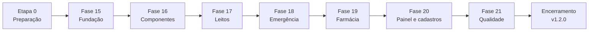

# ✅ MediCore — Plano de Execução dos Módulos Operacionais

> **O que é:** a lista de trabalho, na ordem em que deve ser feita, para implementar **Gestão de leitos, Emergência e Farmácia**. Cada tarefa é pequena (de 15 minutos a 2 horas) e tem um checkbox.
> **Base:** `PLANO_OPERACOES_MEDICORE.md` (Revisão 2), que é a **especificação**. Este documento diz **o que fazer e em que ordem**; a especificação diz **como deve funcionar**. Em caso de dúvida, vale a especificação.
> **Fases:** 15 a 21, iguais às da especificação, precedidas da Etapa 0 (preparação) e seguidas do Encerramento (versão 1.2.0).
> **Estimativa:** 20 dias úteis (1 desenvolvedor): 19 das fases + ½ da Etapa 0 + ½ do Encerramento · ver [cronograma](#-cronograma-dia-a-dia)
> **Criado em:** 28/10/2026 · **Situação:** Etapa 0 concluída em 28/10/2026 (faltam só o commit e o combinado das verificações manuais, que são seus); próxima: Fase 15

---

## 📋 Sumário

1. [Como usar](#-como-usar)
2. [Painel de execução](#-painel-de-execução)
3. [Cronograma dia a dia](#-cronograma-dia-a-dia)
4. [Rotina de cada fase (git, PR e fechamento)](#-rotina-de-cada-fase-git-pr-e-fechamento)
5. [Comandos de referência](#-comandos-de-referência)
6. [Lições do plano anterior aplicadas aqui](#-lições-do-plano-anterior-aplicadas-aqui)
7. [Etapa 0 — Preparação](#etapa-0--preparação)
8. [Fase 15 — Fundação dos módulos operacionais](#fase-15--fundação-dos-módulos-operacionais)
9. [Fase 16 — Componentes compartilhados](#fase-16--componentes-compartilhados)
10. [Fase 17 — Gestão de leitos](#fase-17--gestão-de-leitos)
11. [Fase 18 — Emergência](#fase-18--emergência)
12. [Fase 19 — Farmácia](#fase-19--farmácia)
13. [Fase 20 — Integração com o Painel e os cadastros](#fase-20--integração-com-o-painel-e-os-cadastros)
14. [Fase 21 — Qualidade, testes e entrega](#fase-21--qualidade-testes-e-entrega)
15. [Encerramento (versão 1.2.0)](#encerramento-versão-120)
16. [Diário de execução](#-diário-de-execução)

---

## 🧭 Como usar

**Formato de cada tarefa**

```
- [ ] **15.9.4** O que fazer — `arquivo(s)` · 🔗 referência na especificação · ✔ como verificar
```

- **Número** `fase.etapa.tarefa`: use-o na mensagem de commit (ex.: `fase-15: 15.9.4 transferir de leito`).
- **🔗 Referência**: código da especificação (`L3`, `R-E15`, `A9`, `E-12`, `INV-7`, `D18`, `M27`…) ou seção dela. Leia antes de começar a tarefa.
- **✔ Verificação**: o que precisa ser verdade para marcar o checkbox. Se não der para verificar, a tarefa não está pronta.
- **Esp. 15.6**: seção correspondente na especificação. A numeração deste plano é mais detalhada que a da especificação e não coincide com ela.

**Regras**
1. Siga a ordem. Dentro de uma etapa, as tarefas dependem das anteriores; entre etapas, só quando indicado.
2. Teste junto com o código: cada etapa termina com sua tarefa de testes. Não acumule testes para o fim.
3. Nos serviços, **confira as invariantes depois de cada operação** com o ajudante criado em 15.8 (`esperarConsistente()`).
4. Rode `npm run test` antes de cada commit. Nunca faça commit com teste quebrado.
5. Ao terminar uma etapa, faça o commit. Ao terminar uma fase, siga a [rotina de fechamento](#-rotina-de-cada-fase-git-pr-e-fechamento), que inclui **medir o pacote inicial** e rodar o **axe ponta a ponta** nas telas novas.
6. Se surgir trabalho novo, **não** inclua na fase atual: anote no [Diário](#-diário-de-execução) e no `BACKLOG_MEDICORE.md` (RS-13).
7. Ao fechar cada fase, marque também os checkboxes correspondentes no `PLANO_OPERACOES_MEDICORE.md`.
8. Todo texto visível vai para `src/i18n/` (D16). Todo dado é fictício (RS-01).

**Legenda:** ⬜ não iniciada · 🟨 em andamento · ✅ concluída · 🟥 bloqueada · ⭐ tarefa crítica (atenção redobrada; um bug aqui afeta vários módulos) · 👤 tarefa manual ou feita por você (git, decisão, verificação com pessoa)

---

## 📊 Painel de execução

| Etapa / Fase | Conteúdo | Tarefas | Dias | Status | Início | Fim |
|---|---|:---:|:---:|:---:|:---:|:---:|
| Etapa 0 | Preparação e linha de base | 12 | 0,5 | ✅ (falta 0.2.1 e 0.4.1, suas) | 28/10/2026 | 28/10/2026 |
| Fase 15 | Fundação dos módulos operacionais | 160 | 4 | ⬜ | | |
| Fase 16 | Componentes compartilhados | 56 | 1,5 | ⬜ | | |
| Fase 17 | Gestão de leitos | 78 | 3,5 | ⬜ | | |
| Fase 18 | Emergência | 67 | 3,5 | ⬜ | | |
| Fase 19 | Farmácia | 67 | 3,5 | ⬜ | | |
| Fase 20 | Integração com o Painel e os cadastros | 44 | 1,5 | ⬜ | | |
| Fase 21 | Qualidade, testes e entrega | 36 | 1,5 | ⬜ | | |
| Encerramento | Versão 1.2.0, deploy e documentação | 9 | 0,5 | ⬜ | | |
| **Total** | | **529** | **20** | ⬜ | | |

> A contagem inclui as tarefas de abertura e fechamento de cada fase. A Fase 15 é a maior porque concentra toda a lógica de negócio, os dados de exemplo e os testes; as fases de tela ficam mais rápidas por isso. Atualize o status ao fim de cada fase.

**Ordem das fases**



> **Uma pessoa:** siga a ordem acima (17 → 18 → 19). Assim a regra R-F12 (destino da dispensação) já nasce completa na Fase 19.
> **Duas pessoas:** depois da Fase 16, uma faz 17 → 18 e a outra faz 19. Nesse caso, siga a nota de 19.10 sobre a R-F12.

---

## 📅 Cronograma dia a dia

| Dia | Meta do dia | Tarefas | Entrega verificável |
|:---:|---|---|---|
| D1 | Preparação, configuração, textos e tipos | Etapa 0 · 15.0 a 15.3 | Decisões registradas; `npx tsc -b` sem erros com os tipos novos |
| D2 | Esquemas, erros e algoritmos | 15.4 a 15.6 | Testes de esquemas e de A7–A11 passando; `utils/` ≥ 90% |
| D3 | Repositórios, invariantes e serviço de leitos | 15.7 a 15.9 | L1–L9 testados no serviço, com as invariantes conferidas |
| D4 | Serviços de emergência e farmácia | 15.10 a 15.11 | E1–E10 e F1–F9 testados no serviço |
| D5 | Regras entre módulos, indicadores, retenção, dados de exemplo, hooks, teste aleatório, PR | 15.12 a 15.18 | 500 operações aleatórias sem violação; PR da Fase 15 |
| D6 | Tokens e componentes gerais | 16.0 a 16.5 | `ComboboxPaciente` e `LinhaDoTempo` extraídos, testes da Fase 12 verdes |
| D7 (½) | Componentes dos módulos, vitrine, PR | 16.6 a 16.13 | Vitrine "Módulos operacionais" sem violações axe; PR da Fase 16 |
| D7 (½) – D8 | Leitos: rotas, mapa e ações rápidas | 17.0 a 17.4 | Mapa com 130 leitos; concluir higienização funciona |
| D9 | Leitos: internar, lista e detalhe | 17.5 a 17.7 | L1 e L6 funcionando |
| D10 | Leitos: diálogos, edição, detalhe do leito, testes, PR | 17.8 a 17.14 | L1–L9 funcionando com duas abas; PR da Fase 17 |
| D11 | Emergência: rotas, fila, chegada | 18.0 a 18.3 | Chegada aparece na fila na ordem certa |
| D12 | Emergência: triagem e atendimento | 18.4 a 18.6 | E2–E7, E9, E10 funcionando |
| D13 (½) | Emergência: alertas, histórico, integração com leitos | 18.7 a 18.8 | Emergência → leito → internação completo |
| D13 (½) – D14 (½) | Emergência: testes, PR · Farmácia: rotas e estoque | 18.9 a 18.11 · 19.0 a 19.2 | PR da Fase 18; estoque listado |
| D14 (½) – D15 | Farmácia: catálogo, entrada, dispensar | 19.3 a 19.5 | F1, F2, F3 funcionando com FEFO e alertas |
| D16 (½) | Farmácia: dispensação, movimentações, vencimentos, controlados | 19.6 a 19.10 | F4–F9 funcionando |
| D16 (½) – D17 (½) | Farmácia: testes, PR · Painel: indicadores sob demanda e cards | 19.11 a 19.13 · 20.0 a 20.7 | PR da Fase 19; Painel com números reais |
| D17 (½) – D18 | Painel: limpeza e testes · Cadastros · PR | 20.8 a 20.13 | Nenhum número de leitos, emergência ou farmácia simulado; PR da Fase 20 |
| D19 | Ponta a ponta, acessibilidade, idioma | 21.0 a 21.3 | Cenários 5–10 verdes 3 vezes seguidas |
| D20 | Desempenho, documentação, entrega | 21.4 a 21.7 · Encerramento | Versão 1.2.0 publicada e testada |

> **Margem:** o cronograma não tem folga. Se a Fase 15 passar de 5 dias, aplique os cortes previstos no RS-13 (histórico de leito, devolução F4, observação E4, aba Vencimentos vira filtro) e registre no Diário.

---

## 🔁 Rotina de cada fase (git, PR e fechamento)

Toda fase começa com a **abertura** (`N.0`) e termina com o **fechamento** (`N.último`). As tarefas abaixo se repetem em cada fase e já estão incluídas nas listas.

**Abertura**
1. 👤 Atualizar a `main` local: `git checkout main && git pull`
2. 👤 Criar a branch: `git checkout -b feat/fase-N-<nome>`
3. Confirmar a base verde: `npm run test` passando antes de alterar qualquer coisa
4. Ler a seção da fase na especificação e os processos e regras citados

**Commits** (👤 feitos por você)
- Um commit por etapa (ou por tarefa grande), com a mensagem no formato `fase-N: N.E.T descrição curta`
- Exemplo: `fase-15: 15.9.4 transferir de leito`
- No plano anterior, o fluxo foi simplificado para um commit por fase direto na `main`. Isso funciona, mas perde a revisão por PR. Se repetir, registre no Diário

**Fechamento** (é a [Definição de pronto](PLANO_OPERACOES_MEDICORE.md#-definição-de-pronto-por-pr) da especificação)
1. `npm run lint`, `npm run build` e `npm run test:coverage` sem erros nem avisos
2. Metas de cobertura atingidas para os arquivos da fase (`services/` ≥ 85%, `utils/` ≥ 90%, `components/ui/` ≥ 70%)
3. `npm run i18n:verificar` sem achados
4. **Pacote inicial medido** com `npm run pacote:medir` (criado na Etapa 0) e anotado no Diário. Crescimento acima de 5 kB gzip precisa de justificativa
5. Telas novas conferidas em 375, 768 e 1280px, nos temas claro e escuro, só com teclado e em **escala de cinza** (risco e situação de leito compreensíveis sem cor)
6. Rotas novas incluídas em `e2e/acessibilidade.spec.ts`; `npm run test:e2e` verde
7. Texto do PR em `docs/PR_FASE_N.md`: resumo, matriz de regras, capturas e lista de tarefas concluídas
8. Checkboxes atualizados neste plano e na especificação; painel de execução atualizado
9. 👤 PR aberto, revisado e mesclado na `main` (a Vercel publica a `main` automaticamente)

---

## 🛠️ Comandos de referência

| Para quê | Comando |
|---|---|
| Rodar o projeto | `npm run dev` → http://localhost:5173 |
| Vitrine de componentes | http://localhost:5173/ui (só em desenvolvimento) |
| Testes uma vez | `npm run test` |
| Testes de um arquivo | `npx vitest run src/__tests__/leitos.service.test.ts` |
| Testes em modo observação | `npm run test:watch` |
| Cobertura | `npm run test:coverage` (relatório em `coverage/index.html`) |
| Lint e formatação | `npm run lint` · `npm run format` |
| Build de produção | `npm run build` · `npm run preview` |
| Ponta a ponta | `npm run test:e2e` · interface: `npm run test:e2e:ui` |
| Textos fora do i18n | `npm run i18n:verificar` |
| Tamanho do pacote inicial | `npm run pacote:medir` (criado em 0.3.2) |
| Restaurar dados de exemplo | Vitrine `/ui` → "Restaurar dados de exemplo" (a partir de 15.7 inclui as coleções novas) |
| Ver as invariantes no navegador | Console do DevTools ao abrir o sistema em `npm run dev` (a partir de 15.17) |
| Produção | https://medicore-heltonhelenos-projects.vercel.app |

---

## 🎓 Lições do plano anterior aplicadas aqui

| Lição (Encerramento da versão 1.1.0) | Como este plano aplica |
|---|---|
| O tamanho do pacote só foi medido na Fase 14, e o zod já tinha entrado no carregamento inicial | Script `pacote:medir` na Etapa 0 e medição no fechamento de **todas** as fases |
| O teste de carga só rodou na Fase 14 e revelou lentidão tarde | Medição de armazenamento e do tempo da semeadura já na Fase 15 (15.15.12); carga completa na 21.4 |
| O axe atualizado achou problemas antigos no fim | Rotas novas entram no `acessibilidade.spec.ts` no fechamento de cada fase de tela |
| O teste com duas abas no navegador achou uma perda de dados que os testes unitários não pegavam | Teste manual com duas abas em cada fase de tela (17.13.3, 18.10.3, 19.12.3) e invariantes conferidas em todo teste de serviço |
| A verificação com NVDA ficou pendente desde o início porque precisa de uma pessoa | Roteiro preparado cedo (21.2.5) e marcado como 👤, sem bloquear a entrega |

---

## Etapa 0 — Preparação

**Objetivo:** começar com as decisões aprovadas e uma base versionada, publicada, verde e medida. **Duração:** ½ dia.

### 0.1 Decisões (bloqueiam a Fase 15)

- [x] **0.1.1** 👤 Ler as decisões D8–D20 da especificação e aprovar ou ajustar cada uma · 🔗 [Decisões propostas](PLANO_OPERACOES_MEDICORE.md#-decisões-propostas) · ✔ resultado de cada uma registrado no Registro da especificação — **28/10/2026:** todas aprovadas como recomendadas
- [x] **0.1.2** 👤 D18: validar as faixas de alerta de sinais vitais com alguém da equipe clínica, **ou** registrar que a validação foi adiada (nesse caso, a sinalização para menores de 12 anos fica desligada por configuração em 15.1.6) · 🔗 D18, RS-17 — **28/10/2026:** D18 aprovada como validada; a sinalização pediátrica fica ligada
- [x] **0.1.3** Se alguma decisão mudou, ajustar as seções indicadas em "Onde impacta" na especificação antes de seguir · ✔ especificação sem contradição com as decisões aprovadas — nenhuma decisão mudou, então a especificação não precisou de ajuste

### 0.2 Base versionada e verde

- [ ] **0.2.1** 👤 Fazer o commit dos documentos pendentes (`PLANO_OPERACOES_MEDICORE.md`, `BACKLOG_MEDICORE.md`, este plano) e enviar · ✔ `git status` limpo
- [x] **0.2.2** Rodar `npm run test`, `npm run test:e2e` e `npm run build` na `main` · ✔ 353 testes Vitest + 66 Playwright verdes; build sem erros — **28/10/2026:** 353 Vitest e 66 Playwright verdes; build sem erros
- [x] **0.2.3** Abrir a URL de produção e conferir o Painel e uma tela de cadastro · ✔ sem erros no console — produção serve o commit `cb5931d` com os mesmos arquivos do build local (mesmos hashes); `/pacientes` responde 200; o build local abriu sem erros no console

### 0.3 Linha de base e ferramentas de medição

- [x] **0.3.1** Registrar no Diário os números de partida: quantidade de testes, cobertura geral, `services/` e `utils/`, pacote inicial (gzip), notas do Lighthouse desktop e uso de armazenamento dos dados de exemplo (74 KB) · ✔ tabela da linha de base preenchida
- [x] **0.3.2** ⭐ Criar `scripts/medir-pacote.ts` e o script `pacote:medir` no `package.json`: após o build, soma o gzip dos arquivos carregados pelo `index.html` e procura **marcadores de texto dos módulos** ("Higienização terminal", "Emergência imediata", "Livro de controlados", "Unidades por embalagem") no pacote inicial · 🔗 D16, RS-12 · ✔ imprime "Pacote inicial: N kB gzip · marcadores dos módulos: 0" — testado: um marcador colocado de propósito no pacote faz o script sair com código 1
- [x] **0.3.3** Capturar o Painel em 1600px (tema claro) como referência visual para a Fase 20 — `docs/capturas/referencia-fase14.png` · ✔ arquivo criado
- [x] **0.3.4** Ler a especificação inteira uma vez, com atenção a: Matriz de ações por estado, Invariantes, Tempos, Persistência, Processos e Algoritmos · ✔ dúvidas anotadas no Diário — observações e dúvidas no Diário (28/10/2026, 0.3.4)

### 0.4 Pendências herdadas e painel

- [ ] **0.4.1** 👤 Combinar quando serão feitas as verificações manuais herdadas (NVDA nos fluxos P1 e P9 e revisão das mensagens E-01 a E-10). Elas não bloqueiam, mas entram na Fase 21 junto com L1, E2 e F3 · 🔗 [Pendências herdadas](PLANO_OPERACOES_MEDICORE.md#-pendências-herdadas)
- [x] **0.4.2** Atualizar o painel de execução: Etapa 0 ✅

---

## Fase 15 — Fundação dos módulos operacionais

**Objetivo:** tipos, regras, serviços, dados de exemplo, regras entre módulos e invariantes prontos e testados, **sem telas novas**. **Duração:** 4 dias. **Branch:** `feat/fase-15-fundacao-operacoes`.
**Especificação:** Fase 15, Modelo de dados, Regras, Matriz de ações por estado, Invariantes, Tempos, Persistência, Processos, Algoritmos, Tratamento de erros.

### 15.0 Abertura

- [ ] **15.0.1** 👤 Atualizar a `main` e criar `feat/fase-15-fundacao-operacoes`
- [ ] **15.0.2** `npm run test` verde antes de qualquer alteração
- [ ] **15.0.3** Conferir que as decisões D8–D20 estão aprovadas (0.1) · ✔ se não estiverem, a fase fica 🟥 bloqueada

### 15.1 Configuração · esp. 15.1

- [ ] **15.1.1** `config/setores.ts`: os 4 setores (`uti`, `enfermaria`, `apartamento`, `observacao`) com `nome`, `tipo` (`internacao` ou `observacao`) e `ordem` · 🔗 Modelo de dados › Setor, D10, D17 · ✔ só UTI, Enfermaria e Apartamento têm `tipo: 'internacao'`
- [ ] **15.1.2** Em `config/limites.ts`: tempos-alvo por cor (vermelho 0, laranja 10, amarelo 60, verde 120, azul 240 min) · 🔗 R-E3
- [ ] **15.1.3** Em `config/limites.ts`: limites operacionais — reserva em destaque após 2 h; higienização de referência 60 min (terminal) e 90 min (isolamento); aguardando leito 4 h; sem triagem 15 min; observação 24 h; evasão após 30 min; vencendo em 60 dias; validade curta 30 dias; alerta da UTI em 90%; internação retroativa até 24 h; chegada retroativa até 2 h; eletiva até 30 dias; máximo de 10 itens por dispensação; `LIMITE_CONFIRMACAO_QUANTIDADE = 60` · 🔗 R-L9, R-L13, R-E11, R-E13, R-F2, R-F6, R-F14, A12
- [ ] **15.1.4** Em `config/limites.ts`: janelas de correção — alta 6 h, atendimento 2 h, dispensação 24 h · 🔗 D19
- [ ] **15.1.5** Em `config/limites.ts`: retenção e teto por coleção (tabela do orçamento) · 🔗 D15, Persistência › Orçamento · ✔ os 9 valores de retenção e os 9 tetos batem com a tabela
- [ ] **15.1.6** `config/sinais-vitais.ts`: faixas válidas (R-E5), faixas de alerta por faixa etária (< 1, 1–5, 6–11, ≥ 12 anos), temperatura e a opção `SINALIZACAO_PEDIATRICA_ATIVA` (desligada se a D18 foi adiada em 0.1.2), com o comentário "validar com a equipe clínica" · 🔗 R-E5, D18, RS-17
- [ ] **15.1.7** `utils/autor.ts` com `autorAtual()`, que devolve "Usuário de demonstração" até existir login · 🔗 R-X9, M29, BL-02
- [ ] **15.1.8** Commit `fase-15: 15.1 configuração dos módulos`

### 15.2 Textos por módulo · esp. 15.2 · D16

- [ ] **15.2.1** `i18n/pt-BR/leitos.ts`: títulos, abas, situações do leito, perfis, precauções, tipos de higienização, origens, tipos de alta, motivos sugeridos (transferência, bloqueio), textos dos processos L1–L9, com funções para plural (mesma convenção do `pt-BR.ts`)
- [ ] **15.2.2** `i18n/pt-BR/emergencia.ts`: cores com nome e significado ("Laranja — muito urgente"), status, modos de chegada, queixas sugeridas, rótulos e unidades dos sinais vitais, textos de alerta ("Atenção: abaixo de 92%"), desfechos, textos dos processos E1–E10 e o aviso de escopo administrativo · 🔗 RS-10
- [ ] **15.2.3** `i18n/pt-BR/farmacia.ts`: formas, unidades, listas de controlados, tipos de movimentação, situações do estoque, motivos sugeridos (devolução, perda, estorno), textos dos processos F1–F9, "Verificação por texto; confira sempre a prescrição" e "Alergias não informadas" · 🔗 A10, R-F15
- [ ] **15.2.4** No `pt-BR.ts` (vai no pacote inicial, porque o Painel usa): os textos das 14 atividades novas e as mensagens E-11 a E-18 · 🔗 [Atividades novas](PLANO_OPERACOES_MEDICORE.md#atividades-novas), Tratamento de erros
- [ ] **15.2.5** Ajustar `scripts/varrer-textos.ts` para aceitar `src/i18n/pt-BR/*.ts` como origem válida · ✔ `npm run i18n:verificar` sem achados
- [ ] **15.2.6** `npm run build && npm run pacote:medir` · ✔ marcadores dos módulos: 0 (nenhuma página importa os arquivos novos ainda)
- [ ] **15.2.7** Commit `fase-15: 15.2 textos dos módulos`

### 15.3 Tipos · esp. 15.3

- [ ] **15.3.1** `types/leito.ts`: `Setor`, `Leito`, `StatusLeito`, `PerfilLeito`, `TipoHigienizacao`, `BloqueioLeito`, `LeitoDetalhado` · 🔗 Modelo de dados › Leito, Tipos de leitura
- [ ] **15.3.2** `types/internacao.ts`: `Internacao`, `OrigemInternacao`, `Precaucao`, `TipoAlta`, `AltaInternacao` (com `registradaEm` e `hospitalDestino`), `EventoInternacao` (união com `em` e `autor`), `InternacaoDetalhada`, `SolicitacaoLeito` (com `origem`, `dataPrevista`, `motivoCancelamento`)
- [ ] **15.3.3** `types/emergencia.ts`: `Atendimento`, `StatusAtendimento`, `CorRisco`, `ModoChegada`, `IdentificacaoProvisoria`, `SinaisVitais`, `Triagem` (com `pesoKg` e `justificativa`), `Reavaliacao`, `Desfecho` (com `registradoEm`), `EventoAtendimento`, `AtendimentoDetalhado`, `AlertaOperacional`
- [ ] **15.3.4** `types/farmacia.ts`: `Medicamento` (com `unidadesPorEmbalagem`), `FormaFarmaceutica`, `UnidadeDispensacao`, `ListaControlado`, `Lote` (com `bloqueio`, `saldoArquivado`, `notaFiscal`), `Movimentacao`, `TipoMovimentacao`, `Dispensacao` (com `status` e `estorno`), `ItemDispensacao`, `AlertaConfirmado`, `EstoqueMedicamento`, `SituacaoEstoque`
- [ ] **15.3.5** `types/resumo.ts`: `ResumoMensal` e `RegistroArquivado` · 🔗 A15, M30
- [ ] **15.3.6** `types/atividade.ts`: acrescentar os 14 tipos novos de atividade · ✔ nenhum formato existente mudou, então `ESQUEMA_ATUAL` continua 1
- [ ] **15.3.7** Reexportar em `types/index.ts`; os tipos simulados do Painel (`SetorLeitos`, `AlertaEmergencia`) continuam até a Fase 20 · ✔ `npx tsc -b` sem erros
- [ ] **15.3.8** Commit `fase-15: 15.3 tipos dos módulos`

### 15.4 Esquemas zod · esp. 15.3

- [ ] **15.4.1** `schemas/comuns.ts`: `sinaisVitais` com as faixas válidas de `config/sinais-vitais.ts` e PAS > PAD; `justificativa(10, 300)`; `motivo(5, 200)` · 🔗 R-E5
- [ ] **15.4.2** `schemas/internacao.ts` → entrada de internação: `hospitalOrigem` obrigatório se a origem for transferência externa (3–120); início não futuro e até 24 h no passado; previsão de alta ≥ início; justificativa obrigatória quando houver exceção de perfil ou isolamento · 🔗 L1, R-L5, R-L6, M25
- [ ] **15.4.3** `schemas/internacao.ts` → transferência (destino, motivo, justificativa condicional), alta (tipo, data, `hospitalDestino` obrigatório na transferência, não antes do início nem no futuro), edição, desfazer alta (motivo), bloqueio de leito (motivo 5–200, previsão opcional) · 🔗 L2, L3, L5, L7, L8
- [ ] **15.4.4** `schemas/internacao.ts` → solicitação eletiva: data prevista de hoje até 30 dias; prioridade verde, ou amarelo com justificativa · 🔗 L9
- [ ] **15.4.5** `schemas/emergencia.ts` → chegada: paciente **ou** provisório (descrição 5–200, sexo, idade 0–120), modo, queixa 3–300, chegada até 2 h no passado · 🔗 E1, D9
- [ ] **15.4.6** `schemas/emergencia.ts` → `esquemaTriagem(corAnterior?)`: risco, profissional, sinais, peso opcional, justificativa obrigatória quando a cor nova é menos grave que a anterior · 🔗 E2, R-E3
- [ ] **15.4.7** `schemas/emergencia.ts` → reavaliação, chamar (médico), pedir leito (setor, precaução, motivo), desfecho (`hospitalDestino` na transferência), reabrir (motivo), vincular · 🔗 E3–E7, E9, E10
- [ ] **15.4.8** `schemas/farmacia.ts` → medicamento (nome, princípio ativo, concentração, forma, unidade, unidades por embalagem ≥ 1, mínimo ≥ 0) e entrada de lote (validade não vencida, quantidade > 0, unidades **ou** embalagens) · 🔗 F1, F2, R-F2, M27
- [ ] **15.4.9** `schemas/farmacia.ts` → dispensação (1 a 10 itens, quantidade inteira > 0, justificativa 10–300 nos itens com alerta de alergia), devolução, ajuste (motivo; 10 caracteres ou mais para controlado), descarte (termo para controlado), estorno, bloqueio de lote · 🔗 F3–F9, R-F7
- [ ] **15.4.10** Manter o padrão da Fase 14: os esquemas são carregados sob demanda dentro das funções que gravam · ✔ `pacote:medir` sem crescimento
- [ ] **15.4.11** Testes `schemas.operacoes.test.ts`: um caso válido e um inválido por regra, incluindo PAS ≤ PAD, SpO₂ 101, validade hoje (aceita) e ontem (recusada), quantidade 0, 11 itens, retriagem menos grave sem justificativa, transferência sem hospital, chegada sem paciente e sem provisório · ✔ mensagens em PT-BR
- [ ] **15.4.12** Commit `fase-15: 15.4 esquemas zod dos módulos`

### 15.5 Erros E-11 a E-18 · esp. 15.6

- [ ] **15.5.1** `services/erros.ts`: códigos novos de `ErroConflito` — `leito_indisponivel`, `estoque_insuficiente { disponivel }`, `paciente_internado` e `paciente_em_atendimento { referencia }`, `destino_inativo`, `transicao_invalida`, `pendencias_modulos { itens }`, `janela_correcao_expirada { limite }`; E-13 como `ErroValidacao` no campo · 🔗 Tratamento de erros
- [ ] **15.5.2** `aplicarErrosNoFormulario`: E-11 → campo do leito; E-12 → `itens.N.quantidade`; E-13 → validade ou número do lote; E-14 → paciente
- [ ] **15.5.3** Testes `erros.test.ts` ampliados: cada código novo vira o campo certo e a mensagem certa · ✔ passando
- [ ] **15.5.4** Commit `fase-15: 15.5 erros dos módulos`

### 15.6 Algoritmos (`utils/`) · esp. 15.4

- [ ] **15.6.1** `utils/tempos.ts`: `formatarEspera` ("há 12 min", "há 1 h 05 min"), `formatarPrazo` ("até 10:28"), `excessoMin`, `diaDeInternacao` (dia da entrada = 1), `permanencia`, `textoValidade` ("Vence em 12 dias", "Venceu há 3 dias"), `dentroDaJanela(registradoEm, horas)` e `limiteDaJanela` · 🔗 Tempos, D19
- [ ] **15.6.2** Testes `tempos.test.ts` em `TZ=UTC`: entrada às 23:50 e consulta às 00:10 do dia seguinte (dia 2); janela exatamente no limite; validade hoje · ✔ passando
- [ ] **15.6.3** `utils/sinais-vitais.ts`: `faixaEtaria(idade | null)`, `avaliarSinais(sinais, idade)` → lista de alertas com texto; PAS pediátrica `70 + 2 × idade`; sem idade = faixa de adulto com aviso; respeita `SINALIZACAO_PEDIATRICA_ATIVA` · 🔗 R-E5, D18, M21
- [ ] **15.6.4** Testes `sinais-vitais.test.ts`: os limites de cada faixa etária (valor no limite e um acima), bebê de 11 meses, criança de 5 e de 6 anos, adolescente de 12, provisório sem idade
- [ ] **15.6.5** ⭐ `utils/fila.ts` → `calcularPrazo(atendimento, novaTriagem)`: primeira triagem; retriagem mais grave (mínimo); retriagem igual ou menos grave (não adia); emergência imediata (chegada + 0) · 🔗 A7, R-E3, M20
- [ ] **15.6.6** `utils/fila.ts` → `ordenarFila` (cor, prazo, chegada, número), `acimaDoPrazo` e `numeroAtendimento(atendimentos, chegadaEm)`, com o dia tirado da própria chegada (chegada retroativa das 23:30 registrada às 00:30 entra na sequência do dia anterior) · 🔗 A7, A8, R-E1, R-E4
- [ ] **15.6.7** Testes `fila.test.ts`: retriagem laranja → vermelho adianta o prazo; vermelho → amarelo mantém; empate de cor e prazo desempata pela chegada; número `E-0001` depois da meia-noite no fuso (23:59 → 00:00 em Brasília, testado em UTC); 4 dígitos
- [ ] **15.6.8** ⭐ `utils/fefo.ts`: só lotes com validade ≥ hoje, saldo > 0 e **não bloqueados**; ordem por validade e entrada; divide entre lotes; falta de saldo → erro com o disponível · 🔗 A9, R-F3, R-F5, R-F13
- [ ] **15.6.9** Testes `fefo.test.ts`: lote vencendo hoje entra; vencido ontem não; bloqueado não; divisão em 2 e 3 lotes; pedido maior que o disponível
- [ ] **15.6.10** `utils/alergia.ts`: `termos(texto)` reaproveitando `normalizar` de `utils/busca.ts`; `correspondenciaAlergia(alergias, medicamento)` → termo encontrado e campo (princípio ativo, classe ou nome) · 🔗 A10, D14
- [ ] **15.6.11** Testes `alergia.test.ts`: "Penicilina" × classe "Penicilinas"; "dipirona" × "Dipirona sódica"; acentos; separadores `; , /` e " e "; palavra com menos de 4 letras ignorada; alergias vazias → nenhum alerta (o "não informadas" é tratado na tela)
- [ ] **15.6.12** `utils/compatibilidade-leito.ts`: `avaliarLeito` com o motivo de cada incompatibilidade (situação, perfil, isolamento, setor) e `leitoSugerido` na ordem do A11 · 🔗 A11, R-L2, R-L5, R-L6
- [ ] **15.6.13** Testes `compatibilidade-leito.test.ts`: paciente de 17 e de 18 anos; precaução de contato sem leito de isolamento; precaução padrão prefere leito sem isolamento; quarto com o outro leito livre vem primeiro; reservado para a mesma solicitação é compatível
- [ ] **15.6.14** `npm run test:coverage` · ✔ `utils/` ≥ 90%
- [ ] **15.6.15** Commit `fase-15: 15.6 algoritmos dos módulos`

### 15.7 Repositórios · esp. 15.5

- [ ] **15.7.1** `services/colecoes.ts`: os 9 repositórios novos (`leitos`, `internacoes`, `solicitacoes_leito`, `atendimentos`, `medicamentos`, `lotes`, `movimentacoes`, `dispensacoes`, `resumos_mensais`) com semeadura **vazia provisória** · 🔗 Persistência › Novas chaves · ⚠ até 15.15, use "Restaurar dados de exemplo" depois de trocar as sementes, porque a coleção vazia fica gravada no navegador
- [ ] **15.7.2** `services/demo.ts`: "Restaurar dados de exemplo" inclui os repositórios novos · ✔ teste em `demo.test.tsx`
- [ ] **15.7.3** Campo `retencaoEm` em `medicore:meta`, lido e gravado pelo repositório (sem mudar o esquema)
- [ ] **15.7.4** Teste em `repositorio.test.ts`: transação com 5 coleções desfaz **todas** quando a última validação falha; releitura de uma coleção nova alterada por "outra aba"
- [ ] **15.7.5** Commit `fase-15: 15.7 repositórios dos módulos`

### 15.8 Verificação de consistência (A17), antes dos serviços · esp. 15.10

- [ ] **15.8.1** ⭐ `utils/consistencia.ts`: `verificarConsistencia(dados)` como função pura sobre um retrato das coleções (incluindo pacientes e consultas), com uma função por invariante INV-1 a INV-10, devolvendo `{ inv, ids, descricao }` · 🔗 [Invariantes](PLANO_OPERACOES_MEDICORE.md#-invariantes-de-consistência), A17
- [ ] **15.8.2** Testes `consistencia.test.ts`: para cada invariante, um retrato válido (lista vazia) e um retrato quebrado (a violação certa)
- [ ] **15.8.3** Ajudante de teste `__tests__/utils/invariantes.ts` → `esperarConsistente()`: lê os repositórios e falha mostrando as violações
- [ ] **15.8.4** Commit `fase-15: 15.8 verificação de consistência`

### 15.9 Serviço de leitos (L1–L9) · esp. 15.6

- [ ] **15.9.1** `services/leitos.ts` → `listarLeitos(filtros)` devolvendo `LeitoDetalhado` (nome de exibição, idade, dia de internação, alergia, precaução, previsão), `obterLeito(id)` e `buscarPacienteNoMapa(termo)` · 🔗 R-X5, M24
- [ ] **15.9.2** `leitosCompativeis({ pacienteId, precaucao, setorDesejado?, solicitacaoId? })` com motivos e sugerido (usa A11)
- [ ] **15.9.3** ⭐ `internar(entrada)` → L1: revalida R-L1, R-L2, R-L5, R-L6, R-L10 e R-X1 dentro da transação; internação com evento `internada`, leito `ocupado`, atividade `paciente_internado` · 🔗 L1
- [ ] **15.9.4** ⭐ `internar({ solicitacaoId, ... })` → L6: também marca a solicitação `atendida`; se veio da emergência, encerra o atendimento com desfecho `internacao` e `internacaoId`, leva o leito de observação para higienização e grava `emergencia_desfecho` · 🔗 L6, INV-5, INV-6
- [ ] **15.9.5** `transferir(id, dados, versao)` → L2: destino `ocupado`; origem em higienização (terminal ou isolamento pela precaução); evento `transferida`; atividade · 🔗 L2, R-L7, R-L13
- [ ] **15.9.6** `darAlta(id, alta, versao)` → L3 (sem o óbito, que entra em 15.12): internação encerrada com `registradaEm`; leito em higienização; atividade `alta_registrada` · 🔗 L3, R-L3
- [ ] **15.9.7** `desfazerAlta(id, motivo, versao)` → L8: janela de 6 h (E-18), leito original em higienização ou livre (senão E-11), evento `alta_desfeita` · 🔗 L8, R-L12, D19, M16, RS-18
- [ ] **15.9.8** `concluirHigienizacao(leitoIds, versoes)` → L4 numa transação, pulando e informando os leitos que mudaram (E-16); `reverterHigienizacao(leitoId, desdeOriginal)` para o "Desfazer" de 10 s · 🔗 L4
- [ ] **15.9.9** `bloquear(id, dados, versao)` e `desbloquear(id, versao)` → L5, com as atividades · 🔗 L5, R-L4, R-L14
- [ ] **15.9.10** `listarInternacoes(filtros)` (ativas e encerradas, alta prevista hoje e vencida), `obterInternacao(id)` e `editarInternacao(id, dados, versao)` → L7 com um evento por campo alterado e justificativa quando a precaução nova não combina com o leito · 🔗 L7, R-L8
- [ ] **15.9.11** `solicitarLeitoEletivo(dados)` → L9; `reservarLeito`, `cancelarReserva`, `listarSolicitacoes` (ordem por prioridade e espera ou data prevista) e `cancelarSolicitacao` (devolve o atendimento a `statusAntesDoLeito`) · 🔗 L6, L9, R-L9, R-E15, M23
- [ ] **15.9.12** Testes `leitos.service.test.ts` (1/3): L1 com cada regra positiva e negativa; L6 com e sem atendimento; transação desfeita quando o leito é ocupado "por outra aba" (E-11) · ✔ `esperarConsistente()` depois de cada operação
- [ ] **15.9.13** Testes (2/3): L2, L3, L4 (lote com um leito que mudou), L5, L8 dentro e fora da janela e com o leito já ocupado
- [ ] **15.9.14** Testes (3/3): L7 (eventos por campo, E-05), L9, reservar e cancelar, cancelar solicitação de emergência volta o status anterior
- [ ] **15.9.15** Commit `fase-15: 15.9 serviço de leitos`

### 15.10 Serviço de emergência (E1–E10) · esp. 15.6

- [ ] **15.10.1** ⭐ `services/emergencia.ts` → `registrarChegada(entrada)` → E1: número (A8) dentro da transação; `aguardando_triagem` ou, na emergência imediata, `aguardando_atendimento` com prazo; E-14 para internado ou com atendimento aberto; atividade `emergencia_vermelho` · 🔗 E1, R-E1, R-E2, R-E10, R-X1
- [ ] **15.10.2** `triar(id, triagem, versao)` → E2: acrescenta a triagem, recalcula o prazo (A7), muda de `aguardando_triagem` para `aguardando_atendimento`, evento `triagem {de, para}`; a solicitação de leito aberta acompanha a cor nova · 🔗 E2, R-E3, R-E6
- [ ] **15.10.3** `reavaliar(id, sinais, versao)` → E10: acrescenta a reavaliação sem mudar a cor nem o prazo · 🔗 E10, R-E16, M22
- [ ] **15.10.4** `chamar(id, medicoId, versao)` → E3: médico ativo; evento `chamado` com `excessoMin` · 🔗 E3, R-E7
- [ ] **15.10.5** `colocarEmObservacao(id, leitoId, versao)` e `retomarAtendimento(id, versao)` → E4: só setor Observação, perfil compatível, leito mantido ao retomar · 🔗 E4, R-E12
- [ ] **15.10.6** `solicitarLeito(id, dados, versao)` → E6: exige paciente cadastrado; guarda `statusAntesDoLeito`; solicitação `pendente` com origem `emergencia` e prioridade igual à cor · 🔗 E6, R-E9
- [ ] **15.10.7** ⭐ `encerrar(id, desfecho, versao)` → E5 (sem o óbito, que entra em 15.12): desfecho permitido por status; evasão só depois de 30 min; leito OBS em higienização; com solicitação aberta, cancela e libera a reserva (R-E15); atividade · 🔗 E5, R-E8, R-E11, R-E15
- [ ] **15.10.8** `reabrir(id, motivo, versao)` → E9: janela de 2 h, exceto desfecho internação; volta ao status anterior; leito OBS de volta se ainda estiver livre ou em higienização · 🔗 E9, R-E14, M16
- [ ] **15.10.9** `vincularPaciente(id, pacienteId, versao)` → E7: valida R-E10; evento `vinculado` com a descrição provisória · 🔗 E7
- [ ] **15.10.10** `listarFila()` (grupos por status, ordem A7), `obterAtendimento(id)` (`AtendimentoDetalhado`) e `listarHistorico(filtros)` (7 dias, data, cor e desfecho) · 🔗 E8
- [ ] **15.10.11** Testes `emergencia.service.test.ts` (1/3): E1 com e sem identificação, duas chegadas na mesma transação de "outra aba" com números diferentes, E2 com retriagem mais e menos grave, E10 · ✔ `esperarConsistente()` depois de cada operação
- [ ] **15.10.12** Testes (2/3): E3, E4 (perfil, retomar mantém o leito), E6 (provisório recusado), E7
- [ ] **15.10.13** Testes (3/3): E5 com cada desfecho e status da [matriz](PLANO_OPERACOES_MEDICORE.md#matriz-de-ações-por-estado); evasão aos 29 e aos 31 min; "aguardando leito" encerrado por alta cancela a solicitação e libera a reserva; E9 dentro e fora da janela; E9 recusado para desfecho internação
- [ ] **15.10.14** Commit `fase-15: 15.10 serviço de emergência`

### 15.11 Serviço de farmácia (F1–F9) · esp. 15.6

- [ ] **15.11.1** `services/farmacia.ts` → `listarEstoque(filtros)` (`EstoqueMedicamento`: disponível sem vencidos nem bloqueados, situação, próximo vencimento) e `obterMedicamento(id)` com lotes · 🔗 R-F1, R-F6, R-F13
- [ ] **15.11.2** `criarMedicamento` e `editarMedicamento` → F1: unicidade nome + concentração + forma (E-02); unidade e unidades por embalagem travadas depois da primeira movimentação · 🔗 F1
- [ ] **15.11.3** `inativarMedicamento` e `reativarMedicamento` → F7: E-17 com os lotes com saldo, inclusive bloqueados · 🔗 F7, R-F11
- [ ] **15.11.4** `registrarEntrada(dados)` → F2: E-13 (vencido; lote repetido com outra validade); somar ao lote com a mesma validade; conversão de embalagens; movimentação `entrada`; atividade `lote_recebido` · 🔗 F2, R-F2, M27
- [ ] **15.11.5** `previaFefo(medicamentoId, quantidade)` e `verificarAlergia(pacienteId, medicamentoId)` · 🔗 A9, A10
- [ ] **15.11.6** ⭐ `dispensar(entrada)` → F3: destino válido (R-F12, E-15); FEFO refeito na gravação; confirmações obrigatórias conferidas no serviço (alergia com justificativa, controlado, quantidade alta); baixa por lote e uma movimentação por lote; atividade `estoque_baixo` só quando cruza o mínimo · 🔗 F3, R-F3–R-F8, R-F12, R-F14
- [ ] **15.11.7** `devolver(dispensacaoId, item, quantidade, motivo, versao)` → F4: ordem inversa da saída; lote vencido vira `descarte_vencido`; lote bloqueado vira `perda`; nada é editado nem apagado, toda correção é um movimento contrário · 🔗 F4, R-F9, R-F10
- [ ] **15.11.8** `estornar(id, motivo, versao)` → F8: janela de 24 h, sem devolução anterior; devolve todos os itens; dispensação `estornada`; atividade `dispensacao_estornada` · 🔗 F8, R-F16, M16
- [ ] **15.11.9** `ajustar(loteId, dados, versao)` → F5 e `descartarVencidos(loteIds, motivo, termo?)` → F6 · 🔗 F5, F6, R-F7
- [ ] **15.11.10** `bloquearLote` e `desbloquearLote` → F9, com a atividade `lote_bloqueado` · 🔗 F9, R-F13, M26
- [ ] **15.11.11** `listarMovimentacoes(filtros)`, `obterDispensacao(id)` e `livroControlados(medicamentoId, periodo)` (saldo inicial, entradas, saídas, saldo final) · 🔗 M28
- [ ] **15.11.12** Testes `farmacia.service.test.ts` (1/3): F1, F2 (vencido, curto, repetido, somar, embalagens), F7 · ✔ `esperarConsistente()` depois de cada operação
- [ ] **15.11.13** Testes (2/3): F3 com FEFO em 2 lotes, lote bloqueado fora, alergia sem justificativa recusada, controlado sem confirmação recusado, quantidade alta, estoque cruzando o mínimo, E-12 por "outra aba", E-15 com a internação encerrada
- [ ] **15.11.14** Testes (3/3): F4 (lote vencido vira descarte), F5, F6, F8 dentro e fora da janela e com devolução anterior, F9, livro de controlados com saldo que fecha
- [ ] **15.11.15** Commit `fase-15: 15.11 serviço de farmácia`

### 15.12 Regras entre módulos (R-X) · esp. 15.7

- [ ] **15.12.1** `inativarPaciente`: bloqueia com internação ativa ou atendimento aberto, com E-17 listando as pendências · 🔗 R-X2
- [ ] **15.12.2** `excluirPaciente`: considera também internações, atendimentos e dispensações · 🔗 R-X3
- [ ] **15.12.3** `inativarMedico`: bloqueia como responsável por internação ativa ou com atendimento aberto · 🔗 R-X4
- [ ] **15.12.4** ⭐ `registrarObito(pacienteId, em)` (função interna usada dentro das transações): inativa o paciente com o motivo "Óbito em {data}", cancela as consultas futuras com "Óbito do paciente" e grava `obito_registrado` · 🔗 R-X7, M17, INV-10
- [ ] **15.12.5** Ligar o óbito em `darAlta` e `encerrar`; ligar a reativação em `desfazerAlta` e `reabrir`, devolvendo o aviso "as consultas canceladas não voltam" · 🔗 L3, L8, E5, E9
- [ ] **15.12.6** `situacaoHospitalar(pacienteId)` (internação ativa, atendimento aberto, solicitação) e `consultasDuranteInternacao(internacaoId)` (até a previsão de alta ou 7 dias) · 🔗 R-X8, M18
- [ ] **15.12.7** Atualizar os diálogos de inativar e excluir paciente e o `DialogoInativarMedico` para mostrar as pendências novas com links (rotas que ainda não existem levam ao `Placeholder` até as Fases 17 e 18) · ✔ testes de página de pacientes e médicos verdes
- [ ] **15.12.8** Testes `regras-modulos.test.ts`: cada combinação de R-X2 a R-X4; óbito por alta e por desfecho (paciente inativo, consulta futura cancelada, consulta passada intacta); desfazer o óbito reativa sem devolver consultas · 🔗 RS-11 · ✔ INV-10 sem violação
- [ ] **15.12.9** Commit `fase-15: 15.12 regras entre módulos`

### 15.13 Indicadores operacionais (A12–A14) · esp. 15.6

- [ ] **15.13.1** `services/indicadores-operacionais.ts` → ocupação por setor, operacionais, disponíveis, `previsaoUti`, altas previstas hoje, permanência média, `liberacoesPrevistas24h`, espera média por cor e giro de leito · 🔗 A13, D17, M24
- [ ] **15.13.2** Alertas A12: as 9 condições, ordenadas por prioridade e antiguidade, cada uma com a referência para o atendimento ou o leito · 🔗 A12
- [ ] **15.13.3** Série de internações: semana, mês e ano (resumos mensais + mês corrente) · 🔗 A14
- [ ] **15.13.4** Resumo de estoque: baixo, zerado, vencendo e vencidos · 🔗 R-F6
- [ ] **15.13.5** Testes `indicadores-operacionais.test.ts` com dados montados e relógio fixo: observação fora da ocupação (D17); leito bloqueado fora dos operacionais; cada alerta aparece e some no limite
- [ ] **15.13.6** Commit `fase-15: 15.13 indicadores operacionais`

### 15.14 Retenção e rotina diária (A15) · esp. 15.5

- [ ] **15.14.1** `services/retencao.ts` → `executarRetencao()`: roda no máximo uma vez por dia (`meta.retencaoEm`), numa transação · 🔗 A15, D15
- [ ] **15.14.2** Soma os itens antigos nos resumos mensais antes de remover; aplica os tetos por coleção
- [ ] **15.14.3** ⭐ Troca itens ainda referenciados por **registro arquivado** e soma as movimentações removidas em `lote.saldoArquivado` · 🔗 M30, INV-6, INV-7
- [ ] **15.14.4** Rotina do dia: atividade `lote_vencido` para cada lote que venceu desde a última execução e `estoque_baixo` quando o vencimento derruba o disponível
- [ ] **15.14.5** Chamar a retenção na inicialização, depois das migrações
- [ ] **15.14.6** Testes `retencao.test.ts`: soma antes de apagar; respeita os tetos; tudo ou nada; referência preservada; INV-7 vale depois da limpeza; não roda duas vezes no mesmo dia; roda de novo no dia seguinte
- [ ] **15.14.7** Commit `fase-15: 15.14 retenção e rotina diária`

### 15.15 Dados de exemplo (D13, A16) · esp. 15.8

- [ ] **15.15.1** `data/seeds/gerador.ts`: listas de nomes e sobrenomes brasileiros e funções para gerar paciente fictício com CPF válido (mesma semente fixa)
- [ ] **15.15.2** `data/seeds/pacientes.ts`: completar até ~120 pacientes (90 gerados; ~10% menores; ~15% com alergias, incluindo "Penicilina", "Dipirona" e "AINEs"; alguns com o campo de alergias vazio) · 🔗 D13, R-F15
- [ ] **15.15.3** `data/seeds/leitos.ts`: os 130 leitos com a distribuição da especificação (perfis, isolamento, quartos da enfermaria) · 🔗 Modelo de dados › Distribuição semeada
- [ ] **15.15.4** `data/seeds/internacoes.ts`: 86 ativas (UTI 22, Enfermaria 50, Apartamento 14) com perfil e isolamento coerentes, 2 com alta prevista vencida, 3 com alta prevista hoje, e encerradas dos últimos 30 dias
- [ ] **15.15.5** `data/seeds/atendimentos.ts`: ~12 abertos em todos os status e cores (1 vermelho aguardando, 2 acima do prazo, 1 aguardando leito há mais de 4 h, 2 em observação) + encerrados dos últimos 7 dias; 1 solicitação reservada e 1 pendente; leitos em higienização (2 a 4), 1 bloqueado
- [ ] **15.15.6** `data/seeds/medicamentos.ts`: ~45 medicamentos, 4 controlados, incluindo um da classe "Penicilinas", a dipirona e um AINE (para demonstrar A10)
- [ ] **15.15.7** `data/seeds/lotes.ts`, `movimentacoes.ts` e as dispensações: gerados **simulando as operações**, para que os saldos fechem (INV-7); 3 medicamentos com estoque baixo, 1 zerado, 5 vencendo em 60 dias e 2 lotes vencidos
- [ ] **15.15.8** `data/seeds/resumos.ts`: resumos mensais dos últimos 12 meses com valores próximos aos do gráfico atual
- [ ] **15.15.9** ⭐ A16: as sementes usam os pacientes e médicos ativos que já existem (instalação 1.1.0) e completam com os gerados; trocar as sementes vazias de 15.7.1 pelas reais · 🔗 A16, RS-15
- [ ] **15.15.10** Atualizar os testes que contam pacientes (27 ativos), o Painel e os seeds (`seeds.test.ts`, `dashboard.test.tsx`, `pacientes.paginas.test.tsx`) · ✔ todos verdes
- [ ] **15.15.11** Testes `seeds.operacoes.test.ts`: todos os itens passam nos esquemas; `verificarConsistencia()` vazio; ocupação 72% (86/120); 3 medicamentos com estoque baixo; semeadura sobre uma instalação 1.1.0 modificada (pacientes alterados, 1 excluído, 1 médico inativo) sem referência quebrada
- [ ] **15.15.12** Medir o uso de armazenamento dos dados de exemplo (meta: ~0,9 MB) e o tempo da primeira semeadura (meta: < 300 ms, M31) · ✔ números no Diário
- [ ] **15.15.13** Commit `fase-15: 15.15 dados de exemplo dos módulos`

### 15.16 Hooks · esp. 15.9

- [ ] **15.16.1** `hooks/useRelogio(intervalo = 30 s)`: devolve o instante atual; troca o "hoje" na virada do dia no fuso · 🔗 Tempos, RS-14
- [ ] **15.16.2** `hooks/useDadosLeitos`, `useDadosEmergencia` e `useDadosFarmacia` sobre `useColecao`, cada um assinando as coleções de que depende
- [ ] **15.16.3** Testes `useRelogio.test.ts` (relógio falso: tique de 30 s, virada da meia-noite) e dos hooks de dados (recarregam quando outra coleção relevante muda, inclusive por "outra aba")
- [ ] **15.16.4** Commit `fase-15: 15.16 hooks dos módulos`

### 15.17 Invariantes com operações aleatórias (M15) · esp. 15.10

- [ ] **15.17.1** ⭐ `__tests__/invariantes.aleatorio.test.ts`: gerador de operações com semente fixa que sorteia ações válidas dos três serviços e das regras R-X (aceitando os erros esperados de regra) · 🔗 M15, M33
- [ ] **15.17.2** 500 operações sobre os dados de exemplo, com o relógio avançando; `verificarConsistencia()` vazio depois de cada uma; a semente e a operação que falharem aparecem na mensagem · ✔ passando com 3 sementes diferentes
- [ ] **15.17.3** Verificação ao abrir o sistema em `npm run dev`: violações aparecem no console (import dinâmico, fora do build de produção) · ✔ `pacote:medir` sem crescimento
- [ ] **15.17.4** Commit `fase-15: 15.17 invariantes com operações aleatórias`

### 15.18 Fechamento da Fase 15

- [ ] **15.18.1** `npm run test:coverage`: `services/` ≥ 85% e `utils/` ≥ 90%
- [ ] **15.18.2** Matriz de regras em `docs/PR_FASE_15.md`: cada R-L, R-E, R-F e R-X com pelo menos um teste positivo e um negativo; cada operação grava a atividade certa na mesma transação (R-X6); cada INV com teste
- [ ] **15.18.3** Painel continua mostrando 72% de ocupação e 3 medicamentos com estoque baixo (ainda pela fonte simulada; ligar é a Fase 20)
- [ ] **15.18.4** `npm run lint`, `npm run build`, `npm run i18n:verificar` e `npm run test:e2e` verdes
- [ ] **15.18.5** `npm run pacote:medir`: sem crescimento em relação à linha de base · ✔ número no Diário
- [ ] **15.18.6** Atualizar os checkboxes deste plano e da especificação; painel de execução: Fase 15 ✅
- [ ] **15.18.7** 👤 Abrir o PR "Fase 15 — Fundação dos módulos operacionais", revisar e mesclar

---

## Fase 16 — Componentes compartilhados

**Objetivo:** peças visuais reutilizáveis, acessíveis e na vitrine `/ui`. **Duração:** 1,5 dia. **Branch:** `feat/fase-16-componentes-operacoes`.
**Especificação:** Fase 16, Acessibilidade específica dos módulos.

### 16.0 Abertura

- [ ] **16.0.1** 👤 Atualizar a `main` (com a Fase 15 mesclada) e criar `feat/fase-16-componentes-operacoes`
- [ ] **16.0.2** `npm run test` verde

### 16.1 Tokens de cor · esp. 16.1

- [ ] **16.1.1** Em `index.css`: `--color-risco-{vermelho,laranja,amarelo,verde,azul}` e os pares `--color-on-risco-*`, nos temas claro e escuro · 🔗 Acessibilidade › Novos tokens
- [ ] **16.1.2** Em `index.css`: `--color-leito-{livre,ocupado,reservado,higienizacao,bloqueado}` com os pares de texto, nos dois temas
- [ ] **16.1.3** Calcular o contraste de cada par (texto ≥ 4,5:1; borda e ícone ≥ 3:1) e registrar a tabela no Diário · ✔ todos AA
- [ ] **16.1.4** Commit `fase-16: 16.1 tokens de risco e de leito`

### 16.2 Navegação e números · esp. 16.2

- [ ] **16.2.1** `components/ui/AbasModulo.tsx`: links com `aria-current="page"`, rolagem horizontal própria no celular sem alargar a página
- [ ] **16.2.2** `components/ui/ResumoNumeros.tsx`: linha de números com rótulo ("Baixo 3"), no estilo do `StatCard`, com link opcional para o filtro
- [ ] **16.2.3** Testes: `AbasModulo` marca a aba da URL atual; `ResumoNumeros` com e sem link
- [ ] **16.2.4** Commit `fase-16: 16.2 abas do módulo e resumo de números`

### 16.3 Tempo e quantidade · esp. 16.2

- [ ] **16.3.1** `components/ui/TempoDecorrido.tsx`: usa `useRelogio`; `<time dateTime>`; texto "há 12 min"; **sem** `aria-live`; variante de prazo ("até 10:28") com destaque quando passa · 🔗 Tempos, RS-14
- [ ] **16.3.2** `components/ui/form/CampoQuantidade.tsx`: inteiro, botões − e + com nome acessível ("Diminuir quantidade"), unidade no rótulo, mínimo e máximo
- [ ] **16.3.3** Testes: `TempoDecorrido` com relógio falso (muda o texto a cada tique, sem anunciar); `CampoQuantidade` por teclado e por botões, limites
- [ ] **16.3.4** Commit `fase-16: 16.3 tempo decorrido e campo de quantidade`

### 16.4 Linha do tempo genérica · esp. 16.2

- [ ] **16.4.1** `components/ui/LinhaDoTempo.tsx` extraída da `LinhaDoTempoConsulta` (itens com instante, título, detalhe, autor e ícone)
- [ ] **16.4.2** `LinhaDoTempoConsulta` passa a usar a genérica · ✔ `consultas.paginas.test.tsx` verde, sem mudança visual
- [ ] **16.4.3** Commit `fase-16: 16.4 linha do tempo genérica`

### 16.5 ComboboxPaciente · esp. 16.2

- [ ] **16.5.1** ⭐ `components/pacientes/ComboboxPaciente.tsx` extraído do `FormConsulta`: busca por nome, nome social e CPF; só ativos; resumo com alergias (ou "Alergias não informadas")
- [ ] **16.5.2** Prop `filtro` (ex.: "internados ou em atendimento") e etiqueta de contexto na opção ("Internado em UTI-07", "Emergência E-0039") usando `situacaoHospitalar` · 🔗 R-X8, F3
- [ ] **16.5.3** `FormConsulta` passa a usar o componente · ✔ testes da Fase 12 verdes
- [ ] **16.5.4** Testes: filtro aplicado; etiqueta lida pelo leitor de tela; teclado igual ao `Combobox`
- [ ] **16.5.5** Commit `fase-16: 16.5 combobox de paciente`

### 16.6 Selos · esp. 16.3

- [ ] **16.6.1** `components/emergencia/BadgeRisco.tsx`: cor, ícone e nome por extenso; variante com o tempo-alvo ("Laranja — até 10 min") · 🔗 Acessibilidade › Cor nunca sozinha
- [ ] **16.6.2** `components/leitos/BadgeLeito.tsx`: situação com ícone, texto e cor
- [ ] **16.6.3** `components/farmacia/BadgeEstoque.tsx`: OK, baixo, zerado, vencendo, vencido e bloqueado (texto + ícone)
- [ ] **16.6.4** Testes: cada selo tem texto visível, não só cor
- [ ] **16.6.5** Commit `fase-16: 16.6 selos de risco, leito e estoque`

### 16.7 Cartão de leito · esp. 16.3

- [ ] **16.7.1** `components/leitos/CartaoLeito.tsx`: link para o detalhe com nome acessível completo ("UTI-03, em higienização há 40 minutos"); ocupado mostra nome, dia de internação, ⚠ alergia e precaução; reservado mostra a solicitação · 🔗 Acessibilidade › Grade de leitos
- [ ] **16.7.2** Ação rápida como botão separado com nome completo ("Concluir higienização do leito UTI-03") e menu do cartão (`MenuAcoes`) conforme a matriz · 🔗 [Matriz de ações](PLANO_OPERACOES_MEDICORE.md#matriz-de-ações-por-estado)
- [ ] **16.7.3** Destaques: higienização acima do tempo de referência, reserva há mais de 2 h, liberação prevista vencida · 🔗 R-L9, R-L13, R-L14
- [ ] **16.7.4** Memorizar o cartão (`memo`) para o mapa de 130 leitos · 🔗 RS-16
- [ ] **16.7.5** Testes: um cartão por situação; nome acessível; ações certas por situação
- [ ] **16.7.6** Commit `fase-16: 16.7 cartão de leito`

### 16.8 Seletor de leito · esp. 16.3

- [ ] **16.8.1** ⭐ `components/leitos/SeletorLeito.tsx` no padrão do `SeletorHorario`: radiogroup com setas, Home e End; agrupado por setor; sugerido primeiro e marcado · 🔗 A11
- [ ] **16.8.2** Leitos incompatíveis desabilitados com o motivo visível e lido pelo leitor de tela; opção "Usar mesmo assim" com justificativa (exceção de perfil e isolamento) · 🔗 R-L5, R-L6
- [ ] **16.8.3** Estado vazio com a ação configurável (ex.: "Pedir leito (eletiva)") · 🔗 L9
- [ ] **16.8.4** Testes só com teclado; motivos anunciados; exceção exige justificativa
- [ ] **16.8.5** Commit `fase-16: 16.8 seletor de leito`

### 16.9 Campos de sinais vitais · esp. 16.3

- [ ] **16.9.1** ⭐ `components/emergencia/CamposSinaisVitais.tsx`: rótulos com unidade ("Frequência cardíaca (bpm)"), dica com a faixa válida, peso opcional · 🔗 R-E5, Acessibilidade › Sinais vitais
- [ ] **16.9.2** Sinalização de alerta por faixa etária em texto ("Atenção: abaixo de 92%"), sem ser erro; aviso "faixa de adulto" quando não há idade · 🔗 D18
- [ ] **16.9.3** Testes: valor fora da faixa válida é erro; valor na faixa de alerta mostra o texto; muda com a idade
- [ ] **16.9.4** Commit `fase-16: 16.9 campos de sinais vitais`

### 16.10 Alerta de alergia na dispensação · esp. 16.3

- [ ] **16.10.1** `components/farmacia/AlertaAlergia.tsx`: `role="alert"` na primeira exibição; termo encontrado × campo do medicamento; caixa "Ciente" com rótulo explícito; justificativa; texto "Verificação por texto; confira sempre a prescrição" · 🔗 A10, R-F8
- [ ] **16.10.2** Testes: anúncio uma vez; justificativa obrigatória quando marcado
- [ ] **16.10.3** Commit `fase-16: 16.10 alerta de alergia`

### 16.11 Vitrine · esp. 16.4

- [ ] **16.11.1** `pages/vitrine/VitrineOperacoes.tsx`: seção "Módulos operacionais" com todos os componentes e estados (os 5 riscos, as 5 situações de leito, os selos de estoque, seletor com incompatíveis, sinais com alerta, alerta de alergia)
- [ ] **16.11.2** Commit `fase-16: 16.11 vitrine dos módulos`

### 16.12 Verificação

- [ ] **16.12.1** Vitrine em 375, 768 e 1280px, nos temas claro e escuro, sem rolagem horizontal
- [ ] **16.12.2** Vitrine só com teclado (seletor de leito, campo de quantidade, combobox de paciente)
- [ ] **16.12.3** Vitrine em escala de cinza (DevTools › Rendering › Emulate vision deficiencies) · ✔ riscos e situações distinguíveis pelo texto e pelo ícone
- [ ] **16.12.4** axe na vitrine nos dois temas · ✔ 0 violações

### 16.13 Fechamento da Fase 16

- [ ] **16.13.1** Lint, build, `test:coverage` (`components/ui/` ≥ 70%), `i18n:verificar`
- [ ] **16.13.2** `npm run pacote:medir` · ✔ crescimento ≤ 5 kB gzip (só a extração de componentes usados pelo `FormConsulta`)
- [ ] **16.13.3** `docs/PR_FASE_16.md` com capturas da vitrine
- [ ] **16.13.4** Atualizar checkboxes e painel de execução: Fase 16 ✅
- [ ] **16.13.5** 👤 Abrir, revisar e mesclar o PR "Fase 16 — Componentes compartilhados"

---

## Fase 17 — Gestão de leitos

**Objetivo:** L1–L9 funcionando nas telas. **Duração:** 3,5 dias. **Branch:** `feat/fase-17-leitos`.
**Especificação:** Fase 17, processos L1–L9, Mapa de telas, esboço do mapa, Acessibilidade.

### 17.0 Abertura

- [ ] **17.0.1** 👤 Atualizar a `main` e criar `feat/fase-17-leitos`
- [ ] **17.0.2** `npm run test` verde

### 17.1 Rotas e navegação · esp. 17.1

- [ ] **17.1.1** `router.tsx`: `rotasLeitos` com `/leitos`, `/leitos/internar`, `/leitos/internacoes`, `/leitos/internacoes/:id`, `/leitos/internacoes/:id/editar` e `/leitos/:leitoId`, todas `lazy`, com `handle` (título e breadcrumb) · 🔗 Mapa de telas
- [ ] **17.1.2** Incluir `/leitos` em `COM_TELA` (sai do `Placeholder`)
- [ ] **17.1.3** Páginas vazias com `CabecalhoPagina` e `AbasModulo` (Mapa · Internações); id inexistente → `NaoEncontrado` (E-08) com link para o mapa
- [ ] **17.1.4** As páginas importam `i18n/pt-BR/leitos.ts` · ✔ `pacote:medir`: marcadores dos módulos = 0 no pacote inicial
- [ ] **17.1.5** Commit `fase-17: 17.1 rotas de leitos`

### 17.2 Mapa de leitos · esp. 17.2

- [ ] **17.2.1** `pages/leitos/MapaLeitos.tsx`: `ResumoNumeros` por setor (ocupados/operacionais e %), livres, em higienização, bloqueados, reservados e "Previsão: +N leitos em 24 h" · 🔗 A13, M24
- [ ] **17.2.2** `components/leitos/GradeLeitos.tsx`: uma `section` com título por setor; enfermaria agrupada por quarto; `CartaoLeito` em grade; lista por setor abaixo de 640px
- [ ] **17.2.3** Filtros na URL com `useFiltrosUrl`: setor, situação, perfil, só isolamento; estado vazio por filtro com "Limpar filtros"
- [ ] **17.2.4** Busca de paciente: destaca o cartão, rola até ele e move o foco; "Paciente não está internado" quando não acha · 🔗 M24
- [ ] **17.2.5** Esqueleto ao carregar e estado de erro (E-07, E-09)
- [ ] **17.2.6** Testes: resumo com os dados de exemplo (22/30, 50/69…); filtros na URL; busca destaca e foca
- [ ] **17.2.7** Commit `fase-17: 17.2 mapa de leitos`

### 17.3 Ações rápidas no mapa · esp. 17.2

- [ ] **17.3.1** `hooks/useAcoesLeito.tsx`: ações conforme a [matriz](PLANO_OPERACOES_MEDICORE.md#matriz-de-ações-por-estado), com a `versao` carregada e E-16 (ação descartada, tela atualizada, aviso explicando) · 🔗 M34
- [ ] **17.3.2** "Concluir" higienização sem diálogo, com aviso e "Desfazer" por 10 s · 🔗 L4
- [ ] **17.3.3** "Concluir todas do setor": confirmação com a lista dos leitos; aviso com quantos foram concluídos e quais mudaram
- [ ] **17.3.4** "Internar neste leito" (livre) → `/leitos/internar?leitoId=`
- [ ] **17.3.5** Testes: concluir e desfazer; concluir em lote com um leito alterado por "outra aba"
- [ ] **17.3.6** Commit `fase-17: 17.3 ações rápidas do mapa`

### 17.4 Solicitações de leito · esp. 17.2

- [ ] **17.4.1** `components/leitos/PainelSolicitacoes.tsx`: emergência e eletivas, ordenadas por prioridade e espera (ou data prevista), com `BadgeRisco`, paciente, setor, precaução e `TempoDecorrido`; destaques de reserva há mais de 2 h e aguardando há mais de 4 h · 🔗 L6, L9
- [ ] **17.4.2** "Reservar": diálogo com `SeletorLeito` filtrado pelo setor e pela precaução; "Cancelar reserva" · 🔗 L6
- [ ] **17.4.3** "Internar" → `/leitos/internar?solicitacaoId=`; "Cancelar" com motivo
- [ ] **17.4.4** "Nova solicitação" (eletiva): diálogo com `ComboboxPaciente`, setor, precaução, data prevista, motivo e prioridade (amarelo com justificativa) · 🔗 L9
- [ ] **17.4.5** Anúncio `aria-live="polite"` quando chega uma solicitação nova de outra aba · 🔗 Acessibilidade › Anúncios
- [ ] **17.4.6** Celular: as solicitações ficam acima do mapa
- [ ] **17.4.7** Testes: ordem; reservar; cancelar solicitação de emergência devolve o atendimento ao status anterior; anúncio de outra aba
- [ ] **17.4.8** Commit `fase-17: 17.4 painel de solicitações`

### 17.5 Internar · esp. 17.3 · L1, L6

- [ ] **17.5.1** `pages/leitos/Internar.tsx` com `useFormularioEntidade`: paciente (`ComboboxPaciente`) e resumo (idade, convênio, alergias, consultas dos próximos 7 dias) · 🔗 L1 passo 1, R-X8
- [ ] **17.5.2** Origem (eletiva ou transferência externa) e hospital de origem condicional; precaução · 🔗 M25, R-L6
- [ ] **17.5.3** Setor desejado e `SeletorLeito` com o sugerido marcado; leito da URL vem escolhido e é limpo com aviso se ficar incompatível · 🔗 L1 passo 4
- [ ] **17.5.4** Exceção de perfil ou isolamento com "Usar mesmo assim" e justificativa · 🔗 R-L5, R-L6
- [ ] **17.5.5** Médico responsável (do departamento ligado ao setor primeiro), motivo, início (padrão agora) e previsão de alta
- [ ] **17.5.6** Pré-preenchimento por `?pacienteId=`, `?leitoId=` e `?solicitacaoId=` (L6: paciente, médico do atendimento, queixa, precaução e leito reservado)
- [ ] **17.5.7** Sem leito compatível livre: "Pedir leito (eletiva)" abre o diálogo de 17.4.4 com os dados preenchidos · 🔗 L9
- [ ] **17.5.8** Falhas: E-11 (leitos recarregados, escolha limpa, demais campos mantidos), E-14 com link, E-03, E-01, E-06 · 🔗 L1 › Falhas
- [ ] **17.5.9** Salvar → aviso "Zuleica Prado internada no leito ENF-104A" → detalhe da internação
- [ ] **17.5.10** Testes: eletiva; transferência externa sem hospital; por solicitação (encerra o atendimento); exceção sem justificativa; E-11 com gravação direta no repositório; paciente em atendimento só pela solicitação (R-X1)
- [ ] **17.5.11** Commit `fase-17: 17.5 internar paciente`

### 17.6 Lista de internações · esp. 17.4

- [ ] **17.6.1** `pages/leitos/ListaInternacoes.tsx`: `DataTable` com paciente, leito, setor, médico, dia de internação, previsão de alta ("vencida", "hoje") e precaução
- [ ] **17.6.2** Abas Ativas e Encerradas (30 dias); busca, filtros (setor, médico, "alta prevista hoje", "alta prevista vencida") e paginação na URL; "registro arquivado" sem link · 🔗 D15, M30
- [ ] **17.6.3** Testes: filtros; encerradas; "Voltar" do detalhe mantém os filtros
- [ ] **17.6.4** Commit `fase-17: 17.6 lista de internações`

### 17.7 Detalhe da internação · esp. 17.5

- [ ] **17.7.1** `pages/leitos/DetalheInternacao.tsx`: cabeçalho (nome de exibição, idade, leito, setor, dia de internação, status), alergias em destaque, dados e precaução · 🔗 R-X5
- [ ] **17.7.2** Consultas agendadas durante a internação com "Ver na agenda" · 🔗 R-X8
- [ ] **17.7.3** Linha do tempo a partir dos eventos (com autor); seção de dispensações (preenchida na Fase 19)
- [ ] **17.7.4** Ações por estado: ativa → Transferir, Dar alta, Editar (Dispensar entra em 19.10); encerrada → Desfazer alta (até 6 h) e Internar novamente; "Ver paciente" · 🔗 Matriz › Internação
- [ ] **17.7.5** Testes: E-08; ações por estado; consultas no período
- [ ] **17.7.6** Commit `fase-17: 17.7 detalhe da internação`

### 17.8 Transferir, dar alta e desfazer · esp. 17.5

- [ ] **17.8.1** `components/leitos/DialogoTransferir.tsx`: `SeletorLeito` sem o leito atual, motivo com sugestões, justificativa na exceção; E-11, E-05, E-16 · 🔗 L2
- [ ] **17.8.2** `components/leitos/DialogoAlta.tsx`: resumo (leito, permanência, dispensações em 7 dias); tipo; data; hospital de destino na transferência · 🔗 L3
- [ ] **17.8.3** ⭐ Óbito: segunda confirmação com o aviso de R-X7 (cadastro inativado e consultas futuras canceladas) · 🔗 R-X7
- [ ] **17.8.4** Aviso "Alta registrada. Leito ENF-104A em higienização" com "Desfazer" e "Ver mapa"
- [ ] **17.8.5** Desfazer alta: motivo; "Pode ser desfeita até 16:40"; depois do prazo o botão some e aparece E-18 com "Internar novamente"; óbito desfeito avisa que as consultas não voltam · 🔗 L8, E-18
- [ ] **17.8.6** "Internar novamente": `/leitos/internar` com os dados copiados da internação encerrada · 🔗 R-L11
- [ ] **17.8.7** Testes: transferir; alta comum; alta por óbito; desfazer dentro e fora da janela (relógio falso); desfazer com o leito ocupado (E-11)
- [ ] **17.8.8** Commit `fase-17: 17.8 transferir, alta e desfazer`

### 17.9 Editar internação · esp. 17.5

- [ ] **17.9.1** `pages/leitos/EditarInternacao.tsx`: médico, previsão, precaução e motivo, com a `versao` e E-05 (Recarregar / Continuar editando) · 🔗 L7, R-G1
- [ ] **17.9.2** Precaução nova sem isolamento no leito: aviso com "Transferir agora" (abre o diálogo de 17.8.1) ou justificativa para salvar · 🔗 R-L6
- [ ] **17.9.3** Testes: um evento por campo alterado; E-05; precaução incompatível
- [ ] **17.9.4** Commit `fase-17: 17.9 editar internação`

### 17.10 Detalhe do leito · esp. 17.6

- [ ] **17.10.1** `pages/leitos/DetalheLeito.tsx`: situação, ocupante (link), há quanto tempo, histórico de ocupação dos últimos 30 dias (das internações e eventos)
- [ ] **17.10.2** `components/leitos/DialogoBloqueio.tsx`: motivo com sugestões, previsão de liberação; desbloquear com confirmação; "Liberação prevista vencida" · 🔗 L5, R-L14
- [ ] **17.10.3** Testes: bloquear só livre ou em higienização; desbloquear; E-16
- [ ] **17.10.4** Commit `fase-17: 17.10 detalhe do leito`

### 17.11 Testes de páginas · esp. 17.7

- [ ] **17.11.1** `leitos.paginas.test.tsx`: internar (eletiva, por solicitação e pedido eletivo L9), transferir, alta → higienização → livre, desfazer alta (dentro e fora da janela), óbito (R-X7), bloquear, busca no mapa, filtros na URL · ✔ `esperarConsistente()` no fim de cada fluxo
- [ ] **17.11.2** Concorrência: outra aba ocupa o leito antes de salvar (E-11)

### 17.12 Acessibilidade ponta a ponta

- [ ] **17.12.1** Incluir as rotas de leitos no `e2e/acessibilidade.spec.ts` (claro e escuro), com o mapa em 375px e os diálogos de alta e transferência abertos · ✔ 0 violações
- [ ] **17.12.2** Incluir no `e2e/teclado.spec.ts`: `SeletorLeito` e grade de leitos por Tab na ordem visual

### 17.13 Verificação

- [ ] **17.13.1** Telas em 375, 768 e 1280px, nos temas claro e escuro · ✔ mapa com 130 leitos sem rolagem horizontal em 375px
- [ ] **17.13.2** Só teclado e escala de cinza no mapa, no internar e nos diálogos
- [ ] **17.13.3** 👤 Teste manual com duas abas: internar no mesmo leito nas duas (a segunda recebe E-11) e concluir higienização numa enquanto a outra bloqueia (E-16)
- [ ] **17.13.4** Lighthouse desktop no mapa · ✔ ≥ 90 em todas as categorias (RS-16)

### 17.14 Fechamento da Fase 17

- [ ] **17.14.1** Lint, build, `test:coverage`, `i18n:verificar`, `test:e2e`
- [ ] **17.14.2** `npm run pacote:medir` · ✔ marcadores dos módulos = 0; crescimento ≤ 5 kB gzip
- [ ] **17.14.3** `docs/PR_FASE_17.md` com capturas (mapa claro 1280, escuro 375, internar, detalhe)
- [ ] **17.14.4** Atualizar checkboxes e painel de execução: Fase 17 ✅
- [ ] **17.14.5** 👤 Abrir, revisar e mesclar o PR "Fase 17 — Gestão de leitos"

---

## Fase 18 — Emergência

**Objetivo:** E1–E10 funcionando e o pedido de leito integrado à Fase 17. **Duração:** 3,5 dias. **Branch:** `feat/fase-18-emergencia`.
**Especificação:** Fase 18, processos E1–E10, Estados do atendimento, Matriz de ações, esboços da fila e do atendimento, Acessibilidade.

### 18.0 Abertura

- [ ] **18.0.1** 👤 Atualizar a `main` (com a Fase 17 mesclada) e criar `feat/fase-18-emergencia`
- [ ] **18.0.2** `npm run test` verde

### 18.1 Rotas e navegação · esp. 18.1

- [ ] **18.1.1** `router.tsx`: `rotasEmergencia` com `/emergencia`, `/emergencia/chegada`, `/emergencia/historico`, `/emergencia/:id` e `/emergencia/:id/triagem`, todas `lazy`, com `handle` · 🔗 Mapa de telas
- [ ] **18.1.2** Incluir `/emergencia` em `COM_TELA`; `AbasModulo` Fila · Alertas (`?aba=alertas`) · Histórico; id inexistente → E-08
- [ ] **18.1.3** As páginas importam `i18n/pt-BR/emergencia.ts` · ✔ marcadores dos módulos = 0 no pacote inicial
- [ ] **18.1.4** Commit `fase-18: 18.1 rotas da emergência`

### 18.2 Fila · esp. 18.2 · E8

- [ ] **18.2.1** `components/emergencia/ResumoFila.tsx`: por cor (aguardando e acima do prazo), espera média até o chamado por cor nas últimas 24 h e atendimentos de hoje · 🔗 E8 › Resumo, A13
- [ ] **18.2.2** `components/emergencia/ListaFila.tsx`: grupos Aguardando atendimento (ordem A7), Aguardando triagem (chegada), Em atendimento, Em observação e Aguardando leito · 🔗 E8 › Grupos
- [ ] **18.2.3** Linha: `BadgeRisco`, número, nome ou descrição provisória, idade, queixa, espera (`TempoDecorrido`), prazo ("até 10:28") e faixa "Acima do prazo (+15 min)"
- [ ] **18.2.4** Filtro "Mostrar só" (cor ou status) na URL, sem mudar a ordem
- [ ] **18.2.5** Ações rápidas: Triar, Chamar e Ver; "Chamar" abre a escolha do médico (Emergência primeiro; o último escolhido nesta aba vem marcado, guardado com try/catch) · 🔗 E3, R-E7
- [ ] **18.2.6** Anúncio `aria-live="polite"` só para vermelho ou laranja novo vindo de outra aba ("Novo paciente na fila: laranja, E-0043") · 🔗 Acessibilidade › Anúncios
- [ ] **18.2.7** Celular: cada atendimento vira um cartão, mantendo cor, nome da cor e texto
- [ ] **18.2.8** Testes: ordem com relógio falso; prazo estourando com a tela aberta (a faixa aparece sem recarregar); filtro; anúncio de outra aba; chamar
- [ ] **18.2.9** Commit `fase-18: 18.2 fila da emergência`

### 18.3 Registrar chegada · esp. 18.3 · E1

- [ ] **18.3.1** `components/emergencia/FormChegada.tsx` + `pages/emergencia/RegistrarChegada.tsx`: identificação por paciente cadastrado (`ComboboxPaciente`) **ou** "Sem identificação" (descrição, sexo, idade aproximada) · 🔗 E1, D9
- [ ] **18.3.2** Modo de chegada; queixa com sugestões e texto livre; chegada (padrão agora, até 2 h retroativa)
- [ ] **18.3.3** "Emergência imediata (vermelho)" com a confirmação do E1 · 🔗 R-E2
- [ ] **18.3.4** `?pacienteId=` pré-preenche; E-14 com link para a internação ou o atendimento aberto
- [ ] **18.3.5** Salvar → aviso "Chegada registrada: E-0042" → triagem (ou fila, se vermelho)
- [ ] **18.3.6** Testes: identificada; sem identificação; emergência imediata; paciente internado (E-14)
- [ ] **18.3.7** Commit `fase-18: 18.3 registrar chegada`

### 18.4 Triagem e retriagem · esp. 18.4 · E2

- [ ] **18.4.1** `components/emergencia/FormTriagem.tsx` + `pages/emergencia/Triagem.tsx`: `CamposSinaisVitais` com a idade do paciente (ou a aproximada), peso, profissional e observação · 🔗 E2, D18
- [ ] **18.4.2** Cor de risco em `RadioGroup` com `BadgeRisco` e tempo-alvo; o sistema não sugere a cor · 🔗 D8
- [ ] **18.4.3** Prazo mostrado e recalculado ao trocar a cor (A7); retriagem mostra a triagem anterior ao lado; justificativa obrigatória para cor menos grave · 🔗 R-E3, M20
- [ ] **18.4.4** Confirmação "Classificar sem sinais vitais?" quando não há sinais e a cor não é vermelha
- [ ] **18.4.5** Aviso de escopo administrativo ("sinalização, não diagnóstico") · 🔗 RS-10, RS-17
- [ ] **18.4.6** Salvar → aviso "Triagem registrada: laranja (até 10:28)" → fila; E-05 e E-16
- [ ] **18.4.7** Testes: triagem; retriagem mais grave (prazo adianta); menos grave sem justificativa; sinais de criança com alerta; sem sinais
- [ ] **18.4.8** Commit `fase-18: 18.4 triagem`

### 18.5 Detalhe do atendimento · esp. 18.5

- [ ] **18.5.1** `pages/emergencia/DetalheAtendimento.tsx`: cabeçalho com número, nome ou descrição, idade, alergias e risco; linha com chegada, classificação, prazo, chamado e excesso, e médico · 🔗 esboço do atendimento
- [ ] **18.5.2** Triagens (atual + histórico) com os sinais sinalizados; reavaliações com a evolução em tabela (e gráfico simples no desktop, com a tabela para leitor de tela) · 🔗 E10
- [ ] **18.5.3** Faixas de situação: "Leito UTI-07 reservado" ou "Aguardando leito há…"; "Em observação no OBS-03 há…"
- [ ] **18.5.4** Linha do tempo (com autor) e seção de dispensações (preenchida na Fase 19)
- [ ] **18.5.5** Testes: E-08; provisório; atendimento com solicitação reservada
- [ ] **18.5.6** Commit `fase-18: 18.5 detalhe do atendimento`

### 18.6 Ações do atendimento · esp. 18.5

- [ ] **18.6.1** `hooks/useAcoesAtendimento.tsx`: botões conforme a [matriz](PLANO_OPERACOES_MEDICORE.md#matriz-de-ações-por-estado), com dica quando desabilitado (ex.: evasão antes de 30 min) · 🔗 Matriz › Atendimento, M19
- [ ] **18.6.2** Chamar (E3), Observação (E4, `SeletorLeito` só com o setor Observação) e Retomar · 🔗 E3, E4
- [ ] **18.6.3** `components/emergencia/DialogoPedirLeito.tsx` (E6): setor, precaução e motivo (padrão: a queixa); se provisório, oferece "Identificar paciente" antes · 🔗 E6, R-E9
- [ ] **18.6.4** ⭐ `components/emergencia/DialogoDesfecho.tsx` (E5): só os desfechos permitidos no status; hospital de destino na transferência; óbito com segunda confirmação (R-X7); evasão com confirmação; aviso de R-E15 em "aguardando leito" · 🔗 E5, R-E15
- [ ] **18.6.5** Aviso "Atendimento E-0039 encerrado: alta" com "Desfazer"; "Reabrir atendimento" (E9) no detalhe com o prazo, motivo e E-18; escolha de outro leito OBS se o original não estiver disponível · 🔗 E9
- [ ] **18.6.6** Identificar paciente (E7): `ComboboxPaciente` ou "Cadastrar novo paciente" (`/pacientes/novo?voltarPara=/emergencia/:id&sexo=`); confirmação mostrando a descrição provisória · 🔗 E7
- [ ] **18.6.7** `NovoPaciente` aceita `?sexo=` e volta ao atendimento com o paciente escolhido · ✔ testes de pacientes verdes
- [ ] **18.6.8** Registrar sinais vitais (E10): diálogo com `CamposSinaisVitais`; se piorou para a faixa de alerta, sugere "Fazer retriagem?" · 🔗 E10, R-E16
- [ ] **18.6.9** Testes: cada ação por status; desfecho a partir de "aguardando leito" libera a reserva; óbito; reabrir dentro e fora da janela; vincular por cadastro novo
- [ ] **18.6.10** Commit `fase-18: 18.6 ações do atendimento`

### 18.7 Alertas e histórico · esp. 18.6

- [ ] **18.7.1** Aba Alertas: lista completa de A12 com prioridade, local e link para o atendimento ou o leito · 🔗 A12
- [ ] **18.7.2** `pages/emergencia/Historico.tsx`: encerrados dos últimos 7 dias com filtros (data, cor, desfecho) e paginação na URL; "registro arquivado" sem link · 🔗 D15
- [ ] **18.7.3** Testes: alerta "Sem triagem há 16 min" aparece com o relógio avançando; filtros do histórico
- [ ] **18.7.4** Commit `fase-18: 18.7 alertas e histórico`

### 18.8 Integração com Leitos · esp. 18.7

- [ ] **18.8.1** Solicitação criada no E6 aparece no painel do mapa na hora (mesma aba e outra aba)
- [ ] **18.8.2** Internar pela solicitação encerra o atendimento com o desfecho internação e libera o leito de observação (transação única) · ✔ teste de página
- [ ] **18.8.3** Cancelar a solicitação no mapa devolve o atendimento ao status anterior, e a fila mostra a mudança
- [ ] **18.8.4** Commit `fase-18: 18.8 integração com leitos`

### 18.9 Testes de páginas e ponta a ponta · esp. 18.8

- [ ] **18.9.1** `emergencia.paginas.test.tsx`: chegada identificada e sem identificação, triagem e retriagem (mais e menos grave), reavaliação, chamar, observação, cada desfecho (inclusive a partir de "aguardando leito"), óbito, reabrir (dentro e fora da janela), evasão bloqueada antes de 30 min, pedir leito → internar · ✔ `esperarConsistente()` no fim de cada fluxo
- [ ] **18.9.2** Número E-0001 virando o dia; duas abas registrando chegada ao mesmo tempo (números diferentes)
- [ ] **18.9.3** Rotas da emergência no `e2e/acessibilidade.spec.ts` (claro e escuro), com o diálogo de desfecho e a triagem com alerta · ✔ 0 violações
- [ ] **18.9.4** Fila e `CamposSinaisVitais` no `e2e/teclado.spec.ts`

### 18.10 Verificação

- [ ] **18.10.1** Telas em 375, 768 e 1280px, nos temas claro e escuro
- [ ] **18.10.2** Só teclado e escala de cinza na fila, na triagem e no atendimento
- [ ] **18.10.3** 👤 Teste manual com duas abas: chegada vermelha numa aparece e é anunciada na outra; chamar o mesmo atendimento nas duas (a segunda recebe E-16)
- [ ] **18.10.4** Deixar a fila aberta 10 min com `npm run dev` · ✔ tempos e destaques mudam sozinhos, sem anúncios repetidos

### 18.11 Fechamento da Fase 18

- [ ] **18.11.1** Lint, build, `test:coverage`, `i18n:verificar`, `test:e2e`
- [ ] **18.11.2** `npm run pacote:medir` · ✔ marcadores dos módulos = 0; crescimento ≤ 5 kB gzip
- [ ] **18.11.3** `docs/PR_FASE_18.md` com capturas (fila claro 1280, escuro 375, triagem, atendimento)
- [ ] **18.11.4** Atualizar checkboxes e painel de execução: Fase 18 ✅
- [ ] **18.11.5** 👤 Abrir, revisar e mesclar o PR "Fase 18 — Emergência"

---

## Fase 19 — Farmácia

**Objetivo:** F1–F9 funcionando. **Duração:** 3,5 dias. **Branch:** `feat/fase-19-farmacia`.
**Especificação:** Fase 19, processos F1–F9, esboços do estoque e do dispensar, Acessibilidade.

### 19.0 Abertura

- [ ] **19.0.1** 👤 Atualizar a `main` (com a Fase 18 mesclada) e criar `feat/fase-19-farmacia`
- [ ] **19.0.2** `npm run test` verde

### 19.1 Rotas e navegação · esp. 19.1

- [ ] **19.1.1** `router.tsx`: `rotasFarmacia` com `/farmacia`, `/farmacia/medicamentos/novo`, `/farmacia/medicamentos/:id`, `/farmacia/medicamentos/:id/editar`, `/farmacia/entrada`, `/farmacia/dispensar`, `/farmacia/dispensacoes/:id`, `/farmacia/movimentacoes`, `/farmacia/vencimentos` e `/farmacia/controlados`, todas `lazy` · 🔗 Mapa de telas
- [ ] **19.1.2** Incluir `/farmacia` em `COM_TELA`; `AbasModulo` Estoque · Movimentações · Vencimentos; link "Livro de controlados" no cabeçalho do estoque; id inexistente → E-08
- [ ] **19.1.3** As páginas importam `i18n/pt-BR/farmacia.ts` · ✔ marcadores dos módulos = 0 no pacote inicial
- [ ] **19.1.4** Commit `fase-19: 19.1 rotas da farmácia`

### 19.2 Estoque · esp. 19.2

- [ ] **19.2.1** `pages/farmacia/Estoque.tsx`: `ResumoNumeros` (baixo, zerado, vencendo, vencidos), cada número com link para o filtro · 🔗 R-F6
- [ ] **19.2.2** `components/farmacia/TabelaEstoque.tsx`: medicamento (nome, concentração, forma, lista de controlado), disponível + unidade, mínimo, `BadgeEstoque` e próximo vencimento
- [ ] **19.2.3** Busca (nome, princípio ativo, nome comercial), filtros (situação, forma, só controlados, status) e ordenação na URL; ações "Entrada de lote" e "Dispensar"
- [ ] **19.2.4** Testes: resumo com os dados de exemplo (3 baixo, 1 zerado…); busca por princípio ativo; filtros
- [ ] **19.2.5** Commit `fase-19: 19.2 estoque`

### 19.3 Catálogo · esp. 19.3 · F1, F5, F7, F9

- [ ] **19.3.1** `components/farmacia/FormMedicamento.tsx` + `NovoMedicamento` e `EditarMedicamento`: campos do F1; aviso das regras de controlado; unidade e unidades por embalagem travadas com explicação; E-02 com link; E-05 · 🔗 F1
- [ ] **19.3.2** `pages/farmacia/DetalheMedicamento.tsx`: dados; lotes (validade, saldo, situação, bloqueio); movimentações do medicamento; atalhos "Registrar entrada" e "Dispensar"
- [ ] **19.3.3** Menu do lote: "Ajuste de inventário" e "Registrar perda/avaria" (diálogo F5, motivo maior para controlado); E-12 · 🔗 F5
- [ ] **19.3.4** Menu do lote: "Bloquear lote" (motivo e referência) e "Desbloquear" · 🔗 F9
- [ ] **19.3.5** Inativar (E-17 com os lotes e links para descarte ou ajuste) e reativar · 🔗 F7
- [ ] **19.3.6** Testes: cadastro; duplicado; trava da unidade; ajuste negativo maior que o saldo; bloquear tira do disponível; inativar com saldo
- [ ] **19.3.7** Commit `fase-19: 19.3 catálogo de medicamentos`

### 19.4 Entrada de lote · esp. 19.4 · F2

- [ ] **19.4.1** `components/farmacia/FormEntrada.tsx` + `pages/farmacia/Entrada.tsx`: medicamento com disponível, mínimo e lotes existentes; `?medicamentoId=`
- [ ] **19.4.2** Quantidade em unidades ou em embalagens com a conversão ao lado ("3 caixas × 20 = 60 comprimidos") · 🔗 M27
- [ ] **19.4.3** Validade vencida (E-13) e curta (confirmação); lote repetido: "Somar ao lote L123" ou E-13 · 🔗 R-F2
- [ ] **19.4.4** Salvar → aviso "Entrada registrada: 60 comprimidos de…" → detalhe do medicamento
- [ ] **19.4.5** Testes: vencida, curta, repetida com e sem a mesma validade, por embalagem
- [ ] **19.4.6** Commit `fase-19: 19.4 entrada de lote`

### 19.5 Dispensar · esp. 19.5 · F3

- [ ] **19.5.1** `components/farmacia/FormDispensacao.tsx` + `pages/farmacia/Dispensar.tsx`: `ComboboxPaciente` com o filtro "internados ou em atendimento" e o destino ao lado; `?pacienteId=`. Atendimento provisório não aparece: a tela de dispensar a partir dele oferece "Identificar paciente" (E7) antes · 🔗 F3 passo 1, R-F12, D9
- [ ] **19.5.2** Alergias fixas no topo durante todo o formulário, ou "Alergias não informadas — confirme com a equipe" · 🔗 R-F15, M27
- [ ] **19.5.3** Médico solicitante: só ativos, preenchido com o responsável da internação ou o médico do atendimento
- [ ] **19.5.4** ⭐ `components/farmacia/ItemDispensacao.tsx`: medicamento (mostra disponível e unidade; esconde inativos e sem estoque), `CampoQuantidade`, prévia FEFO atualizada a cada mudança, erro acima do disponível; até 10 itens; mesmo medicamento duas vezes pede para unir · 🔗 A9, R-F3, R-F4
- [ ] **19.5.5** Alertas por item: `AlertaAlergia` com "Ciente" e justificativa; controlado com "Conferi a receita/prescrição"; quantidade alta com confirmação · 🔗 R-F7, R-F8, R-F14
- [ ] **19.5.6** "Dispensar" abre o resumo para confirmar (itens, quantidades, lotes e alertas confirmados); aviso de escopo administrativo · 🔗 RS-10
- [ ] **19.5.7** Falhas: E-12 no item com o disponível atual; lote que venceu ou foi bloqueado (FEFO refeito); E-15 no topo; E-03 no item · 🔗 F3 › Falhas
- [ ] **19.5.8** Salvar → aviso "Dispensação registrada (3 itens)" → detalhe da dispensação
- [ ] **19.5.9** Testes: FEFO em 2 lotes; alergia sem justificativa bloqueia o envio; alergias não informadas; controlado; quantidade alta; E-12 por gravação direta no repositório
- [ ] **19.5.10** Commit `fase-19: 19.5 dispensar`

### 19.6 Detalhe da dispensação · esp. 19.7 · F4, F8

- [ ] **19.6.1** `pages/farmacia/DetalheDispensacao.tsx`: paciente, destino, médico, itens com os lotes usados, alertas confirmados (com justificativa e autor), situação
- [ ] **19.6.2** Devolução por item (F4): quantidade até o saldo e motivo; mostra quanto já foi devolvido · 🔗 F4, R-F10
- [ ] **19.6.3** Estorno (F8): "Pode ser estornada até…"; motivo; some depois da janela ou com devolução anterior (E-18); dispensação estornada aparece riscada com o motivo · 🔗 F8, R-F16
- [ ] **19.6.4** "Imprimir comprovante" com CSS de impressão (sem menu, cabeçalho e banner)
- [ ] **19.6.5** Testes: devolução parcial; devolução de lote vencido vira descarte; estorno dentro e fora da janela; estorno bloqueado após devolução
- [ ] **19.6.6** Commit `fase-19: 19.6 detalhe, devolução e estorno`

### 19.7 Movimentações · esp. 19.7

- [ ] **19.7.1** `pages/farmacia/Movimentacoes.tsx`: `DataTable` com tipo, medicamento, lote, quantidade com sinal, saldo após, motivo, autor e data; filtros (tipo, período, medicamento, paciente) e paginação na URL
- [ ] **19.7.2** Testes: filtros; link para a dispensação
- [ ] **19.7.3** Commit `fase-19: 19.7 movimentações`

### 19.8 Vencimentos · esp. 19.7 · F6

- [ ] **19.8.1** `pages/farmacia/Vencimentos.tsx`: lotes vencendo em até 60 dias e vencidos, com `textoValidade`
- [ ] **19.8.2** Descarte em lote dos vencidos com motivo; termo de descarte para controlados; aviso "3 lotes descartados (45 unidades)" · 🔗 F6
- [ ] **19.8.3** Testes: seleção e descarte; controlado sem termo
- [ ] **19.8.4** Commit `fase-19: 19.8 vencimentos`

### 19.9 Livro de controlados · esp. 19.7 · M28

- [ ] **19.9.1** `pages/farmacia/Controlados.tsx`: medicamento controlado e período; saldo inicial, entradas, saídas, saldo final e movimentações
- [ ] **19.9.2** Versão para impressão
- [ ] **19.9.3** Testes: saldo final = inicial + entradas − saídas
- [ ] **19.9.4** Commit `fase-19: 19.9 livro de controlados`

### 19.10 Ligações com leitos e emergência · esp. 19.6

- [ ] **19.10.1** "Dispensar medicamento" no detalhe da internação e do atendimento (`?pacienteId=`) · 🔗 Matriz
- [ ] **19.10.2** Seções de dispensações no detalhe da internação (17.7.3) e do atendimento (18.5.4), com links
- [ ] **19.10.3** R-F12 completa: destino internação **ou** atendimento aberto · ⚠ se a Farmácia foi feita em paralelo, antes da Fase 18, deixe só "internação ativa" aqui e complete na Fase 20 (20.11.4)
- [ ] **19.10.4** Commit `fase-19: 19.10 ligações com leitos e emergência`

### 19.11 Testes de páginas e ponta a ponta · esp. 19.8

- [ ] **19.11.1** `farmacia.paginas.test.tsx`: cadastrar, entrada (vencida, curta, lote repetido, por embalagem), dispensar com FEFO em 2 lotes, lote bloqueado fora do FEFO, alergia, alergias não informadas, controlado, quantidade alta, devolução, estorno, ajuste, descarte, inativar, livro de controlados · ✔ `esperarConsistente()` no fim de cada fluxo
- [ ] **19.11.2** Rotas da farmácia no `e2e/acessibilidade.spec.ts` (claro e escuro), com o alerta de alergia e o resumo da dispensação abertos · ✔ 0 violações
- [ ] **19.11.3** Itens da dispensação no `e2e/teclado.spec.ts`

### 19.12 Verificação

- [ ] **19.12.1** Telas em 375, 768 e 1280px, nos temas claro e escuro; comprovante e livro na prévia de impressão
- [ ] **19.12.2** Só teclado e escala de cinza no estoque e no dispensar
- [ ] **19.12.3** 👤 Teste manual com duas abas: dispensar o último estoque nas duas (a segunda recebe E-12); estoque nunca negativo
- [ ] **19.12.4** Conferir a rastreabilidade de uma saída: lote → dispensação → paciente → médico solicitante

### 19.13 Fechamento da Fase 19

- [ ] **19.13.1** Lint, build, `test:coverage`, `i18n:verificar`, `test:e2e`
- [ ] **19.13.2** `npm run pacote:medir` · ✔ marcadores dos módulos = 0; crescimento ≤ 5 kB gzip
- [ ] **19.13.3** `docs/PR_FASE_19.md` com capturas (estoque claro 1280, escuro 375, dispensar com alerta, detalhe)
- [ ] **19.13.4** Atualizar checkboxes e painel de execução: Fase 19 ✅
- [ ] **19.13.5** 👤 Abrir, revisar e mesclar o PR "Fase 19 — Farmácia"

---

## Fase 20 — Integração com o Painel e os cadastros

**Objetivo:** o Painel e os cadastros refletem os módulos em tempo real, sem mudar o visual do Painel. **Duração:** 1,5 dia. **Branch:** `feat/fase-20-integracao-operacoes`.
**Especificação:** Fase 20, A12–A14, D20.

### 20.0 Abertura

- [ ] **20.0.1** 👤 Atualizar a `main` (com as Fases 17, 18 e 19 mescladas) e criar `feat/fase-20-integracao-operacoes`
- [ ] **20.0.2** `npm run test` verde

### 20.1 Indicadores sob demanda (D20)

- [ ] **20.1.1** ⭐ `hooks/useIndicadoresOperacionais.ts`: `import()` dinâmico de `services/indicadores-operacionais`, recarga quando as coleções dos módulos mudam (inclusive de outra aba) · 🔗 D20, M31, RS-12
- [ ] **20.1.2** Os cards abrem com o esqueleto (`Skeleton`) e se preenchem em seguida, sem mudar o tamanho do card
- [ ] **20.1.3** `npm run build && npm run pacote:medir` · ✔ o serviço de indicadores fica fora do pacote inicial; crescimento ≤ 5 kB gzip
- [ ] **20.1.4** Commit `fase-20: 20.1 indicadores sob demanda`

### 20.2 Ocupação e leitos disponíveis

- [ ] **20.2.1** `OccupancyDonut`: ocupação por setor de internação a partir dos leitos reais (operacionais, sem Observação) · 🔗 A13, D17
- [ ] **20.2.2** KPI "Leitos disponíveis" = leitos livres dos setores de internação
- [ ] **20.2.3** Commit `fase-20: 20.2 ocupação real no Painel`

### 20.3 Emergência no Painel

- [ ] **20.3.1** KPI "Casos de emergência" = atendimentos abertos, com o detalhe "{n} de alta prioridade" (vermelho e laranja)
- [ ] **20.3.2** Commit `fase-20: 20.3 casos de emergência reais`

### 20.4 Alertas

- [ ] **20.4.1** `AlertList` mostra os 3 primeiros alertas de A12 (`AlertaOperacional`), cada um com link; "Ver todos" abre `/emergencia?aba=alertas` · 🔗 A12
- [ ] **20.4.2** Commit `fase-20: 20.4 alertas reais`

### 20.5 Boas-vindas e insights

- [ ] **20.5.1** `WelcomeCard`: "UTI tendendo a X%" (`previsaoUti`) e "N medicamentos com estoque baixo" reais · 🔗 A13, R-F6
- [ ] **20.5.2** `AIInsights`: os 3 textos calculados (previsão da UTI, estoque baixo, altas previstas para hoje)
- [ ] **20.5.3** Commit `fase-20: 20.5 boas-vindas e insights reais`

### 20.6 Tendência de internações

- [ ] **20.6.1** `AdmissionChart`: série real de A14 (semana, mês e ano com os resumos mensais) · 🔗 A14
- [ ] **20.6.2** Commit `fase-20: 20.6 tendência de internações real`

### 20.7 Atividades

- [ ] **20.7.1** `ActivityTimeline`: ícones e textos dos 14 tipos novos de atividade · 🔗 [Atividades novas](PLANO_OPERACOES_MEDICORE.md#atividades-novas)
- [ ] **20.7.2** Commit `fase-20: 20.7 atividades dos módulos no Painel`

### 20.8 Limpeza dos dados simulados

- [ ] **20.8.1** Remover de `data/mock.ts`: `setoresLeitos`, `alertas`, `kpis.casosEmergencia`, `resumoDia`, `insights` e `internacoes`. "Desempenho por departamento" (`departamentos`) continua simulado
- [ ] **20.8.2** Remover `utils/leitos.ts`, o teste antigo `leitos.test.ts` e os tipos órfãos (`SetorLeitos`, `AlertaEmergencia`, `ResumoDia`, `Insight`, `PontoInternacao`…) que não forem mais usados
- [ ] **20.8.3** `npx tsc -b` e lint sem avisos de código não usado
- [ ] **20.8.4** Commit `fase-20: 20.8 remoção dos dados simulados`

### 20.9 Testes do Painel

- [ ] **20.9.1** Atualizar `dashboard.test.tsx` com os dados de exemplo e relógio fixo (72% de ocupação, leitos livres e alertas calculados a partir dos dados de exemplo)
- [ ] **20.9.2** Painel muda sem recarregar ao internar, dar alta, registrar chegada vermelha e dispensar até o estoque mínimo, inclusive vindo de "outra aba"
- [ ] **20.9.3** Commit `fase-20: 20.9 testes do Painel`

### 20.10 Detalhe do paciente

- [ ] **20.10.1** Seção "Situação hospitalar": internação ativa ou atendimento aberto, com links · 🔗 R-X8
- [ ] **20.10.2** "Histórico": internações, atendimentos dos últimos 7 dias e dispensações dos últimos 30 dias ("registro arquivado" sem link)
- [ ] **20.10.3** Ações "Internar" (`/leitos/internar?pacienteId=`) e "Registrar chegada na emergência" (`/emergencia/chegada?pacienteId=`), escondidas quando não valem (R-X1) ou o paciente está inativo
- [ ] **20.10.4** Testes: paciente internado, em atendimento e sem situação
- [ ] **20.10.5** Commit `fase-20: 20.10 situação hospitalar do paciente`

### 20.11 Detalhe do médico, agenda e R-F12

- [ ] **20.11.1** Detalhe do médico: internações sob responsabilidade e atendimentos em curso, com links
- [ ] **20.11.2** Agendamento de consulta: aviso "Paciente internado em {leito}" ao escolher um paciente internado · 🔗 R-X8
- [ ] **20.11.3** Testes do detalhe do médico e do aviso no agendamento
- [ ] **20.11.4** Se a Farmácia veio antes da Emergência: completar a R-F12 (internação **ou** atendimento aberto) e os testes dela · 🔗 19.10.3
- [ ] **20.11.5** Commit `fase-20: 20.11 médico, agenda e destino da dispensação`

### 20.12 Verificação

- [ ] **20.12.1** Comparar o Painel em 1600px com `docs/capturas/referencia-fase14.png` · ✔ igual, exceto números e nomes
- [ ] **20.12.2** 👤 Com duas abas: internar, dar alta, registrar chegada vermelha e dispensar numa e ver o Painel mudar na outra

### 20.13 Fechamento da Fase 20

- [ ] **20.13.1** Lint, build, `test:coverage`, `i18n:verificar`, `test:e2e`
- [ ] **20.13.2** `npm run pacote:medir` · ✔ crescimento ≤ 5 kB gzip em relação à linha de base da Etapa 0 (ou justificativa no Diário)
- [ ] **20.13.3** `docs/PR_FASE_20.md` com a comparação do Painel
- [ ] **20.13.4** Atualizar checkboxes e painel de execução: Fase 20 ✅
- [ ] **20.13.5** 👤 Abrir, revisar e mesclar o PR "Fase 20 — Integração"

---

## Fase 21 — Qualidade, testes e entrega

**Objetivo:** confiança para publicar a versão **1.2.0**. **Duração:** 1,5 dia. **Branch:** `feat/fase-21-qualidade-operacoes`.
**Especificação:** Fase 21, Estratégia de testes, Checklist final de aceite.

### 21.0 Abertura

- [ ] **21.0.1** 👤 Atualizar a `main` e criar `feat/fase-21-qualidade-operacoes`
- [ ] **21.0.2** `npm run test` e `npm run test:e2e` verdes

### 21.1 Cenários ponta a ponta · esp. 21.1

- [ ] **21.1.1** `e2e/fixtures.ts`: ajudantes para registrar chegada, triar, internar e dispensar pela tela, com `page.clock` fixo
- [ ] **21.1.2** `e2e/cenario5-emergencia-internacao.spec.ts`: chegada sem identificação → triar laranja → vincular a um cadastro → chamar → pedir leito UTI → reservar no mapa → internar → paciente no mapa e no Painel
- [ ] **21.1.3** `e2e/cenario6-alta-higienizacao.spec.ts`: alta → higienização → concluir → livre → "Leitos disponíveis" sobe 1
- [ ] **21.1.4** `e2e/cenario7-farmacia.spec.ts`: entrada de lote → dispensação com FEFO em 2 lotes → alerta de alergia com justificativa → estoque cruza o mínimo e o Painel sobe → devolução
- [ ] **21.1.5** `e2e/cenario8-concorrencia-modulos.spec.ts`: duas abas internando no mesmo leito (E-11) e dispensando o último estoque (E-12); nada gravado em dobro
- [ ] **21.1.6** `e2e/cenario9-correcoes.spec.ts`: desfazer alta, reabrir atendimento e estornar dispensação; depois do prazo (relógio adiantado) o botão some e o aviso explica
- [ ] **21.1.7** `e2e/cenario10-obito.spec.ts`: paciente internado com consulta futura → alta por óbito → cadastro inativo, consulta cancelada, paciente não aparece na chegada
- [ ] **21.1.8** `npm run test:e2e` verde 3 vezes seguidas · ✔ sem instabilidade

### 21.2 Acessibilidade · esp. 21.2

- [ ] **21.2.1** Conferir que todas as rotas novas estão no `acessibilidade.spec.ts` (claro e escuro), com diálogos abertos e o mapa em 375px · ✔ 0 violações
- [ ] **21.2.2** Teclado de ponta a ponta: `SeletorLeito`, grade de leitos, fila, `CamposSinaisVitais`, itens da dispensação
- [ ] **21.2.3** Revisar resumo de erros, foco no primeiro erro e anúncio de rota nas telas novas
- [ ] **21.2.4** Escala de cinza: risco e situação de leito compreensíveis sem cor em todas as telas
- [ ] **21.2.5** Ampliar o roteiro NVDA em `docs/VERIFICACAO_MANUAL.md` com L1, E2 e F3
- [ ] **21.2.6** 👤 Executar o roteiro NVDA (P1, P9, Painel, L1, E2, F3) · ✔ anotações e correções no Diário

### 21.3 Idioma e textos · esp. 21.3

- [ ] **21.3.1** `npm run i18n:verificar` sem achados
- [ ] **21.3.2** Conferir formatos: datas, horas 24 h, "há X min", "até 10:28", quantidades com unidade, números do Painel
- [ ] **21.3.3** Avisos de escopo administrativo presentes na triagem, no alerta de alergia e no controlado · 🔗 RS-10
- [ ] **21.3.4** 👤 Revisar com alguém da área (enfermagem, farmácia) os termos: situações de leito, cores de risco, tipos de movimentação e desfechos; e as mensagens E-01 a E-18 com alguém que não seja desenvolvedor · ✔ tabela em `docs/VERIFICACAO_MANUAL.md`

### 21.4 Desempenho e armazenamento · esp. 21.4

- [ ] **21.4.1** Ampliar `carga.test.ts` com o cenário de D15: 600 pacientes + 2.000 consultas + módulos no teto · ✔ uso < 80%; fila, mapa e estoque em < 100 ms
- [ ] **21.4.2** Se não couber: aplicar a redução de retenção prevista (atendimentos 7 → 3 dias, movimentações 60 → 30 dias) e registrar no Diário · 🔗 D15, RS-09
- [ ] **21.4.3** Tempo da primeira semeadura (instalação nova e instalação 1.1.0) < 300 ms · 🔗 M31
- [ ] **21.4.4** `npm run pacote:medir` comparado com a linha de base da Etapa 0
- [ ] **21.4.5** Lighthouse desktop em mapa, fila, atendimento, estoque e dispensar · ✔ ≥ 90 em todas as categorias

### 21.5 Documentação · esp. 21.5

- [ ] **21.5.1** README: seções Gestão de leitos, Emergência e Farmácia (rotas, processos resumidos, regras principais, limites e avisos)
- [ ] **21.5.2** README: novo "limite prático" de armazenamento (21.4.1) e as janelas de correção
- [ ] **21.5.3** Capturas novas em `docs/capturas/` (mapa, fila, atendimento, estoque, dispensar; claro, escuro e celular)
- [ ] **21.5.4** Conferir `docs/PR_FASE_15.md` a `docs/PR_FASE_21.md` (um por fase)

### 21.6 Verificação final

- [ ] **21.6.1** Percorrer o [Checklist final de aceite](PLANO_OPERACOES_MEDICORE.md#-checklist-final-de-aceite) da especificação e marcar cada item
- [ ] **21.6.2** `verificarConsistencia()` sem violações depois de usar o sistema por 10 min no navegador
- [ ] **21.6.3** Registrar no Diário os números finais (testes, cobertura, Lighthouse, pacote, armazenamento) contra a linha de base

### 21.7 Fechamento da Fase 21

- [ ] **21.7.1** Lint, build, `test:coverage`, `i18n:verificar`, `test:e2e`
- [ ] **21.7.2** `docs/PR_FASE_21.md` com os números finais
- [ ] **21.7.3** Atualizar checkboxes e painel de execução: Fase 21 ✅
- [ ] **21.7.4** 👤 Abrir, revisar e mesclar o PR "Fase 21 — Qualidade e entrega"

---

## Encerramento (versão 1.2.0)

- [ ] **E.1** Versão `1.2.0` no `package.json`
- [ ] **E.2** 👤 Commit e push na `main` (a Vercel publica sozinha) · ✔ deploy de produção "Ready"
- [ ] **E.3** Testar a URL publicada: emergência → internação → dispensação → alta, no desktop e no celular · ✔ sem erros no console; anotações no Diário
- [ ] **E.4** 👤 Criar a tag: `git tag -a v1.2.0 -m "MediCore 1.2.0 — leitos, emergência e farmácia" && git push origin v1.2.0`
- [ ] **E.5** Atualizar o `PLANO_OPERACOES_MEDICORE.md`: todas as fases ✅, painel de progresso e registro final
- [ ] **E.6** Atualizar o painel de execução deste plano: todas ✅, datas de início e fim preenchidas
- [ ] **E.7** Revisar o `BACKLOG_MEDICORE.md`: marcar o que foi resolvido e escolher o próximo passo (recomendado: backend real, BL-01/BL-02, por causa do RS-01 e do RS-09)
- [ ] **E.8** Registrar no Diário as lições aprendidas (o que atrasou, o que ajudou)
- [ ] **E.9** Arquivar este plano e a especificação em `docs/planos/`

---

## 📓 Diário de execução

Use para registrar o dia a dia: bloqueios, decisões pequenas, desvios de prazo e números.

### Linha de base (Etapa 0) e números finais (Fase 21)

| Indicador | Linha de base | Final |
|---|---|---|
| Testes (quantidade) | 353 Vitest (36 arquivos) + 66 Playwright | |
| Cobertura geral (linhas) | 94,15% (comandos 92,6% · ramos 85,8% · funções 90,7%) | |
| Cobertura `services/` / `utils/` | 98,31% / 98,63% (linhas) | |
| Pacote inicial (gzip) | 145,7 kB (JS 137,1 · CSS 8,6), medido com `pacote:medir` (gzip nível 9, inclui o CSS) | |
| Lighthouse desktop (Perf · A11y · BP · SEO) | Painel 99 · 100 · 100 · 100; `/pacientes`, `/pacientes/novo` e `/consultas` 100 em tudo | |
| Violações axe | 0 | |
| Armazenamento dos dados de exemplo | 73,1 KB (74.904 bytes: consultas 33,1 · pacientes 26,7 · atividades 6,7 · médicos 6,6 KB) | |
| Primeira semeadura | — | |

### Pacote inicial por fase

| Fase | Pacote inicial (gzip) | Marcadores dos módulos | Observação |
|---|---|---|---|
| Etapa 0 | 145,7 kB (JS 137,1 · CSS 8,6) | 0 | Linha de base, commit `cb5931d` (v1.1.0) |
| 15 | | | |
| 16 | | | |
| 17 | | | |
| 18 | | | |
| 19 | | | |
| 20 | | | |
| 21 | | | |

### Registro diário

| Data | Fase / tarefa | Anotação (feito, bloqueio, decisão, desvio) |
|---|---|---|
| 28/10/2026 | Criação | Plano de execução criado a partir da especificação Revisão 2. Nenhuma tarefa iniciada. A Etapa 0 depende da aprovação das decisões D8–D20 (0.1.1). |
| 28/10/2026 | Etapa 0 — 0.1 decisões | D8–D20 aprovadas pelo usuário, todas como recomendadas; D18 contada como validada (sinalização pediátrica ligada). Registrado na especificação. |
| 28/10/2026 | Etapa 0 — 0.2 base | `main` = `cb5931d` (tag `v1.1.0`). 353 testes Vitest (36 arquivos) e 66 Playwright verdes; build sem erros. Produção (Vercel) serve o mesmo commit e os mesmos arquivos do build local. **Ambiente:** nesta máquina de trabalho, os testes ponta a ponta usam o Chromium já instalado (`PW_CHROMIUM_PATH`); no seu computador nada muda. |
| 28/10/2026 | Etapa 0 — 0.3 linha de base | Criado `scripts/medir-pacote.ts` e o comando `npm run pacote:medir`. Mede com gzip nível 9 e soma o CSS, por isso dá 145,7 kB e não os ~141 kB anotados na Fase 14 (só JS). Os marcadores dos módulos só passam a valer quando existirem os arquivos de `src/i18n/pt-BR/` (Fase 15); o script avisa se um marcador não existir neles. Referência visual do Painel em `docs/capturas/referencia-fase14.png` (1600px, claro). |
| 28/10/2026 | Etapa 0 — 0.3.4 leitura da especificação | Observações para as próximas fases: (1) **Paciente provisório e dispensação:** a matriz permite "Dispensar" em todo atendimento aberto, mas a dispensação exige paciente cadastrado; a tela de dispensar deve oferecer "Identificar paciente" (E7) antes, e o `ComboboxPaciente` não lista provisórios (19.5). (2) **Número do atendimento com chegada retroativa:** usar a data de `chegadaEm` tanto para o dia quanto para a contagem (A8), para que uma chegada das 23:30 registrada às 00:30 entre na sequência do dia anterior (15.6.6). (3) **"Concluir todas do setor":** uma transação que pula e informa os leitos que mudaram (já está em 15.9.8). (4) **KPI "Leitos disponíveis":** hoje é 34 (total − ocupados); na Fase 20 passa a ser só os leitos **livres** (~28–30 com os dados de exemplo), porque higienização, reserva e bloqueio deixam de contar. É uma mudança visível de número, não de layout; anotar no PR da Fase 20. (5) **Ocupação 72%:** com 1 leito bloqueado na enfermaria, a conta por operacionais dá 86/119 = 72,3%, então o Painel continua mostrando 72%. |
| | | |
| | | |
