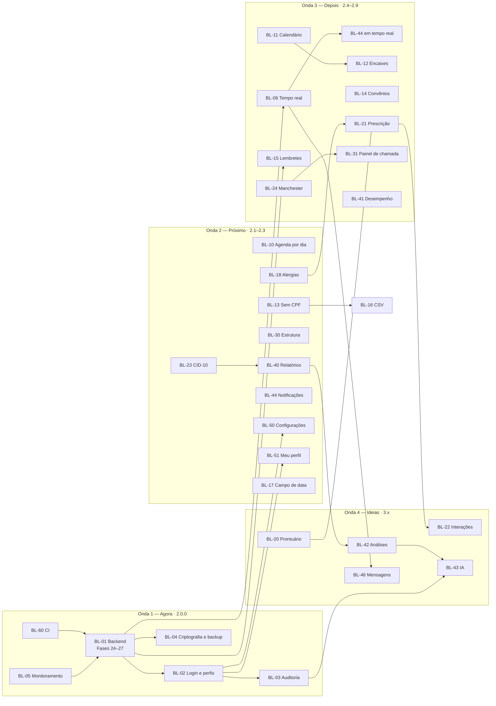
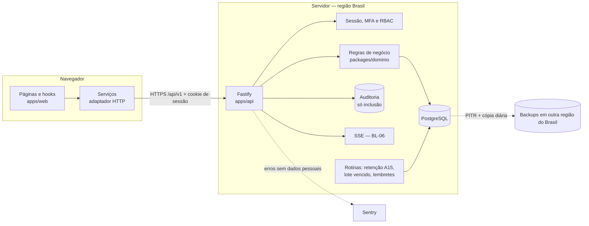

# 🧭 MediCore — Plano de Melhorias (Backlog 2.x)

> **Projeto:** MediCore · Operações Hospitalares
> **Escopo:** as **40 melhorias** do `BACKLOG_MEDICORE.md` (BL-01 a BL-61), separadas por processo:
> - **Onda 1 — Agora:** dados reais com segurança (integração contínua, monitoramento, backend, login, auditoria, criptografia). Versão **2.0.0**.
> - **Onda 2 — Próximo:** ganhos diretos no dia a dia (agenda, identificação, alergias, estrutura, CID-10, relatórios, notificações, configurações, perfil, datas). Versões **2.1** a **2.3**.
> - **Onda 3 — Depois:** extensões dos módulos e da agenda. Versões **2.4** a **2.9**.
> - **Onda 4 — Ideias:** itens que dependem de licença, parceiro ou validação clínica. Cada um começa com uma decisão de seguir ou não. Versão **3.x**.
>
> **Base:** continua o `docs/planos/PLANO_OPERACOES_MEDICORE.md` (Fases 15–21, versão 1.2.0). Por isso a numeração segue a partir da **Fase 22**, da decisão **D21**, do algoritmo **A18**, do erro **E-19** e do risco **RS-19**.
> **Plano de execução:** [`PLANO_EXECUCAO_MELHORIAS.md`](PLANO_EXECUCAO_MELHORIAS.md), com as tarefas por processo e os checkboxes
> **Estimativa total:** ~231 dias úteis (1 desenvolvedor). Onda 1: ~49 · Onda 2: ~47 · Onda 3: ~70 · Onda 4: ~65 (se todos os itens forem aprovados no "seguir ou não")
> **Decisões:** D21–D66 **propostas**, a aprovar no início de cada onda (ver [Decisões propostas](#-decisões-propostas)).
> **Versão do documento:** Revisão 1 — 12/11/2026

> ⚠️ **Dados reais só depois da Onda 1.** Até a versão 2.0.0, o MediCore continua sendo um ambiente de demonstração com dados fictícios (RS-01). Os itens clínicos (BL-20, BL-21, BL-22, BL-24) mudam o sistema de **administrativo** para **clínico** e exigem validação com profissionais de saúde e com o jurídico antes de começar.

---

## 📋 Sumário

**Visão geral**
1. [Como usar este documento](#-como-usar-este-documento)
2. [Análise do projeto na versão 1.2.0](#-análise-do-projeto-na-versão-120)
3. [Ondas, versões e painel de progresso](#-ondas-versões-e-painel-de-progresso)
4. [Dependências entre melhorias](#-dependências-entre-melhorias)
5. [Decisões propostas](#-decisões-propostas)
6. [Perfis de acesso](#-perfis-de-acesso)
7. [Glossário](#-glossário)

**Especificação transversal**

8. [Arquitetura alvo (backend)](#-arquitetura-alvo-backend)
9. [Contrato da API e erros](#-contrato-da-api-e-erros)
10. [Riscos e mitigações](#-riscos-e-mitigações)
11. [Estratégia de testes](#-estratégia-de-testes)
12. [Definição de pronto (por PR)](#-definição-de-pronto-por-pr)

**Processos por melhoria** (um bloco por item, com os processos numerados que geram as tarefas)

13. [Onda 1 — Agora](#onda-1--agora)
14. [Onda 2 — Próximo](#onda-2--próximo)
15. [Onda 3 — Depois](#onda-3--depois)
16. [Onda 4 — Ideias](#onda-4--ideias)
17. [Checklist final de aceite por onda](#-checklist-final-de-aceite-por-onda)
18. [Registro de decisões e observações](#-registro-de-decisões-e-observações)

---

## 🧭 Como usar este documento

- **Cada melhoria é uma fase** do plano de execução, com o mesmo código do backlog. A BL-01 (backend) é grande e foi dividida em quatro fases.
- **Cada melhoria tem processos numerados** (`BL-10.1`, `BL-10.2`…). Cada processo descreve quem faz, gatilho, campos, passos, regras, resultado e falhas, no mesmo roteiro do plano de operações (M32). **No plano de execução, cada processo vira uma etapa com as suas tarefas.**
- **Códigos novos** continuam a numeração dos planos anteriores:

  | Código | O que é | Neste plano |
  |---|---|---|
  | BL | Item do backlog | BL-01 a BL-61 (mesmo código do `BACKLOG_MEDICORE.md`) |
  | D | Decisões | D21–D66 |
  | R-xx | Regras | R-AU (autenticação), R-AD (auditoria), R-AG (agenda), R-ID (identificação), R-AL (alergias), R-ES (estrutura), R-RX (prescrição)… |
  | A | Algoritmos | A18 em diante |
  | E-xx | Erros | E-19 em diante |
  | RS | Riscos | RS-19 em diante |

- **Antes de cada onda:** aprove ou ajuste as decisões da onda. Várias delas mudam a arquitetura (D21–D35) ou dependem de contrato com terceiros (D47, D52, D60, D63).
- **Itens da Onda 4** começam por um processo "Seguir ou não" (`BL-xx.0`). Se a resposta for "não", a fase é marcada ⏸️ e volta para o backlog, com o motivo no Registro.
- **Ao fim de cada fase:** atualize o [painel](#-ondas-versões-e-painel-de-progresso), marque os checkboxes do plano de execução e registre os desvios no [Registro](#-registro-de-decisões-e-observações) e no `BACKLOG_MEDICORE.md` (✅ com a data).

---

## 🔎 Análise do projeto na versão 1.2.0

### O que existe e será reaproveitado

| Recurso | Onde está | Uso nas melhorias |
|---|---|---|
| **Camada de serviços** com as regras (cadastros, agenda, leitos, emergência, farmácia, indicadores, retenção) | `src/services/` (~6.000 linhas) | Passa a rodar no servidor (BL-01). As assinaturas continuam, então páginas e hooks quase não mudam |
| **Esquemas zod** (um por entidade e operação) | `src/schemas/` | Compartilhados entre o navegador e a API (D21, D22): a mesma validação nos dois lados |
| **Erros tipados** (`ErroValidacao`, `ErroConflito`, `ErroConcorrencia`, `ErroNaoEncontrado`, `ErroArmazenamento`) | `services/erros.ts` | Viram respostas HTTP 422, 409, 412, 404 e 507 e voltam a ser as mesmas classes no navegador |
| **Versão por registro (R-G1)** e transações multi-coleção | `services/repositorio.ts` | Viram `ETag`/`If-Match` e transações no banco, com restrições (D25) |
| **Invariantes INV-1 a INV-10** e o teste de 500 operações aleatórias | `utils/consistencia.ts`, `__tests__/invariantes.aleatorio.test.ts` | Rodam contra a API e viram restrições do banco onde dá (INV-3, INV-8) |
| **Autor (R-X9)** em eventos e movimentações | Tipos dos módulos | Passa a ser o usuário da sessão (BL-02), sem mudar o formato |
| **Hooks reativos** (`useColecao`) | `hooks/` | Recarregam depois das gravações e, até o BL-06, por consulta periódica |
| **Textos centralizados** por módulo | `src/i18n/` | Base para outros idiomas (BL-52) |
| **Testes**: 672 Vitest, 139 Playwright, axe, teclado, cenários 1 a 10 | `src/__tests__/`, `e2e/` | Rodam na integração contínua (BL-60) e contra a API (BL-01) |
| **Pacote inicial medido** (`pacote:medir`, 153,6 kB) | `scripts/medir-pacote.ts` | Continua no fechamento de cada fase. Teto: +5 kB por onda |

### O que precisa mudar (pontos de atenção)

| # | Situação na 1.2.0 | Impacto | Onde o plano resolve |
|---|---|---|---|
| 1 | Os dados ficam só no navegador, com limite prático de 600 pacientes + 2.000 consultas com os módulos no teto (73% de ~5 MB) | Sem compartilhamento entre pessoas, sem backup, e com tetos baixos por coleção | BL-01 (Fases 24–27) |
| 2 | Não há login; `autor` = "Usuário de demonstração" | Ninguém responde pelas ações; dados sensíveis sem proteção | BL-02, BL-03 |
| 3 | O push no GitHub depende de uma pessoa, e não há integração contínua; a `main` publica na Vercel a cada push | Publicar com teste quebrado; PRs acumulados (lição do Encerramento) | BL-60 (Fase 22), BL-61 |
| 4 | Erros só são vistos por quem os encontra | Problemas em produção passam despercebidos | BL-05 (Fase 23) |
| 5 | O médico tem um único horário para todos os dias; não há bloqueios (férias, feriados) | O pedido mais provável de quem usa a agenda | BL-10 |
| 6 | CPF obrigatório (R-P1) | Recém-nascido, estrangeiro e quem só tem CNS não podem ser internados | BL-13 |
| 7 | Alergias em texto livre; o alerta da farmácia (A10) compara texto | Falso negativo possível; base insuficiente para a prescrição | BL-18 (antes do BL-21) |
| 8 | Setores e leitos fixos no código (`config/setores.ts`, D10) | Não dá para abrir um leito ou um setor novo | BL-30 |
| 9 | Diagnóstico e motivo em texto livre | Não dá para fazer relatório por diagnóstico | BL-23 (antes do BL-40) |
| 10 | `/analises`, `/configuracoes` e `/perfil` estão "em construção"; o sino, a busca e as mensagens do cabeçalho são só visuais; "Desempenho por departamento" é simulado | Partes da interface sem função | BL-42, BL-50, BL-51, BL-44, BL-45, BL-46, BL-41 |
| 11 | Parâmetros operacionais (tempos-alvo, retenção, limites) em `config/limites.ts` | Mudar um parâmetro exige nova versão | BL-50 |
| 12 | Campo de data nativo (`mm/dd/aaaa` em navegadores em inglês) | Erro de leitura de datas | BL-17 |
| 13 | Pendências manuais da 1.2.0 (NVDA, revisão de termos e mensagens, testes com duas abas, teste da URL) | Verificações ainda sem uma pessoa | Etapa 0 do plano de execução (não são melhorias, mas entram antes) |

---

## 📊 Ondas, versões e painel de progresso

| Fase | Melhoria | Onda | Esforço | Dias | Versão | Status |
|:---:|---|:---:|:---:|:---:|:---:|:---:|
| 22 | BL-60 Integração contínua no GitHub | 1 | P | 2 | 1.2.1 | ⬜ |
| 23 | BL-05 Monitoramento de erros | 1 | P | 2 | 1.2.2 | ⬜ |
| 24 | BL-01 Backend (1/4): fundação, banco e contrato | 1 | G | 8 | — | ⬜ |
| 25 | BL-01 Backend (2/4): cadastros e agenda no servidor | 1 | G | 7 | — | ⬜ |
| 26 | BL-01 Backend (3/4): leitos, emergência e farmácia no servidor | 1 | G | 9 | — | ⬜ |
| 27 | BL-01 Backend (4/4): o navegador passa a usar a API | 1 | M | 5 | — | ⬜ |
| 28 | BL-02 Autenticação e perfis de acesso | 1 | G | 8 | — | ⬜ |
| 29 | BL-03 Auditoria de acesso (LGPD) | 1 | M | 4 | — | ⬜ |
| 30 | BL-04 Criptografia, backup e guarda dos dados | 1 | M | 4 | 2.0.0 | ⬜ |
| 31 | BL-10 Horários por dia da semana e bloqueios de agenda | 2 | M | 6 | 2.1.0 | ⬜ |
| 32 | BL-13 Pacientes sem CPF | 2 | M | 5 | 2.1.0 | ⬜ |
| 33 | BL-18 Cadastro estruturado de alergias | 2 | M | 6 | 2.1.0 | ⬜ |
| 34 | BL-30 Cadastro da estrutura hospitalar | 2 | M | 5 | 2.2.0 | ⬜ |
| 35 | BL-23 CID-10 na internação e na emergência | 2 | M | 4 | 2.2.0 | ⬜ |
| 36 | BL-40 Relatórios gerenciais com exportação | 2 | M | 7 | 2.2.0 | ⬜ |
| 37 | BL-44 Notificações no sino do cabeçalho | 2 | M | 4 | 2.3.0 | ⬜ |
| 38 | BL-50 Tela de Configurações | 2 | M | 6 | 2.3.0 | ⬜ |
| 39 | BL-51 Tela "Meu perfil" | 2 | P | 2 | 2.3.0 | ⬜ |
| 40 | BL-17 Campo de data próprio | 2 | P | 2 | 2.3.0 | ⬜ |
| 41 | BL-61 Revisão por pull request (proteção da `main`) | 3 | P | 0,5 | — | ⬜ |
| 42 | BL-06 Atualização em tempo real entre usuários | 3 | M | 5 | 2.4.0 | ⬜ |
| 43 | BL-11 Calendário semanal e mensal | 3 | M | 5 | 2.4.0 | ⬜ |
| 44 | BL-12 Encaixes e lista de espera | 3 | M | 4 | 2.4.0 | ⬜ |
| 45 | BL-14 Convênios e procedimentos | 3 | M | 5 | 2.5.0 | ⬜ |
| 46 | BL-15 Lembretes por WhatsApp, SMS ou e-mail | 3 | G | 9 | 2.5.0 | ⬜ |
| 47 | BL-16 Importação e exportação CSV | 3 | M | 4 | 2.5.0 | ⬜ |
| 48 | BL-21 Prescrição eletrônica e aprazamento | 3 | G | 12 | 2.6.0 | ⬜ |
| 49 | BL-24 Protocolo de classificação de risco com fluxogramas | 3 | M | 6 | 2.7.0 | ⬜ |
| 50 | BL-31 Painel de chamada da emergência | 3 | M | 3 | 2.7.0 | ⬜ |
| 51 | BL-32 Dispensação ambulatorial | 3 | M | 3 | 2.8.0 | ⬜ |
| 52 | BL-34 Inventário com código de barras | 3 | M | 4 | 2.8.0 | ⬜ |
| 53 | BL-35 Gráfico da evolução dos sinais vitais | 3 | P | 1 | 2.8.0 | ⬜ |
| 54 | BL-36 Ícones por tipo na linha do tempo do Painel | 3 | P | 1 | 2.8.0 | ⬜ |
| 55 | BL-41 "Desempenho por departamento" com dados reais | 3 | M | 3 | 2.9.0 | ⬜ |
| 56 | BL-45 Busca global no cabeçalho | 3 | M | 4 | 2.9.0 | ⬜ |
| 57 | BL-07 PWA com uso offline básico | 4 | M | 6 | 3.x | ⬜ |
| 58 | BL-20 Prontuário eletrônico | 4 | G | 15 | 3.x | ⬜ |
| 59 | BL-22 Interações medicamentosas | 4 | G | 6 | 3.x | ⬜ |
| 60 | BL-33 Compras e fornecedores | 4 | G | 9 | 3.x | ⬜ |
| 61 | BL-42 Tela de Análises | 4 | G | 8 | 3.x | ⬜ |
| 62 | BL-43 Assistente com IA sobre dados reais | 4 | G | 8 | 3.x | ⬜ |
| 63 | BL-46 Central de mensagens | 4 | G | 8 | 3.x | ⬜ |
| 64 | BL-52 Outros idiomas | 4 | M | 5 | 3.x | ⬜ |

Legenda: ⬜ Não iniciada · 🟨 Em andamento · ✅ Concluída · 🟥 Bloqueada · ⏸️ Adiada (decisão "não seguir")

> **Ordem dentro da onda:** a ordem acima respeita as dependências. Itens sem dependência entre si (ex.: BL-13 e BL-18; BL-11 e BL-12) podem ser feitos em paralelo por duas pessoas.
> **BL-61 adiantável:** é meio dia de configuração no GitHub e combina com a BL-60. Se quiser, faça logo depois da Fase 22.

---

## 🔗 Dependências entre melhorias

| Melhoria | Depende de | Por quê |
|---|---|---|
| BL-01 | BL-60, BL-05 | Migrar a camada de dados sem integração contínua e sem monitoramento é o maior risco do plano |
| BL-02, BL-04 | BL-01 | Sessão, perfis, criptografia e backup só existem com servidor |
| BL-03 | BL-01, BL-02 | A auditoria registra **quem**; sem login, não há quem |
| BL-50, BL-51 | BL-02 | Só administradores mudam parâmetros; o perfil é do usuário logado |
| BL-40 | BL-23 | O relatório por diagnóstico precisa do CID-10 |
| BL-21 | BL-18 | A prescrição confere alergias estruturadas |
| BL-22 | BL-21 | Interação é entre itens prescritos |
| BL-31 | BL-06 (recomendado) | O painel da TV precisa atualizar sozinho |
| BL-12 | BL-11 (recomendado) | O encaixe é feito na visão de calendário |
| BL-16 | BL-13 | A importação precisa aceitar os novos tipos de documento |
| BL-43 | BL-03, BL-42 | Dados sensíveis só com auditoria e com as análises definidas |
| BL-46 | BL-01, BL-02, BL-06 | Mensagens são entre usuários, em tempo real |

---
## ✅ Decisões propostas

> **Propostas, a aprovar no início de cada onda.** A coluna "Recomendação" é a escolha usada no restante do plano. Se uma decisão mudar, ajuste as seções indicadas em "Onde impacta" antes de começar a fase.

### Onda 1 — Agora

| # | Decisão | Recomendação | Alternativas | Por quê | Onde impacta |
|---|---|---|---|---|---|
| D21 | Tecnologia do backend | **Node.js 22 + TypeScript + Fastify**, com **PostgreSQL 16** e **Drizzle ORM** (migrações versionadas) | NestJS; Python + FastAPI; BaaS (Supabase) | Reaproveita os esquemas zod, os tipos e boa parte das regras dos serviços. Fastify é leve e tem validação por esquema. Drizzle gera SQL legível e migrações revisáveis | BL-01, Fases 24–27 |
| D22 | Organização do código | **Monorepo com workspaces do npm**: `apps/web` (o app atual), `apps/api` e `packages/dominio` (tipos, esquemas zod, algoritmos puros de `utils/` e textos de erro) | Dois repositórios; copiar os esquemas | Uma mudança de regra vale para os dois lados no mesmo PR; os testes dos algoritmos continuam num lugar só | Fase 24 |
| D23 | Hospedagem e região | **API e banco em região do Brasil** (São Paulo) num provedor com PostgreSQL gerenciado, backup automático e criptografia em repouso. O frontend continua na Vercel | API na Vercel (funções) com banco fora do Brasil | LGPD: dados de saúde preferencialmente no país; latência menor para os hospitais. Validar o contrato com o jurídico (operador de dados) | BL-01, BL-04 |
| D24 | Contrato da API | **REST + JSON em `/api/v1`**, com **OpenAPI gerado dos esquemas zod**. Erros no formato da tabela [Contrato](#-contrato-da-api-e-erros) | GraphQL; tRPC | REST é simples de auditar e de consumir por integrações futuras (BL-14, BL-15). O OpenAPI documenta e gera testes de contrato | BL-01 |
| D25 | Concorrência e invariantes | **Versão otimista com `ETag`/`If-Match`** (a R-G1 de hoje) + **transações no banco** e **restrições** onde a regra é de dado: `UNIQUE` (CPF, CRM, código do leito), `CHECK` (estoque ≥ 0), `EXCLUDE` (consultas sobrepostas por médico), índice único parcial (uma internação ativa por paciente e por leito) | Só validação na aplicação; bloqueio pessimista | O banco garante o que hoje as invariantes conferem; duas pessoas nunca gravam em dobro | Fases 24–26 |
| D26 | Ver as mudanças de outras pessoas (antes do BL-06) | **Recarregar depois de cada gravação própria + consulta a cada 30 s** nas telas que já assinam coleções (fila, mapa, estoque, Painel) | Tempo real já na Onda 1 | Mantém a Onda 1 menor. O tempo real (SSE) é o BL-06 | Fase 27 |
| D27 | Dados que hoje estão no navegador | **Não migrar.** Os dados atuais são fictícios. O banco nasce com os dados de exemplo (mesma semeadura) num ambiente **de demonstração**, separado do ambiente **real**, que nasce vazio | Exportar o `localStorage` e importar na conta | Dados fictícios não devem entrar no banco real; a migração complica o corte sem ganho | Fase 27 |
| D28 | Ambientes | **Local** (Docker Compose), **prévia por PR**, **homologação**, **demonstração** (dados fictícios, aberto) e **produção** (dados reais, só com login). Cada um com o seu banco | Só produção e local | Separar demonstração de produção é o que permite usar dados reais com segurança | Fases 24, 27, 30 |
| D29 | Autenticação | **Login próprio na API**: e-mail + senha (Argon2id), sessão em cookie `HttpOnly`/`Secure`/`SameSite=Lax` com expiração por inatividade (30 min) e absoluta (12 h), **MFA por TOTP obrigatório** para Administrador e Gestão, bloqueio progressivo após tentativas. **Preparado para SSO (OIDC)** depois | Provedor gerenciado (Auth0, Keycloak, Cognito); só SSO do hospital | Sem custo por usuário, sem dependência externa na 2.0; o OIDC entra quando houver o servidor de identidade do hospital | BL-02 |
| D30 | Perfis e permissões | **RBAC com 7 perfis** (Administrador, Recepção, Enfermagem, Médico, NIR, Farmácia, Gestão), permissões por **ação** (ver [Perfis de acesso](#-perfis-de-acesso)). Um usuário pode ter mais de um perfil. O perfil Médico é ligado ao cadastro do médico | Permissões por tela; perfis livres | A matriz de papéis já existe no plano de operações; ação é mais segura que tela (a API confere cada chamada) | BL-02, BL-03 |
| D31 | Autor dos registros | O `autor` (R-X9) passa a ser `{ usuarioId, nome }` da sessão. Os registros antigos mantêm o texto "Usuário de demonstração" | Apagar o histórico antigo | Não muda o formato; o histórico continua legível | BL-02 |
| D32 | Auditoria | **Tabela só de inclusão** (sem `UPDATE` nem `DELETE` para o usuário da aplicação), com quem, quando, de onde (IP, agente), ação, registro, **campos alterados (antes → depois)** e **leituras de dados sensíveis** (abrir cadastro, ver CPF completo, ver alergias, exportar). Guarda: **a validar com o jurídico** (proposta: 5 anos para acessos; os registros clínicos seguem o prazo do prontuário) | Log em arquivo; só gravações | A LGPD pede rastrear acesso a dado sensível; tabela só de inclusão é verificável | BL-03 |
| D33 | Criptografia e backup | **TLS 1.2+** em tudo; **criptografia em repouso** do banco gerenciado; **criptografia de campo** para CPF, CNS, documento, telefone e e-mail (chave no serviço de chaves do provedor; busca por CPF via hash com sal). **Backup**: recuperação a um ponto no tempo (7 dias) + cópia diária guardada por 35 dias em outra região do Brasil + **teste de restauração mensal** | Só a criptografia do disco | Vazamento de uma cópia do banco não expõe os identificadores; restauração testada é a única garantia de backup | BL-04 |
| D34 | Monitoramento de erros | **Sentry** (navegador e API) com **remoção de dados pessoais** antes do envio (nomes, CPF, e-mail, telefone, alergias, corpo das requisições) e amostragem de desempenho de 10% | GlitchTip (autohospedado); só logs | Funciona antes do backend (só o navegador) e depois; a remoção de dados pessoais é configurável e testável | BL-05 |
| D35 | Integração contínua | **GitHub Actions** com `lint`, `format:check`, `i18n:verificar`, `test:coverage`, `build`, `pacote:medir` e `test:e2e` (Chromium) em todo PR; a Vercel só publica a `main` com tudo verde | Outro serviço de CI | Já é onde está o código; o e2e roda em ~11 min | BL-60, BL-61 |

### Onda 2 — Próximo

| # | Decisão | Recomendação | Alternativas | Por quê | Onde impacta |
|---|---|---|---|---|---|
| D36 | Disponibilidade do médico | **Janelas por dia da semana** (cada dia com 0 a N janelas `{inicio, fim}` e duração da consulta) + **bloqueios por período** (férias, congresso, feriado do hospital ou de um médico). Consultas atingidas por um bloqueio **não são canceladas sozinhas**: aparecem numa lista para reagendar | Escala mensal completa | Cobre o pedido mais comum sem montar uma escala; preserva a regra de nunca cancelar sozinho | BL-10 |
| D37 | Identificação do paciente | **Documento principal com tipo**: CPF (preferencial), CNS, passaporte, RNE/CRNM, ou "sem documento" (recém-nascido vinculado à mãe ou ao responsável, ou paciente não identificado da emergência que precisa internar). Unicidade por tipo + número | Gerar CPF provisório | Cobre os casos reais sem inventar CPF; o CNS tem dígito verificador | BL-13 |
| D38 | Alergias | **Lista estruturada**: substância (do catálogo de princípios ativos e classes da farmácia, ou texto livre marcado como "não codificada"), tipo (medicamento, alimento, látex, contraste, outro), reação, gravidade (leve, moderada, grave, anafilaxia), situação (ativa, inativa) e origem (relatada, confirmada). **"Sem alergias conhecidas"** passa a ser um estado explícito. O texto livre antigo vira itens "a revisar" | Manter o texto e só melhorar a comparação | O alerta da farmácia passa a comparar códigos (A10 vira A18), e a prescrição (BL-21) depende disso | BL-18, BL-21 |
| D39 | Estrutura hospitalar | **Setores, quartos e leitos editáveis** pela tela, com **desativação** em vez de exclusão. Não se desativa leito ocupado, reservado ou em higienização. O código do leito é único e não muda depois do primeiro uso | Edição só por migração de banco | É o pedido natural do NIR; a desativação preserva o histórico | BL-30 |
| D40 | Diagnóstico | **CID-10** da tabela oficial do DATASUS (domínio público), com busca por código ou descrição; **CID principal obrigatório** na alta e no desfecho de internação e transferência, **secundários opcionais**; o texto livre continua como complemento. CID-11 fica para depois | CID-11 já agora | O CID-10 é o exigido hoje nos sistemas do SUS e dos convênios | BL-23, BL-40 |
| D41 | Relatórios | **Gerados no servidor**, com filtro de período e setor, em tela e para baixar em **CSV** (UTF-8 com BOM, separador `;`, para abrir certo no Excel em português), **XLSX** e **PDF**. Acesso: Gestão e Administrador; Farmácia vê os da farmácia | Exportar só o que está na tela | Os números batem com o Painel e com os indicadores (mesmas funções); o CSV abre certo no Excel brasileiro | BL-40 |
| D42 | Notificações | **Derivadas no servidor** a partir dos alertas (A12), do estoque baixo, dos pedidos de leito e de eventos dirigidos a um usuário; **"lida" por usuário**. Até o BL-06, o sino consulta a cada 30 s | Notificações gravadas uma a uma | Não duplica regra: o alerta já existe; o servidor só guarda quem leu | BL-44, BL-06 |
| D43 | Parâmetros | **Parâmetros no banco**, com tipo, faixa válida, valor padrão e **histórico de alterações** (auditado). Só Administrador altera; a mudança vale a partir da próxima operação | Arquivo de configuração por ambiente | Mudar um tempo-alvo ou uma retenção não precisa de nova versão | BL-50 |
| D44 | Campo de data | **Componente próprio** `dd/mm/aaaa` com máscara, validação e calendário em diálogo acessível (padrão de seletor de data do WAI-ARIA), usado em todos os formulários | Biblioteca pronta | O campo nativo depende do idioma do navegador; o próprio garante o formato brasileiro | BL-17 |

### Ondas 3 e 4 — Depois e Ideias

| # | Decisão | Recomendação | Por quê | Onde impacta |
|---|---|---|---|---|
| D45 | Tempo real | **Server-Sent Events** com canais por coleção e por usuário; reconexão automática; a consulta de 30 s (D26) continua como reserva | SSE é simples, passa por proxies e basta para "o servidor avisa" | BL-06, BL-44, BL-31, BL-46 |
| D46 | Calendário | Visões **dia, semana e mês** com arrastar para reagendar e **alternativa por teclado** (diálogo "Mover para…") | Arrastar não é acessível sozinho | BL-11 |
| D47 | Encaixe e lista de espera | **Encaixe** fora da grade com aviso de sobreposição e justificativa; **lista de espera** por médico ou especialidade; ao liberar um horário, a lista é **avisada** (não agenda sozinha) | Evita agendamento automático sem confirmação | BL-12 |
| D48 | Convênios | **Cadastro de operadoras e planos** (com o registro na ANS), procedimentos pela **TUSS** e regras simples de autorização. A guia TISS completa fica para depois | Tira o convênio do texto livre sem entrar no faturamento | BL-14 |
| D49 | Lembretes | **Provedor de mensagens contratado** (WhatsApp Business por um provedor oficial, SMS e e-mail), **só com consentimento de contato** registrado, horário permitido (8h–20h) e descadastro em um passo | Mensagem a paciente exige consentimento e provedor oficial | BL-15 |
| D50 | Importação CSV | **Pré-visualização com validação por linha** antes de gravar; grava só as linhas válidas numa transação; relatório de erros para baixar | Nada é gravado sem a pessoa ver o resultado | BL-16 |
| D51 | Prescrição | **Prescrição estruturada** (medicamento do catálogo, dose, unidade, via, frequência, duração, "se necessário"), **aprazamento** gerado pela frequência e **checagem de administração** pela enfermagem; a dispensação passa a partir da prescrição. **Assinatura**: por login + confirmação; assinatura digital ICP-Brasil fica como decisão do jurídico | É a passagem de administrativo para clínico; exige validação com médicos, enfermagem e farmácia antes de começar | BL-21 |
| D52 | Protocolo de classificação | **Seguir ou não** depende de **licença** do Protocolo de Manchester (ou de outro protocolo licenciado) e de treinamento. Sem licença, a triagem continua com a cor escolhida pelo profissional (D8) | O protocolo é licenciado | BL-24 |
| D53 | Painel de chamada | Tela pública para TV com **chamada por número do atendimento e sala**, nunca pelo nome; tempo médio de espera por cor; sem dados clínicos | Privacidade na sala de espera | BL-31 |
| D54 | Dispensação ambulatorial | Destino "ambulatorial" com **receita obrigatória** (número, data, prescritor) e as mesmas regras de controlado (R-F7) | Hoje a R-F12 impede | BL-32 |
| D55 | Código de barras | Leitura por leitor USB (que digita) ou pela **câmera** (API de detecção de código de barras do navegador, com alternativa digitada); padrão **GS1 DataMatrix** (rastreabilidade de medicamentos da ANVISA) para lote e validade | O leitor USB funciona sem programação extra; a câmera ajuda no celular | BL-34 |
| D56 | "Desempenho por departamento" | **Só liga depois de a Gestão definir o indicador.** Proposta: consultas realizadas ÷ agendadas no mês, por departamento | Card sem definição engana | BL-41 |
| D57 | Busca global | **Busca no servidor**, que respeita as permissões do perfil; resultados agrupados; atalho `Ctrl+K`; CPF só para quem pode ver | Não expõe o que o perfil não pode ver | BL-45 |
| D58 | Uso offline | **Só leitura offline** (dados recentes já abertos) na primeira versão; gravação offline exige tratamento de conflitos e fica fora | Gravar offline com vários usuários gera conflitos | BL-07 |
| D59 | Prontuário | **Seguir ou não** depende de validação com a direção clínica, o jurídico (CFM, guarda de 20 anos) e a assinatura digital | É um produto clínico em si | BL-20 |
| D60 | Interações medicamentosas | **Seguir ou não** depende de **base licenciada e mantida** (não criar à mão) | Base errada é risco ao paciente | BL-22 |
| D61 | Compras | Fornecedores, **pedido sugerido** (estoque mínimo + consumo médio dos últimos 90 dias) e recebimento ligado à entrada de lote (F2) | Fecha o ciclo da farmácia sem virar um ERP | BL-33 |
| D62 | Análises | Séries históricas a partir dos **resumos mensais** e dos relatórios (BL-40), com comparação entre períodos | Reaproveita o que já é calculado | BL-42 |
| D63 | Assistente com IA | **Seguir ou não** depende de avaliação jurídica; só com dados **agregados e anonimizados**, sem decisão clínica, com registro na auditoria | Dados de saúde são sensíveis | BL-43 |
| D64 | Mensagens entre setores | Conversas por setor e diretas, **sem dados clínicos em texto livre** (aviso na tela), guardadas e auditadas | Evita prontuário paralelo | BL-46 |
| D65 | Outros idiomas | **Espanhol e inglês**, troca pelo usuário; datas e números pelo idioma; o formato brasileiro continua padrão | Os textos já estão em `src/i18n` | BL-52 |
| D66 | Ícones na linha do tempo | Ícone por **grupo** de atividade (leitos, emergência, farmácia, agenda, cadastros), com a cor de hoje; comparar com a referência visual antes | Mantém o visual próximo da referência da Fase 14 | BL-36 |

---

## 👥 Perfis de acesso

A matriz abaixo é a base do RBAC (D30). "Ver" inclui abrir o detalhe; dados sensíveis (CPF completo, alergias, CID) ficam registrados na auditoria (BL-03).

| Ação | Administrador | Recepção | Enfermagem | Médico | NIR | Farmácia | Gestão |
|---|:---:|:---:|:---:|:---:|:---:|:---:|:---:|
| Usuários, perfis e parâmetros (BL-02, BL-50) | ✅ | | | | | | |
| Cadastrar e editar paciente | ✅ | ✅ | ✅ | ✅ | | | |
| Ver CPF completo | ✅ | ✅ | | ✅ | | | |
| Cadastrar e editar médico; disponibilidade e bloqueios (BL-10) | ✅ | ✅ | | | | | ✅ |
| Agendar, reagendar, cancelar; lista de espera (BL-12) | ✅ | ✅ | | ✅ | | | |
| Chegada e identificação na emergência (E1, E7) | ✅ | ✅ | ✅ | | | | |
| Triagem, reavaliação (E2, E10) | | | ✅ | ✅ | | | |
| Chamar, observação, desfecho, pedir leito (E3–E6), reabrir (E9) | | | ✅ | ✅ | | | ✅ (E9) |
| Internar, transferir, editar, alta, desfazer alta (L1–L3, L7, L8) | | | | ✅ | ✅ | | ✅ (L3, L8) |
| Higienização (L4) | | | ✅ | | ✅ | | |
| Bloquear leito, pedidos de leito (L5, L6, L9) | | | | | ✅ | | ✅ |
| Estrutura hospitalar (BL-30) | ✅ | | | | ✅ | | ✅ |
| Prescrever (BL-21) | | | | ✅ | | | |
| Aprazar e checar administração (BL-21) | | | ✅ | | | | |
| Catálogo, lotes, entrada, ajuste, descarte, inventário (F1, F2, F5–F7, F9, BL-34) | | | | | | ✅ | |
| Dispensar, devolver, estornar (F3, F4, F8, BL-32) | | | | | | ✅ | |
| Compras e fornecedores (BL-33) | | | | | | ✅ | ✅ |
| Relatórios e análises (BL-40, BL-42) | ✅ | | | | | ✅ (farmácia) | ✅ |
| Consultar a auditoria (BL-03) | ✅ | | | | | | ✅ |
| Painel e listas (somente leitura) | ✅ | ✅ | ✅ | ✅ | ✅ | ✅ | ✅ |

---

## 📖 Glossário

| Termo | Significado neste plano |
|---|---|
| **Onda** | Grupo de melhorias com o mesmo horizonte do backlog, entregue em uma ou mais versões |
| **Processo** | Um fluxo de trabalho completo de uma melhoria (`BL-10.2 — Registrar bloqueio de agenda`). No plano de execução, cada processo vira uma etapa com as suas tarefas |
| **Seguir ou não** | Primeiro processo (`BL-xx.0`) dos itens da Onda 4: confere licença, parceiro, validação clínica e jurídica antes de qualquer código |
| **RBAC** | Controle de acesso por perfil: cada ação exige uma permissão, e cada perfil reúne permissões |
| **MFA / TOTP** | Segundo fator de autenticação por código de 6 dígitos gerado num aplicativo (ex.: Google Authenticator) |
| **ETag / If-Match** | Versão do registro enviada pelo servidor e devolvida na gravação; diferença dá 412 (E-05) |
| **SSE** | Server-Sent Events: o servidor envia avisos ao navegador por uma conexão aberta |
| **PITR** | Recuperação a um ponto no tempo do banco de dados |
| **CNS** | Cartão Nacional de Saúde (15 dígitos, com dígito verificador) |
| **CID-10** | Classificação Internacional de Doenças, 10ª revisão (tabela do DATASUS) |
| **TUSS / TISS** | Terminologia e padrão de troca de informações da saúde suplementar (ANS) |
| **GS1 DataMatrix** | Código bidimensional das embalagens de medicamentos, com produto, lote e validade |
| **Aprazamento** | Distribuição dos horários de administração de uma prescrição |

---

## 🏗️ Arquitetura alvo (backend)

- **O que muda no navegador:** só a camada `src/services/`. Cada função mantém a assinatura e passa a chamar a API (o README já descreve o padrão). Os hooks (`useColecao`) recarregam depois da gravação e, até o BL-06, a cada 30 s nas telas operacionais.
- **O que vai para o servidor:** as regras e as transações (hoje em `services/*.ts`), a retenção (A15) e a rotina diária, os indicadores (A12–A14) e a verificação das invariantes (A17), que passa a rodar como rotina noturna com alerta no monitoramento.
- **O que vai para `packages/dominio`:** tipos, esquemas zod, algoritmos puros (`fila`, `fefo`, `alergia`, `compatibilidade-leito`, `tempos`, `sinais-vitais`, `consistencia`) e os textos de erro.
- **Banco:** uma tabela por coleção de hoje (pacientes, médicos, consultas, atividades, leitos, internações, solicitações, atendimentos, medicamentos, lotes, movimentações, dispensações, resumos), com as listas aninhadas que são só do registro (eventos, triagens, itens) em JSONB e as relações em chaves estrangeiras. A retenção da D15 continua para os resumos mensais, mas os tetos por coleção deixam de existir (o limite era do navegador).
- **Restrições no banco (D25):**

  | Regra de hoje | Restrição |
  |---|---|
  | CPF, CRM (número + UF), e-mail do médico, código do leito únicos | `UNIQUE` |
  | Uma internação ativa por paciente e por leito (R-L1) | índice único parcial `WHERE status = 'ativa'` |
  | Um atendimento aberto por paciente (R-E10) | índice único parcial `WHERE status <> 'encerrado'` |
  | Consultas do mesmo médico não se sobrepõem (A1/A2) | `EXCLUDE USING gist (medico_id WITH =, periodo WITH &&) WHERE status = 'agendada'` |
  | Estoque do lote nunca negativo (INV-8) | `CHECK (quantidade_atual >= 0)` |
  | Número do atendimento único no dia (R-E1) | `UNIQUE (dia, numero)` |
  | Movimentações e auditoria imutáveis (R-F9, D32) | sem permissão de `UPDATE`/`DELETE` para o usuário da aplicação |

---

## 🔌 Contrato da API e erros

| Situação | HTTP | Corpo | Classe no navegador | Erro |
|---|---|---|---|---|
| Campo inválido | 422 | `{ codigo: 'validacao', campos: { cpf: 'Informe um CPF válido' } }` | `ErroValidacao` | E-01 |
| Duplicado, regra de negócio, transição inválida | 409 | `{ codigo, mensagem, campo?, detalhes? }` | `ErroConflito` | E-02, E-04, E-11–E-18 |
| Versão diferente | 412 | `{ codigo: 'versao', versaoAtual }` | `ErroConcorrencia` | E-05 |
| Não encontrado | 404 | `{ codigo: 'nao_encontrado' }` | `ErroNaoEncontrado` | E-08 |
| Sem sessão ou sessão expirada | 401 | `{ codigo: 'sessao' }` | `ErroSessao` (nova) | **E-19** |
| Sem permissão para a ação | 403 | `{ codigo: 'permissao', acao }` | `ErroPermissao` (nova) | **E-20** |
| Muitas tentativas de login | 429 | `{ codigo: 'limite', aguardarSegundos }` | `ErroLimite` (nova) | **E-21** |
| Servidor indisponível ou sem rede | — | — | `ErroRede` (nova) | **E-22** |
| Erro inesperado | 500 | `{ codigo: 'interno', id }` (o `id` liga ao Sentry) | `Error` | E-09 |

**Mensagens novas**

| Código | Mensagem | Recuperação |
|---|---|---|
| E-19 | "Sua sessão terminou. Entre de novo para continuar." | Diálogo de login sem sair da tela; o formulário em edição é mantido |
| E-20 | "Seu perfil não permite {ação}. Fale com o administrador." | O botão nem aparece quando o perfil não permite; a mensagem cobre chamadas diretas |
| E-21 | "Muitas tentativas. Tente de novo em {n} minutos." | Espera progressiva; o administrador pode desbloquear |
| E-22 | "Sem conexão com o servidor. Suas alterações não foram salvas." | Botão "Tentar de novo"; nada é gravado pela metade |

---

## ⚠️ Riscos e mitigações

| # | Risco | Prob. | Impacto | Mitigação |
|---|---|:---:|:---:|---|
| RS-19 | A migração para o backend quebra regras que hoje funcionam (transações, invariantes, abas) | Média | Alto | Fases 24–27 com a **mesma suíte** de testes de serviço rodando contra a API; invariantes como restrições no banco; o teste de 500 operações aleatórias contra a API |
| RS-20 | Dados reais entram antes de a segurança estar pronta | Média | Alto | Produção com dados reais **só depois da Fase 30** (2.0.0); até lá, só o ambiente de demonstração |
| RS-21 | Contrato com provedor (hospedagem, mensagens, licenças) atrasa | Média | Médio | Decisões D23, D49, D52, D60 levantadas no início de cada onda; as Fases 24–27 rodam em Docker local enquanto o contrato não sai |
| RS-22 | Desempenho pior que o do `localStorage` (latência de rede) | Média | Médio | Paginação no servidor, índices, cache de requisições no navegador, metas de p95 < 300 ms por chamada e Lighthouse ≥ 90 |
| RS-23 | Funcionalidades clínicas (BL-20, BL-21, BL-22, BL-24) usadas sem validação | Baixa | Alto | Processo "Seguir ou não" com aprovação clínica e jurídica registrada; avisos de escopo nas telas |
| RS-24 | Mensagens e lembretes sem consentimento | Baixa | Alto | Consentimento de contato obrigatório, descadastro em um passo, horário permitido (D49) |
| RS-25 | Perfis mal configurados dão acesso demais | Média | Alto | Permissões negadas por padrão; testes de permissão para cada ação × perfil; auditoria de mudanças de perfil |
| RS-26 | Pacote inicial cresce com login, notificações e busca | Média | Médio | `pacote:medir` em toda fase; teto de +5 kB por onda; telas novas sob demanda |
| RS-27 | Escopo grande (40 itens) | Alta | Médio | Ondas com versão própria; cada fase é um PR; a Onda 4 só entra com "seguir" aprovado |

---

## 🧪 Estratégia de testes

| Nível | Ferramenta | O que cobre | Meta |
|---|---|---|---|
| Domínio | Vitest | Algoritmos novos (A18–A27) e os de hoje, em `packages/dominio` | ≥ 90% |
| Serviços na API | Vitest + PostgreSQL em contêiner (Testcontainers) | Cada regra, transação e restrição; concorrência real (duas transações); invariantes depois de cada operação | ≥ 85% |
| Contrato | Vitest + OpenAPI | Cada rota responde no formato do contrato; erros com o código certo | 100% das rotas |
| Permissões | Vitest | Cada ação × perfil: permitido e negado (E-20) | 100% da matriz |
| Componentes e páginas | Testing Library | Telas novas e alteradas | `components/ui/` ≥ 70% |
| Ponta a ponta | Playwright + API local | Cenários 1 a 10 de hoje contra a API, mais os novos de cada fase | Verde 3 vezes seguidas |
| Acessibilidade | axe + teclado | Rotas e diálogos novos, nos dois temas e em 375 px | 0 violações |
| Segurança | OWASP ZAP (varredura básica) + revisão | Sessão, CSRF, cabeçalhos, injeção, controle de acesso | Sem achado alto |
| Carga | k6 | 50 usuários simultâneos nas telas operacionais | p95 < 300 ms |

---

## ✔️ Definição de pronto (por PR)

Vale a definição dos planos anteriores (lint, testes, i18n, axe, teclado, escala de cinza, pacote medido, `docs/PR_FASE_N.md`). Acrescente:

- [ ] Integração contínua verde (a partir da Fase 22)
- [ ] Rotas novas da API no OpenAPI, com teste de contrato (a partir da Fase 24)
- [ ] Permissões das ações novas na matriz e com teste (a partir da Fase 28)
- [ ] Ações sobre dados pessoais registradas na auditoria (a partir da Fase 29)
- [ ] Migração de banco revisada e reversível (ou com plano de volta escrito)
- [ ] Sem dados pessoais nos relatos de erro (a partir da Fase 23)

---
## Onda 1 — Agora

**Objetivo:** usar o MediCore com pessoas e dados reais com segurança. **Versão:** 2.0.0. **Pré-requisitos:** versão 1.2.0 publicada (Etapa 0 do plano de execução) e decisões D21–D35 aprovadas.

### BL-60 — Integração contínua no GitHub · Fase 22

**Objetivo:** nenhum código entra na `main` (que publica na Vercel) sem as verificações passarem.
**Inclui:** workflow de PR, cache, relatórios, publicação condicionada. **Não inclui:** proteção da `main` (BL-61).

| Processo | Quem | Gatilho | Passos | Resultado | Falhas |
|---|---|---|---|---|---|
| **BL-60.1** Verificar um PR | GitHub Actions | PR aberto ou atualizado | 1. Instala com `npm ci` (cache do npm) · 2. `lint` e `format:check` · 3. `i18n:verificar` · 4. `test:coverage` com as metas por pasta · 5. `build` e `pacote:medir` (falha com marcador dos módulos no pacote inicial) · 6. `test:e2e` (Chromium) | Check "verificacoes" verde no PR; relatórios de cobertura e do Playwright anexados | Qualquer passo vermelho deixa o check vermelho, com o log do passo |
| **BL-60.2** Verificar a `main` | GitHub Actions | Push na `main` | Mesmos passos do BL-60.1 | Check verde no commit | Vermelho: a Vercel não publica (BL-60.3) e o responsável é avisado |
| **BL-60.3** Publicar só com tudo verde | Vercel | Check da `main` | A publicação de produção espera o check "verificacoes" (Vercel → Git → "checks") | Produção sempre corresponde a um commit verificado | Check vermelho: a produção continua na versão anterior |
| **BL-60.4** Comparar o pacote | GitHub Actions | PR | Comenta no PR o tamanho do pacote inicial e a diferença para a `main` | O revisor vê o crescimento | Crescimento acima de 5 kB marca o PR com aviso |

**Critérios de conclusão:** um PR com teste quebrado fica vermelho e não publica; um PR verde mostra os relatórios; o tempo total do workflow fica abaixo de 15 min.

### BL-05 — Monitoramento de erros · Fase 23

**Objetivo:** saber dos erros em produção sem depender de quem os encontrou, **sem enviar dados pessoais** (D34).

| Processo | Quem | Gatilho | Passos | Resultado | Falhas |
|---|---|---|---|---|---|
| **BL-05.1** Capturar um erro da tela | Navegador | Erro não tratado, `errorElement` do roteador, `ErrorState` (E-07, E-09) | 1. O SDK captura com a rota (sem parâmetros), a versão e o ambiente · 2. **Remoção de dados pessoais** (`beforeSend`): tira nomes, CPF, e-mail, telefone, alergias, texto de campos e corpo de requisições · 3. Envia | Evento no Sentry com a pilha legível (mapas de código enviados no build) | Sem rede: o evento é descartado sem afetar a tela |
| **BL-05.2** Capturar um erro da API | API | Erro 500 | Mesmo filtro; o `id` do evento volta na resposta `{ codigo: 'interno', id }` | A tela mostra "Algo deu errado (código {id})" para o suporte encontrar | — |
| **BL-05.3** Alertar a equipe | Sentry | Erro novo ou pico (> 10 em 5 min) | Alerta por e-mail para os responsáveis | A equipe sabe no mesmo dia | — |
| **BL-05.4** Monitorar as invariantes | Rotina (a partir da Fase 26) | Todo dia, de madrugada | Roda A17 no banco; violação vira evento de erro com os ids | Inconsistência detectada antes do usuário | — |

**Critérios de conclusão:** um erro provocado em homologação aparece no Sentry com a pilha e **sem nenhum dado pessoal** (teste automatizado do filtro); alertas chegam por e-mail.

### BL-01 — Backend real (API + banco de dados) · Fases 24 a 27

**Objetivo:** trocar o `localStorage` por uma API com banco, mantendo as regras, os testes e as telas.
**Inclui:** API, banco, migrações, ambientes, o navegador usando a API, semeadura dos dados de exemplo no ambiente de demonstração. **Não inclui:** login (BL-02) e tempo real (BL-06). Até a Fase 28, a API só sobe em ambientes de demonstração e homologação.

| Processo | Fase | O que é | Passos principais | Resultado |
|---|:---:|---|---|---|
| **BL-01.1** Montar o monorepo | 24 | `apps/web`, `apps/api`, `packages/dominio` (D22) | Mover o app atual para `apps/web` sem mudar comportamento; extrair tipos, esquemas, algoritmos puros e textos de erro para `packages/dominio`; os 672 testes continuam verdes | Mesmo app, nova organização |
| **BL-01.2** Subir a API e o banco | 24 | Fastify + PostgreSQL + Drizzle (D21) | Docker Compose local; conexão; migração inicial com as 13 tabelas e as restrições da [arquitetura](#-arquitetura-alvo-backend); rota `/api/v1/saude`; configuração por variáveis de ambiente | API sobe em 1 comando |
| **BL-01.3** Contrato e erros | 24 | REST + OpenAPI (D24) | Gerar o OpenAPI dos esquemas zod; tradutor de erros (classes → HTTP da [tabela](#-contrato-da-api-e-erros)); `ETag`/`If-Match` (D25); paginação, filtros e ordenação no padrão das listas de hoje | Documentação em `/api/v1/docs` |
| **BL-01.4** Cadastros e agenda no servidor | 25 | Pacientes, médicos, consultas, atividades, pendências (R-X2–R-X4) | Portar cada serviço (P1–P13) para a API, com as transações no banco; `horariosLivres` (A1/A2) no servidor; `EXCLUDE` para sobreposição; os testes de serviço rodam contra o banco | Cadastros e agenda com as mesmas regras |
| **BL-01.5** Módulos operacionais no servidor | 26 | Leitos (L1–L9), emergência (E1–E10), farmácia (F1–F9), regras entre módulos (R-X), indicadores (A12–A14) | Portar as transações multi-coleção para transações do banco (nível de isolamento `SERIALIZABLE` nas que mexem em leito e estoque, com nova tentativa automática em conflito); número do atendimento (A8) com `UNIQUE (dia, numero)`; FEFO (A9) com `SELECT … FOR UPDATE` nos lotes | Mesmas regras, agora entre pessoas diferentes |
| **BL-01.6** Rotinas do servidor | 26 | Retenção e resumos mensais (A15), lote vencido, invariantes (A17) | Agendador na API (uma execução por dia, com trava no banco); a verificação das invariantes alimenta o BL-05.4 | Nada depende de alguém abrir o sistema |
| **BL-01.7** O navegador usa a API | 27 | Adaptador HTTP em `src/services/` | Trocar o corpo de cada função por chamadas `fetch` (assinaturas iguais); converter as respostas nas classes de erro; `useColecao` recarrega depois da gravação e a cada 30 s nas telas operacionais (D26); estados de carregamento e E-22 | As telas funcionam igual, com dados no servidor |
| **BL-01.8** Ambientes e corte | 27 | Demonstração, homologação, prévia por PR (D28) | Semeadura dos dados de exemplo no ambiente de demonstração (mesmo A16, agora no servidor); o "Restaurar dados de exemplo" vira rotina só da demonstração; o `localStorage` deixa de guardar dados (só tema e preferências); aviso único "Os dados de exemplo agora ficam no servidor" | Demonstração pública em 2.0-beta |

**Regras novas**

- **R-API1** Toda gravação envia a versão (`If-Match`); sem ela, 428.
- **R-API2** Toda lista é paginada no servidor (máximo de 100 por página; o Painel usa rotas de indicadores, não listas).
- **R-API3** As transações que hoje são multi-coleção são **uma transação do banco**; em conflito de serialização, a API tenta de novo até 3 vezes antes de devolver E-16.
- **R-API4** Nenhuma resposta de erro traz pilha, SQL ou dado de outro registro.

**Critérios de conclusão:** cenários e2e 1 a 10 verdes contra a API; teste de 500 operações aleatórias sem violação, rodando contra o banco; carga de 50 usuários com p95 < 300 ms; Lighthouse ≥ 90 nas telas principais; demonstração publicada.

### BL-02 — Autenticação e perfis de acesso · Fase 28

**Objetivo:** cada pessoa entra com a própria conta e só faz o que o perfil permite (D29, D30).

| Processo | Quem | Gatilho | Campos | Passos | Resultado | Falhas |
|---|---|---|---|---|---|---|
| **BL-02.1** Entrar | Qualquer usuário | Abrir o sistema sem sessão | E-mail\*, senha\*, código MFA (se exigido) | 1. Tela de login (sem o menu) · 2. Valida · 3. Se o perfil exige MFA, pede o código · 4. Cria a sessão | Volta para a rota pedida antes do login | Senha errada: "E-mail ou senha incorretos" (sem dizer qual); 5 erros: E-21; conta inativa: "Conta desativada. Fale com o administrador" |
| **BL-02.2** Primeiro acesso e MFA | Usuário novo | Convite do administrador | Nova senha (mín. 12 caracteres, não pode estar em lista de senhas vazadas), confirmação; QR code do TOTP | 1. Link do convite (válido por 48 h, uso único) · 2. Define a senha · 3. Configura o MFA (se o perfil exige) e guarda os códigos de recuperação | Conta ativa | Link vencido ou usado: pede um novo convite |
| **BL-02.3** Esqueci a senha | Usuário | "Esqueci a senha" no login | E-mail | Envia link de redefinição (30 min, uso único); a resposta é sempre a mesma, exista ou não a conta | Senha nova; **todas as sessões encerradas** | — |
| **BL-02.4** Sair e expirar | Usuário / sistema | "Sair" no menu do usuário; 30 min sem uso; 12 h de sessão | — | Encerra a sessão no servidor; em tela aberta, mostra o diálogo E-19 sem perder o formulário | Volta ao login | — |
| **BL-02.5** Administrar usuários | Administrador | Configurações → Usuários | Nome\*, e-mail\*, perfis\* (1 ou mais), médico vinculado (perfil Médico) | Convidar, editar perfis, desativar (nunca excluir), desbloquear, redefinir MFA | Lista com situação, perfis e último acesso | O último Administrador ativo não pode ser desativado (E-17) |
| **BL-02.6** Conferir a permissão | API e navegador | Toda ação | — | A API confere a permissão em cada rota (negado por padrão); o navegador esconde botões e itens de menu sem permissão | Ação permitida segue; negada dá E-20 | — |
| **BL-02.7** Autor real | Sistema | Toda gravação | — | `autor` = usuário da sessão (D31) em eventos, movimentações e atividades | Histórico mostra quem fez | — |

**Regras:** R-AU1 senha com Argon2id; R-AU2 MFA obrigatório para Administrador e Gestão; R-AU3 bloqueio progressivo (5 erros → 15 min; 10 → 1 h); R-AU4 cookies `HttpOnly`, `Secure`, `SameSite=Lax` e proteção CSRF nas gravações; R-AU5 nenhuma senha, código ou token aparece em log, auditoria ou Sentry.
**Dados novos:** `usuarios`, `perfis_usuario`, `sessoes`, `convites`, `codigos_recuperacao`.
**Critérios de conclusão:** matriz ação × perfil 100% testada; cenários e2e com perfis diferentes (Recepção não vê "Dar alta"; Farmácia não vê triagem); varredura de segurança sem achado alto.

### BL-03 — Auditoria de acesso (LGPD) · Fase 29

**Objetivo:** responder "quem viu ou mudou este registro, quando e de onde" (D32).

| Processo | Quem | Gatilho | Passos | Resultado |
|---|---|---|---|---|
| **BL-03.1** Registrar gravações | API | Toda gravação | Registra usuário, ação, entidade, id, **campos alterados (antes → depois, com CPF e documentos mascarados)**, IP, agente, momento, na mesma transação da gravação | Trilha completa, sem lacunas |
| **BL-03.2** Registrar leituras sensíveis | API | Abrir cadastro de paciente, ver CPF completo, ver alergias, abrir atendimento, internação ou dispensação, exportar relatório ou lista | Registra a leitura (sem o conteúdo) | Acesso a dado de saúde rastreável |
| **BL-03.3** Consultar a auditoria | Administrador, Gestão | Configurações → Auditoria; "Histórico de acesso" no detalhe do paciente | Filtros por pessoa, paciente, ação e período; exportar CSV (a exportação também é registrada) | Resposta a pedido de titular ou a investigação interna |
| **BL-03.4** Atender pedido do titular | Administrador | Pedido do paciente (LGPD, art. 18) | Relatório "acessos ao meu cadastro" e cópia dos dados do paciente | Resposta dentro do prazo legal |
| **BL-03.5** Proteger a trilha | Banco | — | Usuário da aplicação só insere; retenção conforme D32; conferência mensal de integridade (cadeia de hash por dia) | Trilha não pode ser alterada sem deixar marca |

**Critérios de conclusão:** cada gravação e leitura sensível tem teste que confere o registro; a trilha não aceita alteração pelo usuário da aplicação (teste); consulta por paciente em < 1 s com 1 milhão de registros.

### BL-04 — Criptografia, backup e guarda dos dados · Fase 30

**Objetivo:** proteger os dados em trânsito, em repouso e contra perda (D33).

| Processo | Quem | Gatilho | Passos | Resultado |
|---|---|---|---|---|
| **BL-04.1** Criptografar em trânsito | Infra | — | HTTPS obrigatório com HSTS; TLS 1.2+; conexão com o banco por TLS | Nada trafega em texto aberto |
| **BL-04.2** Criptografar campos sensíveis | API | Gravação e leitura | CPF, CNS, documentos, telefone e e-mail criptografados com chave do serviço de chaves; busca e unicidade por hash com sal | Uma cópia do banco não expõe identificadores |
| **BL-04.3** Fazer backup | Provedor + rotina | Contínuo e diário | PITR de 7 dias; cópia diária para outra região do Brasil, guardada 35 dias; alerta se o backup falhar | Perda máxima de dados de minutos |
| **BL-04.4** Testar a restauração | Responsável técnico | Todo mês | Restaurar a cópia mais recente em ambiente isolado; conferir contagens e invariantes; registrar o tempo | Backup comprovado; tempo de recuperação medido (meta: < 4 h) |
| **BL-04.5** Guardar e descartar | Rotina + jurídico | Conforme a política | Política escrita (prontuário: 20 anos; auditoria: D32); dados de demonstração nunca vão para a produção | Prazos legais cumpridos |
| **BL-04.6** Plano de incidente | Gestão + TI | Suspeita de vazamento | Roteiro: conter, avaliar, comunicar à ANPD e aos titulares quando exigido, registrar | Resposta organizada |

**Critérios de conclusão:** restauração testada e cronometrada; varredura de cabeçalhos e TLS sem achado; política de guarda e plano de incidente aprovados pelo jurídico; **produção com dados reais liberada (versão 2.0.0)**.

---
## Onda 2 — Próximo

**Objetivo:** ganhos diretos no trabalho do dia a dia, já com dados reais. **Versões:** 2.1.0 (agenda, identificação, alergias), 2.2.0 (estrutura, CID-10, relatórios), 2.3.0 (notificações, configurações, perfil, datas). **Pré-requisitos:** 2.0.0 em produção e decisões D36–D44 aprovadas.

### BL-10 — Horários por dia da semana e bloqueios de agenda · Fase 31

**Objetivo:** cada dia da semana com os seus horários e bloqueios por período (D36).

| Processo | Quem | Gatilho | Campos | Passos e regras | Resultado | Falhas |
|---|---|---|---|---|---|---|
| **BL-10.1** Definir os horários por dia | Recepção, Gestão | Editar médico → Disponibilidade | Para cada dia: 0 a 3 janelas `{início, fim}`; duração padrão da consulta | Janelas do mesmo dia não se sobrepõem (R-AG1); a grade de horários (A1) passa a usar a janela do dia (**A19**); ao salvar, mostra as consultas futuras fora dos novos horários (como no P7 de hoje) | Grade por dia | Sobreposição: E-01 no campo |
| **BL-10.2** Registrar um bloqueio | Recepção, Gestão | Detalhe do médico → "Bloquear agenda"; Configurações → Feriados | Período\* (data/hora início e fim), motivo\* (férias, congresso, feriado, outro), escopo (um médico ou o hospital todo) | 1. Mostra quantas consultas agendadas o bloqueio atinge · 2. Confirma · 3. Grava; **nada é cancelado sozinho** (R-AG2) · 4. As consultas atingidas vão para a lista do BL-10.3 | Horários bloqueados somem do agendamento | Bloqueio no passado: E-01 |
| **BL-10.3** Reagendar as consultas atingidas | Recepção | Aviso no Painel e na agenda "N consultas em período bloqueado" | — | Lista com reagendar (P10) ou cancelar (P11, motivo "Agenda bloqueada") cada uma | Lista vazia | — |
| **BL-10.4** Desfazer um bloqueio | Recepção, Gestão | Lista de bloqueios | Motivo | Remove o bloqueio (registro mantido na auditoria) | Horários voltam | — |

**Algoritmo A19 — Horários livres com janelas e bloqueios:** horários do dia = janelas do dia da semana − bloqueios que cruzam o período − consultas agendadas (A1/A2 de hoje), na duração escolhida.
**Migração:** a disponibilidade atual (mesmos horários em vários dias, com pausa) vira duas janelas em cada dia marcado.
**Critérios de conclusão:** grade correta com 2 janelas e bloqueio parcial do dia; nenhuma consulta cancelada por bloqueio; migração conferida nos 10 médicos de exemplo.

### BL-13 — Pacientes sem CPF · Fase 32

**Objetivo:** cadastrar quem não tem CPF sem inventar documento (D37).

| Processo | Quem | Gatilho | Campos | Passos e regras | Resultado | Falhas |
|---|---|---|---|---|---|---|
| **BL-13.1** Cadastrar com outro documento | Recepção, Enfermagem | Novo paciente → "Tipo de documento" | Tipo\* (CPF, CNS, passaporte, RNE/CRNM, sem documento), número\* (exceto "sem documento"), país emissor (passaporte) | CPF e CNS com dígito verificador (**A20**); unicidade por tipo + número (R-ID1); CPF continua sendo o padrão | Cadastro sem CPF | Número inválido: E-01; duplicado: E-02 com link |
| **BL-13.2** Cadastrar recém-nascido | Enfermagem | Detalhe da mãe internada → "Cadastrar recém-nascido" | Nome (pode ser "RN de {mãe}"), data e hora de nascimento, sexo | Vínculo com a mãe como responsável; tipo "sem documento"; permite internação e dispensação (R-ID2) | Recém-nascido com cadastro | — |
| **BL-13.3** Identificar depois | Recepção | Detalhe do paciente "sem documento" | Documento | Acrescenta o documento; se já existir outro cadastro com ele, oferece **unir os cadastros** (BL-13.4) | Cadastro completo | — |
| **BL-13.4** Unir cadastros duplicados | Administrador, Recepção | Duplicidade encontrada | Cadastro que fica | Move consultas, internações, atendimentos e dispensações para o que fica; o outro fica inativo com "unido a {id}"; tudo numa transação e na auditoria | Um cadastro só | Os dois com internação ativa: E-14 |

**Telas:** formulário do paciente, listas e busca mostram o documento principal com o tipo ("CNS 123…"). O provisório da emergência (D9) continua; para internar, ele pode virar "sem documento" no E7.
**Critérios de conclusão:** internar um recém-nascido e um estrangeiro; unir dois cadastros com histórico sem perder nada; R-ID1 com teste de banco.

### BL-18 — Cadastro estruturado de alergias · Fase 33

**Objetivo:** alergias como lista estruturada, base do alerta da farmácia e da prescrição (D38).

| Processo | Quem | Gatilho | Campos | Passos e regras | Resultado | Falhas |
|---|---|---|---|---|---|---|
| **BL-18.1** Registrar alergia | Recepção, Enfermagem, Médico | Detalhe do paciente → Alergias; triagem; dispensação | Substância\* (busca no catálogo de princípios ativos e classes; ou texto livre "não codificada"), tipo\*, reação, gravidade\*, origem\* | Uma substância não se repete ativa (R-AL1) | Lista de alergias | — |
| **BL-18.2** Registrar "sem alergias conhecidas" | Mesmos | Mesmo lugar | — | Só com a lista vazia; some ao registrar qualquer alergia (R-AL2) | Estado explícito, diferente de "não informadas" (R-F15) | — |
| **BL-18.3** Inativar alergia | Médico, Enfermagem | Item da lista | Motivo\* | Fica no histórico (R-AL3) | — | — |
| **BL-18.4** Revisar o texto antigo | Enfermagem, Médico | Aviso "Alergias a revisar" no detalhe e na lista "Pacientes com alergias a revisar" | — | O texto livre de hoje vira itens "não codificados, a revisar", sugeridos pela comparação A10; a pessoa confirma ou corrige | Base migrada com conferência humana | — |
| **BL-18.5** Alerta na dispensação | Farmácia | F3 | — | **A18:** compara a substância codificada com o princípio ativo e a classe do medicamento (exato); itens não codificados continuam pela A10 (texto). Anafilaxia: o alerta pede a justificativa e a confirmação de um segundo profissional | Menos falso negativo | — |

**Critérios de conclusão:** migração das alergias de exemplo com revisão; A18 com casos de classe ("Penicilinas" × Amoxicilina); "sem alergias conhecidas" e "não informadas" diferentes em todas as telas (triagem, dispensar, internar, agendar).

### BL-30 — Cadastro da estrutura hospitalar · Fase 34

**Objetivo:** setores, quartos e leitos editáveis pela tela (D39).

| Processo | Quem | Gatilho | Passos e regras | Resultado | Falhas |
|---|---|---|---|---|---|
| **BL-30.1** Criar ou editar setor | NIR, Gestão, Administrador | Configurações → Estrutura | Nome\*, tipo\* (internação, observação), ordem no mapa, departamento ligado (L1 passo 6) | Setor no mapa e nos indicadores | Nome repetido: E-02 |
| **BL-30.2** Criar quarto e leitos | Mesmos | Setor → "Novo quarto" / "Novo leito" | Código\* (único; não muda depois do primeiro uso, R-ES1), quarto, perfil\*, isolamento | Leito livre no mapa | Código repetido: E-02 |
| **BL-30.3** Desativar leito ou setor | Mesmos | Menu do leito/setor | Motivo\*; só leito livre ou bloqueado (R-ES2); setor só sem leito ativo | Sai do mapa e dos operacionais (A13); histórico mantido | Leito ocupado, reservado ou em higienização: E-16 |
| **BL-30.4** Reativar | Mesmos | Lista de inativos | — | Volta como livre | — |

**Migração:** os 4 setores e 130 leitos de `config/setores.ts` viram registros; o código do setor continua o mesmo.
**Critérios de conclusão:** criar um setor com 4 leitos e internar num deles; desativar um leito e ver a ocupação recalcular; o Painel e o mapa leem a estrutura do banco.

### BL-23 — CID-10 na internação e na emergência · Fase 35

**Objetivo:** diagnóstico codificado, base dos relatórios por diagnóstico (D40).

| Processo | Quem | Gatilho | Passos e regras | Resultado |
|---|---|---|---|---|
| **BL-23.1** Carregar a tabela | Administrador | Instalação e atualização | Importa a tabela CID-10 do DATASUS (capítulos, categorias, subcategorias) com a versão | Tabela no banco |
| **BL-23.2** Informar o CID | Médico | Internar (L1), editar (L7), alta (L3), desfecho da emergência (E5) | Campo de busca por código ou descrição (sem acento, como a busca de hoje); **CID principal obrigatório na alta e no desfecho de internação e transferência** (R-CID1); secundários opcionais; texto livre continua | Diagnóstico codificado |
| **BL-23.3** Mostrar o CID | Todos com permissão | Detalhes e listas | "J18.9 — Pneumonia não especificada"; leitura registrada na auditoria (BL-03) | — |

**Critérios de conclusão:** busca "pneumo" acha J18.x; alta sem CID principal dá E-01; relatório por capítulo (BL-40) usa o CID.

### BL-40 — Relatórios gerenciais com exportação · Fase 36

**Objetivo:** relatórios com os mesmos números do Painel, para baixar (D41).

| Processo | Relatório | Fonte | Filtros |
|---|---|---|---|
| **BL-40.1** Leitos | Ocupação por setor e dia, permanência média, giro de leito, altas por tipo, tempo de higienização | Internações, leitos, resumos mensais (A13, A15) | Período, setor |
| **BL-40.2** Emergência | Atendimentos por cor e desfecho, tempo até o chamado por cor, acima do prazo, evasões | Atendimentos, resumos | Período, cor |
| **BL-40.3** Farmácia | Consumo por medicamento, dispensações por setor, perdas e descartes, controlados (o livro, M28) | Movimentações, dispensações | Período, medicamento, lista de controlado |
| **BL-40.4** Agenda | Consultas por médico e departamento, faltas, cancelamentos por motivo | Consultas | Período, médico, departamento |
| **BL-40.5** Diagnósticos | Internações e atendimentos por capítulo e categoria do CID-10 | BL-23 | Período, setor |
| **BL-40.6** Exportar | Qualquer relatório em CSV (`;`, UTF-8 com BOM), XLSX e PDF, com filtros e data de geração no cabeçalho | — | — |

**Regras:** R-RL1 os relatórios usam as mesmas funções dos indicadores (um número só para a mesma pergunta); R-RL2 relatórios com dado pessoal (lista de pacientes) só para Gestão e Administrador e registrados na auditoria; R-RL3 até 12 meses por geração (mais que isso vai para fila e chega por notificação).
**Telas:** `/relatorios` com a lista por área; cada relatório com filtros, tabela, gráfico simples e "Baixar".
**Critérios de conclusão:** os totais conferem com o Painel no mesmo período; CSV abre certo no Excel em português (acentos e separador); axe sem violações.

### BL-44 — Notificações no sino do cabeçalho · Fase 37

| Processo | Quem | Gatilho | Passos e regras | Resultado |
|---|---|---|---|---|
| **BL-44.1** Gerar notificações | Servidor | Alertas A12, estoque baixo, pedido de leito novo, consultas em período bloqueado (BL-10), relatório pronto (BL-40) | Cada notificação tem destino por **perfil** (ex.: estoque baixo → Farmácia; pedido de leito → NIR) ou por **usuário**; derivadas, não duplicadas (D42) | Lista por usuário |
| **BL-44.2** Ver e abrir | Usuário | Sino com o número de não lidas | Painel suspenso com as 10 mais recentes, cada uma com link; "Ver todas" abre `/notificacoes` | — |
| **BL-44.3** Marcar como lida | Usuário | Abrir ou "Marcar todas como lidas" | Lida é por usuário | O número some |
| **BL-44.4** Preferências | Usuário | Meu perfil (BL-51) | Desligar tipos não obrigatórios; os de alta prioridade não desligam | — |

**Acessibilidade:** o número de não lidas vai no nome do botão ("Notificações, 3 não lidas"); novas notificações de alta prioridade são anunciadas uma vez (`aria-live="polite"`).
**Critérios de conclusão:** notificação aparece no perfil certo e não aparece nos outros; consulta a cada 30 s até o BL-06.

### BL-50 — Tela de Configurações · Fase 38

| Processo | Quem | Gatilho | Passos e regras | Resultado |
|---|---|---|---|---|
| **BL-50.1** Ver parâmetros | Administrador (Gestão só lê) | `/configuracoes` | Grupos: Agenda (antecedência, tolerância, duração), Emergência (tempos-alvo por cor, limites de alerta), Leitos (higienização, reserva), Farmácia (vencendo em, validade curta, quantidade alta), Retenção | Página no lugar do "em construção" |
| **BL-50.2** Alterar parâmetro | Administrador | Editar | Valor dentro da faixa válida (R-CF1); confirmação mostrando o efeito ("O tempo-alvo do laranja passa de 10 para 15 min"); vale a partir da próxima operação (R-CF2); registro no histórico e na auditoria | Parâmetro novo |
| **BL-50.3** Ver o histórico | Administrador, Gestão | Aba Histórico | Quem mudou, de quanto para quanto, quando | — |
| **BL-50.4** Usuários, estrutura e feriados | Administrador | Abas | Reúne BL-02.5, BL-30 e os bloqueios do hospital (BL-10.2) | Um lugar só para administrar |

**Critérios de conclusão:** mudar o tempo-alvo do laranja muda o prazo das triagens seguintes (não das já feitas); valor fora da faixa é recusado; os parâmetros saem de `config/limites.ts` (que fica só com os padrões).

### BL-51 — Tela "Meu perfil" · Fase 39

| Processo | Quem | Passos | Resultado |
|---|---|---|---|
| **BL-51.1** Ver e editar dados | Usuário | Nome de exibição, foto (opcional, até 1 MB), telefone | `/perfil` no lugar do "em construção" |
| **BL-51.2** Trocar a senha | Usuário | Senha atual, nova (R-AU1), confirmação; encerra as outras sessões | — |
| **BL-51.3** MFA e sessões | Usuário | Configurar ou trocar o MFA; ver e encerrar sessões abertas (dispositivo, último uso) | — |
| **BL-51.4** Preferências | Usuário | Tema, página inicial, notificações (BL-44.4), idioma (quando houver o BL-52) | Preferências seguem o usuário, não o navegador |

**Critérios de conclusão:** trocar a senha encerra as outras sessões (teste); preferências valem em outro navegador.

### BL-17 — Campo de data próprio · Fase 40

| Processo | Passos | Resultado |
|---|---|---|
| **BL-17.1** Componente `CampoData` | Digitação com máscara `dd/mm/aaaa`; validação (data existe, faixa mínima e máxima); botão que abre o calendário em diálogo (setas, PageUp/PageDown para mês, Home/End, Esc devolve o foco); valor interno continua `AAAA-MM-DD` | Mesmo formato em qualquer navegador |
| **BL-17.2** `CampoDataHora` | Mesma ideia, com hora `HH:mm` (24 h) | Substitui `datetime-local` (alta, chegada, internação) |
| **BL-17.3** Trocar nos formulários | Todos os `type="date"` e `datetime-local` | Nenhum campo nativo de data |

**Critérios de conclusão:** navegador em inglês mostra `dd/mm/aaaa`; teste de teclado no calendário; axe sem violações.

---
## Onda 3 — Depois

**Objetivo:** extensões úteis da agenda, dos módulos e do Painel. **Versões:** 2.4.0 a 2.9.0. **Pré-requisitos:** Onda 2 concluída (ou os itens de que cada fase depende) e decisões D45–D57 aprovadas.

### BL-61 — Revisão por pull request · Fase 41

| Processo | Passos | Resultado |
|---|---|---|
| **BL-61.1** Proteger a `main` | Regra da `main`: exige PR, 1 aprovação, o check "verificacoes" (BL-60) verde e a branch atualizada; proíbe push direto e force-push | Nada entra na `main` sem revisão e testes |
| **BL-61.2** Modelo de PR | `.github/pull_request_template.md` com a checklist da [Definição de pronto](#-definição-de-pronto-por-pr) e o link do `docs/PR_FASE_N.md` | Revisão padronizada |
| **BL-61.3** Prévia por PR | A prévia da Vercel de cada PR aparece no PR (já existe) e passa a usar o banco de homologação | O revisor testa a tela |

### BL-06 — Atualização em tempo real entre usuários · Fase 42

| Processo | Quem | Passos e regras | Resultado |
|---|---|---|---|
| **BL-06.1** Canal de eventos | API | SSE em `/api/v1/eventos` com a sessão; eventos `{colecao, id, versao}` sem dados (o navegador relê pela API, que confere a permissão, R-TR1) | Avisos em segundos |
| **BL-06.2** Recarregar as telas | Navegador | O `useColecao` (que hoje assina o `repositorio`) assina o canal; a consulta de 30 s (D26) vira reserva quando o canal cai | Fila, mapa, estoque, Painel e agenda mudam sozinhos |
| **BL-06.3** Alertas imediatos | Navegador | Vermelho novo na emergência e pedido de leito novo: anúncio (já existe) e **som opcional** (preferência do usuário, desligado por padrão) | — |
| **BL-06.4** Reconectar | Navegador | Reconexão com espera progressiva; ao voltar, relê o que mudou desde o último evento | Nada se perde numa queda curta |

**Critérios de conclusão:** duas pessoas em navegadores diferentes: a chegada vermelha aparece na fila da outra em < 3 s; o cenário 8 do e2e roda com dois contextos de navegador.

### BL-11 — Calendário semanal e mensal · Fase 43

| Processo | Passos e regras | Resultado |
|---|---|---|
| **BL-11.1** Visão semana | `/consultas?visao=semana`: colunas por dia, linhas por horário, por médico ou por departamento; consultas como blocos com paciente e situação | Planejamento da semana |
| **BL-11.2** Visão mês | Contagem por dia, com destaque para dias bloqueados (BL-10) | Visão geral |
| **BL-11.3** Reagendar arrastando | Arrastar um bloco para outro horário livre chama o P10 (mesmas regras, E-04 se ocupado); **alternativa por teclado**: "Mover para…" no menu do bloco (D46) | Reagendar mais rápido |

**Critérios de conclusão:** teclado e leitor de tela fazem tudo o que o mouse faz; axe sem violações; 375 px cai para a lista do dia.

### BL-12 — Encaixes e lista de espera · Fase 44

| Processo | Quem | Passos e regras | Resultado | Falhas |
|---|---|---|---|---|
| **BL-12.1** Encaixe | Recepção, Médico | Agendar fora da grade (horário ocupado ou fora da janela) com justificativa; marca "Encaixe"; não pode cair em bloqueio (R-EN1) | Consulta encaixada, sinalizada na agenda | Bloqueio: E-16 |
| **BL-12.2** Entrar na lista de espera | Recepção | Paciente, médico ou especialidade, período preferido, prioridade | Paciente na lista | — |
| **BL-12.3** Avisar quando liberar | Sistema | Cancelamento ou reagendamento libera um horário compatível: notifica a Recepção (BL-44) com a lista ordenada por prioridade e espera; **não agenda sozinho** (D47) | Horário reaproveitado | — |
| **BL-12.4** Sair da lista | Recepção | Agendado, desistiu ou venceu (90 dias) | Lista limpa | — |

### BL-14 — Convênios e procedimentos · Fase 45

| Processo | Quem | Passos e regras | Resultado |
|---|---|---|---|
| **BL-14.1** Cadastrar operadora e planos | Administrador, Gestão | Nome, registro ANS\*, planos, situação | Lista de convênios |
| **BL-14.2** Vincular ao paciente | Recepção | O convênio do paciente passa a ser escolhido da lista (operadora, plano, carteirinha, validade); o texto de hoje é migrado com revisão | Convênio estruturado |
| **BL-14.3** Procedimentos | Administrador | Tabela TUSS (consulta, exames básicos) importada; procedimento padrão por tipo de consulta | Base para faturamento futuro |
| **BL-14.4** Regras de autorização | Administrador | Por plano: procedimentos que exigem autorização prévia; aviso no agendamento ("Requer autorização do convênio") | Menos glosa |

### BL-15 — Lembretes por WhatsApp, SMS ou e-mail · Fase 46

| Processo | Quem | Passos e regras | Resultado |
|---|---|---|---|
| **BL-15.0** Contratar o provedor | Gestão + jurídico | Provedor oficial de WhatsApp Business, SMS e e-mail; contrato de operador de dados | Provedor definido (D49) |
| **BL-15.1** Consentimento de contato | Recepção | No cadastro: canais aceitos e horários; descadastro por link ou resposta "SAIR" (R-LB1) | Só quem aceitou recebe |
| **BL-15.2** Enviar lembrete | Rotina | 24 h antes de cada consulta agendada, entre 8h e 20h (R-LB2); mensagem sem dado clínico (médico, data, hora, endereço) | Lembrete enviado e registrado |
| **BL-15.3** Confirmar ou cancelar pelo paciente | Paciente | Resposta "1 confirma / 2 cancela" ou link | Consulta marcada como confirmada, ou cancelada com o motivo "Cancelada pelo paciente", que libera o horário (BL-12.3) |
| **BL-15.4** Acompanhar entregas | Recepção | Situação de cada envio (enviado, entregue, lido, falhou); falha de entrega vira tarefa de ligar | — |

### BL-16 — Importação e exportação CSV · Fase 47

| Processo | Quem | Passos e regras | Resultado |
|---|---|---|---|
| **BL-16.1** Baixar o modelo | Administrador | Modelo CSV de pacientes e de médicos com as colunas e um exemplo | — |
| **BL-16.2** Importar | Administrador | Enviar o arquivo (até 5.000 linhas); **pré-visualização com validação por linha** (mesmos esquemas zod; duplicados; documentos com A20); gravar só as válidas numa transação (D50); relatório de erros para baixar | Cadastros importados; na auditoria |
| **BL-16.3** Exportar listas | Usuário com permissão | "Exportar" nas listas de pacientes, médicos e consultas, com os filtros da tela; CPF mascarado salvo para quem pode ver (BL-03) | CSV que abre certo no Excel |

### BL-21 — Prescrição eletrônica e aprazamento · Fase 48

**Pré-requisito:** BL-18 concluída e **validação com médicos, enfermagem, farmácia e jurídico** (D51). Muda o MediCore para clínico.

| Processo | Quem | Gatilho | Passos e regras | Resultado | Falhas |
|---|---|---|---|---|---|
| **BL-21.1** Prescrever | Médico | Detalhe da internação ou do atendimento → "Prescrever" | Itens: medicamento do catálogo\*, dose\*, unidade\*, via\*, frequência\* (ex.: 8/8 h), duração, "se necessário" com condição, observação; alerta de alergia (A18), controlado (R-F7) e dose acima do máximo cadastrado; **validade de 24 h** (R-RX1) | Prescrição ativa | Alergia sem justificativa: E-01 |
| **BL-21.2** Aprazar | Enfermagem | Prescrição nova | Horários gerados pela frequência a partir de um horário inicial (**A21**); ajuste manual com motivo | Agenda de administração por paciente | — |
| **BL-21.3** Checar a administração | Enfermagem | Horário da dose (lista do plantão) | "Administrado" (com hora real), "Não administrado" (motivo: recusa, jejum, ausência, outro) ou "Adiado" | Registro de cada dose | Dose atrasada > 1 h: alerta (A12) |
| **BL-21.4** Dispensar pela prescrição | Farmácia | Prescrição ativa | A dispensação (F3) parte dos itens prescritos e da quantidade para 24 h; itens fora da prescrição pedem justificativa | Farmácia segue a prescrição | — |
| **BL-21.5** Suspender ou renovar | Médico | Prescrição ativa | Suspender item (motivo) ou renovar por mais 24 h; alta encerra as prescrições | — | — |

**Telas:** prescrição no detalhe da internação; "Plano de cuidados" do plantão (`/leitos/aprazamento`) por setor.
**Critérios de conclusão:** validação clínica registrada; ciclo prescrever → aprazar → dispensar → administrar → suspender coberto em e2e.

### BL-24 — Protocolo de classificação de risco com fluxogramas · Fase 49

| Processo | Passos e regras | Resultado |
|---|---|---|
| **BL-24.0** Seguir ou não | Licença do protocolo (D52), treinamento das equipes, versão do protocolo | Decisão registrada; sem licença a fase fica ⏸️ |
| **BL-24.1** Carregar os fluxogramas | Fluxogramas e discriminadores da versão licenciada, com a cor de cada discriminador | Protocolo no banco |
| **BL-24.2** Triagem guiada | Na triagem (E2): escolher o fluxograma pela queixa; responder os discriminadores em ordem; o primeiro "sim" define a cor sugerida; o profissional confirma ou muda com justificativa (R-MT1) | Cor justificada pelo protocolo |
| **BL-24.3** Auditoria da triagem | Relatório de discordância entre a cor sugerida e a escolhida | Qualidade da triagem |

### BL-31 — Painel de chamada da emergência · Fase 50

| Processo | Passos e regras | Resultado |
|---|---|---|
| **BL-31.1** Tela da TV | `/painel-chamada` em tela cheia, com token próprio de dispositivo (sem login de pessoa); mostra **número e sala**, nunca o nome (D53); tempo médio de espera por cor | Sala de espera informada |
| **BL-31.2** Chamar na TV | Ao chamar (E3), escolher a sala/consultório; a TV mostra a chamada em destaque e toca um aviso sonoro; últimas 5 chamadas em lista | — |
| **BL-31.3** Atualização | Pelo canal do BL-06 (ou consulta a cada 10 s) | — |

### BL-32 — Dispensação ambulatorial · Fase 51

| Processo | Quem | Passos e regras | Resultado |
|---|---|---|---|
| **BL-32.1** Dispensar sem internação | Farmácia | Destino "Ambulatorial" no F3; **receita obrigatória** (número, data, prescritor com CRM, validade conforme a lista para controlados); paciente ativo sem precisar de internação (exceção à R-F12, regra R-F17) | Saída registrada para o paciente |
| **BL-32.2** Controlados | Farmácia | Retenção da receita (número no livro de controlados) | Livro de controlados completo |

### BL-34 — Inventário com código de barras · Fase 52

| Processo | Quem | Passos e regras | Resultado |
|---|---|---|---|
| **BL-34.1** Abrir inventário | Farmácia | Escolher setor do estoque ou medicamentos; o sistema "fotografa" os saldos | Contagem aberta |
| **BL-34.2** Contar | Farmácia | Ler o código (leitor USB ou câmera, D55; **A22** interpreta o GS1 DataMatrix: produto, lote, validade) ou digitar; somar por lote | Contagem por lote |
| **BL-34.3** Comparar e ajustar | Farmácia | Diferenças por lote; ajuste em lote (F5) com motivo "Inventário" numa transação; controlados exigem segunda conferência | Estoque igual ao físico |
| **BL-34.4** Entrada pelo código | Farmácia | Na entrada de lote (F2), ler o código preenche medicamento, lote e validade | Menos digitação |

### BL-35 — Gráfico da evolução dos sinais vitais · Fase 53

| Processo | Passos e regras | Resultado |
|---|---|---|
| **BL-35.1** Gráfico | No detalhe do atendimento (desktop): linhas de FC, SpO₂, PAS e temperatura nas triagens e reavaliações, com as faixas de alerta da idade (D18) sombreadas; o gráfico carrega sob demanda (Recharts já está num pacote próprio) | Tendência visível |
| **BL-35.2** Acessibilidade | A tabela atual continua; o gráfico tem descrição em texto ("SpO₂ caiu de 96% para 89% em 40 min") e não é a única forma da informação | — |

### BL-36 — Ícones por tipo na linha do tempo do Painel · Fase 54

| Processo | Passos e regras | Resultado |
|---|---|---|
| **BL-36.1** Ícones | Ícone por grupo de atividade (D66) com a cor de hoje; decorativo (o texto continua dizendo o que houve) | — |
| **BL-36.2** Comparar com a referência | Painel em 1600 px comparado com `docs/capturas/referencia-fase14.png`; a altura dos itens não muda | Visual aprovado |

### BL-41 — "Desempenho por departamento" com dados reais · Fase 55

| Processo | Passos e regras | Resultado |
|---|---|---|
| **BL-41.0** Definir o indicador | Reunião com a Gestão: o que é "desempenho" (proposta da D56: consultas realizadas ÷ agendadas no mês) e as metas | Definição escrita |
| **BL-41.1** Calcular | Função de indicador no servidor, com o mesmo período do Painel | Valores reais |
| **BL-41.2** Ligar o card | O card do Painel lê o indicador; texto de ajuda explica a conta; a fonte simulada (`data/mock.ts`, `departamentos`) é removida | Nenhum número simulado no Painel |

### BL-45 — Busca global no cabeçalho · Fase 56

| Processo | Passos e regras | Resultado |
|---|---|---|
| **BL-45.1** Buscar | Campo do cabeçalho (`Ctrl+K`); busca no servidor em pacientes, médicos, leitos, atendimentos e medicamentos, **só no que o perfil pode ver** (D57); 5 resultados por grupo | Achar qualquer coisa em um lugar |
| **BL-45.2** Navegar | Resultados como lista de opções (combobox), setas e Enter; "Ver todos" abre a lista do módulo com a busca na URL | — |
| **BL-45.3** Registrar | Buscas por CPF entram na auditoria | — |

---
## Onda 4 — Ideias

**Objetivo:** avaliar e, se aprovado, construir os itens que exigem licença, parceiro, validação clínica ou jurídica. **Versão:** 3.x. **Regra da onda:** cada item começa pelo processo **`BL-xx.0` — Seguir ou não**, com dono, critérios e data. Sem aprovação registrada, a fase fica ⏸️ e o item volta para o backlog com o motivo.

### BL-07 — PWA com uso offline básico · Fase 57

| Processo | Passos e regras | Resultado |
|---|---|---|
| **BL-07.0** Seguir ou não | Há uso em locais sem rede estável? O ganho compensa? (D58) | Decisão registrada |
| **BL-07.1** Instalar como aplicativo | Manifesto, ícones, *service worker* com cache dos pacotes | Ícone na tela inicial |
| **BL-07.2** Ler sem rede | As últimas listas e detalhes abertos ficam guardados (só do usuário logado, apagados ao sair); faixa "Sem conexão — dados de {hora}" | Consulta offline |
| **BL-07.3** Bloquear gravação offline | Botões de gravar desabilitados sem rede, com o motivo (D58); gravação offline fica fora | Sem conflito de dados |

### BL-20 — Prontuário eletrônico · Fase 58

| Processo | Passos e regras | Resultado |
|---|---|---|
| **BL-20.0** Seguir ou não | Validação com a direção clínica; parecer jurídico (resoluções do CFM, guarda por 20 anos); assinatura digital (ICP-Brasil) e certificação desejada (D59) | Decisão e escopo registrados |
| **BL-20.1** Evolução | Evolução médica e de enfermagem por internação e atendimento, com data, autor e assinatura; nunca editada, só complementada (R-PR1) | Registro clínico |
| **BL-20.2** Anamnese e exame físico | Modelos por especialidade | — |
| **BL-20.3** Anexos | Exames e imagens (PDF, JPG) com armazenamento de arquivos criptografado | — |
| **BL-20.4** Linha do tempo do paciente | Consultas, internações, atendimentos, dispensações e evoluções num só lugar | Visão completa |

### BL-22 — Interações medicamentosas · Fase 59

| Processo | Passos e regras | Resultado |
|---|---|---|
| **BL-22.0** Seguir ou não | Contratar base farmacológica licenciada e mantida (D60); nunca base feita à mão | Decisão registrada |
| **BL-22.1** Carregar a base | Importação e atualização periódica, com versão | — |
| **BL-22.2** Alertar na prescrição | Ao prescrever (BL-21.1), verifica os pares com os itens ativos (**A23**); gravidade; justificativa obrigatória para "grave" | Alerta de interação |
| **BL-22.3** Alertar na dispensação | Mesmo alerta no F3 para itens não prescritos | — |

### BL-33 — Compras e fornecedores · Fase 60

| Processo | Passos e regras | Resultado |
|---|---|---|
| **BL-33.0** Seguir ou não | Já existe ERP de compras no hospital? Integrar ou construir? | Decisão registrada |
| **BL-33.1** Fornecedores | Cadastro com CNPJ, contato, medicamentos fornecidos | — |
| **BL-33.2** Pedido sugerido | Para cada medicamento: consumo médio de 90 dias, estoque, mínimo e prazo de entrega → quantidade sugerida (**A24**, D61) | Pedido de compra |
| **BL-33.3** Receber | A entrada de lote (F2) parte do pedido; diferenças registradas | Ciclo fechado |

### BL-42 — Tela de Análises · Fase 61

| Processo | Passos e regras | Resultado |
|---|---|---|
| **BL-42.0** Seguir ou não | Quais perguntas a gestão quer responder? (lista com 5 a 10 perguntas) | Escopo escrito |
| **BL-42.1** Séries históricas | A partir dos resumos mensais e dos relatórios (D62): ocupação, permanência, espera por cor, consumo, faltas | `/analises` no lugar do "em construção" |
| **BL-42.2** Comparar períodos | Mês contra mês, ano contra ano, com variação | — |
| **BL-42.3** Filtros | Setor, médico, departamento, convênio | — |

### BL-43 — Assistente com IA sobre dados reais · Fase 62

| Processo | Passos e regras | Resultado |
|---|---|---|
| **BL-43.0** Seguir ou não | Parecer jurídico; escolha do provedor e da região; contrato de operador de dados; política de uso (D63) | Decisão registrada |
| **BL-43.1** Perguntas sobre indicadores | O card do Painel responde perguntas usando **só dados agregados e anonimizados** (os indicadores e relatórios), nunca registros de pacientes | Respostas com a fonte dos números |
| **BL-43.2** Limites | Recusa pergunta clínica (diagnóstico, dose, conduta); cada pergunta registrada na auditoria | — |

### BL-46 — Central de mensagens · Fase 63

| Processo | Passos e regras | Resultado |
|---|---|---|
| **BL-46.0** Seguir ou não | O hospital já usa outro canal oficial? (D64) | Decisão registrada |
| **BL-46.1** Conversas | Por setor (Farmácia, NIR, Recepção…) e diretas; em tempo real (BL-06) | Ícone de mensagens com função |
| **BL-46.2** Ligação com registros | Mensagem pode citar um leito, atendimento ou dispensação (link), sem copiar dados clínicos; aviso na tela (D64) | — |
| **BL-46.3** Guarda | Mensagens guardadas e auditadas; sem exclusão pelo usuário | — |

### BL-52 — Outros idiomas · Fase 64

| Processo | Passos e regras | Resultado |
|---|---|---|
| **BL-52.0** Seguir ou não | Há usuários que não leem português? | Decisão registrada |
| **BL-52.1** Estrutura | `src/i18n/es` e `src/i18n/en` com as mesmas chaves (verificação automática de chaves faltando); troca no perfil (BL-51.4) | — |
| **BL-52.2** Formatos | Datas, horas e números pelo idioma escolhido; o padrão continua `pt-BR` | — |
| **BL-52.3** Tradução e revisão | Tradução revisada por falante nativo da área da saúde | — |

---

## 🏁 Checklist final de aceite por onda

### Onda 1 — versão 2.0.0
- [ ] Integração contínua verde em todo PR; a `main` só publica com tudo verde
- [ ] Erros de produção no Sentry, sem dados pessoais
- [ ] Todos os dados no servidor, com as mesmas regras e as invariantes como restrições do banco
- [ ] Cenários e2e 1 a 10 verdes contra a API; carga de 50 usuários com p95 < 300 ms
- [ ] Login com MFA para Administrador e Gestão; cada ação conferida pelo perfil
- [ ] Auditoria de gravações e de leituras sensíveis, sem possibilidade de alteração
- [ ] Criptografia em trânsito, em repouso e de campo; restauração de backup testada
- [ ] Política de guarda e plano de incidente aprovados pelo jurídico
- [ ] Produção com dados reais liberada; demonstração com dados fictícios separada

### Onda 2 — versões 2.1.0 a 2.3.0
- [ ] Agenda por dia da semana e bloqueios, sem cancelamento automático
- [ ] Pacientes sem CPF (CNS, passaporte, recém-nascido) e união de cadastros
- [ ] Alergias estruturadas, com o texto antigo revisado e o alerta por código
- [ ] Estrutura hospitalar editável; o mapa e o Painel leem do banco
- [ ] CID-10 na alta e no desfecho; relatórios por diagnóstico
- [ ] Relatórios com os mesmos números do Painel, em CSV, XLSX e PDF
- [ ] Sino com notificações por perfil; Configurações e Meu perfil funcionando
- [ ] Nenhum campo de data nativo

### Onda 3 — versões 2.4.0 a 2.9.0
- [ ] `main` protegida (PR + revisão + verificações)
- [ ] Tempo real entre usuários (< 3 s)
- [ ] Calendário semanal e mensal acessível por teclado; encaixes e lista de espera
- [ ] Convênios estruturados; lembretes só com consentimento; importação com pré-visualização
- [ ] Prescrição, aprazamento e checagem validados por médicos, enfermagem e farmácia
- [ ] Protocolo de classificação (se licenciado); painel de chamada sem nomes
- [ ] Dispensação ambulatorial com receita; inventário por código de barras
- [ ] Gráfico dos sinais vitais; ícones na linha do tempo; desempenho por departamento real; busca global

### Onda 4 — versão 3.x
- [ ] Cada item com a decisão "seguir ou não" registrada
- [ ] Os itens aprovados entregues com os mesmos critérios das outras ondas

---

## 📝 Registro de decisões e observações

| Data | Decisão / Observação | Responsável |
|---|---|---|
| 12/11/2026 | Plano criado (Revisão 1) a partir do `BACKLOG_MEDICORE.md` revisto no Encerramento da 1.2.0. Escopo pedido pelo usuário: **o backlog inteiro**, com especificação e plano de execução, **separado por processo**. 40 melhorias em 43 fases (a BL-01 em quatro), 4 ondas, decisões D21–D66 propostas | Usuário |
| 12/11/2026 | Ordem: BL-60 e BL-05 antes do backend, porque migrar a camada de dados sem integração contínua e sem monitoramento é o maior risco do plano (RS-19). BL-61 está na Onda 3 como no backlog, mas pode ser feita logo depois da Fase 22 | |
| | | |
