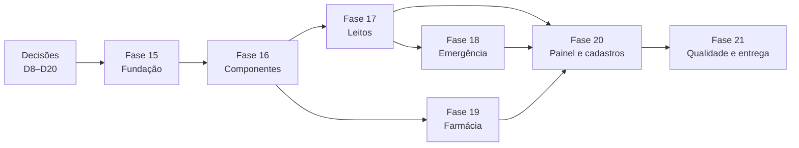
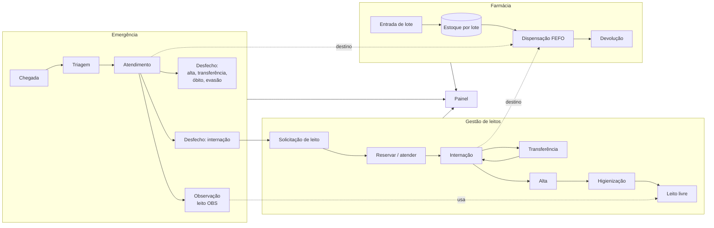
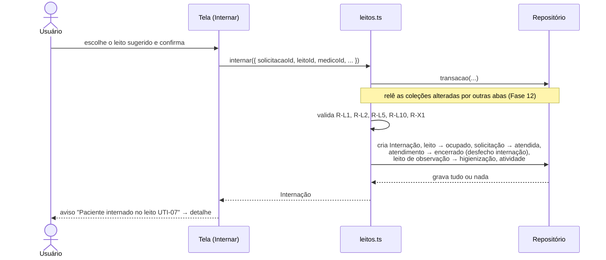
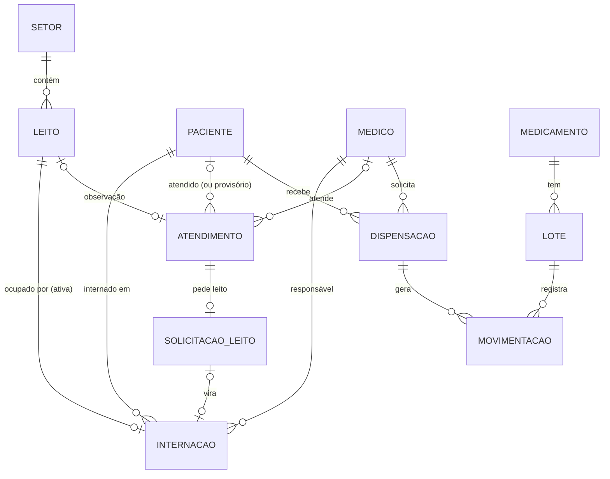
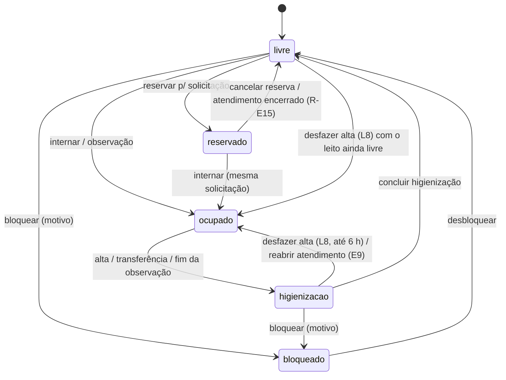

# 🏥 MediCore — Plano de Implementação: Gestão de Leitos, Emergência e Farmácia

> **Projeto:** MediCore · Operações Hospitalares
> **Escopo:** três módulos operacionais que hoje são páginas "em construção":
> - **Gestão de leitos:** mapa de leitos, internação, transferência, alta, higienização e bloqueio.
> - **Emergência:** chegada, classificação de risco, fila, atendimento, observação e desfecho, com pedido de leito.
> - **Farmácia:** catálogo de medicamentos, lotes e validade, entrada, dispensação, devolução, ajustes e alertas de estoque.
>
> Os três ficam integrados entre si, aos cadastros (pacientes e médicos) e ao Painel. Interface 100% em português do Brasil.
>
> **Base:** continua o `docs/planos/PLANO_CADASTROS_MEDICORE.md` (Fases 8–14 e Encerramento concluídos; versão 1.1.0 publicada). Por isso a numeração segue a partir da **Fase 15**.
> **Stack atual:** React 19 + TypeScript · Vite 8 · Tailwind CSS 4 · Recharts 3 · lucide-react · React Router 7 (data router) · react-hook-form + zod · Vitest 5 · Playwright
> **Estimativa total:** 17 a 20 dias úteis (1 desenvolvedor)
> **Decisões:** D8–D20 **aprovadas** em 28/10/2026, todas como recomendadas (ver [Decisões propostas](#-decisões-propostas)).
> **Versão do documento:** Revisão 2 — 28/10/2026 (ver [o que mudou](#-revisão-2--o-que-mudou))
> **Plano de execução:** [`PLANO_EXECUCAO_OPERACOES.md`](PLANO_EXECUCAO_OPERACOES.md), com a lista de tarefas em ordem e os checkboxes de acompanhamento

> ⚠️ **Escopo administrativo, não clínico.** Classificação de risco, sinais vitais e alerta de alergia servem para **organizar o trabalho e chamar atenção**. O sistema não sugere diagnóstico, cor de risco, dose nem conduta. Todos os dados continuam fictícios (RS-01).

---

## 📋 Sumário

**Visão geral**
1. [Como usar este documento](#-como-usar-este-documento)
2. [Revisão 2 — o que mudou](#-revisão-2--o-que-mudou)
3. [Painel de progresso e dependências](#-painel-de-progresso-e-dependências)
4. [Análise do projeto atual](#-análise-do-projeto-atual)
5. [Decisões propostas](#-decisões-propostas)
6. [Pendências herdadas](#-pendências-herdadas)
7. [Papéis e responsabilidades](#-papéis-e-responsabilidades)
8. [Glossário](#-glossário)

**Especificação**

9. [Arquitetura e integração entre módulos](#-arquitetura-e-integração-entre-módulos)
10. [Modelo de dados](#-modelo-de-dados)
11. [Regras de negócio](#-regras-de-negócio) (com a [matriz de ações por estado](#matriz-de-ações-por-estado))
12. [Invariantes de consistência](#-invariantes-de-consistência)
13. [Tempos, prazos e relógio](#-tempos-prazos-e-relógio)
14. [Persistência: novas coleções, orçamento e retenção](#-persistência-novas-coleções-orçamento-e-retenção)
15. [Processos detalhados (passo a passo)](#-processos-detalhados-passo-a-passo)
16. [Algoritmos](#-algoritmos)
17. [Tratamento de erros](#-tratamento-de-erros)
18. [Mapa de telas e rotas](#-mapa-de-telas-e-rotas)
19. [Acessibilidade específica dos módulos](#-acessibilidade-específica-dos-módulos)
20. [Estrutura de pastas (novos arquivos)](#-estrutura-de-pastas-novos-arquivos)
21. [Estratégia de testes](#-estratégia-de-testes)
22. [Riscos e mitigações](#-riscos-e-mitigações)
23. [Definição de pronto (por PR)](#-definição-de-pronto-por-pr)

**Execução**

24. [Fase 15 — Fundação dos módulos operacionais](#fase-15--fundação-dos-módulos-operacionais)
25. [Fase 16 — Componentes compartilhados](#fase-16--componentes-compartilhados)
26. [Fase 17 — Gestão de leitos](#fase-17--gestão-de-leitos)
27. [Fase 18 — Emergência](#fase-18--emergência)
28. [Fase 19 — Farmácia](#fase-19--farmácia)
29. [Fase 20 — Integração com o Painel e os cadastros](#fase-20--integração-com-o-painel-e-os-cadastros)
30. [Fase 21 — Qualidade, testes e entrega](#fase-21--qualidade-testes-e-entrega)
31. [Checklist final de aceite](#-checklist-final-de-aceite)
32. [Backlog futuro](#-backlog-futuro-fora-do-escopo)
33. [Registro de decisões e observações](#-registro-de-decisões-e-observações)

---

## 🧭 Como usar este documento

- Marque cada tarefa trocando `- [ ]` por `- [x]` conforme for concluindo.
- A parte **Especificação** é a referência: as tarefas das fases apontam para ela (ex.: "ver L1", "ver A8"). Na dúvida durante a implementação, a especificação vale.
- **Códigos usados no documento.** Os códigos continuam a numeração do plano de cadastros, para não haver dois "D1" ou dois "A1" no projeto.

  | Código | O que é | Neste plano |
  |---|---|---|
  | D | Decisões | D8–D20 |
  | R-L / R-E / R-F / R-X | Regras de negócio | Leitos, Emergência, Farmácia e regras entre módulos |
  | L / E / F | Processos | L1–L9 (Leitos), E1–E10 (Emergência), F1–F9 (Farmácia) |
  | A | Algoritmos | A7–A17 |
  | E-xx | Tratamento de erros | E-11–E-18 |
  | INV | Invariantes de consistência | INV-1–INV-10 |
  | M | Melhorias da Revisão 2 | M15–M34 |
  | RS-xx | Riscos | RS-09–RS-18 |

- **Antes da Fase 15:** aprove (ou ajuste) as decisões D8–D20. Várias delas mudam o modelo de dados. D18 (faixas de sinais vitais) deve ser validada com a equipe clínica.
- Cada fase tem **✅ Critérios de conclusão**. Só avance quando todos estiverem marcados. Todo PR precisa cumprir a [Definição de pronto](#-definição-de-pronto-por-pr).
- Ao final de cada fase:
  - atualize o [Painel de progresso](#-painel-de-progresso-e-dependências);
  - registre os desvios no [Registro](#-registro-de-decisões-e-observações).
- **Fluxo de git:** um commit por fase direto na `main` (o mesmo usado nas Fases 8–14). Cada push na `main` publica na Vercel. Use uma branch por fase se quiser revisão por PR, para que a `main` só receba fases fechadas.

---

## 🔄 Revisão 2 — o que mudou

A Revisão 1 foi analisada por inteiro, com foco em **o que acontece quando algo dá errado** (engano, morte do paciente, concorrência, passagem do tempo) e em **deixar cada processo implementável sem adivinhação**. Melhorias (a numeração M continua a do plano de cadastros, que foi até M14):

| # | Problema na Revisão 1 | Risco | Solução na Revisão 2 | Onde |
|---|---|---|---|---|
| M15 | Nada garantia que leitos, internações, atendimentos e solicitações continuassem coerentes entre si | Leito "ocupado" sem internação; dois registros no mesmo leito | **Invariantes** escritas (INV-1 a INV-10), verificadas a cada transação nos testes e por uma checagem ao abrir o sistema (A17); teste com sequências aleatórias de operações | [Invariantes](#-invariantes-de-consistência), A17, 15.10 |
| M16 | Não havia como corrigir enganos (alta no paciente errado, desfecho errado, dispensação errada) | Dados errados para sempre, ou contornos que quebram o histórico | **Correções com janela de tempo:** desfazer alta (L8, 6 h), reabrir atendimento (E9, 2 h), estornar dispensação (F8, 24 h); sempre com motivo e evento no histórico (D19) | L8, E9, F8, R-L12, R-E14, R-F16 |
| M17 | O óbito não afetava o cadastro | Paciente falecido continuaria ativo, com consultas e podendo "chegar" à emergência | **R-X7:** óbito inativa o paciente, cancela as consultas futuras e bloqueia novos registros; desfazer o óbito reativa | R-X7, L3, E5 |
| M18 | Consultas agendadas de um paciente internado eram ignoradas | Faltas "falsas" e agenda desatualizada | **R-X8:** aviso no detalhe da internação e no agendamento (sem cancelar sozinho) | R-X8, L1 |
| M19 | Um atendimento "aguardando leito" só podia terminar em internação | Óbito ou transferência enquanto espera leito ficavam impossíveis; reserva presa | **R-E15:** os outros desfechos cancelam a solicitação e liberam a reserva; diagramas de estado completos e **matriz de ações por estado** | R-E15, [Matriz](#matriz-de-ações-por-estado) |
| M20 | O tempo-alvo contava desde a chegada, e a retriagem não tinha regra | Prazos diferentes da prática (o tempo-alvo conta da classificação) | **Prazo** = momento da classificação + tempo-alvo da cor; retriagem para cor mais grave antecipa o prazo; para menos grave, exige justificativa e não adia o prazo | R-E3, A7 |
| M21 | As faixas de alerta dos sinais vitais eram de adulto | Bebê com FC 140 (normal) marcado como alerta; criança hipotensa sem alerta | **D18:** faixas de alerta por faixa etária (configuráveis, a validar com a equipe clínica) e peso opcional na triagem | D18, R-E5 |
| M22 | Sem reavaliação na espera ou na observação; observação sem limite | Piora não registrada; paciente "esquecido" na observação | **E10** (sinais vitais sem mudar a cor) e alertas de "sem triagem há 15 min" e "observação acima de 24 h" | E10, A12 |
| M23 | Internação eletiva sem leito livre não tinha caminho | A pessoa precisaria voltar depois e lembrar | **L9:** solicitação de leito também para eletiva, com data prevista | L9, Solicitação |
| M24 | O mapa não respondia "onde está o paciente X?" nem "quantos leitos vão liberar hoje?" | Perguntas mais comuns do NIR sem resposta | Busca de paciente no mapa; previsão de leitos liberados em 24 h; tipos de higienização (terminal 60 min, isolamento 90 min) | Mapa, A13, L4 |
| M25 | Transferência externa sem o hospital de origem ou de destino | Registro incompleto | Campos de hospital de origem e de destino | Modelo, L1, L3, E5 |
| M26 | Sem lote bloqueado (quarentena ou recolhimento da ANVISA) | Lote suspeito sairia pelo FEFO | **F9:** bloquear lote, fora do FEFO e do disponível | F9, R-F13 |
| M27 | Entrada só em unidades; sem proteção contra erro de digitação; "sem alergias" igual a "não informado" | Entrar 60 caixas como 60 comprimidos; dispensar 600 no lugar de 6; falsa segurança | Unidades por embalagem; confirmação de quantidade alta; "Alergias não informadas" em destaque | F1, F2, F3, R-F14, R-F15 |
| M28 | Sem visão de conferência dos controlados | Conferência manual difícil | **Livro de controlados:** movimentações só de controlados, com saldo por medicamento e por período | Telas (`/farmacia/controlados`) |
| M29 | Eventos e movimentações sem autor | Migração para login (BL-02) exigiria mudar o formato | Campo `autor` em todo evento e movimentação, preenchido com "Usuário de demonstração" até haver login | Modelo, R-X9 |
| M30 | A retenção podia apagar um atendimento ainda referenciado por uma internação retida, e o vencimento de lote "à meia-noite" não gerava nada | Links quebrados; vencimentos silenciosos | **Retenção com integridade** (mantém um registro resumido "arquivado" quando referenciado) e **rotina diária** que registra os lotes que venceram | A15 |
| M31 | O Painel importaria `indicadores-operacionais`, e com ele os dados de exemplo dos 3 módulos, no carregamento inicial | Pacote inicial e primeira abertura mais lentos | Indicadores carregados **sob demanda** (import dinâmico); semeadura medida (< 300 ms) | D20, 20.1, 21.4 |
| M32 | Os processos tinham níveis de detalhe muito diferentes | Implementação "por adivinhação" | **Mesmo roteiro para todos** (quem, gatilho, pré-condições, campos, passos, serviço, resultado, falhas), papéis e glossário | [Processos](#-processos-detalhados-passo-a-passo) |
| M33 | Faltavam testes para correções, óbito, invariantes e passagem do tempo | Regressões nas partes mais delicadas | Testes de invariantes com operações aleatórias; cenários 9 e 10 de ponta a ponta; testes da virada do dia | [Testes](#-estratégia-de-testes) |
| M34 | Concorrência descrita só no L1 e no F3 | Comportamentos diferentes entre telas | Regra única: toda ação envia `versao`; **E-05** nos formulários, **E-16** nas ações rápidas | Processos (introdução) |

**Impacto no prazo:** +2 dias (Fase 15 +1; Fases 17, 18 e 19 +0,5 cada; Fase 21 −0,5 por reaproveitamento). A nova estimativa total é de **17 a 20 dias**.

---

## 📊 Painel de progresso e dependências

| Fase | Descrição | Estimativa | Status | Início | Fim |
|:---:|---|:---:|:---:|:---:|:---:|
| 15 | Fundação dos módulos operacionais | 4 dias | ⬜ Não iniciada | | |
| 16 | Componentes compartilhados | 1,5 dia | ⬜ Não iniciada | | |
| 17 | Gestão de leitos | 3,5 dias | ⬜ Não iniciada | | |
| 18 | Emergência | 3,5 dias | ⬜ Não iniciada | | |
| 19 | Farmácia | 3,5 dias | ⬜ Não iniciada | | |
| 20 | Integração com o Painel e os cadastros | 1,5 dia | ⬜ Não iniciada | | |
| 21 | Qualidade, testes e entrega | 1,5 dia | ⬜ Não iniciada | | |

Legenda: ⬜ Não iniciada · 🟨 Em andamento · ✅ Concluída · 🟥 Bloqueada

### Dependências entre fases



> **Paralelismo:**
> - **Leitos e Farmácia** são independentes entre si e podem ser feitos em paralelo por duas pessoas.
> - **Emergência** depende de Leitos, porque o desfecho "internação" pede um leito (E6 → L6) e a observação usa leitos.
> - **Farmácia** só precisa de Leitos e Emergência para a regra "dispensar só para paciente internado ou em atendimento" (R-F12). Até a Fase 20, a regra pode ficar desligada (ver 19.6).

---

## 🔎 Análise do projeto atual

### O que já existe e será reaproveitado

| Recurso | Onde está | Uso nos novos módulos |
|---|---|---|
| **Itens de menu e rotas** | `config/navegacao.ts`; o `Placeholder` está em `router.tsx` | Os itens Gestão de leitos, Emergência e Farmácia já existem no menu. Basta incluir as rotas em `COM_TELA` e trocar o `Placeholder` pelas páginas reais |
| **Roteador de dados** | `router.tsx` | `lazy` por página, `errorElement` dentro do layout, `handle` com título e breadcrumb |
| **Repositório com transação e sincronização entre abas** | `services/repositorio.ts` | Recursos usados nos módulos novos: `criarRepositorio`, `transacao` multi-coleção, `assinar`, releitura antes de gravar, versão por registro (R-G1) e migrações |
| **Padrão de serviço** | `services/*.ts` | `executar()`, erros tipados, regras só no serviço, atividade na mesma transação, esquema zod carregado sob demanda |
| **Hooks reativos** | `hooks/useColecao.ts`, `hooks/useDados.ts` | Listas e detalhes que se atualizam sozinhos, inclusive vindos de outra aba |
| **Formulários** | `components/ui/form/`, `hooks/useFormularioEntidade.ts` | Recursos: campos, máscaras, Combobox, resumo de erros, aviso ao sair com alterações |
| **Listagem** | `components/ui/lista/` | DataTable, Paginacao, BarraFiltros, MenuAcoes, CabecalhoPagina e filtros na URL (`useFiltrosUrl`) |
| **Feedback** | `components/ui/feedback/` | Recursos: Modal, confirmação (com campo de texto), Toast |
| **Busca de paciente com alergias** | `FormConsulta` (combobox de paciente) | Extrair para um `ComboboxPaciente` reutilizável (internar, registrar chegada, dispensar) |
| **Seletor acessível em grade** | `SeletorHorario` (radiogroup com setas) | Modelo para o `SeletorLeito` |
| **Linha do tempo de eventos** | `LinhaDoTempoConsulta` | Generalizar para `LinhaDoTempo` (internação, atendimento, lote) |
| **Datas no fuso do hospital** | `utils/datas.ts` (com cache de fuso), `utils/relogio.ts` | Tempos de espera, permanência, validade em dias |
| **Atividades do Painel** | `services/atividades.ts` | Novos tipos: internação, alta, chegada com risco vermelho, entrada de lote e outros |
| **Cards do Painel prontos para dados reais** | `OccupancyDonut`, `KpiCards`, `AlertList`, `WelcomeCard`, `AIInsights`, `AdmissionChart` | Trocar a fonte simulada pela real, sem mudar o visual |
| **"Restaurar dados de exemplo"** | `services/demo.ts` | Incluir as coleções novas |
| **Qualidade** | Vitest + Testing Library, Playwright + axe, `npm run i18n:verificar`, teste de carga | O mesmo padrão nas telas novas |

### O que precisa mudar (pontos de atenção)

| # | Situação atual | Impacto | Solução no plano |
|---|---|---|---|
| 1 | Leitos são só números simulados (`setoresLeitos`: 22/30, 50/70, 14/20). `SetorLeitos` não tem leitos individuais | Não dá para internar, transferir ou liberar um leito | Leito e Internação como entidades (Fase 15). O Painel passa a calcular a ocupação (Fase 20) |
| 2 | Alertas de emergência, "Casos de emergência" (18) e "Tendência de internações" são fixos em `data/mock.ts` | Painel e telas novas mostrariam números diferentes | Alertas derivados dos atendimentos (A12) e série de internações calculada (A14) |
| 3 | "3 medicamentos com estoque baixo" e "UTI tendendo a 90%" são fixos (`resumoDia`, `insights`) | Mesmo problema | Calculados a partir da farmácia e dos leitos (A13) |
| 4 | Os dados de exemplo têm **30 pacientes** (27 ativos) | Ocupar 86 leitos, como o Painel mostra hoje, exige 86 pacientes internados | D13: ampliar os dados de exemplo para cerca de 120 pacientes |
| 5 | Inativar ou excluir paciente e inativar médico só olham as **consultas** (R-P2, R-P3, R-M2) | Seria possível inativar um paciente internado ou um médico responsável por internações | Novas regras entre módulos, R-X1 a R-X4 (Fase 15) |
| 6 | `i18n/pt-BR.ts` tem 951 linhas e vai no pacote inicial | Os três módulos acrescentariam cerca de 900 linhas ao carregamento de **todas** as páginas | D16: textos dos módulos em arquivos próprios, carregados com a página |
| 7 | O armazenamento suporta cerca de 1.000 pacientes + 3.000 consultas a 68% do limite. Hoje: ~900 bytes por paciente ou consulta; dados de exemplo = 74 KB | Atendimentos, internações e movimentações de estoque crescem todo dia | D15: retenção por coleção, teto por coleção e novo "limite prático" medido (Fase 21) |
| 8 | Não há cores para classificação de risco nem estados de leito | Contraste e daltonismo (cor nunca pode ser a única informação) | Novos tokens com par de texto AA nos dois temas, sempre com rótulo e ícone (Fase 16) |
| 9 | Tempos ("há 12 min") não se atualizam sozinhos | A fila da emergência ficaria parada | `useRelogio` (tique a cada 30 s), com os tempos sempre calculados a partir dos horários gravados |
| 10 | O próximo passo recomendado no Encerramento era o **backend real** (RS-01) | Mais dados ficam só no navegador | A arquitetura continua isolada em `services/`, então a troca futura pela API mexe só nessa camada. O risco está registrado em RS-09 |
| 11 | O sino de notificações e a busca global do cabeçalho são só visuais | — | Continuam no backlog. Os alertas aparecem no Painel e na Emergência |
| 12 | "Desempenho por departamento" é simulado | — | Continua simulado (backlog) |

---

## ✅ Decisões propostas

> **Aprovadas em 28/10/2026**, todas como recomendadas (Etapa 0 do plano de execução). A coluna "Recomendação" é a escolha usada no restante do plano. Se alguma decisão mudar depois, ajuste as seções indicadas em "Onde impacta".

| # | Decisão | Recomendação | Alternativas | Por quê | Onde impacta |
|---|---|---|---|---|---|
| D8 | Classificação de risco na emergência | **5 cores com tempo-alvo, escolhidas pelo profissional** (inspirada no Protocolo de Manchester, sem reproduzir os fluxogramas dele). O sistema **não sugere** a cor | Calcular a cor pelos sinais vitais | Decisão clínica fica com a pessoa. Evita que o sistema pareça apoio ao diagnóstico (RS-10). O protocolo oficial é licenciado | R-E3–R-E5, E2, A7 |
| D9 | Paciente sem identificação na emergência | **Atendimento com identificação provisória** (descrição, sexo e idade aproximada), vinculado ao cadastro depois (E7). Para internar, o cadastro é obrigatório | Exigir cadastro completo na chegada | Na emergência não dá para esperar CPF. O cadastro de paciente exige CPF (R-P1), então não se cria cadastro "falso" | R-E9, E1, E7 |
| D10 | Estrutura de leitos | **Setores e leitos semeados** (130 leitos: 120 de internação + 10 de observação). A tela permite **bloquear e desbloquear**, mas não criar ou apagar leitos | Tela de cadastro de setores e leitos | Cobre a operação do dia a dia com menos risco. O cadastro da estrutura fica no backlog | Modelo de dados, L5, Backlog |
| D11 | Controle de estoque | **Por lote, com validade, saída automática por FEFO** (vence primeiro, sai primeiro). Quantidades em **unidades inteiras** (comprimido, ampola, frasco) | Saldo único por medicamento; escolha manual do lote | Rastreabilidade e controle de vencimento, padrão em farmácia hospitalar | R-F1–R-F5, F2, F3, A9 |
| D12 | Dispensação × prescrição | **Dispensação sem posologia:** registra *o que saiu, para quem, a pedido de quem*. A prescrição eletrônica fica no backlog | Prescrição completa com dose, via e horários | Prescrição é funcionalidade clínica, com regras próprias | F3, Backlog |
| D13 | Volume dos dados de exemplo | **Ampliar para ~120 pacientes** (90 novos gerados) e semear a ocupação igual à do Painel atual (86 de 120, 72%) | Manter 30 pacientes e mostrar ~20% de ocupação | O Painel continua com a mesma cara. Um hospital de 120 leitos com 27 pacientes não é realista | Seeds (15.8), testes que contam pacientes |
| D14 | Alerta de alergia na dispensação | **Comparação de texto** entre as alergias do paciente e o princípio ativo e a classe do medicamento (A10). **Alerta com confirmação e justificativa**, nunca bloqueio | Bloquear; não alertar | As alergias são texto livre (Fase 10). O alerta ajuda, mas não substitui a conferência | R-F8, F3, A10 |
| D15 | Armazenamento | **Retenção por coleção + teto por coleção** (ver [Persistência](#-persistência-novas-coleções-orçamento-e-retenção)), com resumos mensais para os gráficos. O "limite prático" é medido de novo na Fase 21 | IndexedDB (exige reescrever o repositório, que hoje é síncrono); compactar o JSON | Mantém o repositório e as transações como estão. O backend real continua sendo a solução definitiva (RS-01) | Persistência, A15, 21.4 |
| D16 | Textos dos módulos | **Um arquivo de textos por módulo** (`i18n/pt-BR/leitos.ts`, `emergencia.ts`, `farmacia.ts`), importado só pelas páginas do módulo | Tudo no `pt-BR.ts` atual | O pacote inicial não cresce. O script `i18n:verificar` continua valendo | 15.2, 21.4 |
| D17 | Leitos de observação da emergência | **Setor "Observação" com 10 leitos**, usado só pela Emergência e **fora** da taxa de ocupação de internação do Painel | Sem observação; observação sem leito | Reflete o pronto-socorro real e não distorce os 120 leitos de internação do Painel | Modelo de dados, E4, A13 |
| D18 | Faixas de alerta dos sinais vitais | **Por faixa etária**, configuráveis em `config/sinais-vitais.ts` e **a validar com a equipe clínica** antes do uso. Padrão inicial na tabela de R-E5 | Faixas de adulto para todos; sem alerta abaixo de 12 anos | Uma única faixa geraria alerta falso em crianças e esconderia alertas reais (M21) | R-E5, E2, E10, A12 |
| D19 | Corrigir enganos | **Janelas de correção:** desfazer alta 6 h, reabrir atendimento 2 h, estornar dispensação 24 h; sempre com motivo; o registro original continua no histórico | Edição livre; sem correção | Corrige o erro comum sem apagar a história (M16) | L8, E9, F8 |
| D20 | Indicadores no Painel | **Import dinâmico** de `indicadores-operacionais`: o Painel abre com o esqueleto e os cards se preenchem em seguida | Import direto | Mantém o pacote inicial e a primeira abertura rápidos (M31) | 20.1, RS-12 |

---

## 🧾 Pendências herdadas

Itens abertos do plano de cadastros. Não bloqueiam este plano, mas vale fechá-los junto com a Fase 21.

- [ ] Teste com NVDA nos fluxos P1 e P9 e no Painel (`docs/VERIFICACAO_MANUAL.md`)
- [ ] Revisão das mensagens E-01 a E-10 por alguém que não seja desenvolvedor
- [ ] Incluir no mesmo roteiro manual os fluxos novos L1 (internar), E2 (triagem) e F3 (dispensar). Tarefa da Fase 21

---

## 👥 Papéis e responsabilidades

Ainda **não há login** (BL-02), então qualquer pessoa pode fazer qualquer ação. Mesmo assim, as telas, os textos e a ordem das listas são pensados para estes papéis, e a matriz abaixo será a base dos perfis de acesso.

| Ação | Recepção | Enfermagem | Médico | NIR (gestão de leitos) | Farmácia | Gestão |
|---|:---:|:---:|:---:|:---:|:---:|:---:|
| Registrar chegada (E1), vincular cadastro (E7) | ✅ | ✅ | | | | |
| Triagem, retriagem e reavaliação (E2, E10) | | ✅ | ✅ | | | |
| Chamar, observação, desfechos, pedir leito (E3–E6) | | ✅ | ✅ | | | |
| Reabrir atendimento (E9) | | ✅ | ✅ | | | ✅ |
| Internar, transferir, editar (L1, L2, L7) | | | ✅ | ✅ | | |
| Dar alta (L3), desfazer alta (L8) | | | ✅ | ✅ | | ✅ |
| Higienização (L4) | | ✅ | | ✅ | | |
| Bloquear leito (L5), atender solicitações (L6, L9) | | | | ✅ | | ✅ |
| Catálogo, entrada, ajustes, descarte, lotes (F1, F2, F5–F7, F9) | | | | | ✅ | |
| Dispensar, devolver, estornar (F3, F4, F8) | | | | | ✅ | |
| Ver tudo (somente leitura) | ✅ | ✅ | ✅ | ✅ | ✅ | ✅ |

> **NIR (Núcleo Interno de Regulação):** equipe que controla a ocupação e a distribuição dos leitos do hospital.

---

## 📖 Glossário

| Termo | Significado neste sistema |
|---|---|
| **Leito operacional** | Leito que não está bloqueado. A taxa de ocupação usa os operacionais |
| **Higienização terminal** | Limpeza completa do leito após a saída do paciente (alta ou transferência). Tempo de referência: 60 min |
| **Higienização de isolamento** | Limpeza após paciente com precaução de contato, gotículas ou aerossóis. Tempo de referência: 90 min |
| **Precaução** | Medidas de isolamento exigidas pelo paciente (padrão, contato, gotículas, aerossóis) |
| **Perfil do leito** | Adulto ou pediátrico |
| **Solicitação de leito** | Pedido de vaga para internar (da emergência ou eletivo), atendido pelo NIR |
| **Classificação de risco** | Cor dada na triagem (vermelho a azul) que define a ordem e o **prazo** para o atendimento médico |
| **Prazo** | Momento da classificação + tempo-alvo da cor (R-E3) |
| **Observação** | Permanência do paciente da emergência num leito do setor Observação, sem internação |
| **Evasão** | Paciente que saiu sem atendimento ou sem alta |
| **Desfecho** | Como o atendimento terminou: alta, internação, transferência, óbito ou evasão |
| **Permanência** | Dias de internação. O dia da entrada é o **dia 1** |
| **Giro de leito** | Altas no período ÷ leitos operacionais |
| **FEFO** | *First Expired, First Out*: sai primeiro o lote que vence primeiro |
| **Disponível** | Soma dos lotes não vencidos e não bloqueados |
| **Dispensação** | Saída de medicamento da farmácia para um paciente, a pedido de um médico. Não é prescrição (D12) |
| **Controlado** | Medicamento sujeito a controle especial (Portaria 344/98), com regras extras (R-F7) |
| **Estorno** | Desfazer uma dispensação inteira por engano (F8) |
| **Janela de correção** | Tempo em que um registro pode ser desfeito (D19) |

---

## 🏗️ Arquitetura e integração entre módulos

As camadas e as **regras de ouro** do plano de cadastros continuam valendo:
- o componente nunca acessa o repositório;
- as regras ficam só no serviço;
- há um esquema zod por entidade;
- trocar pela API real mexe só em `services/`.

### Novos serviços

| Serviço | Responsável por | Lê também |
|---|---|---|
| `services/leitos.ts` | Leitos, internações, solicitações de leito; L1–L9 | Pacientes, médicos |
| `services/emergencia.ts` | Atendimentos, triagens, fila e alertas; E1–E10 | Pacientes, médicos, leitos (observação, solicitação) |
| `services/farmacia.ts` | Medicamentos, lotes, movimentações, dispensações; F1–F9 | Pacientes, médicos, internações e atendimentos (destino) |
| `services/indicadores-operacionais.ts` | Ocupação, previsões, alertas, séries e indicadores do Painel (A12–A14) | Todos acima (só leitura) |
| `services/retencao.ts` | Limpeza de históricos antigos e resumos mensais (A15) | Todos (escrita controlada) |

### Fluxo entre módulos



### Exemplo de transação multi-coleção: internar a partir da emergência (E6 → L6 → L1)



> **Tudo ou nada:** se o leito foi ocupado por outra aba entre a escolha e a confirmação, a transação inteira é desfeita e a tela mostra **E-11** com os leitos atualizados.

---

## 🗃️ Modelo de dados



Todas as entidades gravadas seguem os **campos comuns** do plano anterior: `id` (UUID), `criadoEm`, `atualizadoEm` (ISO UTC) e `versao` (R-G1). Os setores são uma configuração fixa (D10), não uma coleção.

> **Autor (R-X9, M29):** todo evento e toda movimentação têm `autor`. Até existir login (BL-02), o valor é `"Usuário de demonstração"`. Com o login, passa a ser o usuário da sessão, sem mudar o formato.

### Setor (configuração em `config/setores.ts`)

| Campo | Tipo | Valores semeados |
|---|---|---|
| `id` | texto | `uti`, `enfermaria`, `apartamento`, `observacao` |
| `nome` | texto | UTI, Enfermaria, Apartamento, Observação (Emergência) |
| `tipo` | `'internacao'` \| `'observacao'` | Só os de `internacao` entram na ocupação do Painel (D17) |
| `ordem` | inteiro | Ordem no mapa |

### Leito

| Campo | Tipo | Obrigatório | Regras |
|---|---|:---:|---|
| `codigo` | texto | ✅ | Único. Ex.: `UTI-07`, `ENF-104B`, `APT-212`, `OBS-03` |
| `setorId` | texto | ✅ | Um dos setores da configuração |
| `quarto` | texto | | Ex.: `104`. Leitos do mesmo quarto aparecem lado a lado no mapa |
| `perfil` | `'adulto'` \| `'pediatrico'` | ✅ | R-L5 |
| `isolamento` | booleano | ✅ | Leito com estrutura de isolamento (R-L6) |
| `status` | `'livre'` \| `'ocupado'` \| `'reservado'` \| `'higienizacao'` \| `'bloqueado'` | ✅ | Transições na tabela [Estados do leito](#estados-do-leito) |
| `internacaoId` | texto | se `ocupado` por internação | — |
| `atendimentoId` | texto | se `ocupado` em Observação | — |
| `solicitacaoId` | texto | se `reservado` | — |
| `desde` | ISO | ✅ | Início do status atual. Usado em "em higienização há 40 min" |
| `bloqueio` | `{ motivo, previsaoLiberacao? }` | se `bloqueado` | Motivo com 5–200 caracteres |
| `higienizacao` | `{ tipo: 'terminal' \| 'isolamento' }` | se `higienizacao` | O tipo define o tempo de referência (60 ou 90 min, L4) |

**Distribuição semeada (D10, D13)**

| Setor | Leitos | Perfil | Isolamento | Ocupados no dia 0 |
|---|---:|---|---:|---:|
| UTI | 30 (`UTI-01`…`UTI-30`) | 26 adultos + 4 pediátricos | 4 | 22 |
| Enfermaria | 70, em 35 quartos de 2 leitos (`ENF-101A`…) | 60 adultos + 10 pediátricos | 6 | 50 |
| Apartamento | 20 (`APT-201`…`APT-220`) | adulto | 2 | 14 |
| Observação | 10 (`OBS-01`…`OBS-10`) | 8 adultos + 2 pediátricos | 1 | conforme os atendimentos semeados |

Fora dos ocupados, os dados de exemplo distribuem os leitos assim: alguns em higienização (2 a 4), 1 bloqueado (manutenção), 1 reservado para uma solicitação da emergência e o restante livre.

### Internação

| Campo | Tipo | Obrigatório | Regras |
|---|---|:---:|---|
| `pacienteId` | texto | ✅ | Paciente ativo, sem outra internação ativa (R-L1, R-X1) |
| `leitoId` | texto | ✅ | Leito atual |
| `medicoResponsavelId` | texto | ✅ | Médico ativo (R-L10) |
| `origem` | `'emergencia'` \| `'eletiva'` \| `'transferencia_externa'` | ✅ | — |
| `hospitalOrigem` | texto | se `transferencia_externa` | 3–120 caracteres (M25) |
| `atendimentoId` / `solicitacaoId` | texto | se origem `emergencia` | — |
| `motivo` | texto | ✅ | Diagnóstico ou motivo de entrada, 3–300 caracteres (texto livre; CID no backlog) |
| `precaucao` | `'padrao'` \| `'contato'` \| `'goticulas'` \| `'aerossois'` | ✅ | Diferente de `padrao` exige leito de isolamento (R-L6) |
| `inicio` | ISO | ✅ | Pode ser retroativo até 24 h (registro tardio) |
| `previsaoAlta` | AAAA-MM-DD | | Vencida aparece como "Alta prevista vencida" (R-L8) |
| `status` | `'ativa'` \| `'encerrada'` | ✅ | — |
| `alta` | `{ tipo, em, hospitalDestino?, observacao?, registradaEm }` | se `encerrada` | `tipo`: `melhorada`, `a_pedido`, `transferencia` (exige `hospitalDestino`), `obito`. `registradaEm` conta a janela do L8 |
| `eventos` | lista | ✅ | `internada`, `transferida {de, para, motivo}`, `responsavel_alterado`, `previsao_alterada`, `precaucao_alterada`, `alta`, `alta_desfeita {motivo}`. Imutável; cada evento tem `em` e `autor` (R-X9) |

### Solicitação de leito

| Campo | Tipo | Regras |
|---|---|---|
| `origem` | `'emergencia'` \| `'eletiva'` | L9 (M23) |
| `atendimentoId` | texto | Quando a origem é emergência |
| `dataPrevista` | AAAA-MM-DD | Eletiva: de hoje até 30 dias |
| `motivo` | texto | Motivo da internação |
| `pacienteId` | texto | Obrigatório: precisa haver cadastro (R-E9) |
| `setorDesejado` | `'uti'` \| `'enfermaria'` \| `'apartamento'` | — |
| `precaucao` | igual à da Internação | Define a compatibilidade (A11) |
| `prioridade` | cor de risco | Emergência: a cor atual do atendimento (acompanha a retriagem). Eletiva: verde (amarelo com justificativa) |
| `status` | `'pendente'` \| `'reservada'` \| `'atendida'` \| `'cancelada'` | Cancelada guarda `motivoCancelamento` (inclusive automático, R-E15) |
| `leitoReservadoId` | texto | Quando `reservada` |

### Atendimento de emergência

| Campo | Tipo | Obrigatório | Regras |
|---|---|:---:|---|
| `numero` | texto | ✅ | `E-0001`, sequencial por dia no fuso do hospital (R-E1) |
| `pacienteId` | texto | um dos dois | — |
| `provisorio` | `{ descricao, sexo, idadeAproximada }` | um dos dois | D9. Ex.: "Homem, ~40 anos, camiseta azul" |
| `chegadaEm` | ISO | ✅ | — |
| `modoChegada` | `'meios_proprios'` \| `'ambulancia'` \| `'samu'` \| `'bombeiros'` \| `'policia'` | ✅ | — |
| `queixa` | texto | ✅ | Queixa principal, 3–300 caracteres |
| `triagens` | lista de Triagem | | A última vale. Retriagem acrescenta (R-E6) |
| `status` | ver [Estados do atendimento](#estados-do-atendimento) | ✅ | — |
| `medicoId` | texto | a partir de `em_atendimento` | — |
| `leitoObservacaoId` | texto | se `em_observacao` | — |
| `solicitacaoId` | texto | se `aguardando_leito` | — |
| `desfecho` | `{ tipo, em, hospitalDestino?, observacao?, internacaoId?, registradoEm }` | se `encerrado` | `tipo`: `alta`, `internacao`, `transferencia` (exige `hospitalDestino`), `obito`, `evasao` |
| `prazo` | ISO | após a triagem | Calculado por A7 a cada triagem (R-E3) |
| `reavaliacoes` | lista `{ em, sinais, observacao?, autor }` | | E10 |
| `statusAntesDoLeito` | status | se `aguardando_leito` | Para voltar quando a solicitação é cancelada |
| `eventos` | lista | ✅ | `chegada`, `triagem {de, para}`, `reavaliacao`, `chamado {medico, excessoMin}`, `observacao`, `retomado`, `leito_solicitado`, `solicitacao_cancelada`, `vinculado`, `desfecho`, `reaberto {motivo}`. Cada evento tem `em` e `autor` |

**Triagem**

Campos: `em`, `profissional` (texto), `risco` e `sinais` (sinais vitais), mais `observacao` opcional, `pesoKg` opcional (D18) e `justificativa` (obrigatória quando a retriagem reduz a urgência, R-E3).
- `risco`: `vermelho`, `laranja`, `amarelo`, `verde` ou `azul`.
- `sinais`: `pas`, `pad`, `fc`, `fr`, `temperatura`, `spo2`, `dor` (0–10) e `glicemia`. Todos opcionais, exceto quando o risco é escolhido sem nenhum sinal: nesse caso o sistema pede confirmação.

### Medicamento

| Campo | Tipo | Obrigatório | Regras |
|---|---|:---:|---|
| `nome` | texto | ✅ | Nome genérico (DCB). Ex.: "Dipirona sódica" |
| `nomeComercial` | texto | | — |
| `principioAtivo` | texto | ✅ | Usado no alerta de alergia (A10) |
| `classe` | texto | | Ex.: "Penicilinas", "AINE". Também usada no alerta |
| `concentracao` | texto | ✅ | Ex.: "500 mg", "1 g", "10 mg/mL" |
| `forma` | `'comprimido'` \| `'capsula'` \| `'solucao_oral'` \| `'solucao_injetavel'` \| `'po_injetavel'` \| `'pomada'` \| `'outro'` | ✅ | — |
| `unidade` | `'comprimido'` \| `'capsula'` \| `'ampola'` \| `'frasco'` \| `'bisnaga'` \| `'unidade'` | ✅ | Unidade de dispensação (D11) |
| `controlado` | `{ lista: 'A1' \| 'B1' \| 'C1' … }` | | Medicamento sujeito a controle especial (Portaria 344/98). R-F7 |
| `unidadesPorEmbalagem` | inteiro ≥ 1 | | Usado na entrada por embalagem (F2, M27). Travado depois da primeira movimentação |
| `estoqueMinimo` | inteiro ≥ 0 | ✅ | R-F6 |
| `ativo` | booleano | ✅ | R-F11 |

**Combinação única:** nome + concentração + forma.

### Lote

| Campo | Tipo | Regras |
|---|---|---|
| `medicamentoId` | texto | — |
| `numero` | texto | Único por medicamento (R-F2) |
| `validade` | AAAA-MM-DD | Não pode estar vencida na entrada |
| `fabricante` | texto | Opcional |
| `quantidadeInicial`, `quantidadeAtual` | inteiros | `0 ≤ atual ≤ inicial + devoluções + ajustes positivos` |
| `bloqueio` | `{ motivo, referencia?, em }` | Lote bloqueado sai do FEFO e do disponível (F9, R-F13) |
| `saldoArquivado` | inteiro | Soma das movimentações removidas pela retenção (para INV-7) |
| `notaFiscal` | texto | Opcional |

### Movimentação (imutável)

| Campo | Tipo | Regras |
|---|---|---|
| `tipo` | `'entrada'` \| `'dispensacao'` \| `'devolucao'` \| `'ajuste_positivo'` \| `'ajuste_negativo'` \| `'perda'` \| `'descarte_vencido'` | — |
| `medicamentoId`, `loteId` | texto | — |
| `quantidade` | inteiro > 0 | O sentido vem do tipo |
| `saldoLoteApos` | inteiro | Para auditoria |
| `dispensacaoId` | texto | Em dispensação e devolução |
| `motivo` | texto | Obrigatório em ajuste, perda, descarte e devolução |
| `autor` | texto | R-X9 |
| `em` | ISO | — |

### Dispensação

| Campo | Tipo | Regras |
|---|---|---|
| `pacienteId` | texto | ✅ |
| `destino` | `{ tipo: 'internacao' \| 'emergencia', id }` | R-F12 |
| `medicoSolicitanteId` | texto | ✅ Médico ativo |
| `itens` | `[{ medicamentoId, quantidade, lotes: [{ loteId, quantidade }], devolvido }]` | Lotes escolhidos pelo FEFO (A9) |
| `alertasConfirmados` | `[{ tipo: 'alergia' \| 'controlado' \| 'quantidade_alta', medicamentoId, termo?, justificativa? }]` | R-F7, R-F8, R-F14 |
| `status` | `'realizada'` \| `'estornada'` | F8 |
| `estorno` | `{ em, motivo, autor }` | se `estornada` |
| `em` | ISO | — |

### Tipos de leitura (montados pelo serviço)

| Tipo | Para | Conteúdo extra |
|---|---|---|
| `LeitoDetalhado` | Mapa | Nome do paciente (nome social, R-P6), idade, dias de internação, alergia (sim/não), precaução, previsão de alta |
| `InternacaoDetalhada` | Lista e detalhe | Nomes, leito e setor, permanência em dias, "alta prevista vencida" |
| `AtendimentoDetalhado` | Fila e detalhe | Nome de exibição ou provisório, risco atual, tempo de espera, prazo, "acima do prazo", sinais fora da faixa |
| `EstoqueMedicamento` | Lista da farmácia | Disponível, vencido, próximo vencimento e situação (`ok`, `baixo`, `zerado`) |
| `AlertaOperacional` | Painel e Emergência | `{ id, titulo, local, responsavel, prioridade, referencia: { tipo, id } }`. Substitui o `AlertaEmergencia` simulado |

---

## 📐 Regras de negócio

### Leitos (R-L)

- **R-L1** Um leito tem no máximo uma ocupação, seja internação ou observação. Um paciente tem no máximo **uma internação ativa**.
- **R-L2** Só recebe internação um leito `livre`, ou um leito `reservado` para a **mesma** solicitação.
- **R-L3** Alta, transferência ou fim da observação levam o leito para `higienizacao`, **nunca** direto para `livre`. "Concluir higienização" leva para `livre`.
- **R-L4** Bloquear leito:
  - só é possível com o leito `livre` ou em `higienizacao`;
  - o motivo é obrigatório;
  - desbloquear volta o leito para `livre`.
- **R-L5** **Perfil:** paciente com menos de 18 anos só ocupa leito `pediatrico`, e adulto só ocupa leito `adulto`. Uma exceção é permitida com **justificativa registrada no evento**, por exemplo um adolescente de 17 anos num leito adulto.
- **R-L6** **Isolamento:** internação com `precaucao` diferente de `padrao` exige leito de isolamento. Sem leito de isolamento livre, a tela avisa e permite seguir com justificativa.
- **R-L7** Transferência interna: o leito de destino segue R-L2, R-L5 e R-L6; o de origem vai para `higienizacao`; gera o evento `transferida`.
- **R-L8** `previsaoAlta` é opcional. Quando passa da data de hoje, a internação aparece com "Alta prevista vencida".
- **R-L9** Reserva:
  - o leito fica `reservado` para uma solicitação;
  - a reserva não expira sozinha, mas aparece em destaque depois de 2 h (`config/limites.ts`);
  - cancelar a reserva volta o leito para `livre`.
- **R-L10** Paciente e médico responsável precisam estar ativos.
- **R-L11** A alta é final, salvo pela correção do R-L12. Depois da janela de correção, só uma nova internação ("Internar novamente", com os dados copiados).
- **R-L12** **Desfazer alta** (L8): até 6 h depois do registro (D19), com motivo, e só se o leito original estiver em higienização ou livre. A alta continua no histórico, com o evento `alta_desfeita`.
- **R-L13** **Tipo de higienização:** `terminal` (60 min de referência) ou `isolamento` (90 min), conforme a precaução do paciente que saiu. Passou do tempo de referência: destaque; passou do dobro: alerta (A12).
- **R-L14** **Previsão de liberação:** o leito bloqueado com a previsão vencida aparece com "Liberação prevista vencida".

### Estados do leito



### Emergência (R-E)

- **R-E1** O número do atendimento (`E-0001`) é sequencial **por dia** no fuso do hospital e nunca se repete no mesmo dia.
- **R-E2** Um atendimento sem triagem fica `aguardando_triagem`. A **exceção** é "Emergência imediata" na chegada: risco `vermelho` sem sinais vitais, que vai direto para `aguardando_atendimento`. A triagem completa é registrada depois.
- **R-E3** **Prazo para o atendimento médico** (M20). O tempo-alvo de cada cor vem de `config/limites.ts`:
  - **prazo** = momento da classificação + tempo-alvo da cor. Na "emergência imediata", o momento é a chegada;
  - **retriagem para cor mais grave:** novo prazo = min(prazo atual, momento da retriagem + tempo-alvo da nova cor);
  - **retriagem para cor menos grave:** exige justificativa, e o prazo **não é adiado** (fica o atual);
  - a espera exibida conta desde a **chegada**; o destaque e o alerta usam o **prazo**.

  Tempos-alvo:

  | Cor | Significado | Tempo-alvo |
  |---|---|---|
  | Vermelho | Emergência | 0 min (imediato) |
  | Laranja | Muito urgente | 10 min |
  | Amarelo | Urgente | 60 min |
  | Verde | Pouco urgente | 120 min |
  | Azul | Não urgente | 240 min |

- **R-E4** **Fila:**
  - ordem: cor (vermelho → azul) e, dentro da cor, **prazo** (o mais próximo primeiro) e depois a chegada (A7);
  - passar do prazo **não muda a ordem entre cores**, mas destaca o atendimento e gera um alerta (A12).
- **R-E5** **Sinais vitais:**
  - **faixas válidas** (valor fisicamente possível), em que fora delas há erro no campo:
    - PAS 40–300 e PAD 20–200 mmHg, com PAS > PAD;
    - FC 20–250 bpm e FR 4–80 irpm;
    - temperatura 30–45 °C e SpO₂ 50–100 %;
    - dor 0–10 e glicemia 20–800 mg/dL.
  - **Sinalização visual por faixa etária** (D18, M21), configurável em `config/sinais-vitais.ts`. É só um destaque, não um diagnóstico, e **deve ser validada pela equipe clínica antes do uso**. Padrão inicial:

    | Faixa etária | FC (bpm) alerta | FR (irpm) alerta | PAS (mmHg) alerta | SpO₂ alerta |
    |---|---|---|---|---|
    | < 1 ano | < 100 ou > 180 | > 60 | < 70 | < 92% |
    | 1–5 anos | < 80 ou > 160 | > 40 | < 70 + 2 × idade | < 92% |
    | 6–11 anos | < 70 ou > 140 | > 30 | < 70 + 2 × idade | < 92% |
    | ≥ 12 anos | < 50 ou > 130 | > 30 | < 90 ou > 180 | < 90% |

    - Temperatura (todas as idades): ≥ 39,5 °C ou < 35 °C.
    - Sem idade conhecida (provisório sem idade aproximada), vale a faixa ≥ 12 anos, com o aviso "faixa de adulto".
- **R-E6** Retriagem: acrescenta uma nova triagem, que passa a valer, e guarda o histórico. A troca de cor gera o evento `triagem` com "de → para".
- **R-E7** Chamar para atendimento:
  - exige um médico ativo;
  - a lista mostra primeiro os médicos do departamento **Emergência**, mas aceita qualquer médico ativo.
- **R-E8** Desfechos `alta`, `transferencia`, `obito` e `evasao` encerram o atendimento e liberam o leito de observação (R-L3).
  - O desfecho `internacao` só se completa quando a internação é criada (L6). Até lá, o status é `aguardando_leito`.
- **R-E9** Pedir leito ou internar exige atendimento **vinculado a um paciente cadastrado** (D9). O cadastro rápido pode ser aberto a partir do atendimento (E7).
- **R-E10** Um paciente não pode ter dois atendimentos abertos. Também não pode abrir atendimento estando com internação ativa (R-X1).
- **R-E11** `evasao` (paciente saiu sem atendimento ou sem alta) só pode ser registrada depois de 30 min sem resposta ao chamado. Exige confirmação.
- **R-E12** Observação: o atendimento ocupa um leito do setor Observação (R-L1, R-L5). "Retomar atendimento" mantém o leito. Encerrar o atendimento ou internar libera o leito para higienização.
- **R-E13** **Limites de tempo:** aguardando triagem há mais de 15 min e em observação há mais de 24 h geram alerta (A12). Os dois limites são configuráveis.
- **R-E14** **Reabrir atendimento** (E9): até 2 h depois do encerramento (D19), com motivo, exceto quando o desfecho foi `internacao` (nesse caso, use o L8 na internação).
- **R-E15** **Aguardando leito** termina em internação (L6) ou em alta, transferência ou óbito (E5). Nos três últimos, a solicitação é cancelada automaticamente (motivo "Atendimento encerrado: {desfecho}") e a reserva é liberada, na mesma transação. Cancelar a solicitação pelo NIR devolve o atendimento a `statusAntesDoLeito`.
- **R-E16** **Reavaliação** (E10) registra sinais vitais sem mudar a cor nem o prazo. Piora para a faixa de alerta sugere retriagem, sem fazer nada sozinha.

### Estados do atendimento

```mermaid
stateDiagram-v2
    [*] --> aguardando_triagem: chegada
    [*] --> aguardando_atendimento: emergência imediata (vermelho)
    aguardando_triagem --> aguardando_atendimento: triagem
    aguardando_atendimento --> em_atendimento: chamar (médico)
    em_atendimento --> em_observacao: observação (leito OBS)
    em_observacao --> em_atendimento: retomar
    em_atendimento --> aguardando_leito: desfecho internação (solicita leito)
    em_observacao --> aguardando_leito: desfecho internação
    aguardando_leito --> encerrado: internação criada (L6)
    aguardando_leito --> em_atendimento: solicitação cancelada pelo NIR
    aguardando_leito --> em_observacao: solicitação cancelada (estava em observação)
    aguardando_leito --> encerrado: alta, transferência, óbito (R-E15)
    aguardando_atendimento --> encerrado: óbito
    encerrado --> em_atendimento: reabrir (E9, até 2 h; exceto internação)
    em_atendimento --> encerrado: alta, transferência, óbito
    em_observacao --> encerrado: alta, transferência, óbito
    aguardando_triagem --> encerrado: evasão
    aguardando_atendimento --> encerrado: evasão
```



### Matriz de ações por estado

**Leito** (✅ disponível · — não aparece)

| Ação \ Situação | livre | reservado | ocupado | higienização | bloqueado |
|---|:---:|:---:|:---:|:---:|:---:|
| Internar (L1) | ✅ | ✅ só pela solicitação | — | — | — |
| Observação (E4) | ✅ (setor OBS) | — | — | — | — |
| Transferir / dar alta (L2, L3) | — | — | ✅ | — | — |
| Concluir higienização (L4) | — | — | — | ✅ | — |
| Bloquear (L5) | ✅ | — | — | ✅ | — |
| Desbloquear (L5) | — | — | — | — | ✅ |
| Cancelar reserva (L6) | — | ✅ | — | — | — |

**Atendimento**

| Ação \ Status | aguardando triagem | aguardando atendimento | em atendimento | em observação | aguardando leito | encerrado |
|---|:---:|:---:|:---:|:---:|:---:|:---:|
| Triar / retriar (E2) | ✅ | ✅ | ✅ | ✅ | ✅ | — |
| Reavaliar (E10) | ✅ | ✅ | ✅ | ✅ | ✅ | — |
| Chamar (E3) | — | ✅ | — | — | — | — |
| Observação (E4) | — | — | ✅ | — | — | — |
| Retomar | — | — | — | ✅ | — | — |
| Pedir leito (E6) | — | — | ✅ | ✅ | — | — |
| Alta / transferência (E5) | — | — | ✅ | ✅ | ✅ (cancela a solicitação) | — |
| Óbito (E5) | — | ✅ | ✅ | ✅ | ✅ (cancela a solicitação) | — |
| Evasão (E5) | ✅ (> 30 min) | ✅ (> 30 min) | — | — | — | — |
| Identificar paciente (E7) | ✅ | ✅ | ✅ | ✅ | — (exigido antes) | — |
| Dispensar (F3) | ✅ | ✅ | ✅ | ✅ | ✅ | — |
| Reabrir (E9) | — | — | — | — | — | ✅ (2 h; exceto internação) |

> **Dispensar a partir de atendimento provisório:** a dispensação exige paciente cadastrado, então a tela oferece "Identificar paciente" (E7) antes.

**Internação:**
- **Ativa:** Transferir, Dar alta, Editar e Dispensar.
- **Encerrada:** Desfazer alta (até 6 h) e Internar novamente.

### Farmácia (R-F)

- **R-F1** **Disponível** = soma da `quantidadeAtual` dos lotes **não vencidos**. Lotes vencidos aparecem à parte, como "vencido, aguardando descarte".
- **R-F2** Número de lote único por medicamento. A validade é obrigatória e não pode estar vencida na entrada. Validade a menos de 30 dias gera aviso, não erro.
- **R-F3** A dispensação usa **FEFO** automático (A9), dividindo a quantidade entre lotes quando preciso. A tela mostra quais lotes foram usados.
- **R-F4** O estoque nunca fica negativo. Pedido maior que o disponível dá erro no campo; em concorrência entre abas, dá E-12.
- **R-F5** Lote vencido não é dispensado. "Descartar vencidos" registra o `descarte_vencido`.
- **R-F6** Situação do medicamento:
  - **baixo:** disponível ≤ `estoqueMinimo`;
  - **zerado:** disponível = 0;
  - **vencendo:** lote com validade em até 60 dias (configurável).
- **R-F7** **Controlado** (lista da Portaria 344/98):
  - dispensar exige médico solicitante e a confirmação "Conferi a receita/prescrição";
  - ajuste, perda e descarte exigem motivo;
  - tudo fica registrado.
- **R-F8** **Alergia** (D14):
  - se A10 encontrar correspondência, a tela mostra um alerta e pede justificativa para seguir;
  - a confirmação fica gravada em `alertasConfirmados`.
- **R-F9** Movimentações são imutáveis. Correções são feitas com um movimento contrário (devolução ou ajuste), nunca editando ou apagando.
- **R-F10** Devolução:
  - só de uma dispensação existente, até a quantidade dispensada ainda não devolvida;
  - volta ao **mesmo lote**, se ele não estiver vencido; se estiver vencido, a quantidade vai direto para descarte.
- **R-F11** Inativar medicamento:
  - exige disponível igual a 0 (descarte ou ajuste antes);
  - medicamento inativo não recebe entrada nem é dispensado.
- **R-F12** **Destino da dispensação:** o paciente precisa ter uma **internação ativa** ou um **atendimento de emergência aberto**. Dispensação ambulatorial fica no backlog.
- **R-F13** **Lote bloqueado** (F9): fica fora do FEFO e do disponível. Desbloquear devolve o lote ao estoque, se não estiver vencido.
- **R-F14** **Quantidade alta:** um item acima de `LIMITE_CONFIRMACAO_QUANTIDADE` (padrão 60 unidades) exige confirmação, registrada em `alertasConfirmados`.
- **R-F15** **Alergias não informadas:** paciente com o campo de alergias vazio aparece como "Alergias não informadas", que **não** é o mesmo que "sem alergias".
- **R-F16** **Estorno** (F8): até 24 h depois (D19), com motivo, e só sem devolução parcial anterior. Devolve todos os itens aos lotes de origem e marca a dispensação como `estornada` (que continua no histórico).

### Entre módulos (R-X)

- **R-X1** Internação × atendimento:
  - paciente internado não abre atendimento na emergência;
  - paciente em atendimento só é internado pela própria solicitação do atendimento (L6), não por internação avulsa (L1).
- **R-X2** **Inativar paciente** (amplia R-P2): é bloqueado se houver internação ativa ou atendimento aberto. A mensagem leva até eles.
- **R-X3** **Excluir paciente** (amplia R-P3): só é possível se ele nunca teve consulta, internação, atendimento nem dispensação.
- **R-X4** **Inativar médico** (amplia R-M2): é bloqueado se ele for responsável por internação ativa ou estiver em atendimento aberto. O diálogo lista esses casos, com atalho para trocar o responsável (L7).
- **R-X5** Nome exibido: o nome social vale em todas as telas novas (R-P6).
- **R-X6** Toda operação que altera o estado grava, na mesma transação, a **atividade** correspondente (ver [Atividades novas](#atividades-novas)).
- **R-X7** **Óbito** (alta tipo óbito ou desfecho óbito), na mesma transação (M17):
  - inativa o paciente, com o motivo "Óbito em {data}";
  - cancela as consultas futuras agendadas, com o motivo "Óbito do paciente";
  - a partir daí, o paciente não aparece para nova chegada, internação ou agendamento.

  Desfazer o óbito (L8 ou E9) reativa o paciente; as consultas canceladas **não** voltam, e a tela avisa isso.
- **R-X8** **Consultas de paciente internado** (M18):
  - não são canceladas automaticamente;
  - o detalhe da internação lista as consultas agendadas até a previsão de alta (ou nos próximos 7 dias), com o atalho "Ver na agenda";
  - agendar uma consulta para um paciente internado mostra o aviso "Paciente internado em {leito}".
- **R-X9** **Autor:** todo evento e toda movimentação gravam `autor` (M29).

### Atividades novas

| Tipo | Texto |
|---|---|
| `paciente_internado` | "Paciente {nome} internado no leito {leito}" |
| `paciente_transferido` | "{nome} transferido de {leito} para {leito}" |
| `alta_registrada` | "Alta de {nome} ({tipo})" |
| `emergencia_vermelho` | "Emergência: paciente classificado como vermelho ({numero})" |
| `emergencia_desfecho` | "Atendimento {numero} encerrado: {desfecho}" |
| `lote_recebido` | "Entrada de {qtd} {unidade} de {medicamento}" |
| `estoque_baixo` | "{medicamento} abaixo do estoque mínimo" (só quando cruza o limite) |
| `leito_bloqueado` / `leito_desbloqueado` | "Leito {leito} bloqueado: {motivo}" / "Leito {leito} liberado" |
| `alta_desfeita` | "Alta de {nome} desfeita: {motivo}" |
| `atendimento_reaberto` | "Atendimento {numero} reaberto" |
| `obito_registrado` | "Óbito registrado: {nome}" (cadastro inativado) |
| `lote_bloqueado` | "Lote {lote} de {medicamento} bloqueado: {motivo}" |
| `lote_vencido` | "Lote {lote} de {medicamento} venceu ({qtd} {unidade})". Gravada pela rotina diária (A15) |
| `dispensacao_estornada` | "Dispensação para {nome} estornada" |

> As dispensações comuns **não** geram atividade, para não inundar a linha do tempo. Elas ficam no histórico da farmácia.

---
## 🧷 Invariantes de consistência

Regras que **sempre** valem, depois de qualquer transação (M15). São verificadas:
- nos testes de serviço, depois de cada operação;
- num teste com sequências aleatórias de operações (15.10);
- por `verificarConsistencia()` (A17), ao abrir o sistema em desenvolvimento.

| # | Invariante |
|---|---|
| INV-1 | Leito `ocupado` ⇔ existe **exatamente uma** internação ativa **ou** um atendimento em observação apontando para ele, e o leito aponta de volta |
| INV-2 | Leito `reservado` ⇔ existe exatamente uma solicitação `reservada` com `leitoReservadoId` igual a ele |
| INV-3 | Leito `livre`, `higienizacao` ou `bloqueado` não tem `internacaoId`, `atendimentoId` nem `solicitacaoId` |
| INV-4 | Um paciente tem no máximo uma internação ativa, um atendimento aberto e uma solicitação pendente ou reservada; nunca uma internação ativa **e** um atendimento aberto ao mesmo tempo |
| INV-5 | Atendimento `aguardando_leito` ⇔ existe uma solicitação `pendente` ou `reservada` dele |
| INV-6 | Atendimento `encerrado` com desfecho `internacao` ⇔ a internação existe e tem o `atendimentoId` dele (ou está arquivada, A15) |
| INV-7 | `quantidadeAtual` de cada lote = entradas + devoluções + ajustes positivos − saídas (dispensação, ajuste negativo, perda, descarte) das movimentações do lote, dentro da janela de retenção (o saldo antes da janela fica guardado no próprio lote) |
| INV-8 | Nenhum lote com `quantidadeAtual` < 0 |
| INV-9 | Toda dispensação aponta para lotes do medicamento certo, e a soma dos lotes de cada item é igual à quantidade do item |
| INV-10 | Paciente inativo por óbito não tem internação ativa, atendimento aberto nem consulta futura agendada |

> Se `verificarConsistencia()` achar uma violação em desenvolvimento, ela é mostrada no console com o detalhe. Em produção, nada é corrigido sozinho: a violação é registrada para investigação, quando houver monitoramento (BL-05).

---

## ⏱️ Tempos, prazos e relógio

As regras de fuso do plano anterior continuam valendo:
- fuso fixo `America/Sao_Paulo`;
- instantes gravados em ISO UTC;
- datas sem hora em `AAAA-MM-DD`;
- testes em `TZ=UTC`;
- relógio só por `agora()`.

| Medida | Como é calculada | Exibição |
|---|---|---|
| **Espera na emergência** | `agora − chegadaEm`, até o evento `chamado` | "há 12 min", "há 1 h 05 min" |
| **Prazo** | Momento da classificação + tempo-alvo (R-E3, A7) | "até 10:28" |
| **Acima do prazo** | `agora > prazo` e ainda não chamado | Faixa "Acima do prazo (+15 min)" e alerta (A12) |
| **Permanência da internação** | Dias de calendário entre `inicio` e hoje (ou a alta), no fuso, **+ 1** (o dia da entrada é o dia 1) | "Dia 4 de internação", "Permanência: 6 dias" |
| **Janelas de correção** | `agora − registradaEm` (alta, desfecho, dispensação) | "Pode ser desfeita até 16:40" |
| **Em higienização / reservado / bloqueado há** | `agora − leito.desde` | "há 40 min" (destaque após 60 min de higienização, configurável) |
| **Validade** | Dias de calendário entre hoje e `validade` | "Vence em 12 dias", "Venceu há 3 dias" |
| **"Hoje" nos números** | `hojeNoFuso()` | Altas de hoje, atendimentos de hoje, número E-0001 |
| **Virada do dia** | Ao passar da meia-noite (no fuso), `useRelogio` muda o "hoje" | Lotes que venceram saem do disponível na hora; a rotina diária registra a atividade `lote_vencido` (A15) |

- **Tempos que se atualizam sozinhos:**
  - `useRelogio(intervalo = 30 s)` devolve o instante atual e faz a tela recalcular;
  - os valores **nunca** vêm de contadores acumulados, sempre de `agora() − instante gravado`. Assim continuam certos mesmo quando o navegador desacelera abas em segundo plano (RS-14);
  - nos testes, o relógio falso avança com `vi.setSystemTime` (unitários) e `page.clock` (e2e).
- **Leitor de tela:** os tempos que mudam sozinhos ficam fora de regiões `aria-live`, para não falar sem parar. Só eventos relevantes são anunciados (ver [Acessibilidade](#-acessibilidade-específica-dos-módulos)).

---

## 💾 Persistência: novas coleções, orçamento e retenção

### Novas chaves no `localStorage`

`medicore:leitos:v1`, `medicore:internacoes:v1`, `medicore:solicitacoes_leito:v1`, `medicore:atendimentos:v1`, `medicore:medicamentos:v1`, `medicore:lotes:v1`, `medicore:movimentacoes:v1`, `medicore:dispensacoes:v1`, `medicore:resumos_mensais:v1`

- **Coleções novas não precisam de migração:** cada uma é semeada na primeira leitura. Quem já usa a versão 1.1.0 recebe os módulos com dados de exemplo **ligados aos pacientes e médicos que já existem** (A16).
- **`ESQUEMA_ATUAL` sobe para 2** só se algum formato existente mudar. Por exemplo, se `Atividade` ganhar campos. Os tipos novos de atividade não exigem migração.
- **"Restaurar dados de exemplo"** passa a apagar e semear também as coleções novas.

### Orçamento de armazenamento (D15)

Medição atual: cerca de 900 bytes por paciente ou consulta (UTF-16). Os dados de exemplo de hoje ocupam 74 KB. Estimativas para as coleções novas:

| Coleção | Tamanho por item (estimado) | Dados de exemplo | Retenção | Teto |
|---|---:|---:|---|---:|
| Leitos | ~400 B | 130 → ~52 KB | Fixo | 130 |
| Internações | ~1,2 KB | ~120 (86 ativas + 30 dias de altas) → ~145 KB | Ativas + encerradas dos últimos **30 dias** | 600 |
| Solicitações de leito | ~300 B | ~5 → 2 KB | Pendentes + últimos 7 dias | 200 |
| Atendimentos | ~1,5 KB | ~90 (abertos + 7 dias) → ~135 KB | Abertos + encerrados dos últimos **7 dias** | 400 |
| Medicamentos | ~500 B | ~45 → 23 KB | Sem limite (catálogo) | 500 |
| Lotes | ~300 B | ~110 → 33 KB | Lotes zerados há mais de 90 dias saem | 1.000 |
| Movimentações | ~400 B | ~400 → 160 KB | Últimos **60 dias** | 3.000 |
| Dispensações | ~600 B | ~150 → 90 KB | Últimos **30 dias** | 1.000 |
| Resumos mensais | ~200 B | 12 meses → 3 KB | 24 meses | 24 |
| **Total dos módulos novos** | | **~640 KB** | | **pior caso ~3,3 MB** |

- **Somando com os cadastros:**
  - dados de exemplo ampliados (D13: ~120 pacientes): ~0,9 MB, folgado;
  - uso intenso dentro dos tetos, mais 1.000 pacientes e 3.000 consultas: passa do limite.
- **O "limite prático" muda**, porque o limite de 5 MB do navegador é compartilhado:
  - a meta é ficar abaixo de 80% num cenário de **600 pacientes + 2.000 consultas + módulos com uso intenso dentro dos tetos**;
  - o cenário é medido de novo na Fase 21 (21.4) e registrado no README.
- **Se não couber:**
  - reduzir a retenção de atendimentos (7 → 3 dias) e de movimentações (60 → 30 dias);
  - antecipar o backend (RS-09).
- **Retenção (A15):**
  - roda ao abrir o sistema, no máximo uma vez por dia;
  - **nunca quebra uma referência:** um item ainda referenciado por outro item retido é trocado por um **registro arquivado** (só id, número, paciente, datas e desfecho, ~150 B), e as telas mostram "registro arquivado" no lugar do link (M30);
  - roda numa transação, e antes de apagar soma os itens aos **resumos mensais**, para que os gráficos e indicadores não percam histórico;
  - o aviso de 80% (já existente) continua valendo.

### Transações

Todas as operações abaixo são **uma transação**: tudo ou nada, com releitura das coleções alteradas por outra aba antes de validar.

| Operação | Coleções alteradas |
|---|---|
| Internar a partir da emergência | Internações, leitos (2: o novo e o de observação), solicitações, atendimentos, atividades |
| Transferir | Internações, leitos (2), atividades |
| Alta | Internações, leitos, atividades |
| Dispensar | Dispensações, lotes (1 ou mais), movimentações (1 ou mais), atividades (se cruzar o mínimo) |
| Devolução | Dispensações, lotes, movimentações |
| Desfazer alta (L8) | Internações, leitos, pacientes (se óbito), atividades |
| Reabrir atendimento (E9) | Atendimentos, leitos (OBS), pacientes (se óbito) |
| Óbito (R-X7) | Internações ou atendimentos, leitos, pacientes, consultas, atividades |
| Estorno (F8) | Dispensações, lotes, movimentações, atividades |
| Retenção | Coleções com histórico + resumos mensais |

---

## 🧩 Processos detalhados (passo a passo)

> **Revisão 2 (M32):** todos os processos seguem o mesmo roteiro.
>
> | Campo | Conteúdo |
> |---|---|
> | Quem | Papel (ver [Papéis](#-papéis-e-responsabilidades)) |
> | Gatilho | Onde a ação começa |
> | Pré-condições | O que precisa ser verdade antes |
> | Campos | O que a pessoa informa |
> | Passos | Na ordem da tela |
> | Serviço | Função chamada e regras revalidadas |
> | Resultado | Estado final, aviso, para onde a tela vai e atividade |
> | Falhas | Erros possíveis e o que a tela faz |
>
> **Concorrência, em todos os processos:**
> - toda ação sobre um registro existente envia a `versao` que a tela carregou;
> - versão diferente dá **E-05** nos formulários (recarregar ou continuar);
> - nas ações rápidas de listas e mapas, versão diferente dá **E-16**: a ação é descartada, a tela é atualizada e o aviso explica o que mudou.

### L1 — Internar paciente (eletiva ou por transferência externa)

| Item | Descrição |
|---|---|
| **Quem** | NIR (gestão de leitos) ou médico |
| **Gatilho** | "Internar paciente" no mapa; "Internar neste leito" num leito livre; "Internar" no detalhe do paciente |
| **Pré-condições** | Paciente ativo, sem internação ativa e sem atendimento aberto (R-X1). Pelo menos um leito livre compatível; senão, a tela oferece "Pedir leito (eletiva)" (L9) |
| **Campos** | Paciente\*, origem\* (eletiva ou transferência externa), hospital de origem\* (se transferência externa), precaução\*, setor desejado, leito\*, médico responsável\*, motivo\*, início\* (padrão: agora), previsão de alta |

**Passos**
1. **Paciente:** `ComboboxPaciente` (só ativos). Ao escolher, aparece o resumo:
   - idade e convênio;
   - **alergias**, ou "Alergias não informadas" (M27);
   - consultas agendadas nos próximos 7 dias, se houver (R-X8).
   - Se já houver internação ou atendimento: E-14, com link.
2. **Origem.** "Emergência" não aparece aqui: essa origem só existe pelo L6.
3. **Precaução** (padrão, contato, gotículas ou aerossóis). Diferente de padrão filtra os leitos de isolamento (R-L6).
4. **Setor desejado** (opcional) e **leito:** o `SeletorLeito` mostra os compatíveis, com o sugerido (A11) já marcado. Os incompatíveis aparecem com o motivo.
   - O leito que veio pela URL vem escolhido. Se ele ficou incompatível com o paciente escolhido, a escolha é limpa e um aviso explica o motivo.
5. **Exceção de perfil ou isolamento** (R-L5, R-L6): escolher um leito incompatível exige marcar "Usar mesmo assim" e escrever uma justificativa (10–300 caracteres).
6. **Médico responsável** (só ativos; os do departamento ligado ao setor aparecem primeiro), **motivo**, **início** e **previsão de alta** (não pode ser antes do início).
7. "Internar".

**Serviço:** `internar(entrada)` revalida R-L1, R-L2, R-L5, R-L6, R-L10 e R-X1 dentro da transação (com releitura). Grava:
- a internação, com o evento `internada {leito, autor}`;
- o leito como `ocupado` (`internacaoId`, `desde`);
- a atividade `paciente_internado`.

**Resultado**
- Aviso: "Zuleica Prado internada no leito ENF-104A".
- A tela vai para `/leitos/internacoes/:id`.
- Se houver consultas agendadas durante a previsão de internação, o detalhe mostra o aviso "2 consultas agendadas durante a internação", com link (R-X8).

**Falhas**

| Situação | Comportamento |
|---|---|
| Leito ocupado ou reservado por outra aba | **E-11** junto ao seletor; os leitos são recarregados; a escolha é limpa; os demais campos ficam |
| Paciente internado ou em atendimento por outra aba | **E-14** no campo paciente, com link |
| Paciente ou médico inativado nesse meio-tempo | **E-03** no campo |
| Início no futuro ou mais de 24 h no passado | **E-01** no campo |
| Armazenamento cheio | **E-06**; nada é gravado |

### L2 — Transferir de leito

| Item | Descrição |
|---|---|
| **Quem** | NIR ou médico |
| **Gatilho** | "Transferir" no detalhe da internação ou no menu do cartão do leito ocupado |
| **Pré-condições** | Internação ativa |
| **Campos** | Leito de destino\*, motivo\* (sugestões: "Piora clínica (UTI)", "Melhora (sai da UTI)", "Isolamento", "Pedido do paciente"), justificativa (se for exceção de perfil ou isolamento) |

**Passos**
1. O diálogo abre o `SeletorLeito` com a precaução da internação. O leito atual não aparece.
2. Escolher o destino e o motivo e confirmar.

**Serviço:** `transferir(id, { leitoDestinoId, motivo, justificativa? }, versao)`. Na mesma transação:
- o leito de destino vai para `ocupado`;
- o de origem vai para `higienizacao` (tipo `terminal`, ou `isolamento` se a precaução não for padrão);
- a internação ganha o evento `transferida {de, para, motivo, autor}`;
- grava a atividade `paciente_transferido`.

**Resultado:** aviso "Transferido de ENF-104A para UTI-07". O detalhe é atualizado.

**Falhas:** **E-11** (destino ocupado), **E-05** (internação alterada) e **E-16** (internação encerrada nesse meio-tempo).

### L3 — Dar alta

| Item | Descrição |
|---|---|
| **Quem** | Médico (registro feito pelo NIR ou pela enfermagem) |
| **Gatilho** | "Dar alta" no detalhe da internação ou no menu do cartão do leito |
| **Pré-condições** | Internação ativa |
| **Campos** | Tipo\* (melhorada, a pedido, transferência para outro hospital, óbito), data e hora\* (padrão: agora; não antes do início nem no futuro), hospital de destino\* (se transferência), observação |

**Passos**
1. O diálogo mostra um resumo: paciente, leito, permanência e "N dispensações nos últimos 7 dias".
2. **Óbito:** pede uma segunda confirmação ("Registrar óbito de Zuleica Prado?") e avisa que o cadastro será inativado e as consultas futuras canceladas (R-X7).
3. Confirmar.

**Serviço:** `darAlta(id, alta, versao)`. Na mesma transação:
- a internação vai para `encerrada`, com o evento `alta`;
- o leito vai para `higienizacao` (tipo pela precaução);
- grava a atividade `alta_registrada`;
- **óbito:** também roda R-X7 (inativa o paciente, cancela as consultas futuras com o motivo "Óbito do paciente" e grava as atividades).

**Resultado**
- Aviso "Alta registrada. Leito ENF-104A em higienização", com as ações **"Desfazer"** (L8, válida por 6 h) e "Ver mapa".
- A tela volta ao detalhe, já encerrado.

**Falhas:** **E-05** e **E-16** (alta registrada por outra aba).

### L4 — Higienização

| Item | Descrição |
|---|---|
| **Quem** | Enfermagem, hotelaria ou NIR |
| **Gatilho** | "Concluir" no cartão do leito em higienização; "Concluir todas do setor" |
| **Pré-condições** | Leito em `higienizacao` |

**Passos e regras**
1. **Tipo de higienização**, definido automaticamente:
   - `terminal` (após alta ou transferência): tempo de referência de 60 min;
   - `isolamento` (o paciente tinha precaução diferente de padrão): 90 min.

   Os tempos ficam em `config/limites.ts`.
2. **"Concluir"** é imediato, sem diálogo, e leva o leito para `livre`. O aviso tem "Desfazer" por 10 s (volta para higienização, mantendo o `desde` original).
3. **"Concluir todas do setor"** pede confirmação com a lista dos leitos e roda numa transação.

**Serviço:** `concluirHigienizacao(leitoIds[], versoes)`.

**Resultado:** o leito fica `livre`, e o KPI "Leitos disponíveis" do Painel sobe.

**Falhas:** **E-16** se o leito foi bloqueado ou já foi liberado por outra aba. Os outros leitos do lote seguem.

### L5 — Bloquear e desbloquear leito

| Item | Descrição |
|---|---|
| **Quem** | NIR ou gestão |
| **Gatilho** | "Bloquear" no detalhe do leito ou no menu do cartão |
| **Pré-condições** | Leito `livre` ou em `higienizacao` (R-L4) |
| **Campos** | Motivo\* (5–200 caracteres; sugestões: "Manutenção", "Equipamento com defeito", "Reforma"), previsão de liberação |

**Serviço:** `bloquear(id, dados, versao)` e `desbloquear(id, versao)`. Desbloquear leva o leito para `livre`. As duas ações gravam as atividades `leito_bloqueado` e `leito_desbloqueado`.

**Resultado:**
- o leito sai de "operacionais" (A13) e a ocupação do setor é recalculada;
- com a previsão de liberação vencida, o leito aparece com "Liberação prevista vencida".

**Falhas:** **E-16**, se o leito foi ocupado ou reservado nesse meio-tempo.

### L6 — Atender solicitação de leito

| Item | Descrição |
|---|---|
| **Quem** | NIR |
| **Gatilho** | Painel "Solicitações de leito" do mapa: "Reservar", "Internar" ou "Cancelar" |
| **Pré-condições** | Solicitação `pendente` ou `reservada` |

**Reservar**
1. Abre o `SeletorLeito` filtrado pelo setor desejado e pela precaução da solicitação.
2. `reservarLeito(solicitacaoId, leitoId, versoes)`: o leito vai para `reservado` e a solicitação para `reservada`.
3. Na emergência, o atendimento passa a mostrar "Leito UTI-07 reservado".

**Internar**
1. Abre o L1 já preenchido:
   - paciente e origem;
   - médico: o do atendimento, ou nenhum para eletiva;
   - motivo: a queixa ou o motivo da solicitação;
   - precaução e leito: o reservado, se houver.
2. Ao salvar, `internar({ solicitacaoId, ... })` grava, além do L1:
   - a solicitação como `atendida`;
   - **se veio da emergência:** o atendimento como `encerrado`, com o desfecho `internacao` e o `internacaoId`;
   - o leito de observação, se houver, em `higienizacao`;
   - a atividade `emergencia_desfecho`.

**Cancelar**
- Pede o motivo.
- A solicitação vai para `cancelada` e o leito reservado volta para `livre`.
- Se veio da emergência, o atendimento volta de `aguardando_leito` para `em_atendimento` ou `em_observacao`, conforme o anterior.

**Falhas:** **E-11** (leito reservado ocupado por outra solicitação) e **E-16** (solicitação cancelada ou atendimento encerrado nesse meio-tempo, ver R-E15).

### L7 — Editar internação

| Item | Descrição |
|---|---|
| **Quem** | NIR ou médico |
| **Gatilho** | "Editar" no detalhe da internação |
| **Pré-condições** | Internação ativa |
| **Campos** | Médico responsável, previsão de alta, precaução, motivo |

**Regras**
- Precaução nova incompatível com o leito atual (R-L6): aviso "O leito atual não tem isolamento", com o botão "Transferir agora" (L2). Salvar mesmo assim exige justificativa.
- Cada campo alterado gera seu evento: `responsavel_alterado`, `previsao_alterada`, `precaucao_alterada`.

**Serviço:** `editarInternacao(id, dados, versao)`.

**Falhas:** **E-05** (com "Recarregar" ou "Continuar editando", como nos cadastros).

### L8 — Desfazer alta (novo, M16)

| Item | Descrição |
|---|---|
| **Quem** | Quem registrou a alta |
| **Gatilho** | "Desfazer" no aviso da alta; "Desfazer alta" no detalhe da internação encerrada |
| **Pré-condições** | Até **6 h** após o registro (D19). O leito original está em `higienizacao` ou `livre`. Se não estiver, a tela oferece "Internar novamente" (L1 com os dados copiados) |

**Serviço:** `desfazerAlta(id, motivo, versao)`. Na mesma transação:
- a internação volta para `ativa`, com o evento `alta_desfeita {motivo, autor}` (a alta continua no histórico);
- o leito volta para `ocupado`;
- **óbito desfeito:** o paciente é reativado, e um aviso informa que as consultas canceladas **não** voltam.

**Falhas**

| Situação | Comportamento |
|---|---|
| Leito ocupado por outra pessoa | **E-11**, com a sugestão de transferir para outro leito |
| Janela de 6 h vencida | **E-18** |

### L9 — Pedir leito para internação eletiva (novo, M23)

| Item | Descrição |
|---|---|
| **Quem** | NIR ou médico |
| **Gatilho** | No L1, sem leito compatível livre: "Pedir leito"; "Nova solicitação" no painel de solicitações |
| **Campos** | Paciente\*, setor desejado\*, precaução\*, data prevista\* (hoje até 30 dias), motivo\* |

**Serviço:** `solicitarLeitoEletivo(dados)` cria a solicitação com origem `eletiva` e prioridade **verde**. A prioridade pode ser elevada para amarelo com justificativa.

**Resultado:**
- a solicitação entra no painel do mapa, ordenada por prioridade e data prevista;
- a atendida segue o L6.

**Falhas:** **E-14**, se o paciente já tiver solicitação pendente ou internação ativa.

### E1 — Registrar chegada

| Item | Descrição |
|---|---|
| **Quem** | Recepção |
| **Gatilho** | "Registrar chegada" na fila; "Registrar chegada na emergência" no detalhe do paciente |
| **Pré-condições** | Nenhuma: a emergência sempre aceita chegada |
| **Campos** | Identificação\* (paciente cadastrado **ou** sem identificação: descrição, sexo, idade aproximada), modo de chegada\*, queixa principal\*, chegada (padrão: agora; até 2 h retroativa), "Emergência imediata (vermelho)" |

**Passos**
1. **Identificação:**
   - paciente cadastrado: `ComboboxPaciente` (com alergias). Se ele estiver internado ou com atendimento aberto, aparece **E-14** com link;
   - sem identificação: a descrição tem 5–200 caracteres; a idade aproximada vai de 0 a 120.
2. **Modo de chegada** e **queixa principal**, que tem sugestões frequentes ("Dor torácica", "Falta de ar", "Febre", "Trauma", "Dor abdominal") e aceita texto livre.
3. **"Emergência imediata"** pede confirmação: "O paciente vai direto para atendimento médico, sem triagem. Confirmar?"

**Serviço:** `registrarChegada(entrada)`:
- gera o número (A8) dentro da transação;
- cria o atendimento com status `aguardando_triagem` (ou `aguardando_atendimento` com risco vermelho provisório);
- grava o evento `chegada`;
- se for vermelho, grava a atividade `emergencia_vermelho`.

**Resultado**
- Aviso "Chegada registrada: E-0042".
- A tela vai para a triagem (E2), ou para a fila, se for vermelho.
- Se veio pelo detalhe do paciente, o paciente já vem escolhido.

**Falhas:** **E-14** e **E-01**.

### E2 — Triagem e retriagem

| Item | Descrição |
|---|---|
| **Quem** | Enfermagem |
| **Gatilho** | "Triar" na fila ou no atendimento; "Retriagem" no atendimento (qualquer status antes de `encerrado`) |
| **Pré-condições** | Atendimento aberto |
| **Campos** | Sinais vitais (PAS, PAD, FC, FR, temperatura, SpO₂, dor 0–10, glicemia), **peso** (kg, opcional, M21), cor de risco\*, profissional\*, observação. **Na retriagem para uma cor menos grave**, também a justificativa\* |

**Passos**
1. **Sinais vitais:** os campos mostram a unidade e a faixa válida (R-E5).
   - A sinalização de alerta usa a **faixa etária** do paciente (D18), ou a idade aproximada, se for provisório.
   - Valor fora da faixa válida dá erro. Valor na faixa de alerta mostra o texto "Atenção: abaixo de 92%" (não é erro).
2. **Cor de risco:** um `RadioGroup` com cor, nome e tempo-alvo. O sistema **não** sugere a cor (D8).
3. **Retriagem:** a triagem anterior aparece ao lado para comparar. Na mudança para uma cor menos grave, a justificativa é obrigatória.
4. **Nenhum sinal vital** com cor diferente de vermelho pede a confirmação "Classificar sem sinais vitais?".

**Serviço:** `triar(id, triagem, versao)`:
- acrescenta a triagem (R-E6) e recalcula o **prazo** (R-E3, A7);
- o status vai de `aguardando_triagem` para `aguardando_atendimento`; nos outros status, não muda;
- grava o evento `triagem {de, para}`;
- risco vermelho grava a atividade `emergencia_vermelho`.

**Resultado:** aviso "Triagem registrada: laranja (até 10:28)". A tela volta à fila.

**Falhas:** **E-01** (faixas), **E-05** e **E-16** (atendimento encerrado).

### E3 — Chamar para atendimento

| Item | Descrição |
|---|---|
| **Quem** | Médico ou recepção |
| **Gatilho** | "Chamar" na fila ou no atendimento |
| **Pré-condições** | Status `aguardando_atendimento` |
| **Campos** | Médico\* (os do departamento Emergência primeiro, R-E7; o último escolhido nesta aba vem marcado) |

**Serviço:** `chamar(id, medicoId, versao)`. O status vai para `em_atendimento` e o evento `chamado` encerra a contagem da espera.

**Resultado:** a linha muda para "Em atendimento — Dr. Marcos Ribeiro — há 0 min". Se a chamada estava **acima do prazo**, o evento registra o excesso (para o indicador de espera, A13).

**Falhas:** **E-16** (já chamado por outra pessoa) e **E-03** (médico inativado).

### E4 — Observação

| Item | Descrição |
|---|---|
| **Quem** | Médico ou enfermagem |
| **Gatilho** | "Colocar em observação" no atendimento |
| **Pré-condições** | Status `em_atendimento` e paciente com perfil compatível com algum leito OBS livre |

**Passos e serviço**
1. O `SeletorLeito` mostra só o setor Observação.
2. `colocarEmObservacao(id, leitoId, versao)`: o status vai para `em_observacao` e o leito OBS para `ocupado` (com o `atendimentoId`). Grava o evento `observacao`.
3. "Retomar atendimento" volta para `em_atendimento` e **mantém** o leito, porque o paciente continua nele.
4. O leito só é liberado (para higienização) no desfecho ou na internação.

**Alertas:** observação há mais de **24 h** gera o alerta "Observação acima de 24 h" (A12, M22).

**Falhas:** **E-11** (leito OBS ocupado) e **E-16**.

### E5 — Registrar desfecho (alta, transferência, óbito, evasão)

| Item | Descrição |
|---|---|
| **Quem** | Médico (evasão: enfermagem ou recepção) |
| **Gatilho** | "Encerrar atendimento" no atendimento |
| **Pré-condições** | Atendimento aberto. Se o status for `aguardando_leito`, o diálogo avisa que a solicitação será cancelada e o leito reservado liberado (R-E15) |
| **Campos** | Desfecho\*, data e hora\* (padrão: agora), hospital de destino\* (se transferência), observação |

**Regras por desfecho**

| Desfecho | Quando pode | Exigências |
|---|---|---|
| Alta | `em_atendimento`, `em_observacao`, `aguardando_leito` | — |
| Transferência | Os mesmos da alta | Hospital de destino |
| Óbito | Os mesmos da alta, e também `aguardando_atendimento` | Confirmação extra; R-X7 |
| Evasão | Status de espera (`aguardando_triagem`, `aguardando_atendimento`) há mais de 30 min sem resposta ao chamado (R-E11) | Confirmação |

**Serviço:** `encerrar(id, desfecho, versao)`. Na mesma transação:
- o status vai para `encerrado`;
- o leito OBS vai para `higienizacao`;
- se houver solicitação, ela é cancelada e a reserva liberada (R-E15);
- **óbito:** roda R-X7, se houver paciente cadastrado;
- grava a atividade `emergencia_desfecho`.

**Resultado:**
- aviso "Atendimento E-0039 encerrado: alta", com "Desfazer" (E9);
- a tela volta à fila.

**Falhas:** **E-05**, **E-16** e **E-01** (evasão antes de 30 min).

### E6 — Desfecho "internação" (pedir leito)

| Item | Descrição |
|---|---|
| **Quem** | Médico |
| **Gatilho** | "Pedir leito (internação)" no atendimento |
| **Pré-condições** | Status `em_atendimento` ou `em_observacao`. **Paciente cadastrado** (R-E9); se for provisório, a tela oferece "Identificar paciente" (E7) antes |
| **Campos** | Setor desejado\*, precaução\*, motivo (padrão: a queixa) |

**Serviço:** `solicitarLeito(id, dados, versao)`:
- o status vai para `aguardando_leito`, e o status anterior fica guardado para o caso de cancelamento;
- a solicitação nasce `pendente`, com origem `emergencia` e prioridade igual à cor atual;
- grava o evento `leito_solicitado`.

**Resultado:**
- o atendimento mostra "Aguardando leito há…";
- o mapa recebe a solicitação na hora, com anúncio;
- depois de 4 h, gera o alerta (A12).

**Falhas:** **E-14** (o paciente já tem solicitação ou internação) e **E-16**.

### E7 — Vincular atendimento provisório a um cadastro

| Item | Descrição |
|---|---|
| **Quem** | Recepção |
| **Gatilho** | "Identificar paciente" no atendimento provisório |
| **Pré-condições** | Atendimento aberto e sem paciente |

**Passos**
1. **Escolher o paciente**, de uma de duas formas:
   - `ComboboxPaciente`;
   - **"Cadastrar novo paciente"**, que abre `/pacientes/novo?voltarPara=/emergencia/:id` com o sexo já preenchido; ao salvar, a tela volta ao atendimento com o paciente escolhido.
2. Confirmar: "Vincular E-0042 a Zuleica Prado?". O resumo mostra a descrição provisória.

**Serviço:** `vincularPaciente(id, pacienteId, versao)` valida R-E10 e grava o evento `vinculado {descricaoProvisoria}`. Na tela, a descrição continua no histórico.

**Falhas:** **E-14** (o paciente tem outro atendimento aberto ou está internado) e **E-16**.

### E8 — Fila da emergência

| Item | Descrição |
|---|---|
| **Quem** | Todos |
| **Gatilho** | Menu "Emergência" |

**Comportamento**
1. **Grupos:**
   - **Aguardando atendimento**, na ordem de A7. Cada linha mostra:
     - cor, número, nome ou descrição, idade e queixa;
     - espera desde a chegada e prazo ("até 10:28");
     - faixa "Acima do prazo (+15 min)" quando for o caso.
   - **Aguardando triagem**, por ordem de chegada (alerta depois de 15 min sem triagem, A12).
   - **Em atendimento** (médico e há quanto tempo), **Em observação** (leito e há quanto tempo) e **Aguardando leito** (setor, situação da solicitação e há quanto tempo).
2. **Resumo:**
   - por cor: aguardando e acima do prazo;
   - espera média até o chamado, por cor, nas últimas 24 h;
   - atendimentos de hoje.
3. **Ações rápidas:** Triar, Chamar e Ver.
4. **Atualização:** outra aba atualiza a fila na hora; `useRelogio` move os tempos e os destaques; vermelho ou laranja novo é anunciado (ver Acessibilidade).
5. **Filtro "Mostrar só"** (por cor ou status) na URL. A ordem nunca muda por filtro.

### E9 — Reabrir atendimento encerrado (novo, M16)

| Item | Descrição |
|---|---|
| **Quem** | Quem encerrou |
| **Gatilho** | "Desfazer" no aviso do E5; "Reabrir atendimento" no detalhe |
| **Pré-condições** | Até **2 h** após o encerramento (D19). Desfecho diferente de `internacao`; para esse, use L8 na internação |
| **Campos** | Motivo\* |

**Serviço:** `reabrir(id, motivo, versao)`. Na mesma transação:
- o atendimento volta ao status anterior ao desfecho;
- o leito OBS volta para `ocupado`, se ainda estiver em higienização ou livre; se não estiver, a tela pede para escolher outro leito;
- **óbito desfeito:** reativa o paciente (as consultas canceladas não voltam);
- grava o evento `reaberto {motivo}`.

**Falhas:** **E-18** (janela vencida), **E-14** (o paciente abriu outro atendimento) e **E-11**.

### E10 — Reavaliação (sinais vitais sem mudar a cor) (novo, M22)

| Item | Descrição |
|---|---|
| **Quem** | Enfermagem |
| **Gatilho** | "Registrar sinais vitais" no atendimento |
| **Pré-condições** | Atendimento aberto |
| **Campos** | Sinais vitais (como no E2), observação |

**Serviço:** `reavaliar(id, sinais, versao)` acrescenta a reavaliação, com o evento `reavaliacao`. Sinais na faixa de alerta geram o alerta "Sinais vitais de atenção" (A12).

**Resultado:**
- o atendimento mostra o **gráfico simples** dos últimos sinais (tabela no celular e para leitor de tela);
- se algum sinal piorou para a faixa de alerta, a tela sugere "Fazer retriagem?", sem mudar a cor automaticamente.

### F1 — Cadastrar e editar medicamento

| Item | Descrição |
|---|---|
| **Quem** | Farmácia |
| **Gatilho** | "Novo medicamento" no estoque; "Editar" no detalhe |
| **Campos** | Nome\*, nome comercial, princípio ativo\*, classe, concentração\*, forma\*, unidade\*, **unidades por embalagem** (M27), controlado (lista), estoque mínimo\* |

**Regras**
- **Unicidade:** a combinação nome + concentração + forma é única (**E-02**, com link para o existente).
- **Controlado:** escolher a lista mostra o aviso das regras R-F7.
- **Edição com movimentações:** a unidade e as unidades por embalagem ficam **travadas**, com a explicação; o resto pode mudar.

**Serviço:** `criarMedicamento` e `editarMedicamento(id, dados, versao)`.

**Resultado:** aviso "Medicamento cadastrado", e a tela vai para o detalhe, com o atalho "Registrar entrada".

**Falhas:** **E-02** e **E-05**.

### F2 — Entrada de lote

| Item | Descrição |
|---|---|
| **Quem** | Farmácia |
| **Gatilho** | "Entrada de lote" no estoque; "Registrar entrada" no detalhe do medicamento |
| **Pré-condições** | Medicamento ativo |
| **Campos** | Medicamento\*, número do lote\*, validade\*, quantidade\* (em unidades **ou** em embalagens × unidades por embalagem, M27), fabricante, nota fiscal |

**Passos**
1. Ao escolher o medicamento, a tela mostra o disponível, o mínimo e os lotes existentes.
2. **Quantidade em embalagens** mostra a conversão ao lado: "3 caixas × 20 = 60 comprimidos".
3. **Validade:**
   - vencida: **E-13**;
   - menos de 30 dias: aviso com confirmação (R-F2).
4. **Lote já existente:**
   - mesma validade: oferece "Somar ao lote L123";
   - validade diferente: **E-13**.

**Serviço:** `registrarEntrada(dados)` grava o lote (ou soma ao existente), a movimentação `entrada {autor}` e a atividade `lote_recebido`.

**Resultado:** aviso "Entrada registrada: 60 comprimidos de Dipirona sódica 500 mg (lote L123)". A tela vai para o detalhe do medicamento.

**Falhas:** **E-13**, **E-03** (medicamento inativado nesse meio-tempo) e **E-06**.

### F3 — Dispensar

| Item | Descrição |
|---|---|
| **Quem** | Farmácia |
| **Gatilho** | "Dispensar" no estoque; "Dispensar medicamento" no detalhe da internação ou do atendimento (`?pacienteId=`) |
| **Pré-condições** | Paciente com internação ativa ou atendimento aberto (R-F12) |
| **Campos** | Paciente\*, médico solicitante\*, itens\* (medicamento + quantidade; 1 a 10), confirmações (alergia, controlado, quantidade alta) |

**Passos**
1. **Paciente:**
   - `ComboboxPaciente` com o filtro "internados ou em atendimento" e o destino escrito ao lado ("Internado em UTI-07", "Emergência E-0039");
   - as **alergias ficam fixas no topo** durante todo o formulário. Sem alergias informadas, aparece "Alergias não informadas — confirme com a equipe" (M27).
2. **Médico solicitante:** só ativos; vem preenchido com o responsável pela internação ou com o médico do atendimento.
3. **Itens:**
   - o combobox do medicamento mostra o disponível e a unidade, e esconde os inativos e os sem estoque disponível;
   - a **prévia FEFO** (A9) é atualizada a cada mudança de quantidade: "2 do lote L123 (vence 10/12), 3 do lote L130 (vence 02/02)";
   - quantidade maior que o disponível dá erro no campo;
   - **quantidade alta** (acima de `LIMITE_CONFIRMACAO_QUANTIDADE`, padrão 60 unidades) pede confirmação, para evitar erro de digitação (M27);
   - o mesmo medicamento duas vezes pede para unir as linhas.
4. **Alertas por item:**
   - **alergia** (A10): faixa "Possível alergia", com o termo encontrado; marcar "Ciente" e escrever a justificativa (10–300 caracteres);
   - **controlado:** "Conferi a receita/prescrição".
5. "Dispensar" mostra um resumo para confirmar: itens, quantidades, lotes e alertas confirmados.

**Serviço:** `dispensar(entrada)`. Dentro da transação, com releitura:
- refaz o FEFO **no momento da gravação**;
- valida R-F4, R-F5, R-F12 e lote não bloqueado (R-F13);
- grava a dispensação (com `alertasConfirmados`), a baixa em cada lote e uma movimentação `dispensacao` por lote;
- se algum item cruzar o mínimo, grava a atividade `estoque_baixo`.

**Resultado**
- Aviso "Dispensação registrada (3 itens)".
- A tela vai para o detalhe da dispensação, com "Imprimir comprovante" e "Estornar" (F8, até 24 h).

**Falhas**

| Situação | Comportamento |
|---|---|
| Estoque insuficiente na gravação (outra aba) | **E-12** no item, com o disponível atual; nada é gravado |
| Lote venceu (virada do dia) ou foi bloqueado | O FEFO refeito usa outro lote; se não houver, **E-12** |
| Paciente recebeu alta, ou o atendimento foi encerrado | **E-15** |
| Medicamento inativado | **E-03** no item |

### F4 — Devolução

| Item | Descrição |
|---|---|
| **Quem** | Farmácia |
| **Gatilho** | "Devolver" por item no detalhe da dispensação |
| **Pré-condições** | Quantidade dispensada ainda não devolvida maior que 0 (R-F10) |
| **Campos** | Quantidade\* (até o saldo do item), motivo\* ("Não utilizado", "Alta", "Suspenso pelo médico") |

**Serviço:** `devolver(dispensacaoId, itemIndex, quantidade, motivo, versao)`. A devolução volta **aos mesmos lotes**, na ordem inversa da saída (o último lote usado primeiro).
- Lote não vencido nem bloqueado: a movimentação `devolucao` soma ao lote.
- Lote vencido ou bloqueado: grava `devolucao` e, logo depois, `descarte_vencido` (ou `perda`, se bloqueado), com o motivo automático.

**Resultado:** aviso "Devolução registrada (2 comprimidos)". O item mostra quanto foi devolvido.

**Falhas:** **E-05** e **E-12** (devolução acima do saldo, por concorrência).

### F5 — Ajuste e perda

| Item | Descrição |
|---|---|
| **Quem** | Farmácia |
| **Gatilho** | Menu do lote no detalhe do medicamento: "Ajuste de inventário" ou "Registrar perda/avaria" |
| **Campos** | Tipo\* (ajuste positivo, ajuste negativo, perda), quantidade\*, motivo\* (10 caracteres ou mais para controlado) |

**Regras**
- O saldo do lote nunca fica negativo (**E-12**).
- Controlado exige confirmação extra (R-F7).

**Serviço:** `ajustar(loteId, dados, versao)` grava a movimentação. Se o ajuste cruzar o mínimo, grava a atividade `estoque_baixo`.

### F6 — Descartar vencidos

| Item | Descrição |
|---|---|
| **Quem** | Farmácia |
| **Gatilho** | "Descartar" na aba Vencimentos (seleção em lote) |
| **Pré-condições** | Lotes vencidos com saldo |

**Serviço:** `descartarVencidos(loteIds, motivo)` grava uma movimentação `descarte_vencido` por lote, numa transação. Para controlados, também pede o número do termo de descarte (texto).

**Resultado:** aviso "3 lotes descartados (45 unidades)". Os lotes zerados saem da lista.

### F7 — Inativar e reativar medicamento

| Item | Descrição |
|---|---|
| **Quem** | Farmácia |
| **Gatilho** | Menu do detalhe do medicamento |
| **Pré-condições** | Disponível = 0 e sem lotes bloqueados com saldo (R-F11) |

**Serviço:** `inativarMedicamento(id, motivo, versao)` e `reativarMedicamento(id, versao)`.

**Falhas:** **E-17**, que lista os lotes com saldo e leva ao descarte ou ajuste.

### F8 — Estornar dispensação (novo, M16)

| Item | Descrição |
|---|---|
| **Quem** | Farmácia |
| **Gatilho** | "Estornar" no detalhe da dispensação |
| **Pré-condições** | Até **24 h** (D19) e nenhuma devolução parcial já feita. Com devolução parcial, use F4 para o restante |
| **Campos** | Motivo\* ("Registro em paciente errado", "Medicamento errado", "Duplicidade") |

**Serviço:** `estornar(id, motivo, versao)`:
- devolve **todos** os itens aos lotes de origem (como no F4);
- marca a dispensação como `estornada`, que continua visível e riscada no histórico;
- grava as movimentações `devolucao` com o motivo "Estorno: …".

**Falhas:** **E-18** (janela vencida) e **E-05**.

### F9 — Bloquear e desbloquear lote (novo, M26)

| Item | Descrição |
|---|---|
| **Quem** | Farmácia |
| **Gatilho** | Menu do lote: "Bloquear lote" (quarentena, recolhimento, suspeita de desvio de qualidade) |
| **Campos** | Motivo\*, referência (ex.: número do alerta da ANVISA) |

**Regras**
- O lote `bloqueado` sai do FEFO e do disponível e aparece à parte como "bloqueado".
- Desbloquear devolve o lote ao estoque, se não estiver vencido.
- Recolhimento definitivo: "Registrar perda" (F5) com o saldo do lote.

**Serviço:** `bloquearLote(id, dados, versao)` e `desbloquearLote(id, versao)`. Grava a atividade `lote_bloqueado`.

---

## 🧮 Algoritmos

### A7 — Prazo e ordem da fila da emergência

```
peso(cor) = { vermelho: 0, laranja: 1, amarelo: 2, verde: 3, azul: 4 }

ao classificar (E2):
  se primeira triagem: prazo = triagem.em + alvo(cor)
  senão, se cor nova mais grave: prazo = min(prazo, triagem.em + alvo(corNova))
  senão (mesma cor ou menos grave): prazo = prazo        // não adia; menos grave exige justificativa
"emergência imediata" sem triagem: prazo = chegadaEm + alvo(vermelho)

ordenar aguardando_atendimento por:
  1. peso(cor atual)
  2. prazo (mais próximo primeiro)
  3. chegadaEm
  4. numero (desempate estável)
acimaDoPrazo = agora > prazo
excesso = max(0, agora − prazo)
```

### A8 — Número do atendimento

```
dia = dataDoInstante(novo.chegadaEm)          // a própria chegada (pode ser retroativa até 2 h)
n = 1 + quantidade de atendimentos com dataDoInstante(chegadaEm) == dia   // dentro da transação
numero = "E-" + n com 4 dígitos
```

Calculado **dentro da transação**, com releitura, para que duas abas nunca gerem o mesmo número (R-E1).

### A9 — FEFO (vence primeiro, sai primeiro)

```
lotes = lotes do medicamento com validade >= hoje e quantidadeAtual > 0
ordenar por validade crescente, depois entradaEm crescente
restante = quantidade pedida
para cada lote enquanto restante > 0:
  usar = min(restante, lote.quantidadeAtual)
  alocar (lote, usar); restante -= usar
se restante > 0 → ErroEstoqueInsuficiente(disponivel)   // E-12
```

### A10 — Correspondência de alergia

```
termos(texto) = normalizar(texto)                    // minúsculas, sem acento, sem pontuação
                separar por ; , / e "e"
                remover vazios e palavras com menos de 4 letras
alergias = termos(paciente.alergias)
candidatos = termos(medicamento.principioAtivo) ∪ termos(medicamento.classe) ∪ termos(medicamento.nome)
há alerta se algum termo de alergias está contido em algum candidato, ou o contrário
  (ex.: "penicilina" ⊂ "penicilinas"; "dipirona" ⊂ "dipirona sodica")
```

- **Falso positivo é aceitável** (há a confirmação). **Falso negativo é a limitação conhecida**, porque a alergia é texto livre. Isso está registrado na tela: "Verificação por texto; confira sempre a prescrição".

### A11 — Leitos compatíveis e leito sugerido

```
compativel(leito, paciente, precaucao, setorDesejado?) =
  leito.status == 'livre' (ou 'reservado' para a mesma solicitação)
  e perfil(leito) == (idade(paciente) < 18 ? 'pediatrico' : 'adulto')   // senão: incompatível "perfil" (R-L5)
  e (precaucao == 'padrao' ou leito.isolamento)                          // senão: "sem isolamento" (R-L6)
  e (sem setorDesejado ou leito.setorId == setorDesejado)
sugerido = primeiro compatível, ordenado por:
  1. setor desejado
  2. leito sem isolamento quando a precaução é padrão (guarda os de isolamento)
  3. quarto com o outro leito livre (menos movimentação)
  4. código
```

### A12 — Alertas operacionais (derivados, não gravados)

| Condição | Título | Prioridade |
|---|---|---|
| Atendimento vermelho ainda não chamado | "Emergência — aguardando médico" | Alta |
| Atendimento acima do prazo | "Acima do prazo ({cor}, +{min})" | Alta (vermelho/laranja), média (demais) |
| Aguardando triagem há mais de 15 min | "Sem triagem há {min} min" | Alta |
| Em observação há mais de 24 h | "Observação acima de 24 h: {leito}" | Média |
| Última triagem ou reavaliação com sinal vital na faixa de alerta da idade (D18) | "Sinais vitais de atenção: {sinais}" | Alta |
| Aguardando leito há mais de 4 h | "Aguardando leito há {tempo}" | Média |
| Ocupação da UTI ≥ 90% (operacionais) | "UTI com {p}% de ocupação" | Média |
| Leito em higienização acima do dobro do tempo de referência (R-L13) | "Higienização atrasada: {leito}" | Baixa |
| Reserva de leito há mais de 2 h sem internar (R-L9) | "Reserva há {tempo}: {leito}" | Baixa |

- **Ordem:** prioridade, depois o mais antigo.
- **No Painel**, o card "Alertas de emergência" mostra os 3 primeiros. "Ver todos" abre `/emergencia?aba=alertas`.

### A13 — Indicadores de leitos e previsões

```
operacionais(setor) = leitos do setor − bloqueados
ocupacao(setor) = ocupados / operacionais
disponiveis = livres (só setores de internação)                          // KPI "Leitos disponíveis"
previsaoUti = (ocupados + reservados + solicitações pendentes p/ UTI) / operacionais(UTI)   // "UTI tendendo a X%"
altasPrevistasHoje = internações ativas com previsaoAlta == hoje
permanenciaMedia(30 dias) = média dos dias das internações encerradas nos últimos 30 dias
liberacoesPrevistas24h = altas previstas para hoje e amanhã + leitos em higienização   // "Previsão: +9 leitos em 24 h" (M24)
esperaMediaPorCor(24 h) = média de (chamado − chegada) dos atendimentos chamados nas últimas 24 h
giroLeito(30 dias) = altas no período / leitos operacionais
```

### A14 — Série "Tendência de internações"

| Período | Fonte | Rótulos |
|---|---|---|
| Semana | Internações com `inicio` em cada um dos últimos 7 dias | Seg…Dom, no fuso do hospital |
| Mês | Últimas 4 semanas | Sem 1–4 |
| Ano | Resumos mensais (A15) + o mês corrente calculado | Jan…Dez |

Os dados de exemplo trazem resumos mensais dos últimos 12 meses (valores parecidos com os atuais) e internações dos últimos 30 dias, para que o gráfico tenha o mesmo aspecto de hoje.

### A15 — Retenção e resumos mensais

```
ao iniciar (uma vez por dia, registrado em medicore:meta.retencaoEm):
  transacao:
    para cada coleção com histórico:
      antigos = itens encerrados antes do limite de retenção
      somar antigos em resumos_mensais[AAAA-MM]
        (internações por mês, altas por tipo, atendimentos por cor e desfecho,
         espera média por cor, dispensações e saídas por medicamento)
      remover antigos
    se ainda acima do teto da coleção: remover os mais antigos (já somados)
    itens referenciados por outro item retido → trocar por registro arquivado (não remover)
    movimentações removidas → somar em lote.saldoArquivado (mantém INV-7)
  rotina do dia (mesma transação):
    lotes que venceram desde a última execução → atividade lote_vencido (uma por lote)
    estoque que ficou baixo por causa do vencimento → atividade estoque_baixo
```

### A16 — Semeadura ligada aos cadastros existentes

```
pacientes = pacientes ativos já existentes (seeds ou do usuário), em ordem estável
se faltarem pacientes para a ocupação-alvo (86 internados + atendimentos):
  completar com pacientes de exemplo gerados (D13), também gravados em "pacientes"
médicos = médicos ativos existentes, com os da Emergência para os atendimentos
gerar com semente fixa e instantes relativos a agora()
  (mesma técnica dos seeds de consultas)
```

### A17 — Verificação de consistência

```
verificarConsistencia():
  para cada invariante INV-1 a INV-10:
    coletar violações (com ids e descrição)
  devolver lista (vazia = tudo certo)
usada: após cada transação nos testes; ao abrir o sistema em desenvolvimento (console);
       no teste de operações aleatórias (15.10)
```

---
## 🚨 Tratamento de erros

Os erros **E-01 a E-10** do plano de cadastros valem para os módulos novos: validação, unicidade, estado, concorrência (R-G1), armazenamento, dados corrompidos, não encontrado, erro inesperado da tela e rede. Os novos:

| Código | Classe (serviço) | Quando | Onde aparece | Mensagem | Recuperação |
|---|---|---|---|---|---|
| E-11 | `ErroConflito('leito_indisponivel')` | O leito escolhido deixou de estar livre ou reservado (outra aba) | Junto ao `SeletorLeito` | "Este leito acabou de ser ocupado. Escolha outro." | Leitos recarregados, escolha limpa |
| E-12 | `ErroConflito('estoque_insuficiente', { disponivel })` | Quantidade maior que o disponível no momento de gravar | No item da dispensação, devolução ou ajuste | "Estoque insuficiente: disponível 4 comprimidos." | Ajustar a quantidade |
| E-13 | `ErroValidacao` (lote) | Validade vencida, ou número de lote repetido com validade diferente | No campo | "Lote vencido não pode entrar no estoque." / "Já existe o lote L123 com outra validade." | Corrigir |
| E-14 | `ErroConflito('paciente_em_atendimento' \| 'paciente_internado')` | R-X1 ou R-E10 | No campo paciente | "Zuleica Prado está internada no leito ENF-104A." + link | Abrir a internação ou o atendimento |
| E-15 | `ErroConflito('destino_inativo')` | Internação ou atendimento encerrados enquanto a dispensação estava aberta | Topo do formulário | "O paciente não está mais internado nem em atendimento." | Voltar |
| E-16 | `ErroConflito('transicao_invalida')` | Ação que não vale no estado atual (ex.: chamar um atendimento já encerrado) | Aviso + recarga | "Este atendimento mudou de situação. A tela foi atualizada." | Automática |
| E-18 | `ErroConflito('janela_correcao_expirada')` | Desfazer alta depois de 6 h, reabrir depois de 2 h, estornar depois de 24 h (D19) | Aviso no lugar do botão | "Não é mais possível desfazer: o prazo de 6 h terminou em 16:40." | Seguir o caminho alternativo (ex.: "Internar novamente", devolução) |
| E-17 | `ErroConflito('pendencias_modulos', { itens })` | R-X2, R-X3 ou R-X4 | Diálogo de inativar ou excluir | "Não é possível inativar: há 1 internação ativa." + links | Resolver as pendências e tentar de novo |

---

## 🗺️ Mapa de telas e rotas

Cada módulo usa **abas de navegação** no topo (`AbasModulo`). São links com `aria-current`, não um `tablist`, porque cada aba é uma URL.

| Rota | Tela | Processo |
|---|---|---|
| `/leitos` | **Mapa de leitos**: resumo por setor e "previsão: +N leitos em 24 h"; grade por setor e quarto; **busca de paciente** (destaca e rola até o leito); filtros (setor, situação, perfil, isolamento); painel "Solicitações de leito" (emergência e eletivas) | L4, L5, L6, L9 |
| `/leitos/internacoes` | Internações: ativas e encerradas; busca por paciente; filtros (setor, médico, "alta prevista hoje", "alta prevista vencida") | — |
| `/leitos/internar` | Internar. Aceita `?pacienteId=`, `?leitoId=`, `?solicitacaoId=` | L1, L6 |
| `/leitos/internacoes/:id` | Detalhe da internação: dados, consultas agendadas no período (R-X8), linha do tempo, dispensações; ações conforme o estado (Transferir, Dar alta, Editar, Dispensar; encerrada: Desfazer alta, Internar novamente) | L2, L3, L7, L8 |
| `/leitos/internacoes/:id/editar` | Editar internação | L7 |
| `/leitos/:leitoId` | Detalhe do leito: situação, ocupante, histórico de ocupação (últimos 30 dias), Bloquear/Desbloquear | L5 |
| `/emergencia` | **Fila**: abas Fila e Alertas (`?aba=alertas`); resumo por cor | E8, E3 |
| `/emergencia/chegada` | Registrar chegada | E1 |
| `/emergencia/:id` | Atendimento: identificação, prazo, triagens (atual + histórico), reavaliações (com evolução dos sinais), linha do tempo, dispensações; ações conforme a [matriz](#matriz-de-ações-por-estado) | E3–E7, E9, E10 |
| `/emergencia/:id/triagem` | Triagem ou retriagem | E2 |
| `/emergencia/historico` | Atendimentos encerrados (até 7 dias, D15), com filtros de data, cor e desfecho | — |
| `/farmacia` | **Estoque**: resumo (baixo, zerado, vencendo, vencidos); lista de medicamentos com disponível, mínimo, situação e próximo vencimento | — |
| `/farmacia/medicamentos/novo`, `/:id`, `/:id/editar` | Catálogo; o detalhe mostra lotes (com bloquear/desbloquear) e movimentações | F1, F5, F7, F9 |
| `/farmacia/entrada` | Entrada de lote. Aceita `?medicamentoId=` | F2 |
| `/farmacia/dispensar` | Dispensar. Aceita `?pacienteId=` | F3 |
| `/farmacia/dispensacoes/:id` | Detalhe da dispensação; devolução, estorno (até 24 h) e comprovante | F4, F8 |
| `/farmacia/movimentacoes` | Movimentações: filtros por tipo, período, medicamento e paciente | — |
| `/farmacia/controlados` | **Livro de controlados** (M28): por medicamento controlado e período — saldo inicial, entradas, saídas, saldo final e movimentações, para conferência; versão para impressão | — |
| `/farmacia/vencimentos` | Lotes vencendo em até 60 dias e vencidos; descarte em lote | F6 |

- Todas as rotas usam `lazy`.
- Breadcrumb e título vêm do `handle`.
- O detalhe com id inexistente mostra a página `NaoEncontrado` (E-08), com link para a lista do módulo.

### Esboços das telas

**Mapa de leitos (`/leitos`, 1280px)**
```
┌───────────────────────────────────────────────────────────────────────────┐
│ Painel › Gestão de leitos                                                 │
│ Gestão de leitos                                        [+ Internar]      │
│ [ Mapa ] [ Internações ]                                                  │
├───────────────────────────────────────────────────────────────────────────┤
│ UTI 22/30 (73%) · Enf. 50/69 (72%) · Apto 14/20 · Livres 30 · 🧽 3 · ⛔ 1 · Previsão +9/24h │
│ Buscar paciente [🔍      ] Setor [▾] Situação [▾] Perfil [▾] [ ] Isolamento │
├────────────────────────────────────────────────────┬──────────────────────┤
│ UTI                                                │ Solicitações (2)     │
│ ┌────────┐ ┌────────┐ ┌────────┐ ┌────────┐        │ 🟧 E-0040 · 1h20     │
│ │UTI-01  │ │UTI-02  │ │UTI-03  │ │UTI-04  │        │ Carlos S. → UTI      │
│ │● Ocup. │ │○ Livre │ │🧽 Hig. │ │◆ Reserv│        │ [Reservar][Internar] │
│ │J.Pereira│ │        │ │há 40min│ │E-0040  │        │ 🟨 E-0037 · 3h05 ⚠  │
│ │Dia 4 ⚠A│ │        │ │[Concl.]│ │        │        │ ...                  │
│ └────────┘ └────────┘ └────────┘ └────────┘ ...    │                      │
│ Enfermaria — Quarto 101 [ENF-101A][ENF-101B] ...   │                      │
└────────────────────────────────────────────────────┴──────────────────────┘
```

- **Cartão do leito:** situação com ícone, texto e cor. Ocupado mostra nome, dia de internação e os sinais de alergia (⚠A) e precaução. Livre tem a ação "Internar"; em higienização, "Concluir".
- **Celular:** os cartões viram uma lista por setor, e as solicitações ficam acima do mapa.

**Fila da emergência (`/emergencia`)**
```
┌───────────────────────────────────────────────────────────────────────────┐
│ Emergência                                       [+ Registrar chegada]    │
│ [ Fila ] [ Alertas (3) ] [ Histórico ]                                    │
│ 🟥 1 · 🟧 2 · 🟨 5 · 🟩 4 · 🟦 1 · Acima do prazo: 2 · Espera média 🟨 38 min │
├───────────────────────────────────────────────────────────────────────────┤
│ Aguardando atendimento (8)                                                │
│ 🟥 Vermelho  E-0042  Homem ~40a (sem identificação)  Dor no peito  há 2 min [Chamar] │
│ 🟧 Laranja   E-0039  Mariana Alves  Falta de ar  há 14 min · até 10:28 ⚠ +4 min [Chamar] │
│ 🟨 Amarelo   E-0035  Lucas Ferreira  Febre alta  há 41 min                 [Chamar] │
│ Aguardando triagem (2)                                     [Triar]        │
│ Em atendimento (3) · Em observação (2) · Aguardando leito (1)            │
└───────────────────────────────────────────────────────────────────────────┘
```

**Atendimento (`/emergencia/:id`)**
```
E-0039 · Mariana Alves · 35 anos · ⚠ Alergia: dipirona      [Laranja — muito urgente]
Chegada 10:12 (ambulância) · Classificada 10:18 · Prazo 10:28 (chamado 10:32, +4 min) · Dr. Marcos Ribeiro
Queixa: Falta de ar há 2 horas
Triagem 10:18 — PA 150/95 · FC 112 · FR 28 · T 37,8 · SpO₂ 89% ⚠ · Dor 6   [Retriagem]
Reavaliação 11:05 — FC 104 · SpO₂ 92% · T 37,4                         [Registrar sinais vitais]
Ações: [Observação] [Pedir leito (internação)] [Encerrar ▾] [Dispensar medicamento]
Linha do tempo: chegada → triagem (amarelo) → retriagem (laranja) → chamado
```

**Estoque da farmácia (`/farmacia`)**
```
Farmácia                                     [Entrada de lote] [Dispensar]
[ Estoque ] [ Movimentações ] [ Vencimentos ]
Baixo 3 · Zerado 1 · Vencendo em 60 dias 5 · Vencidos 2
Buscar [nome, princípio ativo]  Situação [Todas ▾]  Forma [Todas ▾]  [ ] Só controlados
Medicamento                    Disponível   Mínimo  Situação   Próx. vencimento
Dipirona sódica 500 mg comp.   1.240 comp.  300     OK         12/03/2027
Ceftriaxona 1 g pó inj.        18 frascos   40      Baixo ⚠    05/01/2027
Morfina 10 mg/mL amp. (A1)     24 ampolas   20      OK         20/12/2026
```

**Dispensar (`/farmacia/dispensar`)**
```
Paciente* [🔍 Ana Paula Silva ▾]  Internada em ENF-104A · ⚠ Alergias: Penicilina; látex
Médico solicitante* [Dr. Paulo Mendes ▾]
Itens
 1. [Amoxicilina 500 mg cáps. ▾] Qtd [14]  Disponível 120 · Lotes: 14 do L881 (vence 10/12/2026)
    ⛔ Possível alergia: "penicilina" × classe "Penicilinas"  [ ] Ciente  Justificativa [________]
 2. [Dipirona 500 mg comp. ▾]   Qtd [6]
[+ Adicionar item]                                      [Cancelar] [Dispensar]
```

---

## ♿ Acessibilidade específica dos módulos

- **Cor nunca sozinha:**
  - classificação de risco e situação do leito sempre têm **texto + ícone + cor**;
  - nas listas, o nome da cor aparece por extenso ("Laranja — muito urgente").
- **Novos tokens** em `index.css`, com contraste AA nos temas claro e escuro, verificados no axe e por cálculo:
  - risco: `--color-risco-{vermelho,laranja,amarelo,verde,azul}`, cada um com o par `--color-on-risco-*`;
  - leito: `--color-leito-{livre,ocupado,reservado,higienizacao,bloqueado}`.
- **Grade de leitos:**
  - cada setor é uma `section` com título;
  - cada leito é um **link** para o detalhe, com nome acessível completo ("UTI-03, em higienização há 40 minutos");
  - as ações rápidas são botões separados com nome completo ("Concluir higienização do leito UTI-03");
  - a navegação por Tab segue a ordem visual;
  - ⚠ não há grade com setas: é uma lista de links, mais simples e previsível no leitor de tela.
- **Anúncios (`aria-live="polite"`, um por tela):**
  - na fila da emergência, só quando entra paciente **vermelho ou laranja** vindo de outra aba ("Novo paciente na fila: laranja, E-0043");
  - no mapa, quando uma solicitação de leito nova aparece.
  - Os tempos que mudam sozinhos **não** são anunciados.
- **Sinais vitais:** cada campo tem rótulo com unidade ("Frequência cardíaca (bpm)"), dica com a faixa válida e a sinalização de alerta como texto ("Abaixo de 90%: atenção"), não só cor.
- **Alertas de alergia e controlado:** região com `role="alert"` na primeira vez que aparecem. A confirmação usa `Checkbox` com rótulo explícito.
- **Teclado:** o `SeletorLeito` segue o padrão do `SeletorHorario`: radiogroup, setas, Home/End e motivo de indisponível lido em voz alta.

---

## 🗂️ Estrutura de pastas (novos arquivos)

```
src/
├── config/
│   ├── setores.ts                      # setores fixos (D10, D17)
│   ├── limites.ts                      # (existente) + tempos-alvo, limites, janelas de correção, retenção e tetos
│   └── sinais-vitais.ts                # faixas válidas e de alerta por faixa etária (D18)
├── i18n/pt-BR/                         # D16
│   ├── leitos.ts · emergencia.ts · farmacia.ts
│   └── (pt-BR.ts continua com os textos gerais e do Painel)
├── types/
│   ├── leito.ts · internacao.ts · emergencia.ts · farmacia.ts
├── schemas/
│   ├── internacao.ts · emergencia.ts (triagem, sinais vitais) · farmacia.ts
├── data/seeds/
│   ├── leitos.ts · internacoes.ts · atendimentos.ts · medicamentos.ts · lotes.ts
│   ├── movimentacoes.ts · resumos.ts
│   └── pacientes.ts (ampliado, D13)
├── services/
│   ├── leitos.ts · emergencia.ts · farmacia.ts
│   ├── indicadores-operacionais.ts · retencao.ts
│   └── colecoes.ts (novos repositórios) · demo.ts (restaurar inclui os novos)
├── utils/
│   ├── fila.ts (A7) · fefo.ts (A9) · alergia.ts (A10) · compatibilidade-leito.ts (A11)
│   ├── tempos.ts (formatar espera, prazo, permanência, validade, janelas de correção)
│   └── sinais-vitais.ts (faixa etária, avaliar sinais) · consistencia.ts (A17)
├── hooks/
│   ├── useRelogio.ts · useDadosLeitos.ts · useDadosEmergencia.ts · useDadosFarmacia.ts
│   └── useAcoesLeito.tsx · useAcoesAtendimento.tsx · useAcoesFarmacia.tsx
├── components/
│   ├── ui/ (AbasModulo, LinhaDoTempo genérica, CampoQuantidade, TempoDecorrido, ResumoNumeros)
│   ├── pacientes/ComboboxPaciente.tsx (extraído do FormConsulta)
│   ├── leitos/ (CartaoLeito, GradeLeitos, SeletorLeito, PainelSolicitacoes, DialogoTransferir, DialogoAlta, DialogoBloqueio, BadgeLeito)
│   ├── emergencia/ (BadgeRisco, ListaFila, ResumoFila, CamposSinaisVitais, FormChegada, FormTriagem, DialogoDesfecho, DialogoPedirLeito)
│   └── farmacia/ (TabelaEstoque, BadgeEstoque, FormMedicamento, FormEntrada, FormDispensacao, ItemDispensacao, AlertaAlergia, ListaMovimentacoes)
└── pages/
    ├── leitos/ (MapaLeitos, ListaInternacoes, Internar, DetalheInternacao, EditarInternacao, DetalheLeito)
    ├── emergencia/ (Fila, RegistrarChegada, DetalheAtendimento, Triagem, Historico)
    └── farmacia/ (Estoque, NovoMedicamento, DetalheMedicamento, EditarMedicamento, Entrada, Dispensar, DetalheDispensacao, Movimentacoes, Vencimentos, Controlados)
e2e/
└── cenario5-emergencia-internacao.spec.ts · cenario6-alta-higienizacao.spec.ts
    cenario7-farmacia.spec.ts · cenario8-concorrencia-modulos.spec.ts
    cenario9-correcoes.spec.ts · cenario10-obito.spec.ts
```

---

## 🧪 Estratégia de testes

| Nível | Ferramenta | O que cobre | Meta |
|---|---|---|---|
| Algoritmos | Vitest | A7–A17 com casos de borda: prazo com retriagem para mais e menos grave, empate na fila, FEFO com lote vencendo hoje e lote bloqueado, alergia com acento e plural, perfil 17/18 anos, faixas de sinais vitais em cada faixa etária, virada de dia no número E-0001, retenção com registro arquivado | `utils/` ≥ 90% |
| Serviços | Vitest + repositório real + relógio fixo | Todas as regras R-L, R-E, R-F e R-X; janelas de correção (antes e depois do limite); óbito (R-X7); aguardando leito com outros desfechos (R-E15); transações (tudo ou nada); concorrência simulada; **invariantes** conferidas depois de cada operação | `services/` ≥ 85% |
| Invariantes | Vitest | 500 operações aleatórias (semente fixa, relógio avançando) sobre os dados de exemplo; depois de cada uma, `verificarConsistencia()` vazio. A semente que falhar é registrada para reproduzir | — |
| Componentes | Testing Library | CartaoLeito, SeletorLeito (teclado), CamposSinaisVitais (faixas), BadgeRisco (texto), ItemDispensacao (alertas) | `components/ui/` ≥ 70% |
| Páginas | Testing Library + rotas reais | Fluxos L1–L9, E1–E10 e F1–F9 do começo ao fim, com os dados de exemplo | — |
| Ponta a ponta | Playwright + `page.clock` | Cenários 5–10 abaixo + axe em todas as rotas novas, nos dois temas | Verde 3 vezes seguidas |
| Carga | Vitest | Cenário de D15 (600 pacientes + 2.000 consultas + módulos no teto): uso < 80%; fila, mapa e estoque em < 100 ms | — |

**Cenários de ponta a ponta**
5. **Emergência → internação:** registrar chegada sem identificação → triar laranja → vincular a um cadastro → chamar → pedir leito UTI → reservar no mapa → internar → paciente aparece no mapa e no Painel (ocupação, linha do tempo).
6. **Alta e higienização:** dar alta → leito em higienização → concluir → leito livre → o KPI "Leitos disponíveis" sobe 1.
7. **Farmácia:**
   - entrada de lote;
   - dispensação para paciente internado usando FEFO em 2 lotes;
   - alerta de alergia com justificativa;
   - o item cruza o estoque mínimo, e "medicamentos com estoque baixo" sobe no Painel;
   - devolução.
8. **Concorrência:** duas abas internando no mesmo leito (a segunda recebe E-11) e duas abas dispensando o último estoque (a segunda recebe E-12). Nada é gravado em dobro.
9. **Correções:** dar alta → desfazer (L8) → paciente volta ao leito; encerrar atendimento → reabrir (E9); dispensar → estornar (F8) → estoque volta; depois do prazo, o botão some e o aviso explica (relógio adiantado).
10. **Óbito:** paciente internado com consulta futura → alta por óbito → cadastro inativo, consulta cancelada, paciente não aparece na chegada da emergência.

**Ajustes nos testes existentes:** os testes que contam pacientes (27 ativos), leitos (34 disponíveis, 86 ocupados) e alertas fixos precisam ser atualizados com a ampliação dos dados de exemplo (D13) e a troca dos dados simulados (Fase 20).

---

## ⚠️ Riscos e mitigações

| # | Risco | Prob. | Impacto | Mitigação |
|---|---|:---:|:---:|---|
| RS-09 | O armazenamento local não comporta o uso intenso dos três módulos junto com os cadastros | Alta | Alto | Retenção e tetos (D15), resumos mensais, nova medição na Fase 21, aviso de 80%. Saída definitiva: backend |
| RS-10 | Telas de triagem e alergia serem vistas como apoio à decisão clínica | Média | Alto | O sistema não sugere cor, dose nem conduta (D8, D12). Avisos explícitos nas telas. Dados fictícios (RS-01) |
| RS-11 | Regras entre módulos (R-X) esquecidas, como inativar paciente internado | Média | Alto | Regras centralizadas nos serviços, com testes de cada combinação na Fase 15 |
| RS-12 | Pacote inicial crescer com textos e serviços dos módulos | Média | Médio | Textos por módulo (D16), páginas `lazy`. O Painel importa só `indicadores-operacionais`. Pacote medido ao fechar **cada** fase (lição da Fase 14) |
| RS-13 | Escopo grande (3 módulos) | Média | Médio | Fases independentes (Leitos e Farmácia em paralelo). Cortes previstos se atrasar: histórico de leito, devolução (F4), observação (E4), aba Vencimentos (vira filtro) |
| RS-14 | Tempos errados em abas em segundo plano (timers desacelerados) | Média | Baixo | Tempos sempre `agora − instante`, nunca acumulados. Testes com relógio falso |
| RS-15 | Dados de exemplo inconsistentes para quem já tem dados (paciente excluído, médico inativo) | Média | Médio | A16 usa só o que existe e completa com novos. Teste com uma instalação 1.1.0 modificada |
| RS-16 | Desempenho do mapa com 130 cartões e da fila com o relógio | Baixa | Médio | Componentes memorizados, relógio de 30 s, medição no Lighthouse (≥ 90) |
| RS-17 | Faixas de alerta de sinais vitais inadequadas para algum público | Média | Alto | Faixas por idade (D18), configuráveis e validadas pela equipe clínica antes do uso; texto "sinalização, não diagnóstico"; nada é decidido sozinho |
| RS-18 | Correções (desfazer, reabrir, estornar) usadas para apagar rastros | Baixa | Médio | Janelas curtas (D19), motivo obrigatório, evento com autor; o registro original nunca é apagado |

---

## ✔️ Definição de pronto (por PR)

A definição de pronto do plano de cadastros continua valendo. Acrescente:

- [ ] Pacote inicial medido no fechamento da fase (não pode crescer mais de 5 kB gzip sem justificativa registrada)
- [ ] `npm run i18n:verificar` sem achados (inclui os arquivos de texto dos módulos)
- [ ] Regras R-L, R-E, R-F e R-X tocadas pela fase com teste de serviço
- [ ] Telas novas no `e2e/acessibilidade.spec.ts` (axe, claro e escuro)
- [ ] Classificação de risco e situação de leito conferidas sem cor (escala de cinza no DevTools)

---
## Fase 15 — Fundação dos módulos operacionais

**Estimativa:** 4 dias · **Objetivo:** tipos, regras, serviços, dados de exemplo, regras entre módulos e invariantes prontos e testados, **sem telas**.

### 15.0 Abertura
- [x] Decisões D8–D20 aprovadas, com o resultado registrado no [Registro](#-registro-de-decisões-e-observações); D18 validada com a equipe clínica (ou adiada, com a sinalização desligada para menores de 12 anos)
- [ ] `npm run test`, `npm run test:e2e` e `npm run build` verdes na `main` (linha de base)
- [ ] Registrar a linha de base: quantidade de testes, cobertura, pacote inicial (gzip) e uso de armazenamento dos dados de exemplo

### 15.1 Configuração
- [ ] `config/setores.ts`: setores (D10, D17). Em `config/limites.ts`: tempos-alvo por cor (R-E3) e limites (reserva 2 h, higienização 60/90 min, aguardando leito 4 h, vencendo em 60 dias, validade curta em 30 dias)
- [ ] Retenção e tetos por coleção (D15) em `config/limites.ts`
- [ ] Janelas de correção (D19), limite de confirmação de quantidade (R-F14), limites de tempo (R-E13, R-L13)
- [ ] `config/sinais-vitais.ts`: faixas válidas e de alerta por faixa etária (D18)

### 15.2 Textos por módulo (D16)
- [ ] Criar `i18n/pt-BR/leitos.ts`, `emergencia.ts` e `farmacia.ts`, com a mesma convenção do `pt-BR.ts` (funções para plural)
- [ ] `scripts/varrer-textos.ts` continua valendo para os arquivos novos (os textos ficam fora de `src/i18n` só por exceção)
- [ ] Teste: o pacote inicial **não** contém textos dos módulos (verificação no build)

### 15.3 Tipos e esquemas
- [ ] `types/leito.ts`, `internacao.ts`, `emergencia.ts`, `farmacia.ts` conforme o [Modelo de dados](#-modelo-de-dados)
- [ ] `schemas/internacao.ts`: entrada de internação, transferência, alta e edição
- [ ] `schemas/emergencia.ts`: chegada (paciente **ou** provisório), triagem com sinais vitais (R-E5), desfecho
- [ ] `schemas/farmacia.ts`: medicamento, entrada de lote (validade, quantidade), dispensação (até 10 itens), devolução, ajuste
- [ ] Campo `autor` nos eventos e nas movimentações (R-X9)
- [ ] Testes de esquema com casos de borda: PAS ≤ PAD, SpO₂ 101, validade hoje, quantidade 0, 11 itens, retriagem menos grave sem justificativa, transferência sem hospital

### 15.4 Algoritmos (`utils/`)
- [ ] `fila.ts`: prazo e ordem (A7); número do atendimento (A8)
- [ ] `sinais-vitais.ts`: faixa etária e avaliação (D18)
- [ ] `fefo.ts` (A9)
- [ ] `alergia.ts` (A10): normalização reaproveitando `utils/busca.ts`
- [ ] `compatibilidade-leito.ts` (A11), com o motivo de cada incompatibilidade
- [ ] `tempos.ts`: espera, permanência, validade, "há X min" e "há X h Y min"
- [ ] Testes unitários de cada um (meta ≥ 90%)

### 15.5 Repositórios e retenção
- [ ] Novos repositórios em `services/colecoes.ts` (9 coleções)
- [ ] `services/retencao.ts` (A15) com resumos mensais, registros arquivados, `saldoArquivado` e rotina diária (`lote_vencido`); roda no máximo uma vez por dia
- [ ] "Restaurar dados de exemplo" inclui as coleções novas
- [ ] Testes: retenção soma antes de apagar; respeita os tetos; é uma transação

### 15.6 Serviços
- [ ] `services/leitos.ts`: `listarLeitos`, `obterLeito`, `buscarPacienteNoMapa`, `leitosCompativeis`, `internar`, `transferir`, `darAlta`, `desfazerAlta`, `concluirHigienizacao`, `bloquear`, `desbloquear`, `listarInternacoes`, `obterInternacao`, `editarInternacao`, `solicitarLeitoEletivo`, `reservarLeito`, `cancelarReserva`, `listarSolicitacoes`, `cancelarSolicitacao`
- [ ] `services/emergencia.ts`: `registrarChegada`, `triar`, `reavaliar`, `chamar`, `colocarEmObservacao`, `retomarAtendimento`, `encerrar`, `reabrir`, `solicitarLeito`, `vincularPaciente`, `listarFila`, `obterAtendimento`, `listarHistorico`
- [ ] `services/farmacia.ts`: `listarEstoque`, `criarMedicamento`, `editarMedicamento`, `inativarMedicamento`, `reativarMedicamento`, `registrarEntrada`, `bloquearLote`, `desbloquearLote`, `previaFefo`, `dispensar`, `devolver`, `estornar`, `ajustar`, `descartarVencidos`, `listarMovimentacoes`, `livroControlados`, `obterDispensacao`, `verificarAlergia`
- [ ] `services/indicadores-operacionais.ts`: ocupação e previsões (A13), alertas (A12), série de internações (A14), resumo de estoque
- [ ] Atividades novas registradas na mesma transação (R-X6)
- [ ] Erros E-11 a E-18 em `services/erros.ts` e `i18n`

### 15.7 Regras entre módulos (R-X)
- [ ] `inativarPaciente` bloqueia com internação ativa ou atendimento aberto (R-X2), com E-17 listando as pendências
- [ ] `excluirPaciente` também considera internações, atendimentos e dispensações (R-X3)
- [ ] `inativarMedico` bloqueia como responsável por internação ativa ou com atendimento aberto (R-X4)
- [ ] Atualizar os diálogos de inativar e excluir paciente e médico para mostrar as novas pendências, com links
- [ ] Óbito (R-X7): inativa o paciente, cancela as consultas futuras e bloqueia novos registros; desfazer reativa
- [ ] Consultas de paciente internado (R-X8): função de consulta para o detalhe da internação e aviso no agendamento
- [ ] Testes de cada combinação

### 15.8 Dados de exemplo (D13, A16)
- [ ] `semearPacientes` ampliado para ~120 (90 gerados: nomes brasileiros, CPFs válidos, ~10% menores, ~15% com alergias, incluindo "Penicilina", "Dipirona" e "AINEs" para demonstrar A10)
- [ ] Leitos (130) com a distribuição da tabela; ocupação do dia 0 = 22/50/14 (igual ao Painel atual)
- [ ] Internações ativas (86) e encerradas dos últimos 30 dias; 2 com "alta prevista vencida"; 3 com alta prevista para hoje
- [ ] Atendimentos: ~12 abertos em todos os status e cores (1 vermelho aguardando, 2 acima do tempo-alvo, 1 aguardando leito há mais de 4 h, 2 em observação) + encerrados dos últimos 7 dias
- [ ] 1 solicitação reservada e 1 pendente
- [ ] Medicamentos (~45, com 4 controlados) e lotes (~110): **3 com estoque baixo** (igual ao Painel atual), 1 zerado, 5 vencendo em 60 dias e 2 lotes vencidos
- [ ] Movimentações e dispensações dos últimos 30 dias
- [ ] Resumos mensais dos últimos 12 meses (valores próximos dos atuais do gráfico)
- [ ] Teste: semeadura sobre uma instalação 1.1.0 já existente (pacientes alterados, 1 excluído, 1 médico inativo), sem referências quebradas (RS-15)

### 15.9 Hooks
- [ ] `useRelogio(intervalo)`, com a troca do "hoje" na virada do dia
- [ ] `useDadosLeitos`, `useDadosEmergencia`, `useDadosFarmacia` sobre `useColecao`, com as coleções certas para recarregar

### 15.10 Invariantes (M15)
- [ ] `utils/consistencia.ts` com INV-1 a INV-10 (A17)
- [ ] Ajudante de teste que confere as invariantes depois de cada operação de serviço
- [ ] Teste de 500 operações aleatórias com semente fixa e relógio avançando
- [ ] Verificação ao abrir o sistema em desenvolvimento (console)

### ✅ Critérios de conclusão — Fase 15
- [ ] Invariantes sem violação nos testes, inclusive no de operações aleatórias
- [ ] Todos os serviços e algoritmos testados: `services/` ≥ 85% e `utils/` ≥ 90%
- [ ] As regras R-X impedem inativar ou excluir com pendências nos módulos novos
- [ ] Dados de exemplo coerentes: o Painel continua mostrando 72% de ocupação e 3 medicamentos com estoque baixo (por enquanto ainda pela fonte simulada; ligar é a Fase 20)
- [ ] Pacote inicial sem crescimento (os módulos ainda não são importados pelo Painel)
- [ ] [Definição de pronto](#-definição-de-pronto-por-pr) cumprida

---

## Fase 16 — Componentes compartilhados

**Estimativa:** 1,5 dia · **Objetivo:** peças visuais reutilizáveis, acessíveis e na vitrine `/ui`.

### 16.1 Tokens de cor
- [ ] Risco (5 cores) e situação do leito (5), com par de texto, nos temas claro e escuro
- [ ] Contraste AA calculado e registrado no Diário. Verificação em escala de cinza

### 16.2 Componentes gerais (`components/ui/`)
- [ ] `AbasModulo`: links com `aria-current="page"`; rolagem horizontal no celular, sem quebrar a página
- [ ] `TempoDecorrido`: usa `useRelogio`; `<time datetime>`; texto "há 12 min"; sem `aria-live`
- [ ] `ResumoNumeros`: linha de números com rótulo, ex.: "Baixo 3", reaproveitando o estilo do `StatCard`
- [ ] `CampoQuantidade`: inteiro, com botões − e + acessíveis e a unidade no rótulo
- [ ] `LinhaDoTempo` genérica, extraída da `LinhaDoTempoConsulta` (que passa a usá-la)
- [ ] `ComboboxPaciente`, extraído do `FormConsulta`, com prop de filtro (ex.: só internados ou em atendimento) e etiqueta de contexto ("Internado em UTI-07")

### 16.3 Componentes dos módulos
- [ ] `BadgeRisco`: cor, ícone e nome; variante com o tempo-alvo
- [ ] `BadgeLeito` e `CartaoLeito`: situação, código, ocupante, sinais e ação rápida
- [ ] `SeletorLeito`: radiogroup no padrão `SeletorHorario`; agrupado por setor; motivo de indisponibilidade; sugerido em primeiro lugar
- [ ] `CamposSinaisVitais`: unidades, faixas válidas (R-E5), sinalização de alerta em texto
- [ ] `BadgeEstoque`: OK, baixo, zerado, vencendo (texto + ícone)
- [ ] `AlertaAlergia`: `role="alert"`, termo encontrado × medicamento, caixa "Ciente" e justificativa

### 16.4 Vitrine e testes
- [ ] Seção "Módulos operacionais" na vitrine `/ui`, com todos os estados
- [ ] Testes de componente: teclado do `SeletorLeito`, faixas e alertas do `CamposSinaisVitais`, `TempoDecorrido` com relógio falso, `ComboboxPaciente` com filtro
- [ ] axe na vitrine (claro e escuro) sem violações

### ✅ Critérios de conclusão — Fase 16
- [ ] Componentes na vitrine, testados e acessíveis
- [ ] `FormConsulta` e `DetalheConsulta` continuam funcionando com os componentes extraídos (testes da Fase 12 verdes)
- [ ] [Definição de pronto](#-definição-de-pronto-por-pr) cumprida

---

## Fase 17 — Gestão de leitos

**Estimativa:** 3,5 dias · **Objetivo:** L1–L9 funcionando nas telas.

### 17.1 Rotas e navegação
- [ ] Rotas `/leitos/*` (lazy), `handle` com título e breadcrumb; `/leitos` sai de `COM_TELA`/`Placeholder`
- [ ] `AbasModulo`: Mapa · Internações

### 17.2 Mapa de leitos (`/leitos`)
- [ ] Resumo por setor (ocupados/operacionais e %), livres, em higienização, bloqueados e reservados
- [ ] Grade por setor e quarto com `CartaoLeito`; versão em lista no celular
- [ ] Filtros na URL: setor, situação, perfil, só isolamento
- [ ] Ações rápidas conforme a [matriz](#matriz-de-ações-por-estado): Internar (livre), Concluir higienização (com "Desfazer" por 10 s), "Concluir todas do setor"
- [ ] Busca de paciente no mapa (destaca o cartão e rola até ele); "Previsão: +N leitos em 24 h" no resumo
- [ ] Painel "Solicitações de leito" (L6, L9): emergência e eletivas, ordem por prioridade e espera ou data prevista; Reservar, Internar, Cancelar; "Nova solicitação" (eletiva)
- [ ] Anúncio de solicitação nova vinda de outra aba
- [ ] Estados de carregamento (esqueleto), vazio por filtro e erro

### 17.3 Internar (`/leitos/internar`) — L1 e L6
- [ ] Formulário com `ComboboxPaciente`, origem, precaução, setor desejado e `SeletorLeito` (A11, sugerido em primeiro lugar)
- [ ] Pré-preenchimento por `?pacienteId=`, `?leitoId=` e `?solicitacaoId=` (L6 vem com os dados do atendimento)
- [ ] Justificativa obrigatória para exceção de perfil ou isolamento (R-L5, R-L6)
- [ ] E-11 e E-14 tratados (leitos recarregados, link para a internação existente)

### 17.4 Internações (`/leitos/internacoes`)
- [ ] `DataTable`: paciente, leito, setor, médico, dia de internação, previsão de alta (com "vencida" e "hoje"), precaução
- [ ] Busca, filtros e paginação na URL; abas Ativas e Encerradas (30 dias, D15)

### 17.5 Detalhe e edição da internação
- [ ] Dados, alergias em destaque, linha do tempo (eventos) e dispensações (aparecem na Fase 19/20)
- [ ] Transferir (L2), Dar alta (L3, com o fluxo de óbito), Editar (L7, com R-G1/E-05) e Desfazer alta (L8, aviso com prazo e E-18)
- [ ] Consultas agendadas durante a internação (R-X8)
- [ ] Atalhos: "Dispensar medicamento" (a partir da Fase 19) e "Ver paciente"

### 17.6 Detalhe do leito (`/leitos/:leitoId`) — L5
- [ ] Situação atual, ocupante e histórico dos últimos 30 dias (a partir das internações e eventos)
- [ ] Bloquear e desbloquear (motivo, previsão)

### 17.7 Testes da fase
- [ ] Páginas: internar (eletiva, por solicitação e pedido eletivo L9), transferir, alta → higienização → livre, desfazer alta (dentro e fora da janela), óbito (R-X7), bloquear, busca no mapa, filtros na URL, celular
- [ ] Concorrência: outra aba ocupa o leito antes de salvar (E-11)
- [ ] axe nas telas novas (375/768/1280px, claro e escuro)

### ✅ Critérios de conclusão — Fase 17
- [ ] L1–L9 funcionando, inclusive com duas abas
- [ ] O mapa mostra 130 leitos com situação correta e sem rolagem horizontal em 375px
- [ ] [Definição de pronto](#-definição-de-pronto-por-pr) cumprida; pacote inicial medido

---

## Fase 18 — Emergência

**Estimativa:** 3,5 dias · **Objetivo:** E1–E10 funcionando e o pedido de leito integrado à Fase 17.

### 18.1 Rotas e navegação
- [ ] Rotas `/emergencia/*` (lazy); `AbasModulo`: Fila · Alertas · Histórico

### 18.2 Fila (`/emergencia`) — E8
- [ ] Resumo por cor, espera média por cor (últimas 24 h) e quantos estão acima do prazo
- [ ] Grupos por status; "Aguardando atendimento" na ordem de A7, com `TempoDecorrido`, prazo e destaque "Acima do prazo"
- [ ] Ações rápidas: Triar, Chamar (E3, escolha do médico), Ver
- [ ] Anúncio de vermelho ou laranja novo vindo de outra aba
- [ ] Celular: cada atendimento vira um cartão, mantendo a cor e o texto

### 18.3 Registrar chegada (`/emergencia/chegada`) — E1
- [ ] Paciente cadastrado ou "Sem identificação" (D9); modo de chegada; queixa
- [ ] "Emergência imediata (vermelho)" com confirmação (R-E2)
- [ ] E-14 para paciente internado ou com atendimento aberto

### 18.4 Triagem (`/emergencia/:id/triagem`) — E2
- [ ] `CamposSinaisVitais` (faixa etária, peso opcional) + escolha da cor (`RadioGroup` com `BadgeRisco` e tempo-alvo)
- [ ] Prazo mostrado e recalculado (A7); justificativa obrigatória na retriagem menos grave
- [ ] Confirmação "sem sinais vitais"; retriagem mostra a triagem anterior para comparar

### 18.5 Atendimento (`/emergencia/:id`) — E3 a E7
- [ ] Cabeçalho com número, nome ou descrição, idade, alergias e risco; espera × prazo; médico
- [ ] Triagens (atual + histórico) com os sinais sinalizados; linha do tempo
- [ ] Ações conforme a [matriz](#matriz-de-ações-por-estado): Chamar, Observação (E4), Retomar, Pedir leito (E6), Encerrar (E5, inclusive a partir de "aguardando leito", R-E15), Identificar paciente (E7), Reabrir (E9), Registrar sinais vitais (E10, com a evolução em tabela)
- [ ] Pedir leito exige cadastro (R-E9): oferece "Identificar paciente" antes
- [ ] Mostrar "Leito X reservado" ou "Aguardando leito há…" quando houver solicitação

### 18.6 Alertas e histórico
- [ ] Aba Alertas: lista completa de A12, com link para o atendimento ou leito
- [ ] Histórico: encerrados dos últimos 7 dias, com filtros (data, cor, desfecho) na URL

### 18.7 Integração com Leitos
- [ ] Solicitação criada em E6 aparece no painel do mapa (Fase 17) na hora
- [ ] Internar pela solicitação encerra o atendimento com o desfecho internação e libera o leito de observação (transação única)

### 18.8 Testes da fase
- [ ] Páginas: chegada identificada e sem identificação, triagem e retriagem (mais e menos grave), reavaliação, chamar, observação, cada desfecho (inclusive a partir de "aguardando leito"), óbito, reabrir (dentro e fora da janela), evasão bloqueada antes de 30 min, pedir leito → internar
- [ ] Ordem da fila com relógio falso; prazo estourando enquanto a tela está aberta
- [ ] Número E-0001 virando o dia; duas abas registrando chegada ao mesmo tempo (números diferentes)
- [ ] axe nas telas novas

### ✅ Critérios de conclusão — Fase 18
- [ ] E1–E10 funcionando; fila atualiza sozinha (outra aba e relógio)
- [ ] Fluxo emergência → leito → internação completo
- [ ] [Definição de pronto](#-definição-de-pronto-por-pr) cumprida; pacote inicial medido

---

## Fase 19 — Farmácia

**Estimativa:** 3,5 dias · **Objetivo:** F1–F9 funcionando.

### 19.1 Rotas e navegação
- [ ] Rotas `/farmacia/*` (lazy); `AbasModulo`: Estoque · Movimentações · Vencimentos

### 19.2 Estoque (`/farmacia`)
- [ ] Resumo (baixo, zerado, vencendo, vencidos); `DataTable` com disponível + unidade, mínimo, `BadgeEstoque` e próximo vencimento
- [ ] Busca (nome, princípio ativo, nome comercial), filtros (situação, forma, só controlados, status) e ordenação na URL

### 19.3 Catálogo — F1 e F7
- [ ] Novo e editar medicamento (R-G1, unicidade, unidade travada com movimentação)
- [ ] Detalhe: dados, lotes (validade, saldo, situação, bloqueio), movimentações do medicamento, ajuste e perda por lote (F5), bloquear e desbloquear lote (F9)
- [ ] Inativar (R-F11) e reativar

### 19.4 Entrada de lote (`/farmacia/entrada`) — F2
- [ ] Formulário com validações R-F2; entrada em unidades ou embalagens (conversão visível); "Somar ao lote existente" quando cabe
- [ ] Atalho "Entrada" no detalhe do medicamento (`?medicamentoId=`)

### 19.5 Dispensar (`/farmacia/dispensar`) — F3
- [ ] `ComboboxPaciente` filtrado (internados ou em atendimento) com o destino; alergias fixas no topo
- [ ] Itens com `CampoQuantidade`, disponível e prévia FEFO (A9); até 10 itens
- [ ] `AlertaAlergia` (A10), "Alergias não informadas" (R-F15), confirmação de controlado (R-F7) e de quantidade alta (R-F14); resumo antes de confirmar
- [ ] E-12 e E-15 tratados; comprovante para impressão (CSS de impressão)

### 19.6 Destino da dispensação (R-F12)
- [ ] Se a Fase 19 for feita antes da 18, a regra R-F12 aceita só internação ativa; atendimento aberto é ligado na Fase 20

### 19.7 Dispensação, movimentações e vencimentos — F4 e F6
- [ ] Detalhe da dispensação com devolução por item (R-F10) e estorno (F8, janela de 24 h)
- [ ] Livro de controlados (`/farmacia/controlados`) com saldos por período e versão para impressão
- [ ] Movimentações com filtros e paginação na URL
- [ ] Vencimentos: vencendo em até 60 dias e vencidos; descarte em lote

### 19.8 Testes da fase
- [ ] Páginas: cadastrar, entrada (vencida, curta, lote repetido, por embalagem), dispensar com FEFO em 2 lotes, lote bloqueado fora do FEFO, alergia, alergias não informadas, controlado, quantidade alta, devolução (lote vencido vira descarte), estorno, ajuste, descarte, inativar, livro de controlados
- [ ] Concorrência: duas abas dispensando o último estoque (E-12)
- [ ] axe nas telas novas

### ✅ Critérios de conclusão — Fase 19
- [ ] F1–F9 funcionando; estoque nunca negativo, inclusive com duas abas
- [ ] Toda saída rastreável até o lote, o paciente e o médico solicitante
- [ ] [Definição de pronto](#-definição-de-pronto-por-pr) cumprida; pacote inicial medido

---

## Fase 20 — Integração com o Painel e os cadastros

**Estimativa:** 1,5 dia · **Objetivo:** o Painel e os cadastros refletem os módulos em tempo real, sem mudar o visual do Painel.

### 20.1 Painel
- [ ] `OccupancyDonut` e o KPI "Leitos disponíveis" leem os leitos reais (setores de internação, A13)
- [ ] KPI "Casos de emergência" = atendimentos abertos; detalhe "{n} de alta prioridade" (vermelho e laranja)
- [ ] `AlertList` mostra os 3 primeiros alertas de A12; "Ver todos" abre `/emergencia?aba=alertas`
- [ ] `WelcomeCard`: "UTI tendendo a X%" (A13) e "N medicamentos com estoque baixo" reais
- [ ] `AIInsights`: os 3 textos calculados (previsão da UTI, estoque baixo, altas previstas para hoje)
- [ ] `AdmissionChart`: série real (A14)
- [ ] Linha do tempo com as atividades novas
- [ ] Remover os dados simulados que ficarem sem uso (`setoresLeitos`, `alertas`, `kpis.casosEmergencia`, `resumoDia`, `insights`, `internacoes`) e os tipos órfãos; "Desempenho por departamento" continua simulado
- [ ] Atualizar `dashboard.test.tsx` com dados de exemplo e relógio fixo
- [ ] Indicadores carregados sob demanda (D20): o Painel abre com os esqueletos e preenche os cards em seguida; o pacote inicial não cresce

### 20.2 Cadastros
- [ ] Detalhe do paciente: seção "Situação hospitalar" (internação ativa ou atendimento aberto, com links) e "Histórico" (internações, atendimentos dos últimos 7 dias, dispensações dos últimos 30 dias)
- [ ] Detalhe do médico: internações sob responsabilidade e atendimentos em curso
- [ ] Ação "Internar" e "Registrar chegada na emergência" no detalhe do paciente
- [ ] R-F12 completa (internação **ou** atendimento aberto), caso a Fase 19 tenha vindo antes da 18

### 20.3 Testes da fase
- [ ] Painel muda sem recarregar ao internar, dar alta, registrar chegada vermelha e dispensar até o estoque mínimo (inclusive vindo de outra aba)
- [ ] Comparar o Painel em 1600px com `docs/capturas/referencia-fase14.png` (capturada na Etapa 0 do plano de execução): igual, exceto números e nomes

### ✅ Critérios de conclusão — Fase 20
- [ ] Nenhum número do Painel ligado a leitos, emergência ou farmácia continua simulado
- [ ] Cadastros mostram a situação hospitalar
- [ ] [Definição de pronto](#-definição-de-pronto-por-pr) cumprida

---

## Fase 21 — Qualidade, testes e entrega

**Estimativa:** 1,5 dia · **Objetivo:** confiança para publicar a versão **1.2.0**.

### 21.1 Ponta a ponta
- [ ] Cenários 5–10 (ver [Estratégia de testes](#-estratégia-de-testes)) com `page.clock`
- [ ] Rotas novas no `acessibilidade.spec.ts` (claro e escuro), incluindo diálogos abertos e o mapa em 375px
- [ ] `npm run test:e2e` verde 3 vezes seguidas

### 21.2 Acessibilidade
- [ ] Teclado em: `SeletorLeito`, grade de leitos, fila, `CamposSinaisVitais`, itens da dispensação
- [ ] Escala de cinza: risco e situação de leito compreensíveis sem cor
- [ ] Roteiro NVDA ampliado em `docs/VERIFICACAO_MANUAL.md` (L1, E2, F3) — execução manual

### 21.3 Idioma e textos
- [ ] `npm run i18n:verificar` sem achados
- [ ] Revisar com alguém da área (enfermagem, farmácia) os termos: situações de leito, cores de risco, tipos de movimentação, desfechos — manual
- [ ] Avisos de escopo administrativo nas telas de triagem e dispensação (RS-10)

### 21.4 Desempenho e armazenamento
- [ ] Teste de carga D15: 600 pacientes + 2.000 consultas + módulos no teto → uso < 80%; fila, mapa e estoque em < 100 ms; se não couber, aplicar a redução de retenção prevista e registrar
- [ ] Atualizar o "limite prático" no README
- [ ] Pacote inicial (gzip) comparado com a linha de base da Fase 15
- [ ] Tempo da primeira semeadura (instalação nova e instalação 1.1.0) < 300 ms (M31)
- [ ] Lighthouse desktop ≥ 90 em mapa, fila, atendimento, estoque e dispensar

### 21.5 Documentação e entrega
- [ ] README: seções Gestão de leitos, Emergência e Farmácia (rotas, processos, regras, limites, avisos)
- [ ] Capturas novas em `docs/capturas/` (mapa, fila, atendimento, estoque, dispensar; claro, escuro e celular)
- [ ] `docs/PR_FASE_15.md` … `PR_FASE_21.md` (um por fase)
- [ ] Versão 1.2.0 no `package.json`; commit e push na `main` (publica na Vercel); tag `v1.2.0`
- [ ] Testar a URL publicada: fluxo emergência → internação → dispensação → alta (desktop e celular)
- [ ] Atualizar este plano: checkboxes, painel de progresso e registro; arquivar em `docs/planos/` ao encerrar

### ✅ Critérios de conclusão — Fase 21
- [ ] Testes unitários, de componentes e ponta a ponta verdes; cobertura nas metas
- [ ] axe sem violações; Lighthouse ≥ 90
- [ ] Armazenamento dentro do orçamento medido
- [ ] Versão 1.2.0 publicada e testada

---

## 🏁 Checklist final de aceite

### Funcional
- [ ] Leitos: mapa com 130 leitos e busca de paciente; internar, transferir, dar alta (e desfazer), higienizar, bloquear, reservar e pedir leito eletivo (L1–L9)
- [ ] Emergência: registrar chegada (com e sem identificação), triar, retriar e reavaliar, fila por risco e prazo, chamar, observação, desfechos (e reabrir), pedir leito (E1–E10)
- [ ] Farmácia: catálogo, entrada de lote (unidades ou embalagens), dispensação FEFO com alertas, devolução, estorno, ajuste, descarte, bloqueio de lote, inativação e livro de controlados (F1–F9)
- [ ] Emergência → leito → internação → dispensação → alta funcionando de ponta a ponta
- [ ] Painel sem números simulados de leitos, emergência e farmácia
- [ ] Busca, filtros, ordenação e paginação na URL; "Voltar" preserva a lista

### Dados e regras
- [ ] Nenhum leito com duas ocupações; nenhum paciente com duas internações ativas ou dois atendimentos abertos, inclusive com duas abas
- [ ] Estoque nunca negativo; vencidos nunca dispensados; toda saída rastreável até o lote
- [ ] Inativar ou excluir paciente e médico respeitam as pendências dos módulos (R-X2–R-X4)
- [ ] Históricos imutáveis (eventos e movimentações, com autor); correções só dentro das janelas e sempre registradas
- [ ] Óbito inativa o cadastro e cancela as consultas futuras
- [ ] Invariantes INV-1 a INV-10 sem violação
- [ ] Retenção mantém o armazenamento dentro do orçamento, sem perder os totais dos gráficos

### Experiência
- [ ] Risco e situação de leito compreensíveis sem cor
- [ ] Tempos atualizam sozinhos; fila e mapa refletem outras abas
- [ ] Avisos de escopo administrativo (triagem, alergia, controlado)
- [ ] Responsivo de 375 a 1920px, temas claro e escuro

### Qualidade
- [ ] 100% em PT-BR; formatos brasileiros
- [ ] Acessível por teclado; NVDA testado (manual)
- [ ] Testes, lint e build limpos

---

## 🚀 Backlog futuro (fora do escopo)

> **Consolidado em [`BACKLOG_MEDICORE.md`](BACKLOG_MEDICORE.md)**, com códigos `BL-xx`, prioridade, esforço e dependências. A lista abaixo é a original deste plano.

- [ ] **Backend real** com autenticação, perfis (recepção, enfermagem, médico, farmácia, gestão), auditoria e backup — continua sendo o pré-requisito para dados reais (RS-01, RS-09)
- [ ] Cadastro da estrutura hospitalar: setores, quartos e leitos (D10)
- [ ] Prescrição eletrônica com dose, via e horários, e aprazamento de enfermagem (D12)
- [ ] Dispensação ambulatorial (paciente sem internação nem atendimento)
- [ ] CID-10 na internação e no desfecho da emergência
- [ ] Painel de chamada da emergência (TV da sala de espera)
- [ ] Protocolo de classificação de risco com fluxogramas (licença do Protocolo de Manchester)
- [ ] Interações medicamentosas e cadastro estruturado de alergias (com princípio ativo e gravidade)
- [ ] Pedidos de compra e fornecedores; inventário com contagem por código de barras
- [ ] Relatórios: permanência média, giro de leito, tempo de espera por cor, consumo por medicamento (CSV/PDF)
- [ ] Notificações no sino do cabeçalho (alertas operacionais)
- [ ] Integração com o "Desempenho por departamento" (hoje simulado)
- [ ] Telas de Análises e Configurações

---

## 📝 Registro de decisões e observações

| Data | Decisão / Observação | Responsável |
|---|---|---|
| 28/10/2026 | Plano criado (Revisão 1). Numeração continua o plano de cadastros: Fases 15–21, decisões D8–D17, algoritmos A7–A16, erros E-11–E-17, riscos RS-09–RS-16 | |
| 28/10/2026 | Análise: os itens de menu já existem; os cards do Painel ligados a leitos, emergência e farmácia ainda leem `data/mock.ts`; os dados de exemplo têm 30 pacientes (insuficientes para 86 internações) | |
| 28/10/2026 | Medição de partida: dados de exemplo ocupam 74 KB; ~900 bytes por paciente ou consulta (base do orçamento de D15) | |
| 28/10/2026 | O Encerramento recomendava o backend como próximo passo; este plano vem antes dele por escolha do usuário. A camada `services/` continua isolando a troca futura | |
| 28/10/2026 | **Revisão 2:** 20 melhorias (M15–M34), com destaque para invariantes, correções com janela de tempo, óbito, prazo da triagem, sinais vitais por idade, processos com roteiro único e matriz de ações por estado. Novas decisões D18–D20; novos processos L8, L9, E9, E10, F8, F9; A7 revisto e A17 novo; E-18; RS-17 e RS-18; estimativa 17–20 dias | |
| 28/10/2026 | **Plano de execução** criado (`PLANO_EXECUCAO_OPERACOES.md`, 529 tarefas). Ajustes de consistência nesta especificação: tabelas de serviços e testes com L1–L9, E1–E10 e F1–F9; "prazo" no lugar de "tempo-alvo" na fila e no atendimento; transações das correções e do óbito; tempos-alvo e limites em `config/limites.ts`; tela e cenários e2e 9 e 10 na estrutura de pastas; captura de referência do Painel | |
| 28/10/2026 | **Decisões D8–D20 aprovadas** pelo usuário, todas como recomendadas. A D18 (faixas de alerta de sinais vitais por idade) conta como validada: `SINALIZACAO_PEDIATRICA_ATIVA` fica ligada. Nenhuma seção da especificação precisou mudar (0.1.3). Da leitura da Etapa 0: A8 passa a tirar o dia da própria chegada (chegada retroativa) e a matriz ganhou a nota sobre dispensar a partir de atendimento provisório | Usuário |
| | | |
