# MediCore — Operações Hospitalares

Sistema administrativo hospitalar com interface 100% em português do Brasil:

- **Painel:**
  - indicadores do dia, ocupação de leitos e tendência de internações;
  - desempenho por departamento e alertas de emergência;
  - consultas de hoje e linha do tempo de atividades.
- **Cadastros:**
  - pacientes e médicos, com a situação hospitalar de cada um;
  - agenda de consultas, com controle de conflitos de horário.
- **Gestão de leitos:** mapa dos 130 leitos, internação, transferência, alta, higienização,
  bloqueio e pedidos de leito.
- **Emergência:** chegada (com ou sem identificação), classificação de risco, fila por cor e
  prazo, atendimento, observação, desfecho e pedido de leito.
- **Farmácia:** catálogo, lotes com validade, entrada, dispensação por FEFO com alertas,
  devolução, estorno, ajustes, vencimentos e livro de controlados.

Funciona em desktop, tablet e celular, nos temas claro e escuro.

> ⚠️ **Ambiente de demonstração — use apenas dados fictícios.**
> Os dados ficam gravados **somente no navegador** (`localStorage`), sem servidor, sem login, sem
> criptografia e sem backup. Não cadastre dados reais de pacientes (LGPD). Para uso real é
> preciso um backend com autenticação e controle de acesso (veja
> [Como trocar pela API real](#como-trocar-o-armazenamento-local-pela-api-real)).
>
> ⚠️ **Escopo administrativo, não clínico.** A classificação de risco, os sinais vitais e o alerta
> de alergia servem para organizar o trabalho e chamar atenção. O sistema não sugere
> diagnóstico, cor de risco, dose nem conduta.

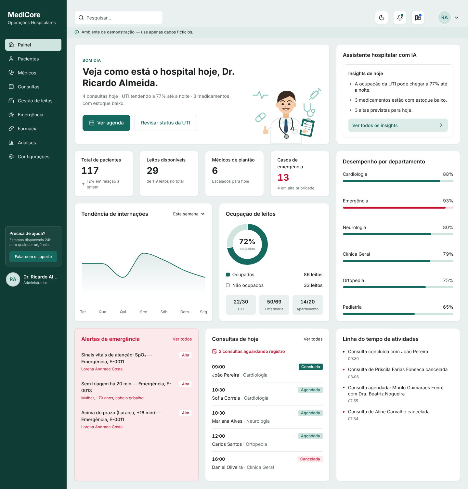

<details>
<summary>Tema escuro, celular, cadastros e módulos operacionais</summary>

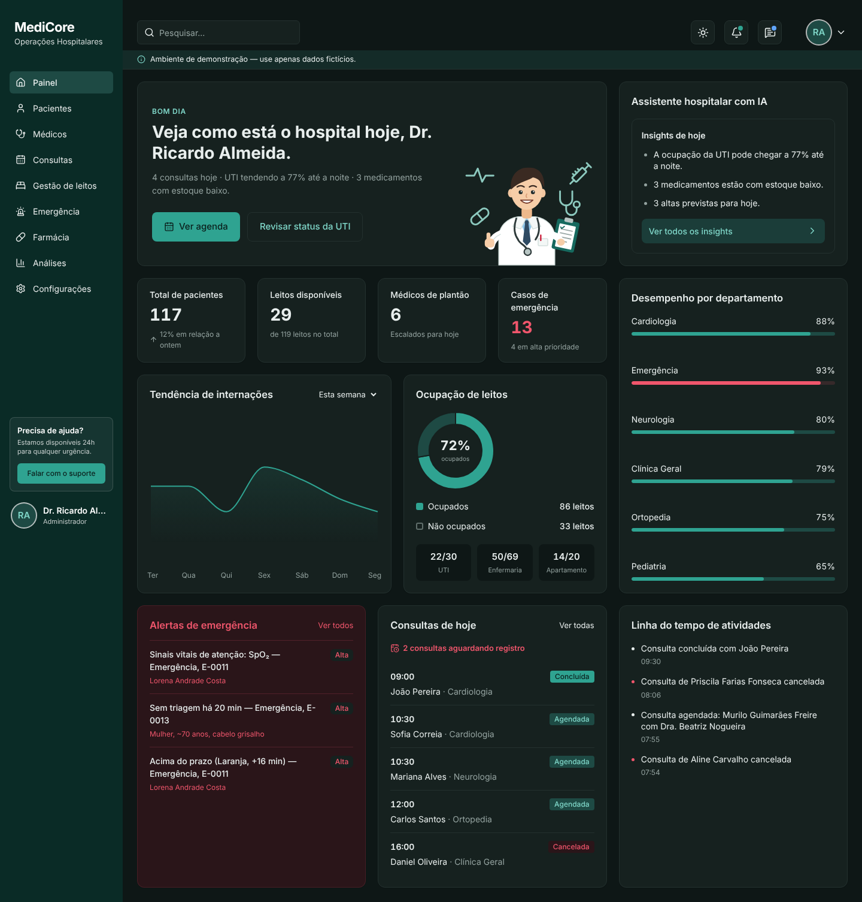

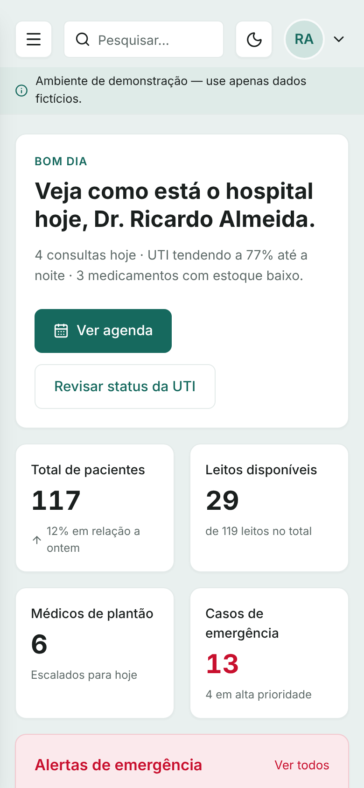

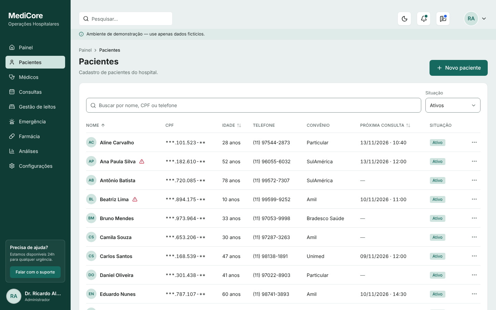
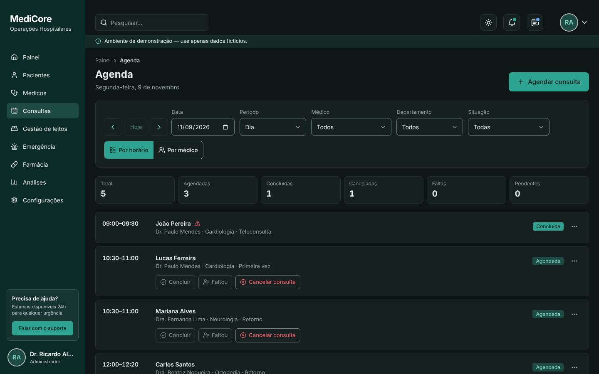
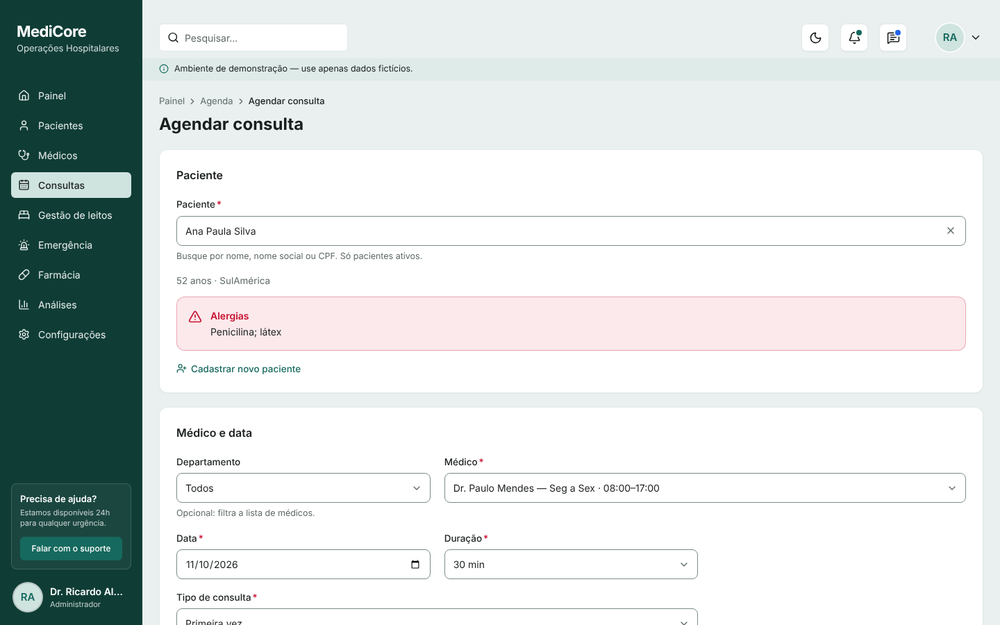
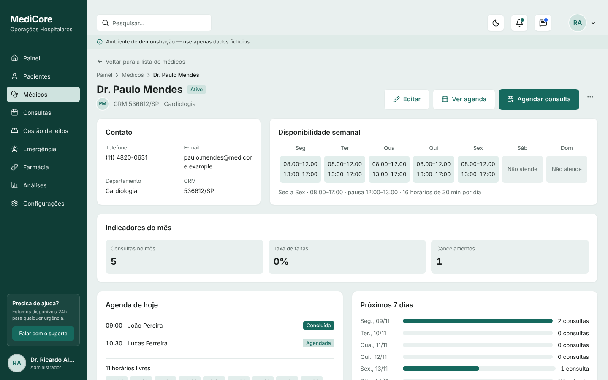
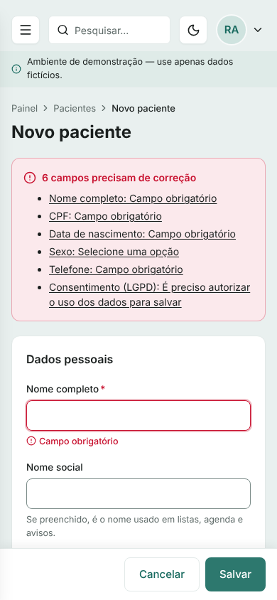

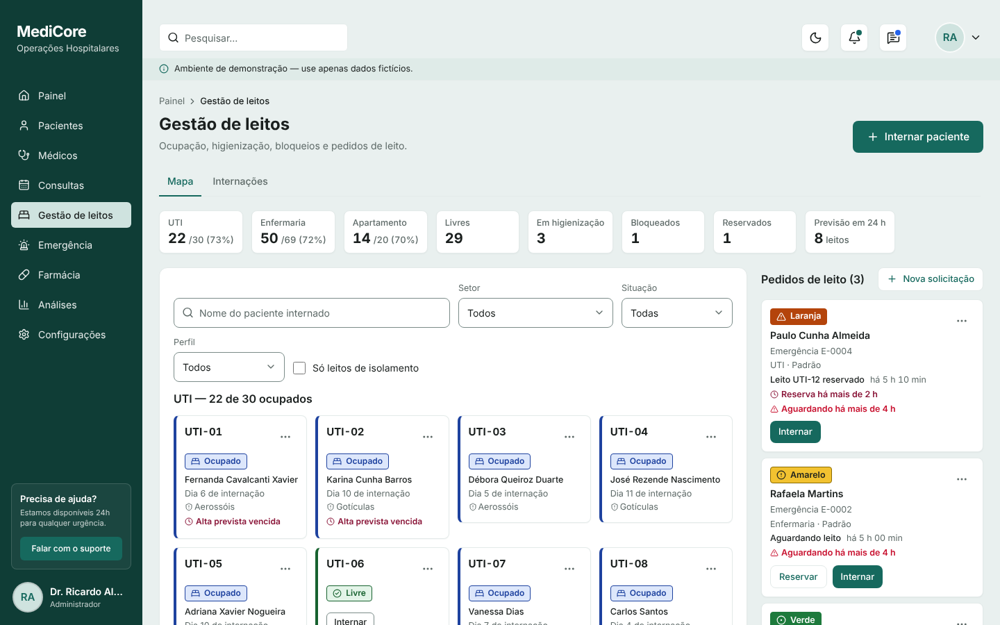
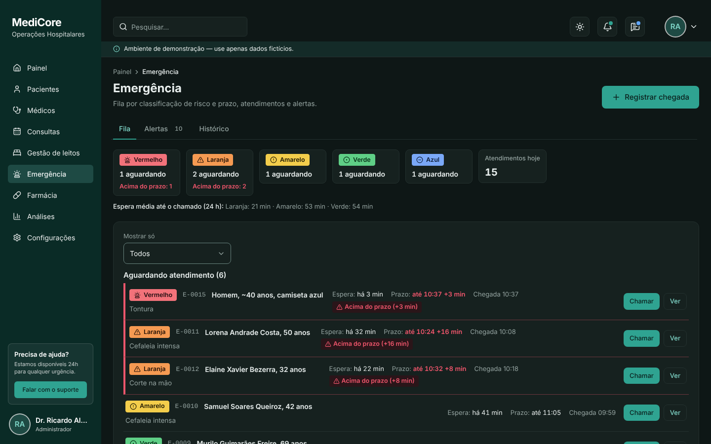
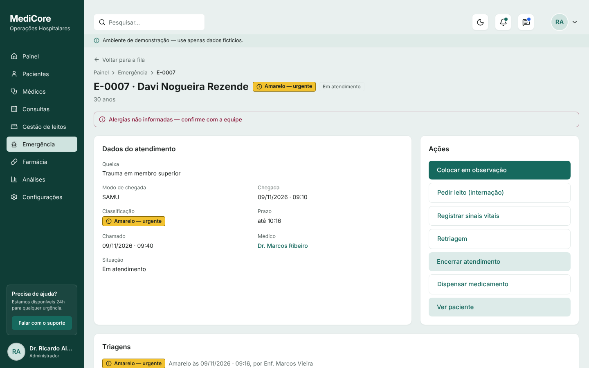
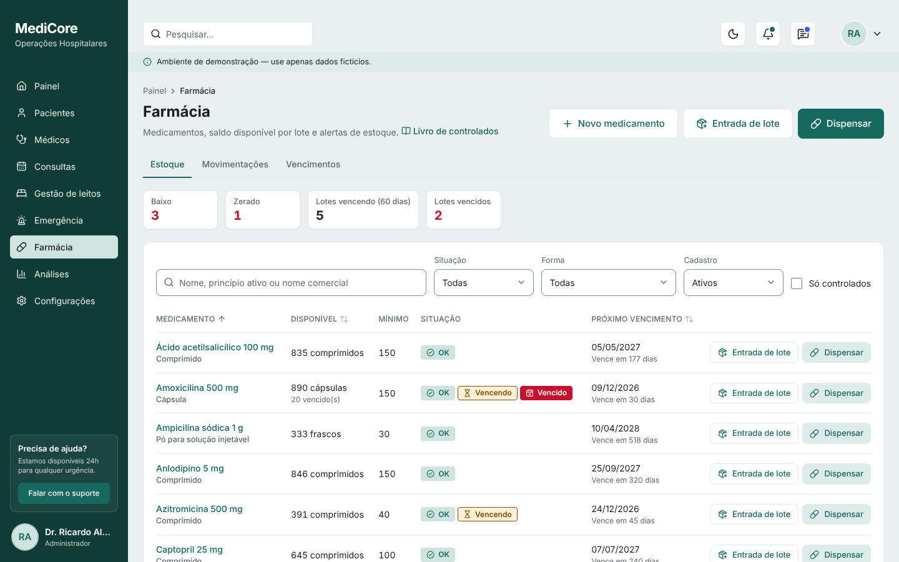
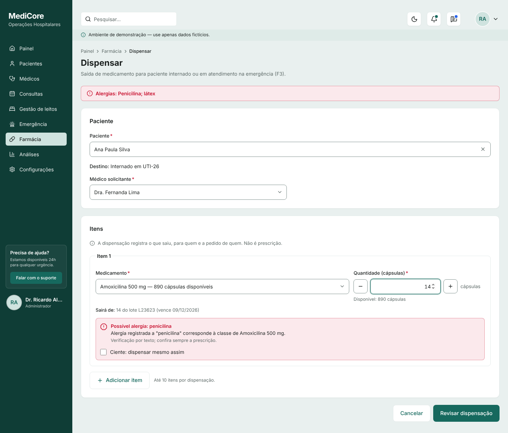
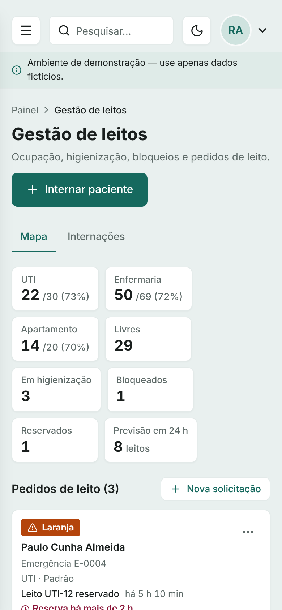
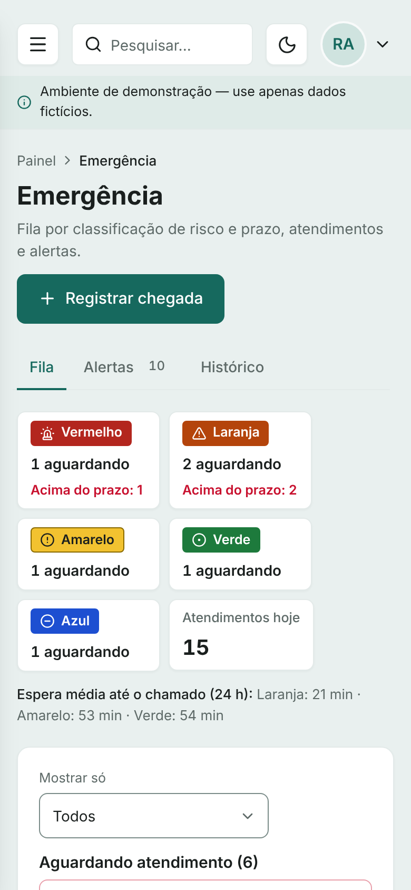

</details>

**Stack:**

- React 19 · TypeScript · Vite 8 · Tailwind CSS 4
- Recharts 3 · lucide-react · React Router 7 (data router)
- react-hook-form + zod
- Testes: Vitest 5 + Testing Library e Playwright

## Pré-requisitos

- Node.js 20.19 ou superior (recomendado: 22 LTS)
- npm 10+

## Como rodar

```bash
npm install        # instala as dependências
npm run dev        # servidor de desenvolvimento (http://localhost:5173)
```

Na primeira execução, os dados de exemplo são criados automaticamente:

- 30 pacientes e 8 médicos, todos fictícios;
- cerca de 40 consultas, da semana passada à próxima.

## Scripts

| Comando                  | O que faz                                                         |
| ------------------------ | ----------------------------------------------------------------- |
| `npm run dev`            | Inicia o servidor de desenvolvimento                              |
| `npm run build`          | Checa os tipos e gera a build de produção em `dist/`              |
| `npm run preview`        | Serve a build de produção localmente (http://localhost:4173)      |
| `npm run test`           | Testes unitários e de componentes (Vitest), uma vez               |
| `npm run test:watch`     | Os mesmos testes em modo observação                               |
| `npm run test:coverage`  | Testes com relatório de cobertura (HTML em `coverage/index.html`) |
| `npm run test:e2e`       | Testes de ponta a ponta e acessibilidade (Playwright + axe)       |
| `npm run test:e2e:ui`    | Os testes de ponta a ponta no modo visual do Playwright           |
| `npm run i18n:verificar` | Procura textos de interface escritos fora de `src/i18n/pt-BR.ts`  |
| `npm run lint`           | Analisa o código com oxlint                                       |
| `npm run format`         | Formata o código com Prettier                                     |

### Testes de ponta a ponta

```bash
npx playwright install chromium   # só na primeira vez
npm run test:e2e
```

O Playwright gera a build, sobe o `vite preview` e roda os cenários em `e2e/`. Cada teste
começa com o navegador limpo e o relógio fixado em uma segunda-feira, 09/11/2026, às 09:40, no
fuso `America/Sao_Paulo`, para que os dados de exemplo sejam sempre os mesmos.

Os cenários são:

- cadastrar paciente → agendar → ver no Painel → concluir;
- horário ocupado durante o preenchimento → erro → escolher outro;
- inativar médico com consultas futuras → bloqueio → cancelar as consultas → inativar;
- duas abas agendando o mesmo horário;
- emergência → leito → internação (chegada sem identificação, triagem, vincular, chamar, pedir
  leito, reservar no mapa, internar);
- alta → higienização → leito livre, com o Painel subindo;
- farmácia: entrada de lote → dispensação por FEFO com alerta de alergia → estoque baixo no
  Painel → devolução;
- duas abas internando no mesmo leito e dispensando o último estoque;
- correções (desfazer alta, reabrir atendimento, estornar) dentro e depois do prazo;
- óbito: cadastro inativado e consultas futuras canceladas;
- fluxos só com teclado;
- axe em todas as rotas e nos diálogos, nos temas claro e escuro.

O relatório fica em `playwright-report/`.

## Cadastros

### Rotas

| Rota                    | Tela                                                                                  |
| ----------------------- | ------------------------------------------------------------------------------------- |
| `/`                     | Painel                                                                                |
| `/pacientes`            | Lista de pacientes: busca por nome, nome social, CPF ou telefone; filtros e ordenação |
| `/pacientes/novo`       | Cadastrar paciente                                                                    |
| `/pacientes/:id`        | Detalhe do paciente, com o histórico de consultas                                     |
| `/pacientes/:id/editar` | Editar paciente                                                                       |
| `/medicos`              | Lista de médicos: busca por nome ou CRM; filtro por departamento                      |
| `/medicos/novo`         | Cadastrar médico, com a disponibilidade semanal                                       |
| `/medicos/:id`          | Detalhe do médico: agenda do dia e indicadores do mês                                 |
| `/medicos/:id/editar`   | Editar médico                                                                         |
| `/consultas`            | Agenda do dia: navegação por data, filtros, resumo e baixa em lote                    |
| `/consultas/nova`       | Agendar consulta. Aceita `?pacienteId=`, `?medicoId=` e `?data=`                      |
| `/consultas/:id`        | Detalhe da consulta, com o histórico de eventos                                       |
| `/consultas/:id/editar` | Reagendar consulta                                                                    |

Busca, filtros, ordenação e página ficam na URL. Por isso, "Voltar" e recarregar a página mantêm
a lista como estava.

### Processos

| Processo                               | O que acontece                                                                                                                                                          |
| -------------------------------------- | ----------------------------------------------------------------------------------------------------------------------------------------------------------------------- |
| **P1** Cadastrar paciente              | O CPF é validado e não pode repetir. Menores de 18 anos exigem um responsável legal. O endereço pode ser preenchido pelo CEP. É preciso registrar o consentimento LGPD. |
| **P2** Editar paciente                 | Pede confirmação para trocar o CPF. Se o cadastro mudou em outra aba, avisa (controle de versão).                                                                       |
| **P3/P4** Inativar e reativar paciente | Inativar cancela as consultas futuras, e a confirmação informa quantas serão canceladas.                                                                                |
| **P5** Excluir paciente                | Só é possível se o paciente nunca teve consulta. Nos outros casos, use inativar.                                                                                        |
| **P6/P7** Cadastrar e editar médico    | O CRM (número + UF) e o e-mail não podem repetir. Ao mudar a disponibilidade, o sistema avisa quais consultas ficaram fora do novo horário.                             |
| **P8** Inativar médico                 | Fica bloqueado enquanto houver consultas futuras. O diálogo lista essas consultas, com opções para reagendar ou cancelar cada uma.                                      |
| **P9** Agendar                         | Só oferece horários livres: dentro do expediente, fora da pausa, sem conflito de médico ou de paciente, e nada no passado.                                              |
| **P10** Reagendar                      | Usa as mesmas regras do agendamento. A consulta não conflita com ela mesma.                                                                                             |
| **P11** Cancelar                       | Exige um motivo. A consulta nunca é apagada e mantém o histórico.                                                                                                       |
| **P12** Concluir ou registrar falta    | Só a partir do horário de início da consulta.                                                                                                                           |
| **P13** Baixa de pendências            | Consultas que já passaram sem registro aparecem como "Aguardando registro" e podem ser baixadas em lote.                                                                |

### Regras principais

- **Os conflitos são verificados de novo ao salvar.** O formulário já esconde os horários
  ocupados, mas o serviço confere tudo outra vez dentro de uma transação. Com duas abas abertas,
  a segunda recebe "Este horário acabou de ser ocupado", e nada é gravado em dobro.
- **Datas sempre no fuso do hospital** (`America/Sao_Paulo`), seja qual for o fuso do computador.
- **Antecedência e duração:** é possível agendar até 180 dias à frente. A duração vai de 5 a 120
  minutos, em múltiplos de 5.
- **Exibição:**
  - registros inativos não aparecem nas listas, mas continuam acessíveis pelo link;
  - o nome social, quando existe, é o nome exibido;
  - o CPF aparece mascarado nas listas.
- **Valores configuráveis:** ficam em `src/config/limites.ts` (antecedência, tolerância, itens
  por página, limite de armazenamento).

### Armazenamento e limites

- Cada coleção fica em `localStorage`, na chave `medicore:<colecao>:v1`.
- Há uma versão de esquema com migrações (`services/migracoes.ts`).
- Mudanças feitas em uma aba aparecem nas outras sem recarregar.
- **Retenção (módulos):** os históricos fechados ficam por um tempo e depois são somados nos
  resumos mensais (os gráficos não perdem os totais): internações 30 dias, atendimentos e pedidos
  de leito 7 dias, movimentações 60 dias, dispensações 30 dias. Um registro ainda citado por outro
  vira "registro arquivado". A rotina roda uma vez por dia, ao abrir o sistema.
- **Tetos por coleção** (só agem no uso intenso, removendo primeiro os fechados mais antigos):
  internações 200, atendimentos 120, pedidos de leito 50, movimentações 800, dispensações 200; o
  volume de referência do catálogo é de 150 medicamentos e 350 lotes. Valores em
  `src/config/limites.ts`.
- **Limite prático:** cerca de **600 pacientes + 2.000 consultas, com os módulos no teto**. Esse
  volume ocupa 3,7 MB, 73% dos ~5 MB do navegador, e a fila, o mapa e o estoque respondem em menos
  de 15 ms (teste em `src/__tests__/carga.operacoes.test.ts`). Só os cadastros, sem os módulos,
  vão até 1.000 pacientes + 3.000 consultas (`carga.test.ts`). Para volumes maiores, é preciso o
  backend.
- Ao passar de 80% do limite, o sistema mostra um aviso.
- Se o armazenamento encher, nada é gravado pela metade: a operação inteira é desfeita.

### Restaurar os dados de exemplo

- **Em desenvolvimento:** abra **`/ui`** (vitrine de componentes) e use **"Restaurar dados de
  exemplo"**. O botão pede confirmação, apaga só os dados do MediCore (o tema escolhido
  continua) e atualiza as outras abas abertas.
- **Na build de produção:** apague as chaves `medicore:*` em DevTools → Application → Local
  Storage e recarregue a página.

### Privacidade do CEP

A busca de endereço usa o serviço público **ViaCEP** (`viacep.com.br`), chamado direto pelo
navegador.

- Só o CEP é enviado; nenhum nome, CPF ou outro dado do paciente sai do navegador.
- Se o ViaCEP estiver fora do ar ou bloqueado pela rede, o endereço pode ser preenchido à mão.
- A busca desiste depois de 5 segundos.

## Módulos operacionais

Gestão de leitos, Emergência e Farmácia funcionam integrados entre si, com os cadastros e com o
Painel. As regras ficam nos serviços (`services/leitos.ts`, `emergencia.ts`, `farmacia.ts`), e cada
operação que envolve mais de uma coleção é uma transação: grava tudo ou nada. Os textos de cada
módulo ficam em `src/i18n/pt-BR/<modulo>.ts` e são carregados com as telas dele.

### Gestão de leitos

| Rota                             | Tela                                                                                                     |
| -------------------------------- | -------------------------------------------------------------------------------------------------------- |
| `/leitos`                        | Mapa: resumo por setor, previsão de liberação em 24 h, busca de paciente, filtros e pedidos de leito     |
| `/leitos/internar`               | Internar. Aceita `?pacienteId=`, `?leitoId=` e `?solicitacaoId=`                                         |
| `/leitos/internacoes`            | Internações ativas e encerradas (30 dias), com filtros                                                   |
| `/leitos/internacoes/:id`        | Detalhe: consultas no período, linha do tempo, dispensações; transferir, dar alta, desfazer alta, editar |
| `/leitos/internacoes/:id/editar` | Editar internação                                                                                        |
| `/leitos/:leitoId`               | Detalhe do leito: ocupante, histórico de 30 dias, bloquear e desbloquear                                 |

- **Processos:** internar (L1), transferir (L2), dar alta (L3), higienização (L4), bloquear (L5),
  atender pedido de leito (L6), editar (L7), desfazer alta (L8) e pedido eletivo (L9).
- **Regras principais:**
  - um leito tem no máximo um ocupante, e um paciente no máximo uma internação ativa;
  - alta e transferência levam o leito para higienização, nunca direto para livre;
  - perfil (adulto ou pediátrico) e isolamento são conferidos; exceção só com justificativa;
  - a escolha do leito é conferida de novo ao gravar. Com duas abas, a segunda recebe "Este
    leito acabou de ser ocupado" (E-11).
- **Painel:** "Leitos disponíveis" conta só os leitos livres; a ocupação usa os leitos
  operacionais (sem bloqueados) dos setores de internação. A Observação da emergência fica de fora.

### Emergência

| Rota                      | Tela                                                                                      |
| ------------------------- | ----------------------------------------------------------------------------------------- |
| `/emergencia`             | Fila por cor e prazo, com resumo; aba Alertas (`?aba=alertas`)                            |
| `/emergencia/chegada`     | Registrar chegada, com ou sem identificação. Aceita `?pacienteId=`                        |
| `/emergencia/:id`         | Atendimento: triagens, sinais vitais, linha do tempo, dispensações e as ações da situação |
| `/emergencia/:id/triagem` | Triagem e retriagem                                                                       |
| `/emergencia/historico`   | Encerrados dos últimos 7 dias, com filtros                                                |

- **Processos:** chegada (E1), triagem (E2), chamar (E3), observação (E4), desfecho (E5), pedir
  leito (E6), identificar paciente (E7), fila (E8), reabrir (E9) e sinais vitais (E10).
- **Regras principais:**
  - a cor é escolhida pelo profissional; o sistema não sugere;
  - **prazo** = momento da classificação + tempo-alvo da cor (vermelho 0, laranja 10, amarelo 60,
    verde 120, azul 240 min). Retriagem mais grave adianta o prazo; menos grave exige
    justificativa e não adia;
  - os sinais vitais são sinalizados por faixa etária, como apoio visual, nunca como diagnóstico
    (faixas em `src/config/sinais-vitais.ts`, a validar com a equipe clínica);
  - um paciente não abre dois atendimentos, nem abre atendimento estando internado.

### Farmácia

| Rota                                                 | Tela                                                                             |
| ---------------------------------------------------- | -------------------------------------------------------------------------------- |
| `/farmacia`                                          | Estoque: resumo (baixo, zerado, vencendo, vencidos), busca, filtros e ordenação  |
| `/farmacia/medicamentos/novo`, `/:id`, `/:id/editar` | Catálogo; o detalhe mostra os lotes (ajuste, perda, bloqueio) e as movimentações |
| `/farmacia/entrada`                                  | Entrada de lote, em unidades ou embalagens. Aceita `?medicamentoId=`             |
| `/farmacia/dispensar`                                | Dispensar. Aceita `?pacienteId=`                                                 |
| `/farmacia/dispensacoes/:id`                         | Detalhe, devolução por item, estorno e comprovante para impressão                |
| `/farmacia/movimentacoes`                            | Movimentações com filtros                                                        |
| `/farmacia/vencimentos`                              | Lotes vencendo em 60 dias e vencidos; descarte em lote                           |
| `/farmacia/controlados`                              | Livro de controlados por período, com versão para impressão                      |

- **Processos:** catálogo (F1), entrada (F2), dispensar (F3), devolução (F4), ajuste e perda
  (F5), descarte de vencidos (F6), inativar (F7), estorno (F8) e bloqueio de lote (F9).
- **Regras principais:**
  - a saída usa **FEFO** (vence primeiro, sai primeiro), dividindo entre lotes; lotes vencidos e
    bloqueados ficam de fora;
  - o estoque nunca fica negativo; com duas abas, a segunda recebe "Estoque insuficiente" (E-12);
  - só dispensa para paciente internado ou em atendimento na emergência;
  - alergia (comparação por texto), controlado e quantidade alta pedem confirmação, que fica
    registrada. "Alergias não informadas" não é o mesmo que "sem alergias";
  - movimentações são imutáveis: toda correção é um movimento contrário.

### Correções com prazo

Enganos podem ser desfeitos dentro de uma janela, sempre com motivo e sem apagar o histórico:

| Correção                  | Prazo | Depois do prazo                             |
| ------------------------- | ----- | ------------------------------------------- |
| Desfazer alta (L8)        | 6 h   | "Internar novamente", com os dados copiados |
| Reabrir atendimento (E9)  | 2 h   | Novo atendimento                            |
| Estornar dispensação (F8) | 24 h  | Devolução por item (F4)                     |

O **óbito** (na alta ou no desfecho) inativa o cadastro e cancela as consultas futuras. Desfazer
reativa o cadastro, mas as consultas canceladas não voltam.

### Integração com os cadastros

- O detalhe do paciente mostra a situação hospitalar (internação ou atendimento em curso) e o
  histórico, com os atalhos Internar e Registrar chegada quando valem.
- O detalhe do médico mostra as internações sob a responsabilidade dele e os atendimentos em curso.
- Agendar consulta para um paciente internado mostra o aviso "Paciente internado em {leito}".
- Inativar ou excluir paciente e inativar médico respeitam as pendências nos módulos.

## Estrutura de pastas

```
src/
├── main.tsx, App.tsx, router.tsx   # entrada e roteador (rotas carregadas sob demanda)
├── index.css                       # Tailwind + tokens de cor (claro/escuro)
├── i18n/pt-BR.ts                   # textos gerais, do Painel e dos cadastros
├── i18n/pt-BR/                     # textos de cada módulo (leitos, emergencia, farmacia…), sob demanda
├── types/                          # tipos do domínio (cadastros, leito, internação, emergência, farmácia)
├── schemas/                        # esquemas zod — um por entidade, usado no formulário e no serviço
├── data/                           # dados de exemplo (seeds) dos cadastros e dos módulos
├── services/                       # regras de negócio (cadastros, leitos, emergência, farmácia,
│   │                               #   indicadores, retenção)
│   └── repositorio.ts              # memória + localStorage: transação, versão, abas, migrações
├── config/                         # menu, limites, setores e faixas de sinais vitais
├── hooks/                          # useColecao/useDados (recarregam sozinhos), formulários, ações
├── utils/                          # datas, agenda, fila (A7), FEFO, alergia, compatibilidade de
│                                   #   leito, sinais vitais, consistência (INV-1 a INV-10)
├── components/
│   ├── layout/                     # AppLayout, Sidebar, Header, UserMenu, MobileDrawer
│   ├── ui/                         # base, formulário, listagem e feedback (Modal, Toast…)
│   ├── dashboard/                  # os 9 cards do Painel
│   └── pacientes/ medicos/ consultas/ leitos/ emergencia/ farmacia/
├── pages/                          # telas (Painel, cadastros, agenda, módulos, /ui)
└── __tests__/                      # Vitest + Testing Library
e2e/                                # Playwright (cenários, teclado, axe)
scripts/varrer-textos.ts            # varredura de textos fora do pt-BR.ts
```

## Como trocar o armazenamento local pela API real

As camadas são separadas para que a troca mexa **só em `src/services/`**:

```
páginas → hooks → serviços (regras de negócio) → repositório (localStorage)
```

1. **Mantenha as assinaturas dos serviços** (`listarPacientes`, `criarPaciente`,
   `agendarConsulta`, `horariosLivres`…) e troque o corpo por chamadas HTTP:

   ```ts
   export async function criarPaciente(entrada: EntradaPaciente): Promise<Paciente> {
     const r = await fetch(`${import.meta.env.VITE_API_URL}/pacientes`, {
       method: 'POST',
       headers: { 'Content-Type': 'application/json' },
       body: JSON.stringify(entrada),
     });
     if (!r.ok) throw await erroDaResposta(r);
     return r.json();
   }
   ```

2. **Converta as respostas de erro nas classes de `services/erros.ts`.** As telas já sabem
   mostrar cada uma:

   | Classe              | Resposta HTTP sugerida                   | Como a tela mostra                           |
   | ------------------- | ---------------------------------------- | -------------------------------------------- |
   | `ErroValidacao`     | 422, com `{ campos: { cpf: '...' } }`    | Erro no campo + resumo                       |
   | `ErroConflito`      | 409, com `{ codigo, campo }`             | CPF ou CRM duplicado, horário ocupado (E-04) |
   | `ErroConcorrencia`  | 412, com cabeçalho `If-Match` e a versão | Diálogo "alterado por outra pessoa"          |
   | `ErroNaoEncontrado` | 404                                      | Página "não encontrado"                      |

3. **Mova as regras para o servidor.**
   - Unicidade, conflitos de agenda (A1/A2) e transições de status precisam ser validados no
     backend, de preferência com restrições no banco (por exemplo, `EXCLUDE` no PostgreSQL para
     intervalos sobrepostos).
   - Os esquemas de `src/schemas/` podem ser reaproveitados no servidor, se ele também for
     TypeScript.

4. **Recarregamento automático.**
   - Os hooks (`useColecao`) recarregam quando `repositorio.assinar()` avisa que algo mudou.
   - Com a API real, chame essa notificação depois de cada gravação feita pelo próprio usuário.
   - Para ver as mudanças de outras pessoas, use WebSocket ou SSE, ou recarregue a cada X
     segundos.

5. **Painel:** os cards que ainda são simulados (alertas, desempenho, leitos e a variação de
   pacientes) leem `src/services/api.ts`, que segue o mesmo padrão.

> Antes de usar com dados reais: autenticação, perfis de acesso, auditoria de quem viu e quem
> alterou cada registro (LGPD), HTTPS, backup e criptografia.

Para testar o estado de erro das telas, crie um `.env.local` com `VITE_SIMULAR_ERRO=true` (veja
`.env.example`) e reinicie o `npm run dev`.

## Como adicionar ou alterar textos

Nenhum texto visível fica escrito direto no código. Para adicionar um texto:

1. Inclua a chave em `src/i18n/pt-BR.ts`, no grupo da área correspondente.
2. Use no componente: `{t.pacientes.novoTexto}`.
3. Rode `npm run i18n:verificar` para conferir que nada ficou de fora.

Textos que dependem de números são funções, para tratar singular e plural:
`t.leitos.leitos(1)` → "1 leito", `t.leitos.leitos(34)` → "34 leitos".

| Dado     | Formato           | Onde                    |
| -------- | ----------------- | ----------------------- |
| Datas    | `dd/mm/aaaa`      | `src/utils/datas.ts`    |
| Horas    | 24h               | `src/utils/datas.ts`    |
| CPF      | `000.000.000-00`  | `src/utils/mascaras.ts` |
| Telefone | `(00) 00000-0000` | `src/utils/mascaras.ts` |
| CEP      | `00000-000`       | `src/utils/mascaras.ts` |
| CRM      | `123456/SP`       | `src/utils/mascaras.ts` |

## Tema e cores

As cores ficam em `src/index.css` como tokens do Tailwind (`bg-primary`, `text-text-muted`,
`bg-card`…), com valores próprios para o tema escuro.

- O modo escuro é ativado pelo atributo `data-theme="dark"` no `<html>`.
- A escolha fica salva no `localStorage`, na chave `medicore-tema`.
- Sem escolha salva, o sistema segue o tema do sistema operacional.

## Componentes de UI

Os componentes base ficam em `src/components/ui/`. Com `npm run dev`, a página interna **/ui**
mostra todas as variantes:

- formulário: campos, máscaras, combobox;
- listagem: tabela, paginação, filtros, menu de ações;
- feedback: diálogos e avisos.

A página também tem o botão de restaurar os dados de exemplo.

## Qualidade

- **Testes:** 672 testes unitários e de componentes (Vitest), com 92% de cobertura de linhas.
  - Metas mínimas por pasta em `vite.config.ts`: `utils/` ≥ 90%, `services/` ≥ 85%,
    `components/ui/` ≥ 70%.
  - As regras dos módulos são testadas nos serviços, com as invariantes INV-1 a INV-10
    conferidas depois de cada operação e num teste de 500 operações aleatórias.
  - Além deles, 139 testes de ponta a ponta (Playwright), com os 10 cenários.
- **Acessibilidade:**
  - **axe:** 0 violações WCAG 2.2 AA e boas práticas em todas as rotas, nos temas claro e
    escuro. Também foi verificado com diálogos, busca e resumo de erros abertos, e em 375 px.
  - **Teclado:** navegação completa, inclusive no seletor de leito, na grade de leitos, na fila,
    nos sinais vitais e nos itens da dispensação. Ao salvar com erros, o foco vai para o 1º campo
    inválido na ordem da tela, e cada mudança de rota é anunciada.
  - **Cor nunca sozinha:** risco e situação do leito têm sempre texto e ícone (conferido em escala
    de cinza).
  - **Gráficos:** têm descrição em texto e tabela para leitores de tela.
  - **Leitor de tela (NVDA):** ainda não testado. Os roteiros (cadastros, Painel, internar,
    triagem e dispensar) estão em [`docs/VERIFICACAO_MANUAL.md`](docs/VERIFICACAO_MANUAL.md),
    assim como a revisão das mensagens de erro e dos termos dos módulos.
  - **Campos de data:** usam o calendário nativo do navegador, que mostra `dd/mm/aaaa` quando o
    navegador está em português.
- **Lighthouse (desktop):** Painel e listas 99 · 100 · 100 · 100. Nas telas dos módulos (mapa,
  fila, atendimento, estoque, dispensar), Desempenho de 94 a 97 e 100 nas outras categorias.
- **Desempenho:**
  - cada módulo e os gráficos são carregados sob demanda, em pacotes próprios; os indicadores do
    Painel também (153,6 kB gzip no carregamento inicial);
  - com 1.000 pacientes e 3.000 consultas, toda busca responde em menos de 100 ms;
  - com 600 pacientes, 2.000 consultas e os módulos no teto, fila, mapa e estoque respondem em
    menos de 15 ms;
  - a primeira semeadura dos dados de exemplo (cerca de 950 KB) leva por volta de 100 ms.

## Deploy

**Versão publicada:** https://medicore-heltonhelenos-projects.vercel.app (1.2.0, com os módulos
operacionais).

- O projeto `medicore` na Vercel está ligado a este repositório no GitHub.
- Cada push na `main` gera uma nova versão de produção. Pushes em outras branches geram prévias,
  que só abrem para quem tem acesso ao time na Vercel.

### Integração contínua (Fase 22)

O workflow `.github/workflows/verificacoes.yml` roda em todo PR e em todo push na `main`:

| Job                       | O que faz                                                                                                                                             |
| ------------------------- | ----------------------------------------------------------------------------------------------------------------------------------------------------- |
| Lint, formato e textos    | `lint`, `format:check` e `i18n:verificar`                                                                                                             |
| Testes e cobertura        | `test:coverage` com as metas de `vite.config.ts`; anexa o relatório `cobertura`                                                                       |
| Build e pacote inicial    | `build` e `pacote:medir` (reprova com textos dos módulos no pacote inicial). No PR, comenta a diferença para a `main` e avisa se crescer mais de 5 kB |
| Ponta a ponta (1/2 e 2/2) | `test:e2e` dividido em duas partes; anexa o relatório e os traces quando falha                                                                        |
| `verificacoes`            | Só passa se os quatro acima passarem. É o check obrigatório                                                                                           |

- **Publicar só com tudo verde:** em _Settings → Build and Deployment → Deployment Checks_ do
  projeto na Vercel, adicione o check `verificacoes` do GitHub. A Vercel continua gerando a versão
  a cada push na `main`, mas só a coloca no endereço de produção quando o check passar. Para
  publicar mesmo assim (emergência), use _Force Promote_ na página da versão.
- **Aviso de falha:** o GitHub manda e-mail a quem fez o push quando uma execução falha
  (_Settings → Notifications → Actions_ da conta, ligado por padrão).
- **Proteger a `main`** (exigir PR e o check `verificacoes`) é a Fase 41 (BL-61).
- É um ambiente de demonstração: cada visitante tem os próprios dados, gravados só no
  navegador dele.

O projeto já vem configurado para dois serviços. Nos dois, as rotas do React Router funcionam ao
recarregar a página.

- **Vercel:** `vercel.json` — importe o repositório em vercel.com ou rode `npx vercel`.
- **Netlify:** `netlify.toml` — importe o repositório em app.netlify.com ou rode
  `npx netlify deploy --prod`.

A página interna `/ui` existe apenas em desenvolvimento e não vai para a build de produção.

## Andamento

Os planos concluídos, com checklists por fase, estão arquivados em `docs/planos/`:

- `PLANO_IMPLEMENTACAO_MEDICORE.md` — Painel, Fases 1–7;
- `PLANO_CADASTROS_MEDICORE.md` — especificação dos cadastros, backlog revisado e próximo passo;
- `PLANO_EXECUCAO_CADASTROS.md` — tarefas das Fases 8–14, diário e lições aprendidas.

- `PLANO_OPERACOES_MEDICORE.md` — especificação dos módulos operacionais (leitos, emergência e
  farmácia);
- `PLANO_EXECUCAO_OPERACOES.md` — tarefas das Fases 15–21, diário, números finais e lições
  aprendidas.

O resumo de cada fase está em `docs/PR_FASE_<N>.md`. O backlog, ainda em uso, fica em
`BACKLOG_MEDICORE.md`, na raiz.

Planos ativos, na raiz:

- `PLANO_MELHORIAS_MEDICORE.md` — especificação das 40 melhorias do backlog (decisões, processos,
  regras, riscos e critérios de aceite);
- `PLANO_EXECUCAO_MELHORIAS.md` — tarefas por processo das Fases 22–64, em 4 ondas (versões 2.0.0
  a 3.x).

- [x] Fases 1–7 — Painel (configuração, layout, componentes, cards, grade, qualidade)
- [x] Fases 8–14 — Cadastros, agenda e qualidade (versão 1.1.0)
- [x] Fase 15 — Fundação dos módulos operacionais (regras, serviços, dados de exemplo, invariantes)
- [x] Fase 16 — Componentes compartilhados
- [x] Fase 17 — Gestão de leitos
- [x] Fase 18 — Emergência
- [x] Fase 19 — Farmácia
- [x] Fase 20 — Integração com o Painel e os cadastros
- [x] Fase 21 — Qualidade, testes e entrega
- [x] Encerramento — versão 1.2.0 (falta publicar: mesclar os PRs na `main`)

**Pendências manuais:** o teste com o leitor de tela NVDA, a revisão das mensagens de erro e dos
termos dos módulos por quem não é desenvolvedor, e os testes com duas abas (roteiros em
`docs/VERIFICACAO_MANUAL.md`).

- [ ] Etapa 0 — Publicar a 1.2.0, acessos e decisões da Onda 1
- [ ] Fases 22–30 — Onda 1: CI, monitoramento, backend, login, auditoria, backup (versão 2.0.0)
- [ ] Fases 31–40 — Onda 2 (versões 2.1–2.3)
- [ ] Fases 41–56 — Onda 3 (versões 2.4–2.9)
- [ ] Fases 57–64 — Onda 4, só os itens aprovados (versão 3.x)

**Próximo passo:** a Etapa 0 do `PLANO_EXECUCAO_MELHORIAS.md` (publicar a versão 1.2.0) e, em
seguida, a Fase 22 (integração contínua, BL-60).
