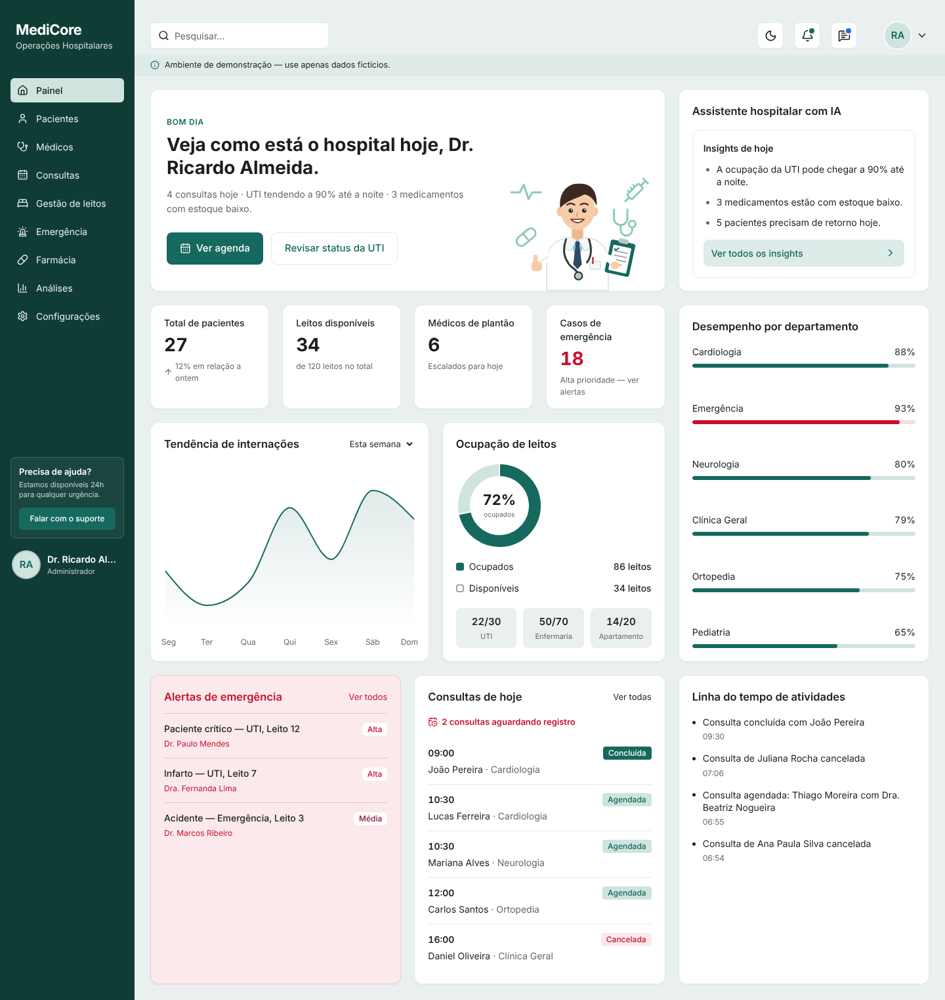
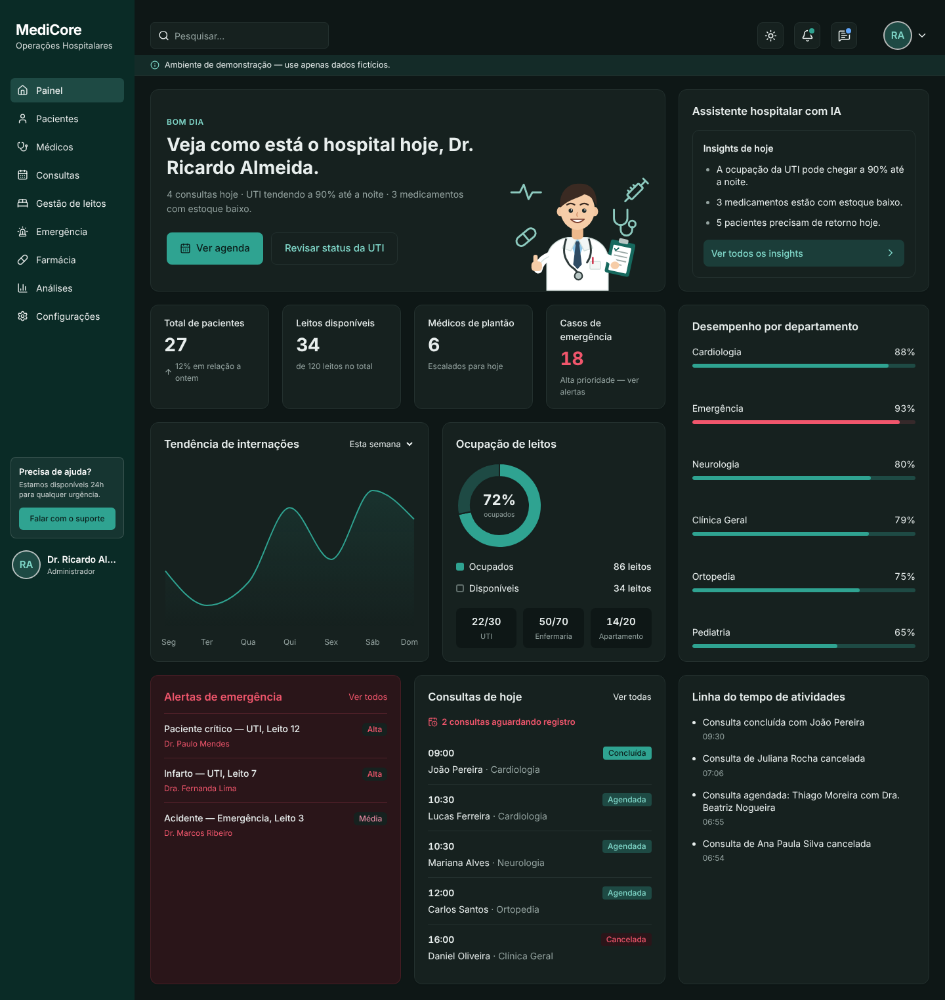
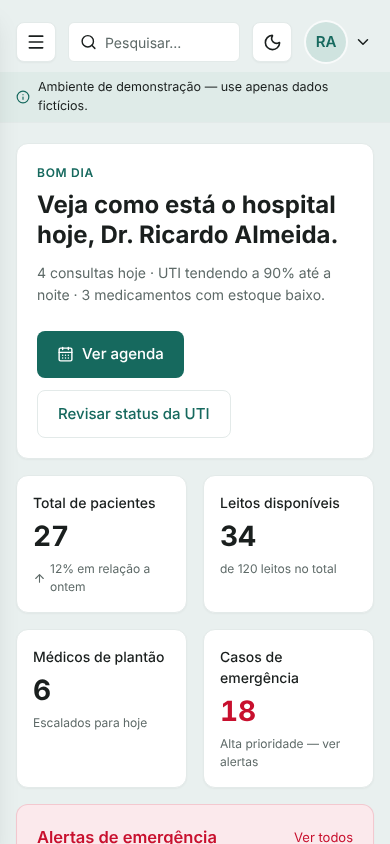
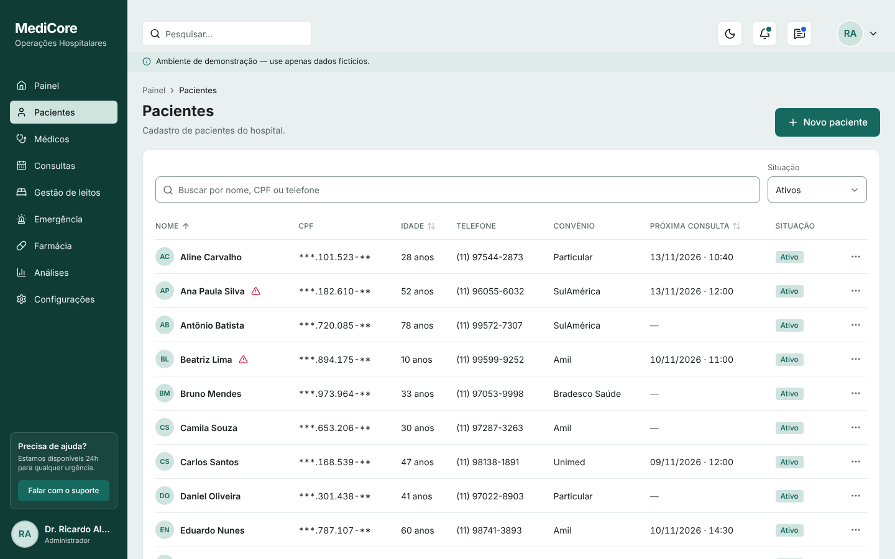
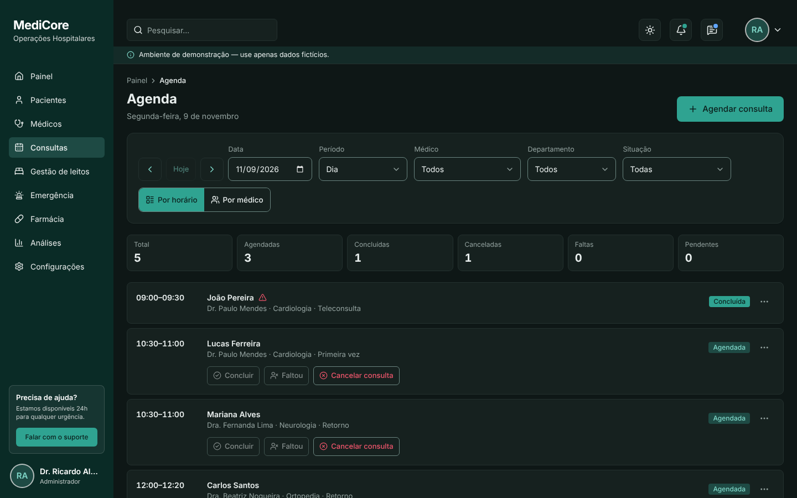
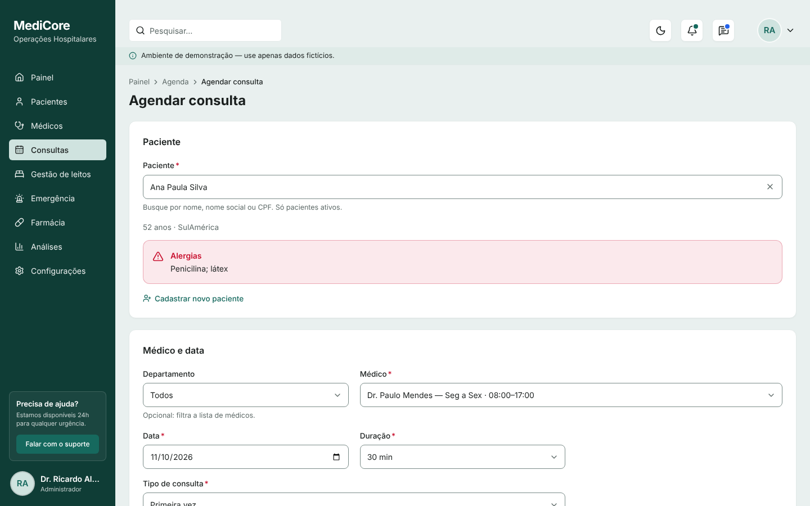
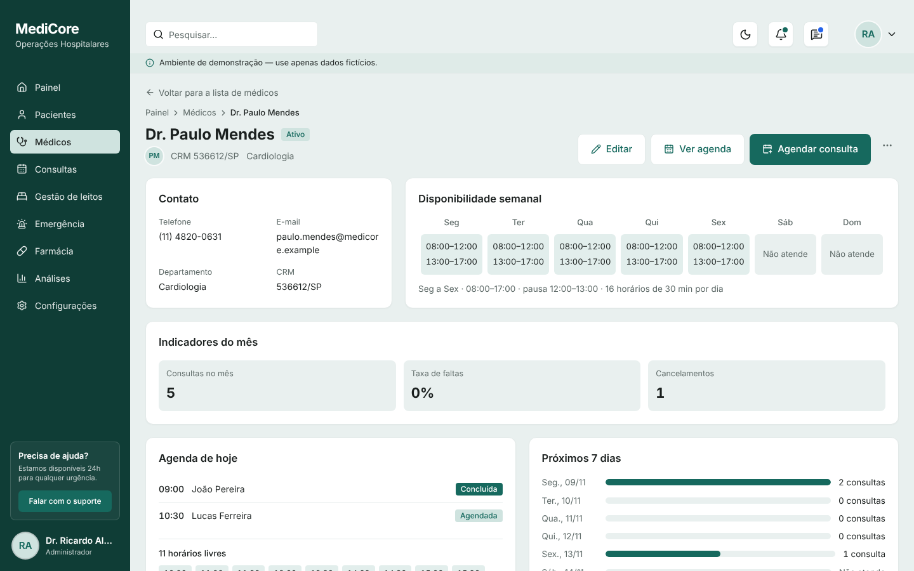
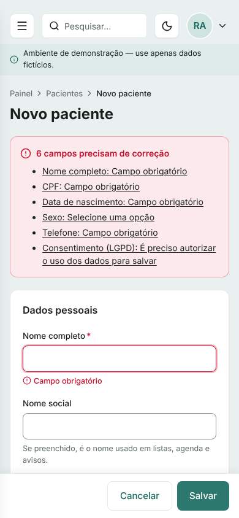

# MediCore — Operações Hospitalares

Sistema administrativo hospitalar com interface 100% em português do Brasil:

- **Painel:**
  - indicadores do dia, ocupação de leitos e tendência de internações;
  - desempenho por departamento e alertas de emergência;
  - consultas de hoje e linha do tempo de atividades.
- **Cadastros:**
  - pacientes e médicos;
  - agenda de consultas, com controle de conflitos de horário.

Funciona em desktop, tablet e celular, nos temas claro e escuro.

> ⚠️ **Ambiente de demonstração — use apenas dados fictícios.**
> Os dados ficam gravados **somente no navegador** (`localStorage`), sem servidor, sem login, sem
> criptografia e sem backup. Não cadastre dados reais de pacientes (LGPD). Para uso real é
> preciso um backend com autenticação e controle de acesso (veja
> [Como trocar pela API real](#como-trocar-o-armazenamento-local-pela-api-real)).



<details>
<summary>Tema escuro, celular e telas de cadastro</summary>











</details>

**Stack:**

- React 19 · TypeScript · Vite 8 · Tailwind CSS 4
- Recharts 3 · lucide-react · React Router 7 (data router)
- react-hook-form + zod
- Testes: Vitest 5 + Testing Library e Playwright

## Pré-requisitos

- Node.js 20.19 ou superior (recomendado: 22 LTS)
- npm 10+

## Como rodar

```bash
npm install        # instala as dependências
npm run dev        # servidor de desenvolvimento (http://localhost:5173)
```

Na primeira execução, os dados de exemplo são criados automaticamente:

- 30 pacientes e 8 médicos, todos fictícios;
- cerca de 40 consultas, da semana passada à próxima.

## Scripts

| Comando                  | O que faz                                                         |
| ------------------------ | ----------------------------------------------------------------- |
| `npm run dev`            | Inicia o servidor de desenvolvimento                              |
| `npm run build`          | Checa os tipos e gera a build de produção em `dist/`              |
| `npm run preview`        | Serve a build de produção localmente (http://localhost:4173)      |
| `npm run test`           | Testes unitários e de componentes (Vitest), uma vez               |
| `npm run test:watch`     | Os mesmos testes em modo observação                               |
| `npm run test:coverage`  | Testes com relatório de cobertura (HTML em `coverage/index.html`) |
| `npm run test:e2e`       | Testes de ponta a ponta e acessibilidade (Playwright + axe)       |
| `npm run test:e2e:ui`    | Os testes de ponta a ponta no modo visual do Playwright           |
| `npm run i18n:verificar` | Procura textos de interface escritos fora de `src/i18n/pt-BR.ts`  |
| `npm run lint`           | Analisa o código com oxlint                                       |
| `npm run format`         | Formata o código com Prettier                                     |

### Testes de ponta a ponta

```bash
npx playwright install chromium   # só na primeira vez
npm run test:e2e
```

O Playwright gera a build, sobe o `vite preview` e roda os cenários em `e2e/`. Cada teste
começa com o navegador limpo e o relógio fixado em uma segunda-feira, 09/11/2026, às 09:40, no
fuso `America/Sao_Paulo`, para que os dados de exemplo sejam sempre os mesmos.

Os cenários são:

- cadastrar paciente → agendar → ver no Painel → concluir;
- horário ocupado durante o preenchimento → erro → escolher outro;
- inativar médico com consultas futuras → bloqueio → cancelar as consultas → inativar;
- duas abas agendando o mesmo horário;
- fluxos só com teclado;
- axe em todas as rotas, nos temas claro e escuro.

O relatório fica em `playwright-report/`.

## Cadastros

### Rotas

| Rota                    | Tela                                                                                  |
| ----------------------- | ------------------------------------------------------------------------------------- |
| `/`                     | Painel                                                                                |
| `/pacientes`            | Lista de pacientes: busca por nome, nome social, CPF ou telefone; filtros e ordenação |
| `/pacientes/novo`       | Cadastrar paciente                                                                    |
| `/pacientes/:id`        | Detalhe do paciente, com o histórico de consultas                                     |
| `/pacientes/:id/editar` | Editar paciente                                                                       |
| `/medicos`              | Lista de médicos: busca por nome ou CRM; filtro por departamento                      |
| `/medicos/novo`         | Cadastrar médico, com a disponibilidade semanal                                       |
| `/medicos/:id`          | Detalhe do médico: agenda do dia e indicadores do mês                                 |
| `/medicos/:id/editar`   | Editar médico                                                                         |
| `/consultas`            | Agenda do dia: navegação por data, filtros, resumo e baixa em lote                    |
| `/consultas/nova`       | Agendar consulta. Aceita `?pacienteId=`, `?medicoId=` e `?data=`                      |
| `/consultas/:id`        | Detalhe da consulta, com o histórico de eventos                                       |
| `/consultas/:id/editar` | Reagendar consulta                                                                    |

Busca, filtros, ordenação e página ficam na URL. Por isso, "Voltar" e recarregar a página mantêm
a lista como estava.

### Processos

| Processo                               | O que acontece                                                                                                                                                          |
| -------------------------------------- | ----------------------------------------------------------------------------------------------------------------------------------------------------------------------- |
| **P1** Cadastrar paciente              | O CPF é validado e não pode repetir. Menores de 18 anos exigem um responsável legal. O endereço pode ser preenchido pelo CEP. É preciso registrar o consentimento LGPD. |
| **P2** Editar paciente                 | Pede confirmação para trocar o CPF. Se o cadastro mudou em outra aba, avisa (controle de versão).                                                                       |
| **P3/P4** Inativar e reativar paciente | Inativar cancela as consultas futuras, e a confirmação informa quantas serão canceladas.                                                                                |
| **P5** Excluir paciente                | Só é possível se o paciente nunca teve consulta. Nos outros casos, use inativar.                                                                                        |
| **P6/P7** Cadastrar e editar médico    | O CRM (número + UF) e o e-mail não podem repetir. Ao mudar a disponibilidade, o sistema avisa quais consultas ficaram fora do novo horário.                             |
| **P8** Inativar médico                 | Fica bloqueado enquanto houver consultas futuras. O diálogo lista essas consultas, com opções para reagendar ou cancelar cada uma.                                      |
| **P9** Agendar                         | Só oferece horários livres: dentro do expediente, fora da pausa, sem conflito de médico ou de paciente, e nada no passado.                                              |
| **P10** Reagendar                      | Usa as mesmas regras do agendamento. A consulta não conflita com ela mesma.                                                                                             |
| **P11** Cancelar                       | Exige um motivo. A consulta nunca é apagada e mantém o histórico.                                                                                                       |
| **P12** Concluir ou registrar falta    | Só a partir do horário de início da consulta.                                                                                                                           |
| **P13** Baixa de pendências            | Consultas que já passaram sem registro aparecem como "Aguardando registro" e podem ser baixadas em lote.                                                                |

### Regras principais

- **Os conflitos são verificados de novo ao salvar.** O formulário já esconde os horários
  ocupados, mas o serviço confere tudo outra vez dentro de uma transação. Com duas abas abertas,
  a segunda recebe "Este horário acabou de ser ocupado", e nada é gravado em dobro.
- **Datas sempre no fuso do hospital** (`America/Sao_Paulo`), seja qual for o fuso do computador.
- **Antecedência e duração:** é possível agendar até 180 dias à frente. A duração vai de 5 a 120
  minutos, em múltiplos de 5.
- **Exibição:**
  - registros inativos não aparecem nas listas, mas continuam acessíveis pelo link;
  - o nome social, quando existe, é o nome exibido;
  - o CPF aparece mascarado nas listas.
- **Valores configuráveis:** ficam em `src/config/limites.ts` (antecedência, tolerância, itens
  por página, limite de armazenamento).

### Armazenamento e limites

- Cada coleção fica em `localStorage`, na chave `medicore:<colecao>:v1`.
- Há uma versão de esquema com migrações (`services/migracoes.ts`).
- Mudanças feitas em uma aba aparecem nas outras sem recarregar.
- O limite prático é de cerca de **1.000 pacientes + 3.000 consultas**: esse volume ocupa cerca
  de 68% dos ~5 MB do navegador (teste em `src/__tests__/carga.test.ts`).
- Ao passar de 80% do limite, o sistema mostra um aviso.
- Se o armazenamento encher, nada é gravado pela metade: a operação inteira é desfeita.

### Restaurar os dados de exemplo

- **Em desenvolvimento:** abra **`/ui`** (vitrine de componentes) e use **"Restaurar dados de
  exemplo"**. O botão pede confirmação, apaga só os dados do MediCore (o tema escolhido
  continua) e atualiza as outras abas abertas.
- **Na build de produção:** apague as chaves `medicore:*` em DevTools → Application → Local
  Storage e recarregue a página.

### Privacidade do CEP

A busca de endereço usa o serviço público **ViaCEP** (`viacep.com.br`), chamado direto pelo
navegador.

- Só o CEP é enviado; nenhum nome, CPF ou outro dado do paciente sai do navegador.
- Se o ViaCEP estiver fora do ar ou bloqueado pela rede, o endereço pode ser preenchido à mão.
- A busca desiste depois de 5 segundos.

## Estrutura de pastas

```
src/
├── main.tsx, App.tsx, router.tsx   # entrada e roteador (rotas carregadas sob demanda)
├── index.css                       # Tailwind + tokens de cor (claro/escuro)
├── i18n/pt-BR.ts                   # TODOS os textos da interface
├── types/                          # tipos do domínio (paciente, médico, consulta, atividade)
├── schemas/                        # esquemas zod — um por entidade, usado no formulário e no serviço
├── data/                           # mocks do Painel e dados de exemplo (seeds) dos cadastros
├── services/                       # regras de negócio (pacientes, médicos, consultas…)
│   └── repositorio.ts              # memória + localStorage: transação, versão, abas, migrações
├── config/                         # menu, rotas e limites
├── hooks/                          # useColecao/useDados (recarregam sozinhos), formulários, ações
├── utils/                          # datas no fuso do hospital, agenda (horários livres), máscaras
├── components/
│   ├── layout/                     # AppLayout, Sidebar, Header, UserMenu, MobileDrawer
│   ├── ui/                         # base, formulário, listagem e feedback (Modal, Toast…)
│   ├── dashboard/                  # os 9 cards do Painel
│   └── pacientes/ medicos/ consultas/
├── pages/                          # telas (Painel, cadastros, agenda, /ui)
└── __tests__/                      # Vitest + Testing Library
e2e/                                # Playwright (cenários, teclado, axe)
scripts/varrer-textos.ts            # varredura de textos fora do pt-BR.ts
```

## Como trocar o armazenamento local pela API real

As camadas são separadas para que a troca mexa **só em `src/services/`**:

```
páginas → hooks → serviços (regras de negócio) → repositório (localStorage)
```

1. **Mantenha as assinaturas dos serviços** (`listarPacientes`, `criarPaciente`,
   `agendarConsulta`, `horariosLivres`…) e troque o corpo por chamadas HTTP:

   ```ts
   export async function criarPaciente(entrada: EntradaPaciente): Promise<Paciente> {
     const r = await fetch(`${import.meta.env.VITE_API_URL}/pacientes`, {
       method: 'POST',
       headers: { 'Content-Type': 'application/json' },
       body: JSON.stringify(entrada),
     });
     if (!r.ok) throw await erroDaResposta(r);
     return r.json();
   }
   ```

2. **Converta as respostas de erro nas classes de `services/erros.ts`.** As telas já sabem
   mostrar cada uma:

   | Classe              | Resposta HTTP sugerida                   | Como a tela mostra                           |
   | ------------------- | ---------------------------------------- | -------------------------------------------- |
   | `ErroValidacao`     | 422, com `{ campos: { cpf: '...' } }`    | Erro no campo + resumo                       |
   | `ErroConflito`      | 409, com `{ codigo, campo }`             | CPF ou CRM duplicado, horário ocupado (E-04) |
   | `ErroConcorrencia`  | 412, com cabeçalho `If-Match` e a versão | Diálogo "alterado por outra pessoa"          |
   | `ErroNaoEncontrado` | 404                                      | Página "não encontrado"                      |

3. **Mova as regras para o servidor.**
   - Unicidade, conflitos de agenda (A1/A2) e transições de status precisam ser validados no
     backend, de preferência com restrições no banco (por exemplo, `EXCLUDE` no PostgreSQL para
     intervalos sobrepostos).
   - Os esquemas de `src/schemas/` podem ser reaproveitados no servidor, se ele também for
     TypeScript.

4. **Recarregamento automático.**
   - Os hooks (`useColecao`) recarregam quando `repositorio.assinar()` avisa que algo mudou.
   - Com a API real, chame essa notificação depois de cada gravação feita pelo próprio usuário.
   - Para ver as mudanças de outras pessoas, use WebSocket ou SSE, ou recarregue a cada X
     segundos.

5. **Painel:** os cards que ainda são simulados (alertas, desempenho, leitos e a variação de
   pacientes) leem `src/services/api.ts`, que segue o mesmo padrão.

> Antes de usar com dados reais: autenticação, perfis de acesso, auditoria de quem viu e quem
> alterou cada registro (LGPD), HTTPS, backup e criptografia.

Para testar o estado de erro das telas, crie um `.env.local` com `VITE_SIMULAR_ERRO=true` (veja
`.env.example`) e reinicie o `npm run dev`.

## Como adicionar ou alterar textos

Nenhum texto visível fica escrito direto no código. Para adicionar um texto:

1. Inclua a chave em `src/i18n/pt-BR.ts`, no grupo da área correspondente.
2. Use no componente: `{t.pacientes.novoTexto}`.
3. Rode `npm run i18n:verificar` para conferir que nada ficou de fora.

Textos que dependem de números são funções, para tratar singular e plural:
`t.leitos.leitos(1)` → "1 leito", `t.leitos.leitos(34)` → "34 leitos".

| Dado     | Formato           | Onde                    |
| -------- | ----------------- | ----------------------- |
| Datas    | `dd/mm/aaaa`      | `src/utils/datas.ts`    |
| Horas    | 24h               | `src/utils/datas.ts`    |
| CPF      | `000.000.000-00`  | `src/utils/mascaras.ts` |
| Telefone | `(00) 00000-0000` | `src/utils/mascaras.ts` |
| CEP      | `00000-000`       | `src/utils/mascaras.ts` |
| CRM      | `123456/SP`       | `src/utils/mascaras.ts` |

## Tema e cores

As cores ficam em `src/index.css` como tokens do Tailwind (`bg-primary`, `text-text-muted`,
`bg-card`…), com valores próprios para o tema escuro.

- O modo escuro é ativado pelo atributo `data-theme="dark"` no `<html>`.
- A escolha fica salva no `localStorage`, na chave `medicore-tema`.
- Sem escolha salva, o sistema segue o tema do sistema operacional.

## Componentes de UI

Os componentes base ficam em `src/components/ui/`. Com `npm run dev`, a página interna **/ui**
mostra todas as variantes:

- formulário: campos, máscaras, combobox;
- listagem: tabela, paginação, filtros, menu de ações;
- feedback: diálogos e avisos.

A página também tem o botão de restaurar os dados de exemplo.

## Qualidade

- **Testes:** 353 testes unitários e de componentes (Vitest), com 94% de cobertura de linhas.
  - Metas mínimas por pasta em `vite.config.ts`: `utils/` ≥ 90%, `services/` ≥ 85%,
    `components/ui/` ≥ 70%.
  - Além deles, 66 testes de ponta a ponta (Playwright).
- **Acessibilidade:**
  - **axe:** 0 violações WCAG 2.2 AA e boas práticas em todas as rotas, nos temas claro e
    escuro. Também foi verificado com diálogos, busca e resumo de erros abertos.
  - **Teclado:** navegação completa. O resumo de erros leva o foco ao 1º campo com erro, e
    cada mudança de rota é anunciada.
  - **Gráficos:** têm descrição em texto e tabela para leitores de tela.
  - **Leitor de tela (NVDA):** ainda não testado. O roteiro está em
    [`docs/VERIFICACAO_MANUAL.md`](docs/VERIFICACAO_MANUAL.md), assim como a revisão das
    mensagens de erro por quem não é desenvolvedor.
  - **Campos de data:** usam o calendário nativo do navegador, que mostra `dd/mm/aaaa` quando o
    navegador está em português.
- **Lighthouse (desktop):** 100 em Acessibilidade, Boas práticas e SEO nas telas de lista,
  formulário e agenda, e Desempenho de 98 a 100.
- **Desempenho:**
  - cada módulo (pacientes, médicos, consultas) e os gráficos são carregados sob demanda, em
    pacotes próprios;
  - com 1.000 pacientes e 3.000 consultas, toda busca responde em menos de 100 ms.

## Deploy

O projeto já vem configurado para dois serviços. Nos dois, as rotas do React Router funcionam ao
recarregar a página.

- **Vercel:** `vercel.json` — importe o repositório em vercel.com ou rode `npx vercel`.
- **Netlify:** `netlify.toml` — importe o repositório em app.netlify.com ou rode
  `npx netlify deploy --prod`.

A página interna `/ui` existe apenas em desenvolvimento e não vai para a build de produção.

## Andamento

Os planos, com checklists por fase:

- `PLANO_IMPLEMENTACAO_MEDICORE.md` — Painel, Fases 1–7;
- `PLANO_CADASTROS_MEDICORE.md` — especificação dos cadastros;
- `PLANO_EXECUCAO_CADASTROS.md` — tarefas das Fases 8–14.

- [x] Fases 1–7 — Painel (configuração, layout, componentes, cards, grade, qualidade)
- [x] Fase 8 — Fundação de dados e roteamento
- [x] Fase 9 — Componentes de formulário e listagem
- [x] Fase 10 — Cadastro de pacientes
- [x] Fase 11 — Cadastro de médicos
- [x] Fase 12 — Agenda de consultas
- [x] Fase 13 — Integração com o Painel
- [x] Fase 14 — Qualidade, testes e entrega
