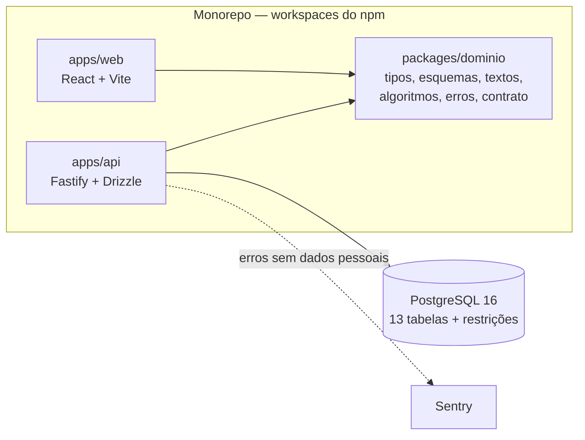

# Fase 24 — Backend (1/4): monorepo, API, banco e contrato (BL-01.1 a BL-01.3)

- **Branch:** `feat/fase-24-backend-fundacao` (sobre a `feat/fase-23-monitoramento`)
- **Plano:** `PLANO_EXECUCAO_MELHORIAS.md`, tarefas 24.0 a 24.F
- **Especificação:** `PLANO_MELHORIAS_MEDICORE.md`, BL-01 (processos BL-01.1 a BL-01.3), D21 a D25 e D28

## Resumo

A API e o banco estão funcionando localmente, com o contrato publicado. O app continua usando os dados do navegador até a Fase 27.

### 24.1 Monorepo (BL-01.1)

- O app foi para `apps/web` sem mudar o comportamento. Um script moveu 372 arquivos e reescreveu os imports de 226: os caminhos relativos para o domínio viraram `@medicore/dominio/...`.
- `packages/dominio` reúne o que o app e a API usam:
  - tipos e esquemas zod;
  - **todos os textos** (`i18n`);
  - limites, setores e faixas de sinais vitais;
  - 15 algoritmos puros de `utils/`;
  - os dados de exemplo (`seeds/`);
  - as classes de erro e a limpeza do monitoramento.
- Os testes desses arquivos foram junto: 17 arquivos e 181 testes, em Node e em UTC, com a mesma meta de cobertura (≥ 90% em `utils/`).
- **Desvio:** os textos de interface também foram para o domínio, porque os esquemas e as regras usam o mesmo objeto `t`. Separar os textos da tela dos textos das regras fica para quando houver um segundo idioma (BL-52).
- Os scripts da raiz continuam com os mesmos nomes (`npm run build`, `test`, `test:e2e`…) e delegam para cada pacote.
- Vercel e Netlify publicam `apps/web/dist`.
- **CSS:** o Tailwind passou a ler só `apps/web`. Antes, ele também lia os `.md` da raiz e gerava 10 classes que nenhuma tela usa. O CSS caiu de 10,3 para 10,0 kB; as 10 classes que saíram foram conferidas uma a uma (as telas usam as variantes com prefixo, que continuam).

### 24.2 API e banco (BL-01.2)

- **`apps/api`:**
  - Fastify 5 com validação e serialização por zod;
  - configuração por variáveis de ambiente validadas, cujas mensagens citam o nome e nunca o valor;
  - logs estruturados só com método, rota com os parâmetros (`/api/v1/pacientes/:id`) e código de resposta: sem busca, cabeçalhos nem corpo.
- **Esquema Drizzle com as 13 tabelas:**
  - colunas em `snake_case`, ids iguais aos de hoje e `versao`, `criado_em` e `atualizado_em`;
  - listas e objetos internos em `jsonb`;
  - chaves estrangeiras nas relações "para a frente". Os ponteiros de volta (o leito que aponta para a internação) ficam sem chave, para não formar ciclos, e as invariantes (A17) continuam conferindo esses ponteiros.
- **Restrições (D25):**

  | Regra | Restrição | Erro do banco → conflito |
  | --- | --- | --- |
  | CPF único (R-P1) | `UNIQUE` | `cpf_duplicado` |
  | CRM (número + UF) e e-mail do médico (R-M1) | `UNIQUE` (e-mail sem diferença de maiúsculas) | `crm_duplicado`, `email_duplicado` |
  | Consultas agendadas do mesmo médico não se sobrepõem (A1/A2) | `EXCLUDE USING gist (medico_id =, tstzrange(inicio, fim) &&) WHERE status = 'agendada'` | `medico_ocupado` (E-04) |
  | Uma internação ativa por leito e por paciente (R-L1) | índices únicos parciais | `leito_indisponivel`, `paciente_internado` |
  | Um atendimento aberto por paciente (R-E10) | índice único parcial | `paciente_em_atendimento` |
  | Número do atendimento único no dia (A8) | `UNIQUE (dia, numero)` | `conflito_dados` (a Fase 26 repete) |
  | Estoque do lote nunca negativo (INV-8) | `CHECK (quantidade_atual >= 0)` | `estoque_insuficiente` |
  | Lote não repete no medicamento (F2) | `UNIQUE (medicamento_id, upper(numero))` | `conflito_dados` |
  | Movimentações imutáveis (R-F9) | papel `medicore_app` sem `UPDATE`, `DELETE` nem `TRUNCATE` | permissão negada |

- **Migrações:**
  - `0000_inicial` é gerada pelo Drizzle;
  - `0001_restricoes` é escrita à mão: `btree_gist`, `EXCLUDE`, o papel da aplicação e a colação `pt_br_base`.
  - `db:migrar` é idempotente.
- **Semeadura (A16):** usa os mesmos geradores do navegador.
  - Grava 120 pacientes, 8 médicos, 130 leitos, 148 internações, 93 lotes, 366 movimentações, entre outros registros.
  - A ocupação dá **72%** e há **3 medicamentos com estoque baixo**.
  - O que sai do banco é **igual** ao que entrou, e as invariantes INV-1 a INV-10 valem sobre os dados lidos.
- **Local:** `docker compose up -d` (PostgreSQL 16 com o login da API no papel da aplicação). Depois, `npm run db:migrar`, `npm run db:semear` e `npm run dev` (API e app juntos).
- **Imagem da API (`apps/api/Dockerfile`):** migra e sobe a API, pronta para o Cloud Run (D23, Fase 27).

### 24.3 Contrato e erros (BL-01.3)

- **OpenAPI** gerado dos esquemas zod, em `/api/v1/openapi.json` e `/api/v1/docs`. Há uma cópia em `docs/backend/openapi.json` (`npm run openapi -w @medicore/api`).
- **Tradutor de erros nos dois sentidos**, em `@medicore/dominio/contrato/erros`:
  - `respostaDeErro` (API) e `erroDeResposta` (navegador, Fase 27);
  - cada classe volta como a mesma classe, com os mesmos campos;
  - as classes novas E-19 a E-22 (`ErroSessao`, `ErroPermissao`, `ErroLimite`, `ErroRede`) e `ErroVersaoObrigatoria` (428) já têm os textos.
- **R-API4:** o Drizzle põe o SQL **e os valores** da consulta na mensagem de erro. A API troca esse erro por `Falha no banco (<código>)` antes de mandar para o log ou para o Sentry. A resposta 500 só tem `{ codigo: 'interno', id }`.
- **Versão:**
  - `ETag: "v<versao>"` nas leituras (304 com `If-None-Match`);
  - `If-Match` obrigatório nas gravações (428 sem ele);
  - `UPDATE … WHERE versao = ?` (412 com a versão atual).
  - Duas gravações simultâneas com a mesma versão: uma passa, a outra recebe 412.
- **Listas:**
  - `pagina`, `porPagina` (padrão 10, máximo 100), `busca`, `ordenarPor` (por rota) e `ordem`;
  - uma página além da última mostra a última, como o `paginar` das telas;
  - texto ordenado com a colação `pt_br_base` (ICU, sem acentos nem maiúsculas, números pela ordem numérica), igual ao `Intl.Collator('pt-BR')` das telas.
- **Monitoramento da API (24.3.6, vinda da 23.2.1):** Sentry carregado só com `SENTRY_DSN`, coleta de dados pessoais desligada e a mesma limpeza do navegador. Sem DSN, o 500 ainda tem um código, para achar a requisição no log.
- **Rotas de exemplo (só nos testes):** listas, `ETag`/`If-Match`, validação e restrições foram exercitadas sobre a tabela de pacientes antes de existirem as rotas de verdade (Fase 25).

## Números

| Indicador | Fase 23 | Fase 24 |
| --- | --- | --- |
| Testes Vitest | 717 (65 arquivos) | **{TOTAL}** — domínio 199 (18), app 536 (48), API 52 (5) |
| Testes Playwright | 139 | **{E2E}** |
| Cobertura | 92,2% (app) | app {COB_WEB} · domínio {COB_DOM} · API 100% de linhas |
| Pacote inicial (gzip) | 154,0 kB | **153,9 kB (−0,1 kB)** · JS +0,2 (classes de erro novas) · CSS −0,3 |
| Inventário dos serviços | — | 181 funções em 24 arquivos (`docs/backend/INVENTARIO.md`) |

## Verificação

- [x] `lint`, `format:check`, `i18n:verificar` e `typecheck` (domínio, app e API) sem achados
- [x] Domínio e app: os 717 testes de antes (181 + 536) verdes depois da mudança para o monorepo; mais 18 do contrato
- [x] {E2E} testes de ponta a ponta verdes
- [x] API contra o PostgreSQL 16: restrições (cada uma violada recebe o erro e o conflito certo), semeadura (ida e volta igual, 72%, 3, invariantes), migração idempotente, contrato (17 testes), logs sem dados pessoais
- [x] `build:api`: `node dist/migrar.js` e `node dist/principal.js` sobem e respondem `/api/v1/saude`
- [x] Fluxo do Docker Compose simulado num PostgreSQL local (script de inicialização, migração como dono, semeadura e o login da API sem `UPDATE` em movimentações)
- [x] `actionlint` sem achados no workflow
- [ ] 👤 A CI no GitHub roda o job novo "API e banco" com Testcontainers (aqui não há acesso ao Docker Hub: os testes usaram um PostgreSQL 16 local via `TEST_DATABASE_URL`)
- [ ] 👤 `docker compose up` e `docker build -f apps/api/Dockerfile .` numa máquina com Docker (aqui o Docker Hub está bloqueado)
- [ ] 👤 Prévia da Vercel igual à da `main` (saída agora em `apps/web/dist`)
- [ ] 👤 PR revisado e mesclado com o `verificacoes` verde

## Para o revisor

- **Ordem dos commits:** o primeiro só move (monorepo e domínio); o segundo traz a API, o banco, a CI e a documentação.
- **Busca nas listas:** as rotas de exemplo usam `ILIKE`. A busca das telas ignora acentos e tem regras para números (`filtrarPorTermo`); as rotas de verdade (Fase 25) precisam fazer igual. A extensão `unaccent` ou uma coluna normalizada estão anotadas para a 25.1.1.
- **Datas:** `timestamptz` volta do banco como texto do PostgreSQL; a conversão para ISO (`deLinha`) está em `src/banco/conversao.ts` e será usada por todas as rotas.

🤖 Generated with [Claude Code](https://claude.com/claude-code)

https://claude.ai/code/session_01TpSdmCvMp9hkqHxXnLjuub
