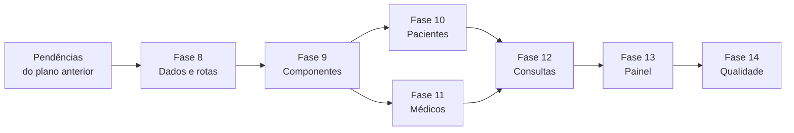
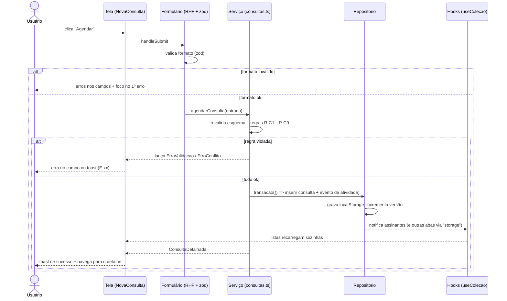
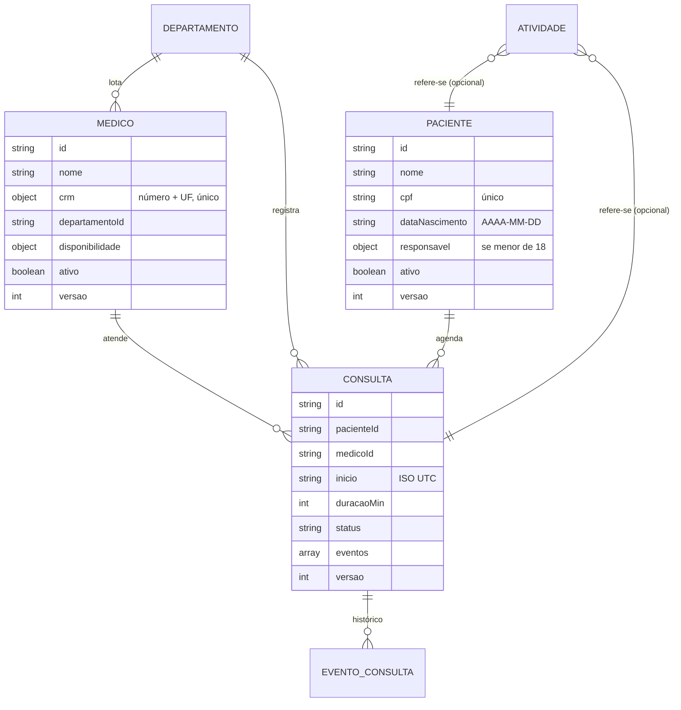

# 🏥 MediCore — Plano de Implementação dos Cadastros

> **Projeto:** MediCore · Operações Hospitalares
> **Escopo:** telas de cadastro e gestão de **Pacientes**, **Médicos** e **Consultas** (listar, buscar, criar, editar, visualizar, inativar/cancelar), integradas ao Painel já existente. Interface 100% em português do Brasil.
> **Base:** continua o `PLANO_IMPLEMENTACAO_MEDICORE.md` (Fases 1–7 concluídas). Por isso a numeração segue a partir da **Fase 8**.
> **Stack atual:** React 19 + TypeScript · Vite 8 · Tailwind CSS 4 · Recharts 3 · lucide-react · React Router 7 · Vitest 5
> **Estimativa total:** 13 a 16 dias úteis (1 desenvolvedor)
> **Decisões:** D1–D7 aprovadas em 26/10/2026, conforme a recomendação (ver [Decisões aprovadas](#-decisões-aprovadas))
> **Versão do documento:** Revisão 2 — 26/10/2026 (ver [o que mudou](#-revisão-2--o-que-mudou))

---

## 📋 Sumário

**Visão geral**
1. [Como usar este documento](#-como-usar-este-documento)
2. [Revisão 2 — o que mudou](#-revisão-2--o-que-mudou)
3. [Painel de progresso e dependências](#-painel-de-progresso-e-dependências)
4. [Análise do projeto atual](#-análise-do-projeto-atual)
5. [Decisões aprovadas](#-decisões-aprovadas)
6. [Pendências herdadas do plano anterior](#-pendências-herdadas-do-plano-anterior)

**Especificação**
7. [Arquitetura e fluxo de dados](#-arquitetura-e-fluxo-de-dados)
8. [Modelo de dados](#-modelo-de-dados)
9. [Regras de negócio](#-regras-de-negócio)
10. [Datas, horários e fuso](#-datas-horários-e-fuso)
11. [Persistência: limites, migração e sincronização](#-persistência-limites-migração-e-sincronização)
12. [Processos detalhados (passo a passo)](#-processos-detalhados-passo-a-passo)
13. [Algoritmos](#-algoritmos)
14. [Tratamento de erros](#-tratamento-de-erros)
15. [Mapa de telas e rotas](#-mapa-de-telas-e-rotas)
16. [Estrutura de pastas (novos arquivos)](#-estrutura-de-pastas-novos-arquivos)
17. [Estratégia de testes](#-estratégia-de-testes)
18. [Riscos e mitigações](#-riscos-e-mitigações)
19. [Definição de pronto (por PR)](#-definição-de-pronto-por-pr)

**Execução**
20. [Fase 8 — Fundação de dados e roteamento](#fase-8--fundação-de-dados-e-roteamento)
21. [Fase 9 — Componentes de formulário e listagem](#fase-9--componentes-de-formulário-e-listagem)
22. [Fase 10 — Cadastro de Pacientes](#fase-10--cadastro-de-pacientes)
23. [Fase 11 — Cadastro de Médicos](#fase-11--cadastro-de-médicos)
24. [Fase 12 — Cadastro e agenda de Consultas](#fase-12--cadastro-e-agenda-de-consultas)
25. [Fase 13 — Integração com o Painel](#fase-13--integração-com-o-painel)
26. [Fase 14 — Qualidade, testes e entrega](#fase-14--qualidade-testes-e-entrega)
27. [Checklist final de aceite](#-checklist-final-de-aceite)
28. [Backlog futuro](#-backlog-futuro-fora-do-escopo)
29. [Registro de decisões e observações](#-registro-de-decisões-e-observações)

---

## 🧭 Como usar este documento

- Marque cada tarefa trocando `- [ ]` por `- [x]` conforme for concluindo.
- A parte **Especificação** é a referência: as tarefas das fases apontam para ela (ex.: "ver P9", "ver A1"). Na dúvida durante a implementação, a especificação vale.
- Códigos usados no documento:
  - **D1–D7**: decisões de arquitetura · **R-xx**: regras de negócio · **P1–P13**: processos · **A1–A6**: algoritmos · **E-xx**: tratamento de erros · **RS-xx**: riscos
- Cada fase tem **✅ Critérios de conclusão**. Só avance quando todos estiverem marcados, e todo PR precisa cumprir a [Definição de pronto](#-definição-de-pronto-por-pr).
- Atualize o [Painel de progresso](#-painel-de-progresso-e-dependências) ao final de cada fase e registre desvios no [Registro](#-registro-de-decisões-e-observações).
- Branches sugeridas: `feat/fase-8-dados`, `feat/fase-9-formularios`, etc. Um PR por fase.

---

## 🔄 Revisão 2 — o que mudou

A revisão analisou o plano anterior em busca de lacunas que fariam o sistema funcionar de forma incorreta ou frágil. Resumo das melhorias:

| # | Lacuna encontrada | Por que importa | O que foi acrescentado |
|---|---|---|---|
| M1 | O aviso de "alterações não salvas" usava `useBlocker`, que **só funciona com o roteador de dados** (`createBrowserRouter`). O projeto usa `<BrowserRouter>` | O recurso simplesmente não funcionaria | Migração do roteador na tarefa 8.1 |
| M2 | O plano não dizia **como** cada operação acontece de ponta a ponta | Cada tela poderia implementar o fluxo de um jeito | 13 [processos detalhados](#-processos-detalhados-passo-a-passo) (P1–P13) com passos, validações, mensagens e falhas |
| M3 | Datas eram "ISO em UTC" sem regra para **data de nascimento** nem para "o dia" da agenda | `2026-10-26T00:00Z` vira 25/10 no Brasil: erro de um dia em aniversários e na agenda | Seção [Datas, horários e fuso](#-datas-horários-e-fuso), com fuso fixo `America/Sao_Paulo` e datas sem hora como `AAAA-MM-DD` |
| M4 | Operações que alteram **várias coleções** (inativar paciente → cancelar consultas) não eram atômicas | Uma falha no meio deixaria dados inconsistentes | `transacao()` no repositório, com desfazer em caso de erro (8.4) |
| M5 | O `localStorage` tem **limite de ~5 MB**; o plano não tratava o estouro | 1 paciente ≈ 1,5 KB e 1 consulta ≈ 0,9 KB: o limite estoura por volta de 10 mil consultas e o salvamento falha em silêncio | Limites, tratamento de `QuotaExceededError` e alerta de uso (seção de persistência, E-06) |
| M6 | Duas abas abertas usam o mesmo `localStorage` sem se falar | Uma aba poderia agendar um horário que a outra acabou de ocupar | Sincronização entre abas pelo evento `storage` + campo `versao` para detectar edição concorrente (R-G1) |
| M7 | Regras de "agora" (passado, concluir após o início) dependiam do relógio real | Testes instáveis e comportamento difícil de reproduzir | Relógio injetável `agora()` (8.6) e `vi.setSystemTime` nos testes |
| M8 | A consulta não guardava **histórico** (reagendamentos, cancelamento), mas a tela de detalhe o mostrava | Não haveria de onde ler a linha do tempo | Campo `eventos[]` na consulta |
| M9 | Faltavam regras do mundo real: **paciente menor de idade**, **intervalo de almoço** do médico, **consultas que passaram do horário sem registro** e **limite de antecedência** | Agenda irreal e dados incompletos | R-P5, R-M4, R-C7, R-C8, R-C9 |
| M10 | Erros inesperados de uma tela derrubariam o app inteiro | Tela branca para o usuário | `errorElement` por rota e tabela de [tratamento de erros](#-tratamento-de-erros) |
| M11 | Mudanças de rota não eram anunciadas a leitores de tela | Usuário de NVDA não percebe que a página mudou | Foco no `<h1>` e anúncio da nova página (9.6) |
| M12 | Faltavam algoritmos escritos (horários livres, conflito, busca) | Implementações divergentes e bugs de borda | Seção [Algoritmos](#-algoritmos) (A1–A6) com pseudocódigo |
| M13 | Sem estratégia de testes, riscos nem "definição de pronto" | Qualidade variando de fase para fase | Seções de testes, riscos e definição de pronto |
| M14 | Voltar da tela de detalhe perdia a busca e os filtros da lista | Retrabalho do usuário | Filtros na URL + "Voltar" que retorna à mesma visão (9.3) |
| M15 | Dados de saúde sensíveis ficam **sem criptografia** no navegador (D2) | Risco de privacidade se usado com dados reais | Aviso explícito: uso **somente com dados fictícios** até existir backend (RS-01) e banner no ambiente de demonstração |

A estimativa subiu de 10–13 para **13–16 dias** por causa desses acréscimos.

---

## 📊 Painel de progresso e dependências

| Fase | Descrição | Estimativa | Status | Início | Fim |
|:---:|---|:---:|:---:|:---:|:---:|
| 8 | Fundação de dados e roteamento | 2,5 dias | ✅ Concluída | 26/10/2026 | 27/10/2026 |
| 9 | Componentes de formulário e listagem | 2,5 dias | ✅ Concluída | 27/10/2026 | 27/10/2026 |
| 10 | Cadastro de Pacientes | 2 dias | ✅ Concluída | 27/10/2026 | 27/10/2026 |
| 11 | Cadastro de Médicos | 1,5 dia | ✅ Concluída | 27/10/2026 | 27/10/2026 |
| 12 | Cadastro e agenda de Consultas | 3 dias | ✅ Concluída | 27/10/2026 | 27/10/2026 |
| 13 | Integração com o Painel | 1 dia | ✅ Concluída | 27/10/2026 | 27/10/2026 |
| 14 | Qualidade, testes e entrega | 2 dias | ✅ Concluída (NVDA e revisão de mensagens pendentes, manuais) | 27/10/2026 | 27/10/2026 |

Legenda: ⬜ Não iniciada · 🟨 Em andamento · ✅ Concluída · 🟥 Bloqueada

> **Projeto encerrado em 28/10/2026 — versão 1.1.0.** Publicado em https://medicore-heltonhelenos-projects.vercel.app. Código em `main` (um commit por fase). Verificações manuais pendentes: NVDA e revisão das mensagens por quem não é desenvolvedor (`docs/VERIFICACAO_MANUAL.md`).

### Dependências entre fases



> As Fases 10 e 11 são independentes entre si e podem ser feitas em paralelo por duas pessoas. A Fase 12 precisa das duas.

---

## 🔎 Análise do projeto atual

O que já existe e será **reaproveitado**:

| Recurso | Onde está | Uso nos cadastros |
|---|---|---|
| Layout, sidebar, cabeçalho, menu mobile | `components/layout/` | Sem mudanças visuais; os itens Pacientes, Médicos e Consultas já existem no menu |
| Rotas por item de menu | `routes.tsx`, `config/navegacao.ts` | Migrar para o roteador de dados (M1) e trocar o `Placeholder` pelas páginas reais |
| `Card`, `Button`/`ButtonLink`, `StatusBadge`, `Skeleton`, `EmptyState`/`ErrorState`, `ConteudoAsync`, `Avatar` | `components/ui/` | Base de todas as telas novas |
| Lógica de foco preso e Esc do `MobileDrawer`; teclado do `UserMenu` | `components/layout/` | Reaproveitar em `Modal` e `MenuAcoes` |
| Hook `useAsync` (dados, carregando, erro, recarregar) | `hooks/useAsync.ts` | Base do novo `useColecao` |
| Textos centralizados | `i18n/pt-BR.ts` | Novos grupos `pacientes`, `medicos`, `agenda`, `formulario`, `validacao`, `erros` |
| Formatação pt-BR | `utils/format.ts` | Datas, horas e números nas listas |
| Tokens de cor claro/escuro e contraste AA | `index.css` | Estados de campo (erro, foco, desabilitado) |
| Departamentos (6) | `data/mock.ts` | Especialidade do médico e departamento da consulta |
| Infra de testes (Vitest, Testing Library, cobertura ≥70%, axe) | `vite.config.ts`, `__tests__/` | Mesmo padrão |

O que **precisa mudar** (pontos de atenção):

| # | Situação atual | Impacto | Solução no plano |
|---|---|---|---|
| 1 | Dados mockados são **somente leitura** e gerados a cada chamada (`criarConsultasHoje`) | Não há onde salvar um cadastro | Repositório em memória com persistência no `localStorage` (Fase 8) |
| 2 | `Consulta` guarda `paciente` e `departamento` como **texto livre** | Não dá para vincular a cadastros nem detectar conflito de agenda | Trocar por `pacienteId` e `medicoId`, com o nome resolvido na leitura (Fase 8) |
| 3 | `services/api.ts` só tem funções `get*` | Sem criação, edição ou exclusão | Serviços CRUD por entidade (Fase 8) |
| 4 | Roteamento com `<BrowserRouter>` + `<Routes>` | `useBlocker`, `errorElement` e rotas com `lazy` exigem o roteador de dados | Migrar para `createBrowserRouter` + `RouterProvider` (8.1) |
| 5 | Não há componentes de formulário, modal, toast nem tabela genérica | Cada tela reinventaria a roda | Kit de formulário e listagem (Fase 9) |
| 6 | Não há validação de CPF, CRM, telefone e e-mail nem máscaras | Dados inconsistentes | `utils/validacao.ts` e `utils/mascaras.ts` (Fase 9) |
| 7 | O card "Consultas de hoje" e os KPIs leem dados fixos | Um agendamento novo não apareceria no Painel | Painel passa a ler o mesmo repositório (Fase 13) |
| 8 | `useAsync` não é invalidado quando os dados mudam | A lista ficaria desatualizada depois de salvar | Repositório com `assinar()`; `useColecao` recarrega sozinho (Fase 8) |
| 9 | `formatHora` usa o fuso do navegador | Um computador com fuso diferente mostraria outro horário | Fuso fixo do hospital (M3) |
| 10 | A busca do cabeçalho é só visual | — | Busca global no backlog; não bloqueia os cadastros |

---

## ✅ Decisões aprovadas

> Aprovadas em 26/10/2026, todas conforme a recomendação inicial. As tarefas das fases já refletem estas escolhas.

| # | Decisão | Escolha aprovada | Por quê | Onde impacta |
|---|---|---|---|---|
| D1 | Biblioteca de formulários | **react-hook-form 7 + zod 4 + @hookform/resolvers 6** | Validação declarativa, menos re-renderizações; o mesmo esquema gera os tipos do formulário e é reaproveitado nos testes e no serviço. Compatíveis com React 19 | 8.2, 8.3, 9.1, 10.3, 11.3, 12.3 |
| D2 | Persistência enquanto não há backend | **Memória + `localStorage`**, isolada em `services/` | Os dados sobrevivem ao recarregar; trocar pela API real mexe só em `services/` | 8.4, 8.5, 13, 14.5, RS-01 |
| D3 | Remover paciente ou médico | **Inativar (exclusão lógica)**; exclusão definitiva só de paciente sem nenhuma consulta | Preserva o histórico clínico e de agenda | R-P2, R-P3, R-M2, P3–P5, P8 |
| D4 | Remover consulta | **Cancelar com motivo**; consultas nunca são apagadas | Rastreabilidade e indicadores de cancelamento | R-S1–R-S3, P11 |
| D5 | Busca de endereço por CEP | **ViaCEP no navegador**, com preenchimento manual se falhar | Agiliza o cadastro; nenhum dado pessoal é enviado (só o CEP) | A6, 10.3 |
| D6 | Nomes dos dados de exemplo | **Nomes brasileiros**, inclusive no Painel já existente | Coerência com CPF, CEP, convênio e CRM | 8.9, 8.10, 13, 14.5 |
| D7 | Visão de agenda | **Lista por dia + grade de horários livres**; calendário semanal/mensal no backlog | Entrega o fluxo completo de agendamento com menos risco | 12.2, 12.3, Backlog |

### Troca de nomes (D6)

| Hoje (referência) | Papel | Passa a ser |
|---|---|---|
| Dr. Johnson | Usuário logado (Administrador) | **Dr. Ricardo Almeida** |
| Dr. James Wilson | Médico — Cardiologia | **Dr. Paulo Mendes** |
| Dr. Michael Brown | Médico — Emergência | **Dr. Marcos Ribeiro** |
| Dra. Emily Davis | Médica — Neurologia | **Dra. Fernanda Lima** |
| Dr. Robert Lee | Médico — Cardiologia (recém-chegado) | **Dr. Rafael Costa** |
| John Smith | Paciente | **João Pereira** |
| Emily Davis | Paciente | **Mariana Alves** |
| Michael Brown | Paciente | **Carlos Santos** |
| Daniel Taylor | Paciente | **Daniel Oliveira** |

> Na referência, "Emily Davis" e "Michael Brown" apareciam como médico **e** como paciente. Com cadastros vinculados por ID, isso confundiria; a troca resolve.

---

## 🧾 Pendências herdadas do plano anterior

Itens do `PLANO_IMPLEMENTACAO_MEDICORE.md` (Fase 7) ainda abertos. Feche-os **antes da Fase 8**, para começar a partir de uma base publicada e versionada.

- [x] Commit das Fases 1–7 e PR mesclado na `main`
- [ ] Teste manual com leitor de tela (NVDA no Windows) no fluxo principal do Painel — pendente, manual (`docs/VERIFICACAO_MANUAL.md`)
- [x] Deploy (Vercel ou Netlify; configuração pronta em `vercel.json` / `netlify.toml`) — feito no Encerramento: https://medicore-heltonhelenos-projects.vercel.app
- [x] Testar a URL publicada no celular e no desktop

---

## 🏗️ Arquitetura e fluxo de dados

### Camadas

```
┌────────────────────────────────────────────────────────────────────────┐
│ PÁGINAS (pages/)             orquestram a tela: lêem a URL, chamam     │
│                              hooks, decidem navegação e toasts         │
├────────────────────────────────────────────────────────────────────────┤
│ COMPONENTES (components/)    só exibem e coletam dados; sem regras     │
│   form/ (RHF + zod)          validação de FORMATO (CPF válido, etc.)   │
├────────────────────────────────────────────────────────────────────────┤
│ HOOKS (hooks/)               useColecao, usePaciente…: estado assíncrono│
│                              + recarga automática quando dados mudam   │
├────────────────────────────────────────────────────────────────────────┤
│ SERVIÇOS (services/)         ÚNICO lugar com REGRAS DE NEGÓCIO (R-xx): │
│                              unicidade, conflitos, transições, eventos │
├────────────────────────────────────────────────────────────────────────┤
│ REPOSITÓRIO (repositorio.ts) armazenamento: memória + localStorage,    │
│                              transação, versão, notificação, abas      │
└────────────────────────────────────────────────────────────────────────┘
```

**Regras de ouro**
1. Componentes **nunca** acessam o repositório nem o `localStorage` direto; sempre via serviço.
2. Toda regra de negócio vive no serviço. O formulário pode **antecipar** uma regra para dar retorno rápido (ex.: CPF já cadastrado ao sair do campo), mas o serviço **sempre** valida de novo ao salvar.
3. O esquema zod é **um só** por entidade (em `schemas/`), usado pelo formulário e pelo serviço.
4. Trocar pela API real (backlog) = reescrever `services/*` mantendo as assinaturas; nada acima muda.

### Fluxo de um salvamento (exemplo: agendar consulta)



---

## 🗃️ Modelo de dados



### Campos comuns a todas as entidades

| Campo | Tipo | Regra |
|---|---|---|
| `id` | texto (UUID) | Gerado por `crypto.randomUUID()` no serviço |
| `criadoEm`, `atualizadoEm` | ISO 8601 (UTC) | Preenchidos pelo serviço com `agora()` |
| `versao` | inteiro | Começa em 1; +1 a cada alteração. Usado para detectar edição concorrente (R-G1) |

### Paciente

| Campo | Tipo | Obrigatório | Regras |
|---|---|:---:|---|
| `nome` | texto | ✅ | 3–120 caracteres; ao menos nome e sobrenome; espaços extras removidos |
| `nomeSocial` | texto | | Quando preenchido, aparece **no lugar** do nome em todas as telas; o nome civil fica só no detalhe (R-P6) |
| `cpf` | texto (11 dígitos, sem máscara) | ✅ | Dígitos verificadores válidos; único entre pacientes (R-P1) |
| `dataNascimento` | data `AAAA-MM-DD` | ✅ | Não futura; idade ≤ 130 anos. **Sem hora e sem fuso** (ver M3) |
| `sexo` | `feminino` · `masculino` · `outro` · `nao_informado` | ✅ | |
| `telefone` | texto (10–11 dígitos) | ✅ | Celular (11) ou fixo (10) com DDD |
| `email` | texto | | Formato válido; guardado em minúsculas |
| `endereco` | `{ cep, logradouro, numero, complemento, bairro, cidade, uf }` | | CEP com 8 dígitos; UF da lista de 27; se o CEP for preenchido, `numero` vira obrigatório |
| `convenio` | `{ tipo: 'particular' \| 'convenio', nome?, carteirinha?, validade? }` | ✅ | Nome e carteirinha obrigatórios se `tipo = convenio`; validade vencida gera **aviso**, não erro |
| `responsavel` | `{ nome, cpf, parentesco, telefone }` | se menor | Obrigatório quando a idade < 18 anos (R-P5); CPF do responsável ≠ CPF do paciente |
| `tipoSanguineo` | `A+` · `A-` · `B+` · `B-` · `AB+` · `AB-` · `O+` · `O-` | | |
| `alergias` | texto | | Até 500 caracteres; quando preenchido, aparece em destaque no detalhe e no agendamento |
| `contatoEmergencia` | `{ nome, telefone, parentesco }` | | Telefone válido se informado |
| `observacoes` | texto | | Até 1.000 caracteres |
| `consentimentoLgpd` | `{ aceito: true, em: ISO }` | ✅ | Deve ser aceito para salvar; data registrada |
| `ativo` | booleano | | Padrão `true` |
| `inativadoEm`, `motivoInativacao` | ISO, texto | | Preenchidos ao inativar |

### Médico

| Campo | Tipo | Obrigatório | Regras |
|---|---|:---:|---|
| `nome` | texto | ✅ | 3–120 caracteres |
| `tratamento` | `Dr.` · `Dra.` | ✅ | Exibido como "Dr. Paulo Mendes" |
| `crm` | `{ numero, uf }` | ✅ | 4–7 dígitos + UF; combinação única (R-M1) |
| `departamentoId` | id | ✅ | Um dos 6 departamentos existentes |
| `telefone` | texto | ✅ | |
| `email` | texto | ✅ | Formato válido; único entre médicos |
| `disponibilidade` | ver abaixo | ✅ | |
| `ativo`, `inativadoEm`, `motivoInativacao` | | | Igual ao paciente |

`disponibilidade`:

| Campo | Tipo | Regra |
|---|---|---|
| `diasSemana` | `number[]` (0 = domingo … 6 = sábado) | Ao menos 1 dia |
| `inicio`, `fim` | `'HH:mm'` | `fim > inicio`; múltiplos de 5 min |
| `pausa` | `{ inicio, fim }` opcional | Dentro do expediente; `fim > inicio` (R-M4) |
| `duracaoPadraoMin` | `15` · `20` · `30` · `45` · `60` | Define a grade de horários (A1) |

> Horários diferentes por dia da semana ficam no backlog. Nesta versão, todos os dias marcados têm o mesmo expediente.

### Consulta

| Campo | Tipo | Obrigatório | Regras |
|---|---|:---:|---|
| `pacienteId` | id | ✅ | Paciente ativo |
| `medicoId` | id | ✅ | Médico ativo |
| `departamentoId` | id | ✅ | Copiado do médico no agendamento (não editável). Se o médico mudar de departamento depois, a consulta mantém o original |
| `inicio` | ISO 8601 UTC | ✅ | Ver R-C1, R-C2, R-C8 |
| `duracaoMin` | número | ✅ | Padrão = `duracaoPadraoMin` do médico; 5–120, múltiplo de 5 (R-C9) |
| `tipo` | `primeira_vez` · `retorno` · `exame` · `teleconsulta` | ✅ | |
| `status` | `agendada` · `concluida` · `cancelada` · `faltou` | ✅ | Ver transições |
| `motivo` | texto | | Queixa/motivo, até 500 caracteres |
| `motivoCancelamento` | texto | se cancelada | 5–300 caracteres |
| `eventos` | `EventoConsulta[]` | ✅ | Histórico imutável (M8); nunca se apaga um evento |

`EventoConsulta = { tipo: 'agendada' | 'reagendada' | 'concluida' | 'faltou' | 'cancelada', em: ISO, detalhe?: string, de?: ISO, para?: ISO }`

### Atividade (para a "Linha do tempo" do Painel)

`Atividade = { id, tipo: 'paciente_cadastrado' | 'paciente_inativado' | 'medico_cadastrado' | 'consulta_agendada' | 'consulta_reagendada' | 'consulta_concluida' | 'consulta_cancelada' | 'consulta_faltou', descricao, em, referenciaId? }`

- Gerada pelo **serviço** dentro da mesma transação da operação.
- Mantém só as **200 mais recentes** (as mais antigas são descartadas ao inserir).

### Tipos de leitura

- `ConsultaDetalhada = Consulta & { pacienteNome, pacienteAlergias?, medicoNome, departamentoNome, fim, atrasada: boolean }`
  - `pacienteNome` já considera o nome social (R-P6)
  - `atrasada` = `status === 'agendada' && fim < agora()` (R-C7)
- `PacienteResumo` (para listas) = `{ id, nomeExibicao, cpfMascarado, idade, telefone, convenioNome, proximaConsulta?, ativo }`
- `MedicoResumo` = `{ id, nomeExibicao, crmFormatado, departamentoNome, diasResumo, consultasHoje, ativo }`

---

## 📐 Regras de negócio

### Gerais
- **R-G1 Edição concorrente:** ao salvar uma edição, o serviço compara a `versao` enviada com a armazenada. Se forem diferentes, lança `ErroConcorrencia` ("Este registro foi alterado em outra aba ou por outra pessoa. Recarregue para ver a versão atual.") e **não** grava.
- **R-G2 Normalização:** antes de validar e gravar, o serviço remove espaços extras, guarda CPF, telefone e CEP só com dígitos e o e-mail em minúsculas.
- **R-G3 Registros inativos** não aparecem nas listas por padrão nem nas buscas de agendamento, mas continuam acessíveis pelo link direto e no histórico.

### Pacientes
- **R-P1** O CPF é único. Conflito → erro no campo CPF: "Já existe um paciente com este CPF" + link "Abrir cadastro existente".
- **R-P2** Inativar um paciente cancela, na mesma transação, todas as consultas **futuras** com status `agendada` (motivo "Paciente inativado"). A confirmação informa quantas serão canceladas.
- **R-P3** Exclusão definitiva só se o paciente **nunca** teve consulta (de qualquer status). Caso contrário, apenas inativar.
- **R-P4** Nas listagens, o CPF aparece mascarado (`***.456.789-**`). O CPF completo só aparece no detalhe, ao clicar em "Mostrar CPF".
- **R-P5** Paciente com menos de 18 anos na data do cadastro exige `responsavel` completo. O formulário mostra a seção "Responsável legal" automaticamente quando a data de nascimento indica menoridade.
- **R-P6** Havendo `nomeSocial`, ele é o nome exibido em listas, agenda, Painel e toasts. O nome civil aparece só no detalhe, identificado como "Nome civil".

### Médicos
- **R-M1** CRM (número + UF) é único. E-mail é único entre médicos.
- **R-M2** Para inativar, o médico não pode ter consultas futuras `agendada`. O diálogo lista essas consultas com links para reagendar ou cancelar; o botão "Inativar" fica desabilitado até a lista zerar.
- **R-M3** Mudar a disponibilidade não altera consultas já marcadas. Ao salvar, o sistema informa quantas consultas futuras ficaram fora do novo horário e oferece "Ver consultas afetadas".
- **R-M4** A pausa (ex.: almoço) não gera horários livres; consultas não podem cruzá-la.

### Agenda e conflitos
- **R-C1** Não é permitido agendar nem reagendar para o passado (tolerância de 5 minutos).
- **R-C2** O horário deve cair em um dia de atendimento do médico, dentro do expediente e fora da pausa. A consulta inteira (início + duração) precisa caber no expediente.
- **R-C3** **Conflito do médico:** não pode haver duas consultas `agendada` do mesmo médico com intervalos sobrepostos (A2).
- **R-C4** **Conflito do paciente:** o paciente não pode ter duas consultas `agendada` sobrepostas, nem com médicos diferentes.
- **R-C5** Os horários livres oferecidos já excluem R-C1 a R-C4 e R-M4; mesmo assim, o serviço revalida tudo ao salvar.
- **R-C6** Reagendar = alterar `inicio` (e opcionalmente o médico) de uma consulta `agendada`, revalidando R-C1 a R-C4 e ignorando a própria consulta no cálculo de conflito. Gera evento `reagendada` com `de` e `para`.
- **R-C7** **Baixa pendente:** consulta `agendada` cujo fim já passou é marcada como "Aguardando registro" (`atrasada = true`). Aparece em destaque na agenda e conta em um indicador do Painel até ser concluída ou marcada como falta.
- **R-C8** Antecedência máxima de agendamento: **180 dias** (configurável em `config/limites.ts`).
- **R-C9** Duração entre 5 e 120 minutos, múltipla de 5.

### Transições de status

```
                 ┌────────────► concluida   (a partir do início)
agendada ────────┼────────────► faltou      (a partir do início)
   ▲  │          └────────────► cancelada   (a qualquer momento, com motivo)
   └──┘ reagendar (continua "agendada", gera evento)
```

- **R-S1** Só consultas `agendada` podem ser editadas, reagendadas ou mudar de status.
- **R-S2** `concluida` e `faltou` só a partir do horário de início (`agora() >= inicio`).
- **R-S3** `concluida`, `faltou` e `cancelada` são finais e somente leitura.

---

## ⏱️ Datas, horários e fuso

| Situação | Como guardar | Como exibir | Por quê |
|---|---|---|---|
| Data **sem hora** (nascimento, validade da carteirinha) | Texto `AAAA-MM-DD` | `dd/mm/aaaa` | Uma data "pura" não tem fuso. Guardar como `2026-10-26T00:00:00Z` faria aparecer **25/10** no Brasil |
| Instante (início da consulta, `criadoEm`, eventos) | ISO 8601 em UTC (`2026-10-26T13:30:00.000Z`) | Convertido para o **fuso do hospital** | Ordenação e comparação seguras |
| Horário de expediente (`inicio`, `fim`, `pausa`) | Texto `HH:mm` | Igual | É uma hora "de parede", sem fuso |
| "Hoje", "o dia" da agenda | Calculado no fuso do hospital | — | O dia do hospital, não o do computador |

- **Fuso do hospital:** constante `FUSO_HOSPITAL = 'America/Sao_Paulo'` em `config/limites.ts`. Todas as funções de `utils/datas.ts` recebem/usam esse fuso via `Intl.DateTimeFormat(..., { timeZone })`.
- **Montar um instante** a partir de data + hora digitadas (`2026-10-26` + `10:30`) usa `instanteNoFuso(data, hora, FUSO_HOSPITAL)`. O Brasil não tem horário de verão desde 2019, mas a função não deve assumir isso (calcula o deslocamento pelo `Intl`).
- **Relógio:** nenhuma regra usa `new Date()` diretamente; sempre `agora()` de `utils/relogio.ts`, que nos testes é controlado por `vi.setSystemTime`.
- **Idade:** calculada por aniversário (não por 365 dias): quem nasceu em 29/02 faz aniversário em 28/02 nos anos não bissextos.
- `formatHora` e `formatData` do projeto passam a usar o fuso do hospital (ajuste em `utils/format.ts`, com teste rodando em `TZ=UTC` para provar).

---

## 💾 Persistência: limites, migração e sincronização

### Chaves no `localStorage`

| Chave | Conteúdo |
|---|---|
| `medicore:meta` | `{ esquema: 1, semeadoEm: ISO }` |
| `medicore:pacientes:v1` | `Paciente[]` |
| `medicore:medicos:v1` | `Medico[]` |
| `medicore:consultas:v1` | `Consulta[]` |
| `medicore:atividades:v1` | `Atividade[]` (máx. 200) |

### Ciclo de vida

1. **Primeira carga** (sem `medicore:meta`): grava os seeds (8.9) com datas relativas a `agora()` e cria `meta`.
2. **Cargas seguintes:** lê as coleções. Se o JSON estiver corrompido, a coleção é recriada a partir do seed e o usuário vê um toast de aviso (E-07). O conteúdo corrompido é guardado em `medicore:backup:<data>` para análise.
3. **Migração de esquema:** se `meta.esquema` < versão do código, executa as funções de `services/migracoes.ts` em ordem (v1→v2…) antes de liberar o app. Nesta entrega existe só a v1, mas o mecanismo nasce pronto.
4. **Restaurar dados de exemplo** (só em desenvolvimento): apaga as chaves `medicore:*` e refaz o passo 1.

### Limites (M5)

| Item | Valor de referência |
|---|---|
| Limite do navegador | ~5 MB por site (texto em UTF-16) |
| Tamanho médio | paciente ≈ 1,5 KB · médico ≈ 1 KB · consulta ≈ 0,9 KB |
| Capacidade prática nesta solução | ~1.000 pacientes + ~3.000 consultas, com folga |
| Alerta ao usuário | quando o uso passar de **80%** do limite estimado (toast de aviso uma vez por sessão) |
| Estouro (`QuotaExceededError`) | a transação é desfeita, nada é gravado, e aparece o erro E-06 |

> Para volumes maiores, a saída é o backend real (backlog). Migrar para IndexedDB foi avaliado e descartado nesta fase, porque adicionaria complexidade sem resolver o problema de fundo (dados só no navegador).

### Transações (M4)

`repositorio.transacao(fn)`:
1. Tira uma cópia em memória das coleções envolvidas.
2. Executa `fn` (que pode inserir/atualizar em várias coleções).
3. Grava todas as coleções alteradas no `localStorage`.
4. Se qualquer passo lançar erro (regra, cota, JSON), **restaura as cópias** e repassa o erro.
5. Só depois do sucesso notifica os assinantes, **uma única vez** (evita a tela piscar várias vezes).

### Sincronização entre abas (M6)

- O repositório escuta `window.addEventListener('storage', …)` para as chaves `medicore:*`.
- Quando outra aba grava, a coleção em memória é recarregada e os assinantes são notificados, então listas e horários livres se atualizam sozinhos.
- Formulário aberto com registro que mudou em outra aba: aparece um aviso não bloqueante "Este registro foi alterado em outra aba", com o botão "Recarregar dados". Se o usuário salvar mesmo assim, R-G1 impede a sobrescrita.

---

## 🧩 Processos detalhados (passo a passo)

> Formato de cada processo: **gatilho → pré-condições → passos → validações → resultado → falhas**. "Toast" = mensagem temporária no canto da tela. Todos os textos ficam em `i18n/pt-BR.ts`.

### P1 — Cadastrar paciente

| Item | Descrição |
|---|---|
| **Gatilho** | Botão "+ Novo paciente" na lista, ou link "Cadastrar novo paciente" dentro do agendamento (`/pacientes/novo?voltarPara=/consultas/nova`) |
| **Pré-condições** | Nenhuma |

**Passos**
1. A tela abre com foco no campo "Nome completo".
2. O usuário preenche os dados; as máscaras (CPF, telefone, CEP) são aplicadas enquanto digita.
3. Ao sair de cada campo, ele é validado (formato via zod). Erros aparecem abaixo do campo.
4. Ao sair do CPF válido, o formulário consulta `cpfDisponivel(cpf)`. Se já existir, mostra o erro de R-P1 com o link para o cadastro existente.
5. Ao preencher a data de nascimento, a idade aparece ao lado ("34 anos"). Se for menor de 18, a seção "Responsável legal" aparece e seus campos ficam obrigatórios (R-P5).
6. Ao completar um CEP de 8 dígitos, roda a busca A6 e o endereço é preenchido.
7. "Convênio" selecionado → campos de convênio aparecem e ficam obrigatórios.
8. O usuário marca o consentimento LGPD e clica "Salvar".
9. Validação completa do formulário. Se houver erros: resumo no topo ("3 campos precisam de correção", `role="alert"`), com links para cada campo, e foco no primeiro campo com erro.
10. Sem erros: botão vira "Salvando…" (desabilitado) e chama `criarPaciente(entrada)`.
11. O serviço normaliza (R-G2), revalida o esquema e R-P1, e grava na transação: paciente + atividade `paciente_cadastrado`.

**Resultado**
- Toast "Paciente cadastrado" e navegação para `/pacientes/:id`.
- Se veio do agendamento (`voltarPara`), volta para `/consultas/nova?pacienteId=<novo id>` com o paciente já selecionado.

**Falhas**
| Situação | Comportamento |
|---|---|
| CPF já cadastrado (corrida entre o passo 4 e o 10) | Erro no campo CPF (E-02), formulário mantém os dados |
| Cota do armazenamento | E-06; nada é gravado; formulário mantém os dados |
| Erro inesperado | E-09; formulário mantém os dados; botão volta a "Salvar" |
| Usuário tenta sair com dados preenchidos | Diálogo "Descartar alterações?" (Continuar editando / Descartar) |

### P2 — Editar paciente

1. A partir do detalhe ou do menu "⋯" da lista → `/pacientes/:id/editar`.
2. O formulário carrega os dados e guarda a `versao` atual.
3. O CPF **pode** ser corrigido, mas a mudança exige confirmação ("Alterar o CPF deste paciente?") e revalida R-P1 (ignorando o próprio paciente).
4. Ao salvar: `atualizarPaciente(id, entrada, versao)`. O serviço verifica R-G1, normaliza, valida e grava.
5. Sucesso: toast "Alterações salvas" e volta ao detalhe.
6. Nenhum campo alterado: o botão "Salvar" fica desabilitado.
7. Falha de concorrência (R-G1): diálogo com "Recarregar dados" (descarta as alterações locais) ou "Continuar editando".
8. Paciente inativo: editar é permitido (para corrigir dados), com aviso no topo "Este paciente está inativo".

### P3 — Inativar paciente

1. Ação "Inativar" (detalhe ou lista).
2. O sistema conta as consultas futuras `agendada` do paciente.
3. Diálogo de confirmação: "Inativar Maria Alves? **2 consultas futuras** serão canceladas automaticamente." + campo opcional "Motivo da inativação".
4. Confirmar → `inativarPaciente(id, motivo)` em **uma transação**: paciente `ativo = false`, `inativadoEm`, `motivoInativacao`; cada consulta futura → `cancelada` com motivo "Paciente inativado" + evento; atividade `paciente_inativado`.
5. Toast "Paciente inativado. 2 consultas canceladas." com ação "Ver consultas canceladas".
6. Se qualquer passo falhar, nada muda (transação).

### P4 — Reativar paciente

1. Ação "Reativar" (visível só em inativos) → confirmação simples.
2. `reativarPaciente(id)`: `ativo = true`, limpa `inativadoEm`/`motivoInativacao`.
3. Consultas canceladas na inativação **não** voltam (toast lembra: "As consultas canceladas não foram restauradas").

### P5 — Excluir paciente definitivamente

1. A ação só aparece se o paciente **não tem nenhuma consulta** (R-P3).
2. Diálogo de perigo: o usuário digita o nome do paciente para habilitar "Excluir definitivamente".
3. `excluirPaciente(id)`: o serviço confere de novo R-P3 (se houver consulta, lança `ErroConflito`) e remove.
4. Toast "Cadastro excluído" e volta para a lista.

### P6 — Cadastrar médico

1. "+ Novo médico" → formulário com foco em "Tratamento".
2. Preenche identificação, CRM (número + UF), contato e departamento.
3. Ao sair do CRM, consulta `crmDisponivel(numero, uf)` (R-M1).
4. Editor de disponibilidade: marca os dias, define início, fim, pausa opcional e duração padrão.
5. A prévia atualiza em tempo real: "Seg a Sex · 08:00–17:00 · pausa 12:00–13:00 · 16 horários de 30 min por dia" (usa A1).
6. Salvar → `criarMedico(entrada)` → transação: médico + atividade `medico_cadastrado`.
7. Toast "Médico cadastrado" → detalhe.

### P7 — Alterar disponibilidade do médico

1. Editar médico → seção Disponibilidade.
2. Ao salvar, o serviço calcula as consultas futuras `agendada` que deixariam de caber (A3) **antes** de gravar.
3. Se houver alguma: diálogo "3 consultas futuras ficarão fora do novo horário. Elas **não** serão alteradas automaticamente." → "Salvar mesmo assim" / "Revisar".
4. Após salvar, toast com ação "Ver consultas afetadas" (abre a agenda filtrada).

### P8 — Inativar médico

1. Ação "Inativar".
2. O sistema lista as consultas futuras `agendada` do médico.
3. Se houver: diálogo bloqueante com a lista (data, hora, paciente) e, para cada uma, "Reagendar" (abre P10 em nova aba de navegação) e "Cancelar" (abre P11). O botão "Inativar" fica desabilitado até a lista zerar; a lista se atualiza sozinha (repositório notifica).
4. Sem pendências: confirmação simples + motivo opcional → `inativarMedico(id, motivo)`.

### P9 — Agendar consulta

| Item | Descrição |
|---|---|
| **Gatilho** | "Agendar consulta" na agenda, no detalhe do paciente/médico, ou "Ver agenda" do Painel |
| **Pré-condições** | Existir ao menos 1 paciente ativo e 1 médico ativo (senão, estado vazio com links para cadastrar) |

**Passos**
1. Campos pré-preenchidos pela URL (`?pacienteId=`, `?medicoId=`, `?data=`), quando houver.
2. **Paciente:** combobox busca por nome, nome social ou CPF (A4), só ativos, até 10 resultados. Selecionado, mostra um resumo (idade, convênio) e **alerta de alergias** se houver.
3. **Departamento** (opcional): filtra a lista de médicos.
4. **Médico:** só ativos; cada opção mostra os dias de atendimento ("Seg, Qua, Sex").
5. **Data:** padrão = hoje (fuso do hospital). Se o médico não atende no dia escolhido, aviso "Dr. Paulo Mendes não atende às terças" + sugestão "Próximo dia de atendimento: qua, 28/10".
6. **Tipo** (padrão "Primeira vez"; se o paciente já teve consulta concluída com o mesmo médico nos últimos 30 dias, sugere "Retorno") e **duração** (padrão do médico).
7. **Horário:** `SeletorHorario` chama `horariosLivres(medicoId, data, duracao, pacienteId)` (A1). Mostra todos os horários do expediente; os indisponíveis aparecem desabilitados com o motivo ("Ocupado", "Paciente já tem consulta", "Horário passado", "Pausa").
8. Qualquer mudança em médico, data, duração ou paciente **recalcula** os horários e limpa o horário escolhido se ele deixou de ser válido (com aviso).
9. **Motivo** (opcional) → "Agendar".
10. `agendarConsulta(entrada)`: o serviço revalida R-C1 a R-C9, monta o evento `agendada`, grava consulta + atividade em transação.

**Resultado:** toast "Consulta agendada: qui, 29/10 às 10:30 com Dr. Paulo Mendes" → `/consultas/:id`.

**Falhas**
| Situação | Comportamento |
|---|---|
| O horário foi ocupado entre a escolha e o salvamento (outra aba) | E-04: erro junto ao seletor "Este horário acabou de ser ocupado", horários recarregam, seleção limpa |
| Médico ou paciente inativado nesse meio-tempo | E-03 no campo correspondente |
| Nenhum horário livre no dia | Estado vazio no seletor + botão "Próximo dia com horário livre" (A5) |

### P10 — Reagendar consulta

1. Só para `agendada` (R-S1). Ação "Reagendar" → `/consultas/:id/editar`.
2. Paciente fixo (não editável). Médico, data, duração e horário editáveis.
3. Horários calculados com `ignorarConsultaId = id` (o horário atual aparece como "Horário atual").
4. Ao salvar: `reagendarConsulta(id, entrada, versao)` → revalida R-C1–R-C4 e R-G1; adiciona evento `reagendada { de, para }`; atividade `consulta_reagendada`.
5. Se trocou de médico, o `departamentoId` passa a ser o do novo médico.
6. Toast "Consulta reagendada para …".

### P11 — Cancelar consulta

1. Só para `agendada`. Ação "Cancelar" → modal.
2. Motivo obrigatório (5–300 caracteres), com sugestões em um clique: "Paciente desmarcou", "Médico indisponível", "Remarcação solicitada", "Outro".
3. `cancelarConsulta(id, motivo, versao)` → status `cancelada`, `motivoCancelamento`, evento e atividade.
4. Toast "Consulta cancelada" com ação "Agendar novamente" (abre P9 pré-preenchido com o mesmo paciente e médico).

### P12 — Concluir consulta ou registrar falta

1. Só para `agendada` e só a partir do início (R-S2). Antes disso, os botões aparecem desabilitados com a dica "Disponível a partir das 10:30".
2. Confirmação curta → `concluirConsulta(id)` ou `marcarFalta(id)` → status, evento e atividade.
3. Disponível também como ação rápida na linha da agenda.

### P13 — Baixa de consultas pendentes

1. Consultas com `atrasada = true` (R-C7) aparecem na agenda com faixa "Aguardando registro".
2. Filtro "Pendentes de registro" na agenda lista todas, de qualquer dia.
3. Ações em lote: selecionar várias → "Marcar como concluídas" ou "Marcar falta" (uma transação; resumo no toast).
4. No Painel, o card "Consultas de hoje" mostra um aviso quando houver pendências: "2 consultas aguardando registro".

---

## 🧮 Algoritmos

### A1 — Horários livres (`horariosLivres`)

```
entrada: medicoId, data (AAAA-MM-DD), duracaoMin, pacienteId?, ignorarConsultaId?
saída: [{ hora: 'HH:mm', inicio: ISO, livre: boolean, motivo?: 'passado'|'pausa'|'medico_ocupado'|'paciente_ocupado'|'fora_expediente' }]

1. medico ← obter(medicoId); se inativo → lançar ErroConflito
2. se diaDaSemana(data, FUSO) ∉ medico.disponibilidade.diasSemana → retornar []
3. passo ← medico.disponibilidade.duracaoPadraoMin
4. para t de inicio até fim (exclusivo) em incrementos de passo:
     ini ← instanteNoFuso(data, t); fimC ← ini + duracaoMin
     motivo ← null
     se fimC > instanteNoFuso(data, expediente.fim)        → motivo 'fora_expediente'
     senão se cruza(ini, fimC, pausa)                       → motivo 'pausa'
     senão se ini < agora() − 5 min                         → motivo 'passado'
     senão se existeSobreposicao(consultasAgendadasDoMedico(data) − ignorar, ini, fimC) → 'medico_ocupado'
     senão se pacienteId e existeSobreposicao(consultasAgendadasDoPaciente(data) − ignorar, ini, fimC) → 'paciente_ocupado'
     adicionar { hora: t, inicio: ini, livre: motivo == null, motivo }
5. retornar lista
```

### A2 — Sobreposição de intervalos

Intervalos **semiabertos** `[inicio, fim)`: `sobrepoe(a, b) = a.inicio < b.fim && b.inicio < a.fim`.
Assim, uma consulta que termina às 10:30 **não** conflita com outra que começa às 10:30.

### A3 — Consultas fora de uma nova disponibilidade (P7)

Para cada consulta futura `agendada` do médico: fora se o dia da semana não está em `diasSemana`, ou `[inicio, fim)` não está contido no expediente, ou cruza a pausa.

### A4 — Busca de pacientes e médicos

1. `normalizar(txt) = txt.normalize('NFD').replace(/\p{Diacritic}/gu, '').toLowerCase().trim()`
2. Se o termo tiver ≥ 3 dígitos e nenhuma letra → busca por CPF/telefone/CRM pelos **dígitos** (`somenteDigitos`), aceitando com ou sem máscara.
3. Senão → cada palavra do termo deve estar contida em `normalizar(nome + ' ' + nomeSocial)` (ordem livre: "silva ana" encontra "Ana Silva").
4. Ordenação com `Intl.Collator('pt-BR', { sensitivity: 'base' })` (acentos e maiúsculas não alteram a ordem); desempate por `id` para ordem estável.
5. Paginação depois de filtrar e ordenar: `itens.slice((pagina − 1) × porPagina, pagina × porPagina)`; se a página pedida não existir mais (ex.: após filtrar), volta para a última página válida.

### A5 — Próximo dia com horário livre

A partir de `data + 1`, até `data + 60 dias`: primeiro dia de atendimento do médico em que A1 retorna ao menos um `livre`. Se não achar, retorna `null` e a tela mostra "Sem horários livres nos próximos 60 dias".

### A6 — Busca de CEP (ViaCEP)

1. Disparada quando o CEP tem 8 dígitos e é diferente da última busca.
2. `GET https://viacep.com.br/ws/{cep}/json/` com `AbortController` de 5 s; uma nova digitação cancela a busca anterior.
3. Resposta `{ "erro": true }` → "CEP não encontrado"; falha de rede ou tempo esgotado → "Não foi possível buscar o CEP. Preencha o endereço manualmente."
4. Sucesso → preenche logradouro, bairro, cidade e UF **somente nos campos que o usuário não editou** (`dirtyFields` do RHF) e move o foco para "Número".
5. Resultados ficam em cache na memória durante a sessão (o mesmo CEP não é buscado duas vezes).

---

## 🚨 Tratamento de erros

| Código | Erro (classe) | Origem | Onde aparece | Mensagem (exemplo) | Ação oferecida |
|---|---|---|---|---|---|
| E-01 | `ErroValidacao` | zod no formulário ou no serviço | Abaixo de cada campo + resumo no topo | "Informe um CPF válido" | Foco no 1º campo com erro |
| E-02 | `ErroConflito` (unicidade) | Serviço | No campo (CPF, CRM, e-mail) | "Já existe um paciente com este CPF" | Link "Abrir cadastro existente" |
| E-03 | `ErroConflito` (estado) | Serviço | Toast de erro ou no campo | "Este médico foi inativado" | Recarregar opções |
| E-04 | `ErroConflito` (agenda) | Serviço | Junto ao seletor de horário | "Este horário acabou de ser ocupado" | Horários recarregam |
| E-05 | `ErroConcorrencia` | Serviço (R-G1) | Diálogo | "Este registro foi alterado em outra aba…" | Recarregar dados / Continuar editando |
| E-06 | `ErroArmazenamento` (cota) | Repositório | Toast persistente | "Não há espaço para salvar. Exclua dados antigos ou restaure os dados de exemplo." | — |
| E-07 | Dados corrompidos | Repositório (leitura) | Toast de aviso | "Alguns dados não puderam ser lidos e foram restaurados." | — |
| E-08 | `ErroNaoEncontrado` | Serviço | Página | "Paciente não encontrado" | Voltar para a lista |
| E-09 | Erro inesperado | Qualquer | `errorElement` da rota (a tela, não o app inteiro) | "Algo deu errado nesta tela." | Tentar novamente / Voltar ao Painel |
| E-10 | Falha de rede (ViaCEP) | `services/cep.ts` | Abaixo do CEP | "Não foi possível buscar o CEP…" | Preencher manualmente |

**Regras de tratamento**
- Erros de regra **nunca** apagam o que o usuário digitou.
- O serviço converte `ErroValidacao.campos` em `setError` do react-hook-form (função `aplicarErrosNoFormulario`), para o erro aparecer no campo certo.
- Erros inesperados são registrados com `console.error` (e, no futuro, num serviço de monitoramento — backlog).

---

## 🗺️ Mapa de telas e rotas

| Rota | Tela | Observações |
|---|---|---|
| `/pacientes` | Lista de pacientes | Busca (A4), filtro ativo/inativo, ordenação, paginação, tudo na URL |
| `/pacientes/novo` | Novo paciente (P1) | Aceita `?voltarPara=` |
| `/pacientes/:id` | Detalhe do paciente | Dados, alergias em destaque, próximas consultas, histórico, ações |
| `/pacientes/:id/editar` | Editar paciente (P2) | |
| `/medicos` | Lista de médicos | Busca, filtros por departamento e status; tabela ou cartões |
| `/medicos/novo` | Novo médico (P6) | |
| `/medicos/:id` | Detalhe do médico | Disponibilidade, agenda de hoje e da semana, indicadores |
| `/medicos/:id/editar` | Editar médico (P7) | |
| `/consultas` | Agenda do dia | `?data=`, `?medicoId=`, `?departamentoId=`, `?status=`, `?pendentes=1` |
| `/consultas/nova` | Agendar (P9) | `?pacienteId=`, `?medicoId=`, `?data=` |
| `/consultas/:id` | Detalhe da consulta | Linha do tempo de eventos; ações P10–P12 |
| `/consultas/:id/editar` | Reagendar (P10) | Só `agendada` |

**Navegação**
- Cada rota define `handle: { titulo, breadcrumb }`; o título da aba e o breadcrumb saem daí.
- "Voltar" no detalhe retorna à lista **com os mesmos filtros** (a URL da lista é guardada em `location.state.de`; sem ela, vai para a lista sem filtros).
- Módulos carregados sob demanda com `lazy` da rota (pacientes, médicos e consultas em pacotes separados).

### Esboços das telas

**Lista (padrão para pacientes e médicos)**
```
┌─────────────────────────────────────────────────────────────────────┐
│ Painel › Pacientes                                                   │
│ Pacientes                                        [ + Novo paciente ] │
├─────────────────────────────────────────────────────────────────────┤
│ [🔍 Buscar por nome, CPF ou telefone ]  [Status: Ativos ▾]          │
├─────────────────────────────────────────────────────────────────────┤
│ NOME ▲            CPF              TELEFONE         CONVÊNIO   ...  │
│ Ana Souza         ***.456.789-**   (11) 98765-4321  Unimed     ⋯   │
│ Bruno Lima        ***.111.222-**   (21) 3456-7890   Particular ⋯   │
├─────────────────────────────────────────────────────────────────────┤
│ Mostrando 1–10 de 48                      ‹ 1 2 3 4 5 ›             │
└─────────────────────────────────────────────────────────────────────┘
   (abaixo de 640px: cada linha vira um cartão)
```

**Formulário (em seções)**
```
┌──────────────────────────────────────────┐
│ Painel › Pacientes › Novo paciente       │
│ Novo paciente                            │
│ ⚠ 2 campos precisam de correção          │  ← resumo de erros (só após tentar salvar)
├──────────────────────────────────────────┤
│ Dados pessoais                           │
│ Nome completo*  [                     ]  │
│ CPF* [___.___.___-__]  Nascimento* [  ]  │  34 anos
│ Sexo* (•) Feminino ( ) Masculino ...     │
│ Responsável legal  (só se menor de 18)   │
│ Contato · Endereço · Convênio · Clínico  │
│ [✓] Autorizo o uso dos dados (LGPD)*     │
├──────────────────────────────────────────┤
│            [ Cancelar ] [ Salvar ]       │  ← fixo no rodapé no celular
└──────────────────────────────────────────┘
```

**Agendar consulta**
```
┌─────────────────────────────────────────────────────────────┐
│ Agendar consulta                                            │
│ Paciente*  [🔍 Digite nome ou CPF          ▾]               │
│   Mariana Alves · 34 anos · Unimed   ⚠ Alergia: dipirona    │
│ Departamento [Cardiologia ▾]  Médico* [Dr. Paulo Mendes ▾]  │
│ Data* [29/10/2026]   Tipo* [Primeira vez ▾]  Duração [30 ▾] │
│ Horários (qui, 29/10):                                      │
│  [08:00] [08:30] ̶0̶9̶:̶0̶0̶ [09:30] ... ̶1̶2̶:̶0̶0̶ (pausa)          │
│ Motivo [                                         ]          │
│                              [ Cancelar ] [ Agendar ]       │
└─────────────────────────────────────────────────────────────┘
```

---

## 🗂️ Estrutura de pastas (novos arquivos)

```
src/
├── router.tsx                        # createBrowserRouter (substitui App.tsx + routes.tsx)
├── types/
│   ├── index.ts                      # (existente) + reexporta os novos
│   ├── paciente.ts · medico.ts · consulta.ts · atividade.ts
├── schemas/                          # esquemas zod (D1): formulário + serviço
│   ├── comuns.ts                     # cpf, telefone, cep, email, data AAAA-MM-DD
│   ├── paciente.ts · medico.ts · consulta.ts
├── config/
│   └── limites.ts                    # (existente) + FUSO_HOSPITAL, ANTECEDENCIA_MAX_DIAS, POR_PAGINA…
├── data/seeds/
│   ├── gerador.ts                    # PRNG com semente fixa + gerador de CPF/CRM válidos
│   ├── pacientes.ts · medicos.ts · consultas.ts
├── services/
│   ├── api.ts                        # (existente) painel
│   ├── repositorio.ts                # memória + localStorage + transação + versão + abas
│   ├── migracoes.ts                  # migrações de esquema
│   ├── erros.ts                      # ErroValidacao, ErroConflito, ErroConcorrencia, ErroNaoEncontrado, ErroArmazenamento
│   ├── pacientes.ts · medicos.ts · consultas.ts · atividades.ts · cep.ts
├── utils/
│   ├── relogio.ts                    # agora()
│   ├── datas.ts                      # fuso do hospital, idade, AAAA-MM-DD ↔ dd/mm/aaaa
│   ├── validacao.ts · mascaras.ts · busca.ts (A4) · agenda.ts (A1–A3, A5)
├── hooks/
│   ├── useColecao.ts · useFiltrosUrl.ts · useToast.ts · useConfirmar.ts
│   ├── useFormularioEntidade.ts      # RHF + zodResolver + erros do serviço + aviso de saída
│   └── useAnunciarRota.ts            # foco no h1 + anúncio da página (M11)
├── components/
│   ├── ui/form/ Campo · Input · InputMascarado · Select · Textarea · Checkbox · RadioGroup · Combobox · SecaoFormulario · ResumoErros
│   ├── ui/ DataTable · Paginacao · BarraFiltros · CabecalhoPagina · Breadcrumb · Modal · DialogoConfirmacao · Toast · MenuAcoes · DescricaoLista · ErroDeRota
│   ├── pacientes/ FormPaciente · TabelaPacientes · CardHistorico · AlertaAlergias
│   ├── medicos/ FormMedico · EditorDisponibilidade · AgendaMedico · PreviaDisponibilidade
│   └── consultas/ FormConsulta · SeletorHorario · ListaAgenda · AcoesConsulta · LinhaDoTempoConsulta
├── pages/
│   ├── pacientes/ ListaPacientes · NovoPaciente · DetalhePaciente · EditarPaciente
│   ├── medicos/ ListaMedicos · NovoMedico · DetalheMedico · EditarMedico
│   └── consultas/ Agenda · NovaConsulta · DetalheConsulta · EditarConsulta
└── __tests__/
    ├── fabricas.ts                   # criarPacienteTeste(), criarMedicoTeste(), criarConsultaTeste()
    └── utils/renderizarComRotas.tsx  # createMemoryRouter + providers (toast, confirmação)
e2e/                                  # Playwright (Fase 14)
```

---

## 🧪 Estratégia de testes

| Camada | Ferramenta | O que testar | Meta de cobertura |
|---|---|---|---|
| `utils/` (validação, máscaras, datas, agenda, busca) | Vitest | Casos de borda: CPF conhecidos válidos/inválidos, 29/02, intervalos que se tocam, acentos | ≥ 90% |
| `services/` | Vitest + `localStorage` do jsdom | **Toda** regra R-xx tem ao menos 1 teste positivo e 1 negativo; transação desfaz em erro; concorrência | ≥ 85% |
| `schemas/` | Vitest | Mensagens em PT-BR; campos condicionais (convênio, responsável) | ≥ 90% |
| Componentes `ui/` | Testing Library | Teclado, ARIA, estados (erro, desabilitado, carregando) | ≥ 70% |
| Páginas | Testing Library + `createMemoryRouter` | Fluxos P1–P13 com serviços reais e repositório limpo | — |
| Ponta a ponta | Playwright | 4 cenários críticos (14.1) em Chromium | — |
| Acessibilidade | axe-core (no Playwright) | Todas as rotas, claro e escuro | 0 violações |

**Práticas obrigatórias**
- **Relógio fixo:** `vi.useFakeTimers({ toFake: ['Date'] })` + `vi.setSystemTime(new Date('2026-10-26T12:00:00-03:00'))` em todo teste que dependa de "agora".
- **Fuso:** a suíte roda com `TZ=UTC` no script `test` (prova que o código usa o fuso do hospital, e não o do computador).
- **Isolamento:** `beforeEach(() => repositorio.resetar())`; nenhum teste depende da ordem de outro.
- **Fábricas** em `__tests__/fabricas.ts` com valores padrão válidos e sobrescrita por parâmetro.
- **Seeds determinísticos:** gerador pseudoaleatório com semente fixa, para os dados de exemplo serem sempre os mesmos.
- **Rede:** `fetch` do ViaCEP sempre simulado (`vi.spyOn(globalThis, 'fetch')`); nenhum teste acessa a internet.

---

## ⚠️ Riscos e mitigações

| # | Risco | Prob. | Impacto | Mitigação |
|---|---|:---:|:---:|---|
| RS-01 | Uso do sistema com **dados reais de pacientes** enquanto a persistência é só no navegador (sem criptografia, sem backup, sem controle de acesso) | Média | Alto (LGPD, dados de saúde) | Banner fixo "Ambiente de demonstração — use apenas dados fictícios"; README explícito; backend como próximo passo obrigatório antes de produção |
| RS-02 | Erro de fuso (dia ou hora errados) | Alta sem regra | Alto | Seção de datas, fuso fixo, testes em `TZ=UTC` |
| RS-03 | Estouro do `localStorage` | Baixa com dados de exemplo | Médio | Limites, alerta a 80%, transação, E-06 |
| RS-04 | Migração do roteador quebrar telas existentes | Média | Médio | Fazer primeiro (8.1), isolado, com os 84 testes atuais passando antes de seguir |
| RS-05 | Combobox e seletor de horário pouco acessíveis | Média | Médio | Seguir o padrão ARIA 1.2; testes de teclado; NVDA na Fase 14 |
| RS-06 | ViaCEP fora do ar ou bloqueado pela rede do hospital | Média | Baixo | Preenchimento manual sempre possível; tempo limite de 5 s |
| RS-07 | Duas abas gravando ao mesmo tempo | Baixa | Médio | Sincronização por `storage` + `versao` (R-G1) |
| RS-08 | Escopo crescer durante a implementação | Alta | Médio | Itens novos vão para o Backlog e só entram com nova estimativa no Registro |

---

## ✔️ Definição de pronto (por PR)

Um PR de fase só é aprovado quando:

- [ ] `npm run lint`, `npm run build` e `npm run test:coverage` passam sem erros nem avisos
- [ ] Metas de cobertura da [estratégia de testes](#-estratégia-de-testes) atingidas para os arquivos tocados
- [ ] Nenhum texto visível fora de `i18n/pt-BR.ts`
- [ ] Telas novas verificadas em 375, 768 e 1280px, nos temas claro e escuro
- [ ] Navegação completa só com teclado nas telas novas
- [ ] axe sem violações nas telas novas
- [ ] Capturas de tela das telas novas anexadas ao PR
- [ ] Este plano atualizado (checkboxes, painel de progresso, registro)

---

## Fase 8 — Fundação de dados e roteamento

**Estimativa:** 2,5 dias · **Branch:** `feat/fase-8-dados`

### 8.1 Migração para o roteador de dados (M1) — fazer primeiro

- [x] Criar `src/router.tsx` com `createBrowserRouter([...])`, reproduzindo as rotas atuais de `routes.tsx` (layout, Painel, placeholders, `/perfil`, `/ui` só em dev, `*`)
- [x] `App.tsx` passa a renderizar `<RouterProvider router={router} />`
- [x] `errorElement: <ErroDeRota />` na rota de layout (mostra E-09 dentro do layout, com sidebar)
- [x] `handle: { titulo }` em cada rota; `useDocumentTitle` passa a ler de `useMatches()` (remove chamadas espalhadas)
- [x] Testes: substituir `<MemoryRouter><AppRoutes/></MemoryRouter>` por `createMemoryRouter(rotas)` em um utilitário `renderizarComRotas`
- [x] **Critério da tarefa:** os 84 testes existentes passam sem alterar comportamento; Painel visualmente idêntico

### 8.2 Dependências (D1)

- [x] `npm install react-hook-form@^7.91 zod@^4.6 @hookform/resolvers@^6`
- [x] `npm run build` e `npm run test` continuam passando
- [x] Padrão: `useForm({ resolver: zodResolver(esquema), mode: 'onTouched' })`; tipos de entrada via `z.infer<typeof esquema>`

### 8.3 Tipos e esquemas

- [x] `types/paciente.ts`, `medico.ts`, `consulta.ts`, `atividade.ts` conforme o [Modelo de dados](#-modelo-de-dados)
- [x] `StatusConsulta` passa a incluir `'faltou'`; atualizar `t.status` e o `StatusBadge` (tom de aviso)
- [x] `ConsultaDetalhada`, `PacienteResumo`, `MedicoResumo`
- [x] `schemas/comuns.ts`: `cpf`, `telefone`, `cep`, `email`, `dataIso` (`AAAA-MM-DD`), `horaHHmm`
- [x] `schemas/paciente.ts` com regras condicionais (`superRefine`): convênio, responsável se menor (R-P5), número se houver CEP
- [x] `schemas/medico.ts`: CRM, disponibilidade (`fim > inicio`, pausa dentro do expediente, ≥ 1 dia)
- [x] `schemas/consulta.ts`: duração (R-C9), motivo de cancelamento
- [x] Mensagens de erro do zod vindas de `t.validacao`

### 8.4 Repositório (`services/repositorio.ts`) — D2, M4, M5, M6

- [x] `criarRepositorio<T extends { id: string; versao: number }>(chave, seed)` com `todos`, `obter`, `inserir`, `atualizar`, `remover`, `assinar`, `resetar`
- [x] Persistência conforme a [seção de persistência](#-persistência-limites-migração-e-sincronização): chaves, `meta`, leitura tolerante a JSON corrompido (E-07) com backup
- [x] `transacao(fn)` com cópia, gravação, desfazer em erro e notificação única
- [x] `QuotaExceededError` → `ErroArmazenamento` (E-06), desfazendo a transação
- [x] Estimativa de uso (`usoArmazenamento()`) e alerta a 80%
- [x] Sincronização entre abas pelo evento `storage`
- [x] `services/migracoes.ts` com a estrutura de migrações (só v1 por enquanto)

### 8.5 Erros (`services/erros.ts`)

- [x] `ErroValidacao { campos }`, `ErroConflito { campo?, codigo }`, `ErroConcorrencia`, `ErroNaoEncontrado`, `ErroArmazenamento`
- [x] `aplicarErrosNoFormulario(erro, setError)` para converter erros do serviço em erros de campo

### 8.6 Utilitários de base (M3, M7)

- [x] `utils/relogio.ts`: `agora()`
- [x] `utils/datas.ts`: `hojeNoFuso()`, `instanteNoFuso(data, hora)`, `dataDoInstante(iso)`, `diaDaSemana(data)`, `idade(dataNascimento, ref)`, `formatarData`, `formatarDataExtenso`, `paraInputDate`
- [x] `utils/format.ts`: `formatHora` passa a usar `FUSO_HOSPITAL`
- [x] `config/limites.ts`: `FUSO_HOSPITAL`, `ANTECEDENCIA_MAX_DIAS = 180`, `TOLERANCIA_PASSADO_MIN = 5`, `POR_PAGINA = 10`, `MAX_ATIVIDADES = 200`
- [x] Script `test` com `TZ=UTC` (adicionar `cross-env` ou definir em `vite.config.ts` → `test.env.TZ`)

### 8.7 Utilitários de agenda e busca

- [x] `utils/agenda.ts`: `sobrepoe` (A2), `gerarHorarios` (A1), `consultasForaDaDisponibilidade` (A3), `proximoDiaLivre` (A5), `podeTransitar` (R-S1–R-S3)
- [x] `utils/busca.ts`: `normalizar`, `filtrarPorTermo`, `ordenar`, `paginar` (A4)

### 8.8 Serviços CRUD

- [x] `services/pacientes.ts`: `listarPacientes`, `obterPaciente`, `cpfDisponivel`, `criarPaciente`, `atualizarPaciente`, `inativarPaciente`, `reativarPaciente`, `excluirPaciente` (P1–P5)
- [x] `services/medicos.ts`: `listarMedicos`, `obterMedico`, `crmDisponivel`, `criarMedico`, `atualizarMedico`, `consultasAfetadas`, `inativarMedico`, `reativarMedico` (P6–P8)
- [x] `services/consultas.ts`: `listarConsultas`, `obterConsulta`, `horariosLivres`, `proximoDiaLivre`, `agendarConsulta`, `reagendarConsulta`, `cancelarConsulta`, `concluirConsulta`, `marcarFalta`, `registrarEmLote` (P9–P13)
- [x] `services/atividades.ts`: `registrarAtividade` (usado dentro das transações) e `listarAtividades`
- [x] Todas as funções: normalizam (R-G2), validam com o esquema, aplicam as regras, usam `agora()`, rodam em transação quando escrevem
- [x] Mesma latência simulada e `VITE_SIMULAR_ERRO` de `api.ts`

### 8.9 Dados iniciais (seeds) — D6

- [x] `data/seeds/gerador.ts`: PRNG com semente fixa; geradores de CPF e CRM **válidos e fictícios**
- [x] ~30 pacientes com nomes brasileiros, incluindo os 4 da [tabela de troca](#troca-de-nomes-d6), 2 menores de idade (com responsável), 3 com alergias, 2 com nome social, 3 inativos
- [x] 8 médicos, ao menos 1 por departamento, incluindo os 4 da tabela de troca; 1 com pausa de almoço; 1 inativo; 1 que não atende às sextas
- [x] ~40 consultas entre a semana passada e a próxima (datas relativas a `agora()` na primeira carga), cobrindo os 4 status e 2 atrasadas (R-C7)
- [x] Os 4 agendamentos de hoje do Painel continuam: 09:00 João Pereira · 10:30 Mariana Alves · 12:00 Carlos Santos · 16:00 Daniel Oliveira

### 8.10 Troca de nomes no Painel existente (D6)

- [x] `data/mock.ts`: usuário (`Dr. Ricardo Almeida`), médicos dos alertas e textos da linha do tempo, conforme a tabela de troca
- [x] Avatar de iniciais passa a mostrar "RA"
- [x] Atualizar as expectativas de texto em `__tests__/dashboard.test.tsx`, `layout.test.tsx` e `qualidade.test.tsx`

### 8.11 Hooks

- [x] `useColecao(fn, deps)`: como `useAsync`, mas também recarrega quando o repositório notifica (inclusive de outra aba)
- [x] `usePaciente(id)`, `useMedico(id)`, `useConsulta(id)`, `useListaPacientes(filtros)`, `useListaMedicos(filtros)`, `useAgenda(filtros)`, `useHorariosLivres(...)`

### 8.12 Testes da fase

- [x] `repositorio.test.ts`: CRUD, persistência, `assinar`, transação desfaz em erro, cota, JSON corrompido, evento `storage`
- [x] `datas.test.ts`: `TZ=UTC` vs fuso do hospital, 29/02, idade na véspera do aniversário
- [x] `agenda.test.ts`: A1 (pausa, passado, fim do expediente), A2 (bordas que se tocam), A3, A5, transições
- [x] `busca.test.ts`: acentos, ordem das palavras, CPF com e sem máscara, paginação além do fim
- [x] `pacientes.service.test.ts`, `medicos.service.test.ts`, `consultas.service.test.ts`: **todas** as regras R-xx (positivo e negativo), R-G1 concorrência

### ✅ Critérios de conclusão — Fase 8

- [x] Roteador migrado sem regressão (84 testes antigos passando)
- [x] Nenhuma tela mudou de layout; no Painel, só os nomes foram trocados
- [x] Todas as regras R-xx cobertas por teste de serviço
- [x] Dados sobrevivem ao recarregar; duas abas ficam sincronizadas
- [x] Cobertura: `services/` ≥ 85%, `utils/` ≥ 90%
- [x] [Definição de pronto](#-definição-de-pronto-por-pr) cumprida; PR aberto — um commit por fase direto na `main`

---

## Fase 9 — Componentes de formulário e listagem

**Estimativa:** 2,5 dias · **Branch:** `feat/fase-9-formularios`

### 9.1 Validação e máscaras

- [x] `utils/validacao.ts`: `cpfValido` (rejeita sequências repetidas), `telefoneValido` (DDD 11–99; celular com 9), `cepValido`, `emailValido`, `crmValido`, `ufValida`
- [x] `utils/mascaras.ts`: `mascararCpf`, `mascararTelefone`, `mascararCep` (durante a digitação, inclusive colagem), `somenteDigitos`, `ocultarCpf` (R-P4)
- [x] Testes com lista de CPFs válidos/inválidos conhecidos e telefones fixos/celulares

### 9.2 Campos (`components/ui/form/`)

- [x] `Campo`: rótulo, `*` + texto "obrigatório" para leitores de tela, dica, erro; liga `aria-describedby`, `aria-invalid`, `aria-required`
- [x] `Input`, `Textarea` (contador de caracteres), `Select` nativo estilizado
- [x] `InputMascarado`: mostra com máscara, entrega ao RHF o valor limpo; cursor não "pula" ao editar no meio
- [x] `Checkbox`, `RadioGroup` (`fieldset` + `legend`)
- [x] `Combobox` (padrão ARIA 1.2 "combobox com lista"): digitar filtra com atraso de 250 ms, ↑/↓, Enter seleciona, Esc fecha, `aria-activedescendant`, anúncio "5 resultados"
- [x] `SecaoFormulario` (título, descrição, grade 1/2/3 colunas)
- [x] `ResumoErros`: lista os erros após tentar salvar, com links que focam cada campo (`role="alert"`)
- [x] Estados: normal, foco, erro, desabilitado, somente leitura — claro e escuro

### 9.3 Listagem e página

- [x] `CabecalhoPagina`: `<h1>`, `Breadcrumb` (de `handle.breadcrumb`) e ações
- [x] `BarraFiltros`: busca com atraso de 300 ms; filtros em uma linha (quebra no celular); botão "Limpar filtros" quando houver filtro ativo
- [x] `DataTable<T>`: colunas declarativas, ordenação (`aria-sort`), link real na 1ª coluna, versão em cartões abaixo de 640px (container query), estados carregando/vazio/erro, seleção múltipla opcional (para P13)
- [x] `Paginacao`: "Mostrando 1–10 de 48", `aria-current`, volta à última página válida (A4)
- [x] `MenuAcoes` ("⋯") reaproveitando a lógica do `UserMenu`
- [x] `DescricaoLista` (`<dl>`) para detalhes
- [x] `useFiltrosUrl`: busca, filtros, ordenação e página na query string; o "Voltar" do detalhe retorna à mesma URL (M14)

### 9.4 Feedback

- [x] `Modal` (foco preso, Esc, `aria-modal`, devolve o foco ao gatilho — lógica do `MobileDrawer`)
- [x] `DialogoConfirmacao` + `useConfirmar()` → `await confirmar({ titulo, mensagem, rotuloConfirmar, perigo, exigirTexto? })` (o `exigirTexto` atende P5)
- [x] `ToastProvider` + `useToast()`: sucesso, erro, aviso; `role="status"`/`alert`; 5 s (erros ficam até fechar); botão de ação opcional ("Ver consultas")
- [x] `useFormularioEntidade`: une RHF + zodResolver + `aplicarErrosNoFormulario` + bloqueio de saída com `useBlocker` (só com alterações) + `beforeunload` ao fechar a aba

### 9.5 Ambiente de demonstração (RS-01)

- [x] Banner discreto no topo do conteúdo: "Ambiente de demonstração — use apenas dados fictícios" (some com `VITE_AMBIENTE=producao`, que só será usado com backend)

### 9.6 Acessibilidade de navegação (M11)

- [x] `useAnunciarRota`: a cada mudança de rota, foca o `<h1>` da página (com `tabIndex={-1}`) e anuncia "Página: Novo paciente" em uma região `aria-live="polite"`

### 9.7 Textos

- [x] Novos grupos em `i18n/pt-BR.ts`: `formulario`, `validacao`, `lista`, `confirmacao`, `toast`, `erros` (E-01 a E-10), `demo`
- [x] Vitrine `/ui` com todos os componentes novos

### 9.8 Testes da fase

- [x] `Campo` liga erro e dica; `InputMascarado` mantém o cursor; `Combobox` 100% por teclado; `DataTable` ordena, pagina e seleciona; `Modal` prende o foco; `useConfirmar` resolve `true`/`false`; `useFormularioEntidade` bloqueia a saída só com alterações

### ✅ Critérios de conclusão — Fase 9

- [x] Todos os componentes na vitrine `/ui`, nos dois temas, sem violações axe
- [x] Cobertura de `components/ui/` ≥ 70%
- [x] [Definição de pronto](#-definição-de-pronto-por-pr) cumprida; PR aberto — um commit por fase direto na `main`

---

## Fase 10 — Cadastro de Pacientes

**Estimativa:** 2 dias · **Branch:** `feat/fase-10-pacientes`

### 10.1 Rotas

- [x] `pacientes`, `pacientes/novo`, `pacientes/:id`, `pacientes/:id/editar` (com `lazy`, `handle.titulo` e `handle.breadcrumb`)
- [x] ID inexistente → E-08 "Paciente não encontrado" com link para a lista

### 10.2 Lista (`/pacientes`)

- [x] Busca (A4), filtro de status (padrão Ativos), ordenação por nome/idade/próxima consulta, paginação de 10
- [x] Colunas: Nome de exibição (R-P6) + avatar · CPF mascarado (R-P4) · Idade · Telefone · Convênio · Próxima consulta · Status · ações
- [x] Ícone de alerta ao lado do nome se o paciente tiver alergias (com texto acessível)
- [x] Ações da linha: Ver, Editar, Agendar consulta, Inativar/Reativar
- [x] Estados vazios: sem cadastros ("Nenhum paciente cadastrado" + botão) e sem resultado ("Nenhum paciente encontrado para 'xyz'" + "Limpar filtros")

### 10.3 Formulário — implementa P1 e P2

- [x] `FormPaciente` com seções: Dados pessoais · Responsável legal (condicional, R-P5) · Contato · Endereço · Convênio · Informações clínicas · Contato de emergência · Consentimento
- [x] Todos os passos de P1 (foco inicial, máscaras, validação ao sair, CPF disponível, idade, CEP via A6, convênio condicional, resumo de erros, botão "Salvando…")
- [x] Edição conforme P2 (versão, confirmação de troca de CPF, "Salvar" desabilitado sem alterações, R-G1)
- [x] `?voltarPara=` retorna ao agendamento com o novo paciente selecionado
- [x] No celular, barra de ações fixa no rodapé

### 10.4 Detalhe (`/pacientes/:id`)

- [x] Cabeçalho: avatar, nome de exibição (e "Nome civil" se houver nome social), idade, status, ações
- [x] `AlertaAlergias` em destaque (`danger`) quando houver
- [x] Cards: Dados pessoais · Responsável legal (se houver) · Contato e endereço · Convênio (aviso se a validade venceu) · Informações clínicas
- [x] "Próximas consultas" e "Histórico" (paginado, mais recentes primeiro), com links
- [x] CPF oculto por padrão; botão "Mostrar CPF" (R-P4)
- [x] Faixa "Paciente inativo desde 10/10/2026 — motivo: …" quando inativo

### 10.5 Inativar, reativar e excluir — P3, P4, P5

- [x] Fluxos exatamente como descritos em P3, P4 e P5

### 10.6 Testes da fase

- [x] Lista: busca, filtro, ordenação, paginação, estados vazios, "Voltar" mantém filtros
- [x] Formulário: obrigatórios, CPF inválido/duplicado, menor sem responsável, convênio condicional, CEP (sucesso, não encontrado, tempo esgotado, não sobrescreve campo editado), aviso de saída
- [x] Detalhe: E-08, CPF oculto, alergias em destaque, inativar cancela consultas futuras (transação)

### ✅ Critérios de conclusão — Fase 10

- [x] P1–P5 funcionando de ponta a ponta
- [x] Responsivo (formulário em 1 coluna no celular), teclado e axe ok
- [x] [Definição de pronto](#-definição-de-pronto-por-pr) cumprida; PR aberto — um commit por fase direto na `main`

---

## Fase 11 — Cadastro de Médicos

**Estimativa:** 1,5 dia · **Branch:** `feat/fase-11-medicos`

### 11.1 Rotas

- [x] `medicos`, `medicos/novo`, `medicos/:id`, `medicos/:id/editar` (mesmo padrão)

### 11.2 Lista (`/medicos`)

- [x] Busca por nome ou CRM (A4); filtros por departamento e status
- [x] Colunas: Nome com tratamento · CRM (`12345/SP`) · Departamento · Dias (`Seg–Sex`) · Consultas hoje · Status · ações
- [x] Ações: Ver, Editar, Ver agenda (`/consultas?medicoId=`), Agendar (`/consultas/nova?medicoId=`), Inativar/Reativar
- [x] Alternância tabela/cartões (preferência guardada no `localStorage`, com try/catch)

### 11.3 Formulário — implementa P6 e P7

- [x] Seções: Identificação · Contato · Lotação · Disponibilidade
- [x] `EditorDisponibilidade`: dias como botões alternáveis (`aria-pressed`); início/fim/pausa (`type="time"`, passo de 5 min); duração padrão
- [x] `PreviaDisponibilidade` em tempo real (usa A1 sem consultas)
- [x] CRM disponível ao sair do campo (R-M1)
- [x] Na edição, aviso de consultas afetadas (P7 / A3)

### 11.4 Detalhe (`/medicos/:id`)

- [x] Cabeçalho com avatar, nome, CRM, departamento, status, ações
- [x] Disponibilidade em grade semanal (dias × faixa, com pausa)
- [x] "Agenda de hoje" (ocupados e livres) e "Próximos 7 dias" (quantidade por dia)
- [x] Indicadores do mês: consultas, taxa de faltas (`faltou / (concluida + faltou)`), cancelamentos

### 11.5 Inativar — P8

- [x] Diálogo bloqueante com a lista viva de consultas futuras, como descrito em P8

### 11.6 Testes da fase

- [x] CRM inválido/duplicado; sem dias; fim antes do início; pausa fora do expediente
- [x] Prévia calcula a quantidade certa de horários (com e sem pausa)
- [x] Inativação bloqueada até zerar as consultas futuras

### ✅ Critérios de conclusão — Fase 11

- [x] P6–P8 funcionando; disponibilidade refletida nos horários livres
- [x] [Definição de pronto](#-definição-de-pronto-por-pr) cumprida; PR aberto — um commit por fase direto na `main`

---

## Fase 12 — Cadastro e agenda de Consultas

**Estimativa:** 3 dias · **Branch:** `feat/fase-12-consultas`

### 12.1 Rotas

- [x] `consultas`, `consultas/nova`, `consultas/:id`, `consultas/:id/editar`
- [x] "Ver agenda" (Painel) e "Ver todas" (Consultas de hoje) abrem a agenda real

### 12.2 Agenda (`/consultas`) — D7

- [x] Data em destaque ("Segunda-feira, 26 de outubro"), botões ‹ Hoje › e seletor de data (no fuso do hospital)
- [x] Filtros: médico, departamento, status, "Pendentes de registro" (P13) — todos na URL
- [x] Resumo do dia: total · agendadas · concluídas · canceladas · faltas · pendentes
- [x] Lista por horário (alternável para "por médico"); cada item: hora–fim, paciente (nome de exibição), ícone de alergia, médico, departamento, tipo, `StatusBadge`, faixa "Aguardando registro" se `atrasada`
- [x] Ações rápidas: Concluir, Faltou, Cancelar (R-S1/R-S2), com seleção em lote para P13
- [x] Vazio: "Nenhuma consulta em 26/10" + "Agendar consulta"

### 12.3 Agendar — implementa P9

- [x] Todos os passos de P9: pré-preenchimento pela URL, combobox de paciente com alerta de alergia, filtro por departamento, aviso de dia sem atendimento + "próximo dia de atendimento", sugestão de "Retorno", duração
- [x] `SeletorHorario`: grupo de rádio acessível (setas navegam, Espaço seleciona), horários indisponíveis desabilitados com motivo visível e lido pelo leitor de tela
- [x] Recalcular horários e limpar seleção inválida quando médico/data/duração/paciente mudarem
- [x] "Próximo dia com horário livre" (A5) quando o dia não tiver horários
- [x] Tratamento de E-03/E-04 conforme P9

### 12.4 Detalhe (`/consultas/:id`)

- [x] Dados: paciente (link + alergias), médico (link), departamento, data, hora–fim, tipo, motivo, status
- [x] `LinhaDoTempoConsulta` a partir de `eventos` (agendada, reagendada de/para, cancelada com motivo…)
- [x] Ações conforme o status (P10–P12)

### 12.5 Reagendar, cancelar, concluir, falta — P10, P11, P12, P13

- [x] Fluxos exatamente como descritos

### 12.6 Testes da fase

- [x] Fluxo P9 completo; horário ocupado não selecionável; E-04 quando ocupado por "outra aba" (simular gravação direta no repositório)
- [x] Pausa e fim de expediente respeitados; R-C8 (antecedência); R-C9 (duração)
- [x] Transições permitidas e bloqueadas (com relógio fixo); cancelamento sem motivo bloqueado
- [x] Reagendar gera evento `de/para`; baixa em lote em uma transação

### ✅ Critérios de conclusão — Fase 12

- [x] Nenhuma combinação permite conflito de médico ou de paciente (incluindo duas abas)
- [x] P9–P13 funcionando; agenda navegável pela URL
- [x] [Definição de pronto](#-definição-de-pronto-por-pr) cumprida; PR aberto — um commit por fase direto na `main`

---

## Fase 13 — Integração com o Painel

**Estimativa:** 1 dia · **Branch:** `feat/fase-13-integracao`

- [x] **Consultas de hoje:** lê `listarConsultas({ data: hojeNoFuso() })` (`ConsultaDetalhada`); linhas clicáveis; aviso de pendências (P13)
- [x] **Resumo de boas-vindas:** "{n} consultas hoje" calculado do repositório
- [x] **KPI Total de pacientes:** pacientes ativos (variação diária segue mockada até haver histórico — registrar no Registro)
- [x] **KPI Médicos de plantão:** médicos ativos com atendimento no dia da semana atual
- [x] **Linha do tempo de atividades:** lê `listarAtividades({ limite: 4 })`
- [x] **Alertas e Desempenho:** continuam mockados (backlog)
- [x] Remover `criarConsultasHoje`/`criarAtividadesHoje` de `data/mock.ts` e as funções antigas de `api.ts` que ficarem sem uso
- [x] Ajustar `dashboard.test.tsx` para usar seeds + relógio fixo
- [x] Botão "Restaurar dados de exemplo" (só em dev) na vitrine `/ui`

### ✅ Critérios de conclusão — Fase 13

- [x] Agendar, concluir ou cancelar muda o Painel sem recarregar (inclusive vindo de outra aba)
- [x] Painel visualmente igual ao da Fase 6 (comparação de captura em 1600px), exceto nomes (D6)
- [x] [Definição de pronto](#-definição-de-pronto-por-pr) cumprida; PR aberto — um commit por fase direto na `main`

---

## Fase 14 — Qualidade, testes e entrega

**Estimativa:** 2 dias · **Branch:** `feat/fase-14-qualidade`

### 14.1 Testes de ponta a ponta (Playwright)

- [x] `npm install -D @playwright/test@^1.64`; `e2e/` com `webServer` subindo `vite preview`; `npx playwright install chromium` na primeira vez
- [x] Cenário 1: cadastrar paciente → agendar → ver no Painel → concluir (com relógio do navegador fixado por `page.clock`)
- [x] Cenário 2: tentar horário ocupado → erro → escolher outro
- [x] Cenário 3: inativar médico com consultas futuras → bloqueio → cancelar → inativar
- [x] Cenário 4: duas abas — agendar o mesmo horário em ambas → a segunda recebe E-04
- [x] axe em todas as rotas (claro e escuro) dentro do Playwright
- [x] Script `npm run test:e2e`

### 14.2 Acessibilidade

- [x] 0 violações axe; resumo de erros anunciado; foco no 1º erro; anúncio de rota (M11)
- [x] `Combobox`, `SeletorHorario`, `Modal`, `MenuAcoes`, `Toast`, `DataTable` testados só com teclado
- [ ] NVDA no fluxo P9 (agendar) e P1 (cadastrar paciente) — roteiro em `docs/VERIFICACAO_MANUAL.md` (manual)

### 14.3 Idioma e formatos

- [x] Varredura de textos fora do `pt-BR.ts`
- [x] `dd/mm/aaaa`, 24h, CPF `000.000.000-00`, telefone `(00) 00000-0000`, CEP `00000-000`, CRM `12345/SP`
- [ ] Revisão das mensagens E-01 a E-10 (claras, sem jargão) — revisão de linguagem feita; falta a leitura por alguém que não seja desenvolvedor

### 14.4 Performance

- [x] Rotas `lazy` por módulo; verificar os pacotes gerados no build
- [x] Teste de carga local: 1.000 pacientes e 3.000 consultas gerados → busca responde em < 100 ms; uso do armazenamento < 80%
- [x] Lighthouse desktop ≥ 90 em lista, formulário e agenda

### 14.5 Documentação

- [x] README: seção "Cadastros" (rotas, processos P1–P13 resumidos, regras, limites de armazenamento, restaurar dados de exemplo)
- [x] README: aviso de **demonstração** (RS-01) e nota de privacidade do CEP (A6)
- [x] README: como trocar o repositório local pela API real
- [x] Capturas das telas novas e do Painel com os nomes novos em `docs/capturas/`
- [x] Atualizar este plano e o `PLANO_IMPLEMENTACAO_MEDICORE.md`

### ✅ Critérios de conclusão — Fase 14

- [x] Testes unitários, de componentes e e2e passando
- [x] Cobertura nas metas da [estratégia de testes](#-estratégia-de-testes)
- [x] Lighthouse e axe nas metas
- [x] README atualizado; PR final aprovado e mesclado na `main` — commit `8a61daf` na `main`

---

## 🏁 Checklist final de aceite

### Funcional
- [x] Pacientes: cadastrar, editar, visualizar, inativar, reativar, excluir sem histórico (P1–P5)
- [x] Médicos: cadastrar, editar (com aviso de consultas afetadas), visualizar, inativar com bloqueio (P6–P8)
- [x] Consultas: agendar, reagendar, cancelar, concluir, marcar falta, baixa em lote (P9–P13)
- [x] Horários livres respeitam expediente, pausa, passado e conflitos de médico e paciente
- [x] Busca, filtros, ordenação e paginação na URL; "Voltar" preserva a lista
- [x] Painel reflete os cadastros em tempo real

### Dados e regras
- [x] CPF e CRM únicos e válidos; menores com responsável
- [x] Nenhum conflito de agenda possível, inclusive com duas abas
- [x] Consultas nunca apagadas; histórico de eventos completo
- [x] Datas corretas em qualquer fuso de computador (testes em `TZ=UTC`)
- [x] Operações compostas atômicas; dados persistem e migram de versão

### Experiência
- [x] Toast em toda ação; resumo de erros; aviso ao sair com alterações
- [x] Responsivo de 375 a 1920px, temas claro e escuro
- [x] Banner de ambiente de demonstração

### Qualidade
- [x] 100% em PT-BR; formatos brasileiros
- [ ] Acessível por teclado e leitor de tela (NVDA testado) — teclado ✅ (e2e); NVDA pendente
- [x] Testes, lint e build limpos

---

## 🚀 Backlog futuro (fora do escopo)

### Revisão do backlog (Encerramento, 28/10/2026)

Ordem sugerida para a próxima etapa. A primeira é **pré-requisito** para qualquer uso com
pessoas reais (RS-01).

| Prioridade | Item | Por quê |
| :---: | --- | --- |
| 1 | **Backend real + autenticação e perfis de acesso** | Hoje os dados ficam só no navegador, sem login nem backup. O README já explica a troca (`services/` mantém as assinaturas; erros HTTP viram as classes de `services/erros.ts`). |
| 2 | **Auditoria de acesso (LGPD)** | Precisa do backend. Registrar quem viu e quem alterou cada cadastro. |
| 3 | **Monitoramento de erros (ex.: Sentry)** | Barato de fazer junto com o backend. Mostra erros que hoje só apareceriam no navegador de quem usa. |
| 4 | Bloqueios de agenda (férias, feriados) e horários por dia da semana | Pedido mais provável de quem usa a agenda no dia a dia. |
| 5 | Calendário semanal/mensal | Hoje a agenda é uma lista por dia (D7). |
| 6 | Campo de data próprio (sempre `dd/mm/aaaa`) | O campo nativo segue o idioma do navegador. Só vale se aparecerem usuários com navegador em inglês. |
| — | Demais itens abaixo | Sem mudança de prioridade. |

**Próximo passo escolhido:** item 1, backend real.

- [ ] **Backend real** (API REST/GraphQL) com autenticação, perfis de acesso, criptografia e backup — pré-requisito para dados reais (RS-01)
- [ ] Auditoria de acesso (quem criou, alterou ou **visualizou** cada registro — LGPD)
- [ ] Calendário completo (semana/mês, arrastar para reagendar)
- [ ] Horários diferentes por dia da semana; bloqueios de agenda (férias, feriados, congressos)
- [ ] Encaixes e lista de espera
- [ ] Pacientes sem CPF (recém-nascidos, estrangeiros com passaporte, CNS)
- [ ] Prontuário eletrônico (evolução, prescrição, anexos)
- [ ] Lembretes por WhatsApp, SMS ou e-mail
- [ ] Cadastro de convênios e procedimentos
- [ ] Busca global no cabeçalho
- [ ] Importação/exportação CSV
- [ ] Monitoramento de erros (ex.: Sentry)
- [ ] Alertas de emergência e desempenho por departamento ligados a dados reais
- [ ] Telas de Gestão de leitos, Emergência, Farmácia e Análises

---

## 📝 Registro de decisões e observações

| Data | Decisão / Observação | Responsável |
|---|---|---|
| 26/10/2026 | Numeração das fases continua o plano anterior (Fases 8–14) | |
| 26/10/2026 | `Consulta` passa a referenciar `pacienteId`/`medicoId`; o Painel usa `ConsultaDetalhada` | |
| 26/10/2026 | Novo status `faltou` (não comparecimento) | |
| 26/10/2026 | D1 — react-hook-form 7.91 + zod 4.6 + @hookform/resolvers 6 (compatíveis com React 19) | |
| 26/10/2026 | D2 — Memória + `localStorage` (chaves `medicore:<colecao>:v1`), isolada em `services/` | |
| 26/10/2026 | D3 — Pacientes e médicos inativados; exclusão definitiva só de paciente sem consultas | |
| 26/10/2026 | D4 — Consultas nunca excluídas; cancelamento exige motivo | |
| 26/10/2026 | D5 — CEP via ViaCEP, tempo limite de 5 s, preenchimento manual como alternativa | |
| 26/10/2026 | D6 — Nomes brasileiros nos cadastros e no Painel | |
| 26/10/2026 | D7 — Agenda em lista por dia; calendário completo no backlog | |
| 26/10/2026 | Testes e2e com Playwright obrigatórios na Fase 14 | |
| 26/10/2026 | **Revisão 2:** migração para `createBrowserRouter` (exigida por `useBlocker`, `errorElement` e rotas `lazy`) | |
| 26/10/2026 | **Revisão 2:** fuso fixo `America/Sao_Paulo`; datas sem hora em `AAAA-MM-DD`; testes em `TZ=UTC` | |
| 26/10/2026 | **Revisão 2:** transações, versão por registro (R-G1) e sincronização entre abas | |
| 26/10/2026 | **Revisão 2:** limite prático ~1.000 pacientes + ~3.000 consultas no `localStorage`; IndexedDB descartado | |
| 26/10/2026 | **Revisão 2:** novas regras R-P5 (menor de idade), R-P6 (nome social), R-M4 (pausa), R-C7 (baixa pendente), R-C8 (antecedência 180 dias), R-C9 (duração) | |
| 26/10/2026 | **Revisão 2:** consulta ganha `eventos[]` (histórico); atividades geradas pelo serviço (máx. 200) | |
| 26/10/2026 | **Revisão 2:** estimativa revista de 10–13 para 13–16 dias | |
| 27/10/2026 | Fase 13: KPI "Total de pacientes" = pacientes ativos e "Médicos de plantão" = ativos que atendem no dia; a variação diária continua simulada até haver histórico | |
| 27/10/2026 | Fase 13: atividades ganham dados de exemplo derivados do histórico das consultas de exemplo; "{n} consultas hoje" não conta canceladas | |
| 27/10/2026 | Fase 14: e2e com Playwright contra a build de produção (fuso e idioma fixos, relógio fixado); axe 4.14 com WCAG 2.2 em todas as rotas | |
| 27/10/2026 | Fase 14: esquemas zod carregados sob demanda nos serviços; deslocamento do fuso em cache por bloco de 15 min (`partesNoFuso`) | |
| 27/10/2026 | Fase 14: campos de data continuam nativos (formato segue o idioma do navegador); campo de data próprio fica no backlog se necessário | |
| 28/10/2026 | **Encerramento:** publicado na Vercel (https://medicore-heltonhelenos-projects.vercel.app), ligado ao GitHub (`HeltonHeleno/medicore`, `main`); versão 1.1.0; planos arquivados em `docs/planos/` | |
| 28/10/2026 | **Encerramento — próximo passo escolhido:** backend real com autenticação e auditoria (RS-01), antes de qualquer uso com dados reais. Ver "Revisão do backlog" | |
| | | |
